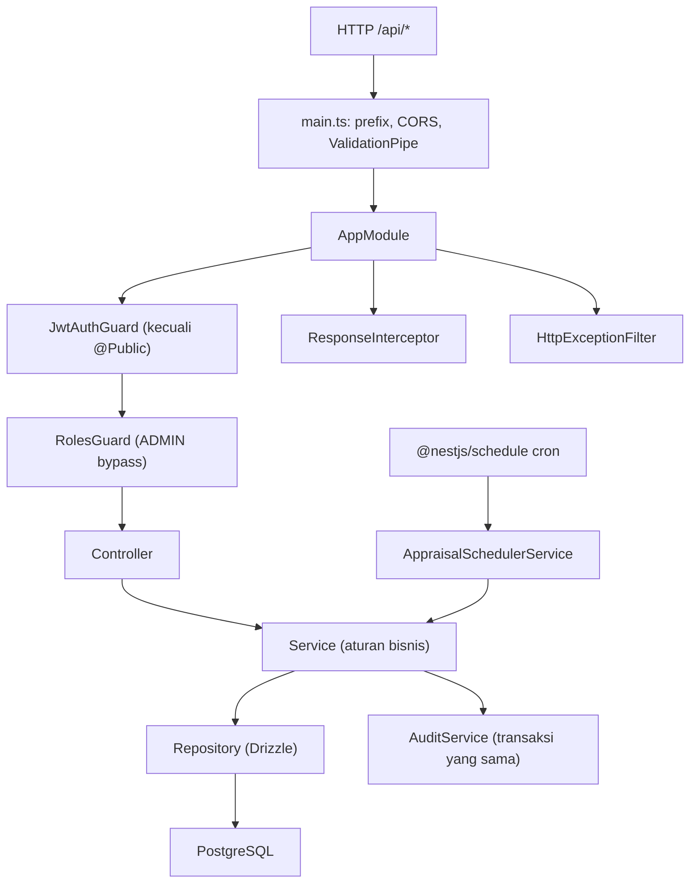

# Alur Backend, per Modul dan Request

**Berdasarkan:** kode di `apps/backend` pada repositori ini (diperbarui 27 Oktober 2026).
**Cakupan:** `apps/backend` saja (NestJS 11, TypeScript 5.7, Drizzle ORM, PostgreSQL). Untuk rancangan lihat `docs/DESIGN-BACKEND.md`; untuk aturan produk lihat `docs/PRD.md`.
**Sifat dokumen:** ini menggambarkan **apa yang benar-benar ada di kode**, bukan yang direncanakan. Bagian 10 mendaftar tempat kode berbeda dari `DESIGN-BACKEND.md` dan module docs.

**Perubahan terbaru yang tercermin:** refresh token tidak lagi dirotasi saat menukar access token (umur access token 5m, refresh token 1d; reuse detection dihapus); refresh token pindah ke cookie HttpOnly; validasi overlap kontrak di service + mapping error Drizzle; daily notes punya search employee; appraisal punya endpoint detail per karyawan dan daily note sum berbasis window kontrak; `lockAppraisal` memakai Drizzle `FOR UPDATE` (bukan raw `SELECT *`); export hasil appraisal `.xlsx` saat COMPLETE.

Cara membaca: dokumen ini mengikuti **urutan request** — dari proses boot, pipeline global, lalu modul per fitur, lalu empat jejak request nyata.

---

## 1. Peta besar



Semua panah adalah **komposisi/pemanggilan**, bukan aliran data. Aliran request nyata ada di bagian 7.

---

## 2. Rantai startup dan pipeline request

### 2.1 `src/main.ts`

**Peran:** membuat aplikasi Nest dan mengatur perilaku HTTP global:

1. `NestFactory.create(AppModule)`.
2. `app.setGlobalPrefix('api')` — semua endpoint berada di `/api/...`.
3. CORS: `origin` dari `CORS_ORIGIN`, `credentials: true`, method GET/HEAD/PUT/PATCH/POST/DELETE.
4. `ValidationPipe({ whitelist: true, forbidNonWhitelisted: true, transform: true })` — properti asing ditolak, query/body ditransformasi ke tipe DTO.
5. Swagger hanya jika `SWAGGER_ENABLED === 'true'`; UI di `/api`.
6. Listen ke `PORT` (default 3000).

### 2.2 `src/app.module.ts`

Modul global dan lintas aplikasi:

- `ConfigModule.forRoot({ isGlobal: true, validate: validateEnv })`.
- `ClsModule` global: menyimpan request id (`x-request-id` atau UUID) dan IP.
- `ContextModule`, `ScopeModule`, `ThrottlerModule` (konfigurasi 20 request/60 detik), `ScheduleModule`, `DbModule`.
- Modul fitur: Users, Auth, DailyNotes, Employees, Contracts, Departments, Positions, Criteria, Appraisals, Audit, Health, Imports, Dashboard.
- `APP_GUARD`: `JwtAuthGuard` lalu `RolesGuard`.
- `APP_INTERCEPTOR`: `ResponseInterceptor`.
- `APP_FILTER`: `HttpExceptionFilter`.
- `AppController` menyediakan `GET /api/app` (publik, hanya `Hello World!`).

### 2.3 Urutan pipeline request

1. **Middleware CLS** membuat request id dan menyimpan IP.
2. **JwtAuthGuard** memeriksa Bearer access token; route `@Public()` dilewati.
3. **RolesGuard** membaca metadata `@Roles`; `ADMIN` selalu lolos.
4. **ResponseInterceptor** menyiapkan pembungkus respons sukses.
5. **ValidationPipe** memvalidasi DTO dan mengubah tipe.
6. **Controller** memanggil service.
7. **Service** memakai repository dan `DbService.transaction` bila menulis.
8. **ResponseInterceptor** mengubah hasil menjadi `{ status, message, data, meta }`.
9. Jika ada exception, **HttpExceptionFilter** mengubahnya menjadi `{ statusCode, code, message, details }`.

### 2.4 Request context

`RequestContextService` (`nestjs-cls`) menyimpan:

- `user` — diisi `JwtStrategy.validate` setelah token valid.
- `ip` — diisi middleware.
- request id — dari `cls.getId()`.

Service membangun aktor audit dari context ini (`userId`, `username`, `role`, `ip`, `requestId`). `@CurrentUser()` ada, tetapi kode produksi lebih banyak membaca `RequestContextService`.

### 2.5 Bentuk respons

**Sukses** (`ResponseInterceptor`):

```json
{ "status": 200, "message": "Action completed succesfully", "data": {}, "meta": null }
```

Service mengembalikan `ok(data)` atau `paginated(data, meta)`; interceptor mengambil `.data`/`.meta` dari hasil itu. Controller `AuthController` mengembalikan `{ message, data }`, tetapi `message` dari controller **tidak dipakai** interceptor (lihat bagian 9).

**Gagal** (`HttpExceptionFilter`):

```json
{ "statusCode": 422, "code": "APPRAISAL_RESULT_NOT_COMPLETE", "message": "...", "details": {} }
```

`DEFAULT_CODES` memberi kode default per status; `BusinessLogicException` selalu 422.

### 2.6 Auth, cookie, dan konfigurasi

- Access token: JWT HS256, `JWT_SECRET`, exp `JWT_ACCESS_EXPIRES_IN` (default 5m).
- Refresh token: JWT HS256, `JWT_REFRESH_SECRET` (fallback ke `JWT_SECRET`), exp `JWT_REFRESH_EXPIRES_IN` (default 1d).
- Refresh token disimpan sebagai cookie `appraisal_refresh_token`: `httpOnly`, `sameSite=lax`, `secure` kecuali `NODE_ENV=development`, path `/api/auth`.
- Refresh tidak merotasi token: yang diterbitkan hanya access token baru, cookie tidak berubah. Token yang dicabut (`revoked_at`) selamanya ditolak dengan `AUTH_INVALID_REFRESH_TOKEN`.
- Throttle: `ThrottlerModule` dikonfigurasi 20/menit, tetapi `ThrottlerGuard` hanya dipasang di `AuthController` (signin 5/menit, refresh 10/menit); endpoint lain tidak di-throttle.
- Env divalidasi `class-validator`; lihat tabel di `env.validation.ts`.

### 2.7 Database

- `DbModule` global membuat `pg.Pool` dan Drizzle `Database`; `DbService` menyediakan `transaction(callback)`.
- Schema ada di `src/db/schema.ts`; `audit_logs` sengaja dipisah di `src/db/audit-logs.schema.ts` agar `drizzle-kit generate` tidak membuat ulang tabel partisi.
- Migration ada di `drizzle/0000`–`0014`; constraint khusus (exclusion kontrak, partition audit, grant `app_user`) ditulis sebagai custom SQL.
- Semua query baca yang menyentuh tabel soft-delete memakai `notDeleted(table)`.

---

## 3. Lapisan cross-cutting

### 3.1 JWT dan role

- `JwtStrategy` mengambil Bearer token, memastikan `typ === 'access'`, memuat user aktif, lalu mengisi `AuthenticatedUser` (`roles` berupa array berisi satu role).
- `JwtAuthGuard` melewati route `@Public()`.
- `RolesGuard` membaca metadata `@Roles(...)`; jika user memiliki `ADMIN`, selalu lolos.
- Sebagian besar controller tidak memasang guard lokal karena dua guard sudah global.

### 3.2 Scope department

`ScopeService`:

- `ADMIN`, `HR`, `GENERAL_MANAGER` → `'ALL'`.
- Role lain → daftar `department_id` dari `user_departments`.
- `assertDepartmentAccess` melempar **404** untuk department di luar scope (bukan 403, agar keberadaan record tidak bocor).

Dipakai oleh Employees, Appraisals, Dashboard, dan daily notes untuk HEAD_DEPARTMENT. Tidak dipakai oleh Contracts, Departments, Positions, dan Criteria.

### 3.3 Validasi

- `ValidationPipe` global: `whitelist`, `forbidNonWhitelisted`, `transform`.
- DTO di `src/**/dto/` memakai `class-validator`/`class-transformer`; query umum mewarisi `QueryDto` (`page=1`, `limit=10`, max 50, `orderBy`, `search`).
- Validasi aturan bisnis yang tidak bisa dilakukan DTO ada di fungsi murni:
  - `criteria.validation.ts` — total bobot 100, skala, deskripsi skor, unique code/label/key, aturan field.
  - `daily-note.validation.ts` — required/tipe/opsi field terhadap criteria set yang di-pin.
  - `field-validation.ts` — validasi satu nilai field (NUMBER, BOOLEAN, OPTION, MULTI_OPTION, DATE, TEXT).

### 3.4 ResponseInterceptor

Mengambil status dari metadata `@HttpCode`/response, message dari `@ResponseMessage` (tidak dipakai), atau default typo `"Action completed succesfully"`.

### 3.5 HttpExceptionFilter

Urutan `resolve`:

1. `HttpException` → status, `errorCode`, `message`, `details`; array `message` (ValidationPipe) menjadi `details.errors`.
2. Error database → kode PostgreSQL:
   - `23505` → 409 `UNIQUE_VIOLATION`
   - `23503` → 400 `FOREIGN_KEY_VIOLATION`
   - `23502` → 400 `NOT_NULL_VIOLATION`
   - `23P01` → 422 `CONTRACT_OVERLAP`
   - lainnya → 500 `DATABASE_ERROR`
3. Error lain → 500 `INTERNAL_SERVER_ERROR`.

`findDatabaseError` menelusuri rantai `cause` (Drizzle membungkus error PostgreSQL dalam `DrizzleQueryError`).

### 3.6 Audit

- `AuditService.record(executor, entry)` menulis ke `audit_logs`; sebaiknya memakai executor transaksi yang sama dengan perubahan.
- `maskSensitive` recursive memasking key yang cocok `password`, `token`, `secret`, `authorization`, `cookie`.
- Tabel audit append-only; aplikasi hanya insert (grant DB juga membatasi).
- Tidak ada endpoint baca audit di kode saat ini.

### 3.7 Transaksi, soft delete, dan repository

- Service menulis lewat `DbService.transaction`; repository menerima `DbExecutor` agar ikut transaksi.
- Perubahan dan audit berada dalam transaksi yang sama.
- Soft delete memakai `isDeleted`/`deletedAt`; `notDeleted` wajib pada query.
- Beberapa operasi memang hard delete: `user_departments` (replace), `criteria`/`criteria_scale_descriptions` saat replace draft, dan field criteria yang belum pernah dipakai note.
- Hanya repository yang mengimpor tabel Drizzle.

### 3.8 Period

`period.util.ts`: period = tanggal 1 bulan (`YYYY-MM-01`), `periodStart`, `periodEnd`, `addMonths`, `currentPeriod`. Appraisal dan daily note memakai representasi ini.

### 3.9 Matriks permission

`src/common/permissions/permissions.ts` berisi `PERMISSIONS` dan `can()`, tetapi `can()` **belum dipakai** di kode produksi. Otorisasi produksi memakai `@Roles` + `RolesGuard` dan `ScopeService`.

---

## 4. Infrastruktur bersama

### 4.1 `DbModule` / `DbService`

- `PG_POOL` + `DB_CONNECTION` global.
- `DbService.client` untuk query langsung; `DbService.transaction` untuk unit of work.
- `onModuleDestroy` menutup pool.

### 4.2 `AuditModule`

- `AuditService` + `AuditRepository`, global.
- Dipakai hampir semua service tulis; `auth` tidak memakainya.
- `audit_logs` dibuat oleh custom migration dan dipartisi berdasarkan `occurred_at`; migration hanya membuat partition default.

### 4.3 `ImportService`

Pipeline bersama untuk Employees dan Contracts:

1. `assertFile`: wajib `.xlsx`, ukuran maksimum `IMPORT_MAX_FILE_SIZE_MB` (default 5 MB).
2. Baca sheet pertama, cek header `strategy.expectedHeaders`.
3. Kumpulkan baris berisi data; batas `IMPORT_MAX_ROWS` (default 5000).
4. `strategy.validate(rows)` — seluruh file divalidasi, **tidak ada write**; error pertama dilempar sebagai 422 `IMPORT_VALIDATION_FAILED` dengan `details { row, column, message }`.
5. `dbService.transaction`: `strategy.commit(rows, tx)` + audit `${ENTITY}_IMPORTED`.

### 4.4 Excel writer

- `EmployeesExcelService`, `ContractsExcelService`, `AppraisalsExcelService`.
- Semua memakai `exceljs` dan menulis buffer in-memory.
- Export teks disanitasi dengan prefix `'` bila dimulai `=`, `+`, `-`, `@`.
- Appraisal export membuat sheet `Summary` + `Assessment`.

### 4.5 Scheduler dan lock

- `AppraisalSchedulerService` cron `0 1 1 * *` (tanggal 1, 01:00), hanya jika `SCHEDULER_ENABLED !== 'false'`.
- `AppraisalsService.runScheduler` memakai `pg_try_advisory_xact_lock(73001)` agar satu instance saja yang berjalan.
- Target period default = bulan berikutnya (look-ahead satu bulan).
- Endpoint manual `POST /api/scheduler/appraisals/run` hanya ADMIN.

### 4.6 Health dan App

- `GET /api/health` — publik, mengeksekusi `SELECT 1`.
- `GET /api/app` — publik, `Hello World!`.

### 4.7 Seed dan skrip

- `pnpm --filter backend seed` — admin awal + criteria set v1 (idempotent).
- `pnpm --filter backend seed:employees` — departemen/posisi/employee/kontrak dummy (idempotent untuk employee number).
- `pnpm --filter backend migrate` — menjalankan migrasi lewat `src/db/migrate.ts`.
- `pnpm --filter backend test` — Jest unit test; tidak ada e2e/Supertest test di repo.

---

## 5. Modul per fitur

### 5.1 `auth`

- **Endpoint:** `POST /auth/signin` (public, throttle 5/menit), `POST /auth/refresh` (public, throttle 10/menit), `POST /auth/logout` (public), `GET /auth/me` (butuh access token).
- **Signin:** cari user by username → bcrypt compare → cek `isActive` → update `lastLoginAt` → issue access+refresh → set cookie refresh → response berisi `{ username, role, accessToken }`.
- **Refresh:** baca cookie → verify JWT refresh (`typ=refresh`, ada `jti`) → cari `refresh_tokens` by jti → tolak bila tidak ada/dicabut/kedaluwarsa/hash berbeda → terbitkan **hanya access token baru** (cookie tetap).
- **Logout:** baca cookie, clear cookie, revoke `jti` bila valid.
- **Me:** mengembalikan `req.user` yang diisi `JwtStrategy`.
- **Catatan:** login/refresh/logout tidak membuat audit entry.

### 5.2 `users`

- **Role:** seluruh controller `@Roles(ADMIN)`.
- **Endpoint:** list, detail, create, update, `PATCH :id/status`, `POST :id/reset-password`, soft delete.
- **Create:** cek username unik → bcrypt → insert user + `user_departments` → audit, satu transaksi.
- **Update:** update role/employee/active dan replace `user_departments` bila dikirim; audit.
- **Reset password:** bcrypt + audit `USER_PASSWORD_RESET`.
- **Delete:** soft delete; audit.
- **Catatan:** `departmentIds` tidak divalidasi terhadap role atau keberadaan department sebelum insert (FK tetap menjaga).

### 5.3 `departments`

- **Endpoint:** `GET /departments` (paginated + search code/name), `GET /departments/:id`, `POST`, `PATCH`, `DELETE`.
- **Role:** baca untuk semua user login; tulis `@Roles(ADMIN)`.
- **Delete:** ditolak bila masih ada employee non-deleted di department.
- **Catatan:** `@UseGuards` di controller dikomentari; guard global tetap aktif.

### 5.4 `positions`

- **Endpoint:** `GET /positions` (semua, tanpa pagination), `GET /positions/:id`, `POST`, `PATCH`, `DELETE`.
- **Role:** baca semua user login; tulis `@Roles(ADMIN)`.
- **Field:** `code`, `name`, `level` (minimal 1).
- **Delete:** ditolak bila masih dipakai employee non-deleted.

### 5.5 `employees`

- **Endpoint:** `GET /employees` (filter search, department, position, status, rentang start/end kontrak; sort; pagination), `GET /employees/:id`, `POST`, `PATCH`, `DELETE`; `GET /employees/export`, `GET /employees/import-template`, `POST /employees/import`.
- **Role:** tulis/import/export `@Roles(ADMIN, HR)`; baca semua user login, tetapi list/detail dibatasi `ScopeService`.
- **List:** raw SQL di repository; department/position di-join; `contract` = kontrak dengan start terbaru; `contractStartDate` = start paling awal.
- **Create:** employee + nested `contracts` dalam satu transaksi; setiap kontrak mendapat audit `CONTRACT_CREATED`. Overlap kontrak mengandalkan constraint DB (tidak ada pre-check di jalur employee).
- **Update:** hanya data employee; kontrak dikelola lewat modul Contracts.
- **Delete:** soft delete; ditolak bila employee tertaut ke user.
- **Export:** mengirim semua employee, **tidak** mengikuti filter list.
- **Import:** `EmployeeImporter`; validasi header/duplikat/gender/tanggal/department/position/status/supervisor, commit dua pass (employee lalu supervisor).

### 5.6 `contracts`

- **Endpoint:** `GET /contracts` (filter search employee, type, rentang start/end; pagination), `GET /contracts/:id`, `POST`, `PATCH`, `DELETE`; `GET /contracts/export`, `GET /contracts/import-template`, `POST /contracts/import`.
- **Role:** tulis/import/export `@Roles(ADMIN, HR)`; baca semua user login.
- **List:** `contracts` sebagai tabel utama + `leftJoin(employees)`; `search` mencari `employees.fullName`/`employeeNumber`; count query ikut join.
- **Create/Update:** `assertNoOverlap` memakai `daterange(..., '[]') && daterange(..., '[]')` sebelum insert/update; update mengecualikan dirinya. Constraint `contracts_no_overlap` tetap menjadi jaring terakhir.
- **Error:** overlap dari service = 422 `CONTRACT_OVERLAP` dengan rentang bentrok; error DB `23P01` juga dipetakan ke 422 oleh filter.
- **Delete:** soft delete.
- **Import:** `ContractImporter`; validasi tipe, tanggal, aturan PERMANENT, duplikat, overlap DB + dalam file; commit upsert by `employeeId + startDate`.
- **Catatan:** endpoint baca contracts tidak memakai `ScopeService`.

### 5.7 `criteria`

- **Endpoint:** `GET /criteria-sets`, `GET /criteria-sets/available?departmentId=`, `GET /criteria-sets/active?departmentId=`, `GET /criteria-sets/:id`, `POST`, `PUT /:id`, `POST /:id/activate`.
- **Role:** create/update/activate `@Roles(ADMIN, HR)`; edit ACTIVE hanya ADMIN (dicek di service). Baca semua user login.
- **Versioning:** versi baru = max versi dalam group department/global + 1; draft baru menyalin criteria + fields dari set ACTIVE group tersebut bila tidak dikirim.
- **DRAFT:** criteria/fields boleh diganti; replace criteria/fields.
- **ACTIVE:** hanya ADMIN; weights dan daftar criteria terkunci; field boleh ditambah/edit/hapus. Field yang sudah dipakai note di-soft-delete; yang belum dipakai di-hard-delete.
- **Activate:** validasi total bobot 100, skala, deskripsi skor, field; archive set ACTIVE sebelumnya untuk group yang sama, lalu set ACTIVE.
- **Catatan:** tidak ada endpoint delete criteria set; endpoint baca tidak memakai scope.

### 5.8 `appraisals`

- **Endpoint:** list, detail, history, detail per karyawan, preview, create, update employees, save ratings, transition, delete, export result; scheduler manual.
- **Role:** preview/create/updateEmployees/delete HR; saveRatings HEAD_DEPARTMENT; employee detail HEAD_DEPARTMENT; export HR/HEAD_DEPARTMENT/MANAGER/GENERAL_MANAGER; transition memakai tabel transisi; ADMIN selalu lolos.
- **Eligibility:** employee ACTIVE di department, punya kontrak non-deleted dengan `end_date` di bulan period, dan belum masuk appraisal non-COMPLETE untuk period yang sama. Kontrak PERMANENT tidak eligible.
- **Dedupe:** jika beberapa kontrak berakhir di bulan yang sama, service memilih `contractEndDate` terbaru lalu `contractStartDate` terbaru.
- **Snapshot:** `appraisal_employees` menyimpan employee/department/position/contract type + contract start/end.
- **Create:** `onConflictDoNothing` pada unique `(department_id, period)`; konflik = 409 `APPRAISAL_ALREADY_EXISTS`.
- **Update employees:** `DRAFT` saja, HR; remove = soft delete `appraisal_employees`, add = eligibility + dedupe + snapshot baru; audit `APPRAISAL_EMPLOYEES_UPDATED`.
- **Scheduler:** bulan berikutnya, criteria ACTIVE department (fallback global), advisory lock, audit SYSTEM; appraisal dan snapshot dibuat dalam transaksi.
- **Ratings:** hanya `PENDING`, department scope, criteria/employee harus milik appraisal, rating dalam skala; upsert + comments + recompute total + audit.
- **Transition:** row lock `FOR UPDATE`, tabel `TRANSITIONS`, scope, comment wajib untuk send back/reopen, precondition `hasEmployees`/`allRatingsFilled`, update status + history + audit dalam transaksi.

**Aturan transisi (`appraisal.transitions.ts`)**

| Dari | Ke | Role | Syarat |
|---|---|---|---|
| DRAFT | PENDING | HR | punya employee |
| PENDING | SUBMITTED | HEAD_DEPARTMENT (scoped) | semua rating terisi |
| SUBMITTED | APPROVED | MANAGER (scoped) | — |
| APPROVED | COMPLETE | GENERAL_MANAGER | — |
| PENDING | DRAFT | HEAD_DEPARTMENT (scoped) | komentar wajib |
| SUBMITTED | PENDING / DRAFT | MANAGER (scoped) | komentar wajib |
| APPROVED | SUBMITTED / PENDING / DRAFT | GENERAL_MANAGER | komentar wajib |
| COMPLETE | APPROVED | ADMIN | komentar wajib (reopen) |

ADMIN selalu lolos pengecekan role transisi lewat `findTransition`.

- **Detail per karyawan:** `GET /appraisals/:id/employees/:appraisalEmployeeId` untuk HEAD_DEPARTMENT/ADMIN; mengembalikan snapshot, ratings, criteria + `scaleDescriptions`, dan `dailyNoteSum`.
- **Daily note sum:** `dailyNoteSums` menjumlahkan nilai `NUMBER` dari daily note employee + department pada `record_date` antara `contract_start_date` dan `contract_end_date`; tidak mempengaruhi `total_score`.
- **Export result:** hanya COMPLETE; sheet `Summary` + `Assessment` (employee rows × criteria, Total Score, Comment).
- **Delete:** soft delete hanya DRAFT, role HR.
- **Catatan:** `lockAppraisal` sekarang memakai Drizzle `select ... for('update')`, sehingga field tetap camelCase.

### 5.9 `daily-notes`

- **Endpoint:** list, `accessible-employees`, detail, create, update, delete. Class-level `@Roles(HEAD_DEPARTMENT, SUPERVISOR)`; ADMIN bypass.
- **Scope:** ADMIN `all`; SUPERVISOR subordinate dari `employee_id` user; HEAD_DEPARTMENT department dari `ScopeService`; role lain 403.
- **List:** filter `search` (employee number/name), `employeeId`, `departmentId`, `dateFrom`, `dateTo`; search + count join employee.
- **Create:** employee harus dalam scope; criteria set tidak boleh DRAFT dan harus department employee/global; `recordDate` menentukan `period` bulan; validasi values terhadap fields; unique employee+date → 409 `DAILY_NOTE_ALREADY_EXISTS`; note + values + audit dalam transaksi.
- **Update:** employee/date immutable; hanya values yang diganti; criteria set yang di-pin dipakai untuk validasi.
- **Delete:** soft delete + audit.
- **Catatan:** `period` adalah turunan bulan dari `record_date`; tidak ada constraint DB yang memaksa konsistensinya.

### 5.10 `dashboard`

- `GET /dashboard/summary` — scoped.
- Mengembalikan jumlah appraisal per status, total employee, dan employee per active department.
- Read-only; tidak ada mutasi.

### 5.11 `audit`

- Hanya `AuditService`/`AuditRepository`; tidak ada controller/endpoint baca.
- `audit_logs` append-only, dipartisi, dan dimasking.
- Dipanggil di dalam transaksi perubahan.

### 5.12 `imports`

- `ImportService` global; dipakai Employees dan Contracts.
- Aturan: file `.xlsx`, header exact, validasi seluruh file, error pertama, commit satu transaksi, audit.
- Batas ukuran dari env 5 MB; controller Multer memakai limit 20 MB (lihat bagian 9).

### 5.13 `health` dan `app`

- `GET /api/health` public + `SELECT 1`.
- `GET /api/app` public hello.
- Tidak memakai guard role.
- **Catatan respons:** keduanya mengembalikan objek/string mentah, sedangkan `ResponseInterceptor` mengharapkan `{ data }`. Akibatnya payload aslinya menjadi `data: null` (lihat bagian 9). Hal yang sama berlaku untuk respons `POST /api/scheduler/appraisals/run`.

---

## 6. Pola menulis (yang harus diikuti)

1. Controller hanya HTTP + DTO; aturan bisnis di service.
2. Service menulis lewat `DbService.transaction`.
3. Repository menerima `DbExecutor`; jangan membuat transaksi sendiri.
4. Audit ditulis dengan executor transaksi yang sama.
5. Validasi bisnis dilakukan sebelum insert/update; error memakai `BusinessLogicException` (422) atau `ConflictException` (409).
6. Soft delete memakai `isDeleted/deletedAt`; query wajib `notDeleted`.
7. Role dicek dengan `@Roles` (guard global); scope department dicek service dan menghasilkan 404.
8. Snapshot dipakai untuk data historis (employee, contract, criteria set).
9. Import: validasi seluruh file dulu, lalu commit satu transaksi.
10. Jangan membaca `process.env` langsung di service; gunakan `ConfigService`.

---

## 7. Jejak request lengkap

### 7.1 Login → refresh → me

1. `POST /api/auth/signin` → `ThrottlerGuard` → `AuthController.signIn`.
2. `AuthService.login` → `UsersRepository.findByUsernameForAuth` → bcrypt compare → cek aktif → update `lastLoginAt`.
3. `issueTokens` membuat access + refresh JWT HS256, menyimpan hash refresh di `refresh_tokens`.
4. Controller memisahkan `refreshToken` dari response, men-set cookie HttpOnly, mengembalikan `{ username, role, accessToken }`.
5. `POST /api/auth/refresh` membaca cookie, verify JWT, cek revoked/expiry/hash, lalu menerbitkan access token baru tanpa mengubah cookie.
6. `GET /api/auth/me` → `JwtAuthGuard` → `JwtStrategy.validate` memuat user aktif dan mengisi `RequestContextService` → controller mengembalikan `req.user`.
7. Frontend memakai access token di header Bearer; 401 memicu single-flight refresh di RTK Query.

### 7.2 Membuat kontrak

1. `POST /api/contracts` → `JwtAuthGuard` → `RolesGuard` (`ADMIN`/`HR`; ADMIN bypass).
2. `ValidationPipe` memvalidasi `CreateContractDto`.
3. `ContractsService.create` membuka transaksi:
   - `assertNoOverlap` memanggil `findOverlapping` dengan `daterange(..., '[]') && daterange(..., '[]')`;
   - jika overlap → 422 `CONTRACT_OVERLAP` dengan rentang yang bentrok;
   - insert contract;
   - audit `CONTRACT_CREATED`.
4. Jika dua request bersamaan lolos pre-check, constraint `contracts_no_overlap` menolak; `DrizzleQueryError.cause` `23P01` dipetakan filter ke 422.
5. Response dibungkus `ResponseInterceptor`.
6. Mutasi frontend menginvalidasi tag `Contracts` + `Employees`.

### 7.3 Membuat daily note

1. `POST /api/daily-notes` → JWT + roles (`HEAD_DEPARTMENT`, `SUPERVISOR`; ADMIN bypass).
2. `DailyNotesService.create` menentukan scope dari role.
3. Employee dimuat; harus ada dan dalam scope; harus punya department.
4. `recordDate` dipotong 10 karakter; `period = YYYY-MM-01`.
5. Criteria set dimuat; DRAFT ditolak; set department harus null (global) atau sama dengan department employee.
6. `validateNoteValues` memeriksa field wajib/tipe/opsi/rules.
7. Transaksi: insert `daily_notes` + `daily_note_values` + audit `DAILY_NOTE_CREATED`.
8. Unique `(employee_id, record_date)` partial → 409 `DAILY_NOTE_ALREADY_EXISTS`.
9. `findOne` mengembalikan note + values.

### 7.4 Appraisal dari DRAFT sampai export

1. HR `POST /appraisals/preview` → eligibility + dedupe + criteria set; `POST /appraisals` → insert DRAFT + snapshot + audit.
2. HR `POST /:id/transition` ke PENDING → tabel transisi `DRAFT→PENDING` (HR), precondition `hasEmployees`.
3. Head Department membuka detail per karyawan, mengisi rating + comment, `PUT /:id/ratings` (PENDING, scope, validasi, recompute skor).
4. `POST /:id/transition` ke SUBMITTED → lock row, `allRatingsFilled`; jika kurang → 422 `APPRAISAL_RATINGS_INCOMPLETE`.
5. Manager `SUBMITTED→APPROVED` (scoped); General Manager `APPROVED→COMPLETE`.
6. Saat COMPLETE, role berhak memanggil `GET /:id/export-result`; service memuat snapshot + ratings + criteria, `AppraisalsExcelService` membuat `.xlsx`.
7. Setiap perubahan status dan rating menulis audit dan history dalam transaksi yang sama.

---

## 8. Cara memprediksi modul baru

Pola module standar:

1. `features/X/x.module.ts` — mendaftarkan controller, service, repository, importer/excel bila ada; export service yang dipakai modul lain.
2. `x.controller.ts` — route, `@Roles`, `@ApiOperation`, DTO, `@Res()` untuk file.
3. `x.service.ts` — aturan bisnis, transaksi, audit, scope, pemetaan payload.
4. `x.repository.ts` — semua query Drizzle, `DbExecutor`, `notDeleted`, join.
5. `dto/` — validasi input; query mewarisi `QueryDto`.
6. `interfaces/` — alias payload dari `@appraisal/types`.
7. Daftarkan module di `AppModule`.
8. Buat migration Drizzle; custom SQL untuk constraint/index khusus.
9. Tambah unit test di sebelah source; update docs.

Modul yang menyimpang dari pola: Contracts punya overlap guard + import/export, Criteria punya versioning dan validator murni, Employees punya raw SQL + nested contracts + importer, Appraisals punya workflow/scheduler/excel, DailyNotes punya dynamic validation.

---

## 9. Catatan kualitas kode

Bagian ini menyebut apa yang ada, bukan menghakimi.

1. **`can()` belum dipakai.** Matriks permission di `common/permissions/permissions.ts` hanya dipakai spec; produksi memakai `@Roles`/`RolesGuard`.
2. **Tidak ada endpoint baca audit.** `audit_logs` hanya ditulis; endpoint `GET /audit-logs` ada di desain, bukan di kode.
3. **Beberapa endpoint baca tidak memakai scope.** Contracts, Departments, Positions, dan Criteria dapat dibaca semua user login; berbeda dari Employees/Appraisals/Dashboard.
4. **Export employees tidak mengikuti filter.** `GET /employees/export` mengirim semua employee; Contracts export memakai query filter.
5. **Batas file import berbeda.** Controller Multer memakai 20 MB, service menolak di atas `IMPORT_MAX_FILE_SIZE_MB` (default 5 MB).
6. **Nested contracts pada create employee tidak pre-check overlap.** Jalur ini mengandalkan exclusion constraint DB; jalur Contracts punya pre-check.
7. **Auth tidak diaudit.** Login/refresh/logout tidak memanggil `AuditService`.
8. **ResponseInterceptor mengabaikan message controller.** `AuthController` mengembalikan `message`, tetapi interceptor memakai default `"Action completed succesfully"` (typo).
9. **Decorator tidak terpakai.** `CurrentUser`, `ResponseMessage`, dan `ApiSuccess` tidak dipakai di kode produksi.
10. **`@UseGuards` di DepartmentsController dikomentari.** Guard global tetap berjalan, tetapi komentar itu menyesatkan.
11. **`JWT_REFRESH_SECRET` opsional.** Jika kosong, refresh memakai `JWT_SECRET`; access dan refresh tidak terpisah.
12. **`daily_notes.period` adalah turunan aplikasi.** Tidak ada check constraint yang memaksa `period = date_trunc('month', record_date)`.
13. **`audit_logs` hanya punya partition default di migration.** Tidak ada job pembuat partition bulanan.
14. **Tidak ada e2e test.** Test yang ada adalah unit test Jest; jalur HTTP/DB penuh belum diuji di repo.
15. **`lockAppraisal` pernah salah bentuk.** Versi lama raw `SELECT *` + cast membuat `criteriaSetId`/`departmentId` undefined; sekarang memakai Drizzle `FOR UPDATE`.
16. **Throttle tidak global.** `ThrottlerModule` dikonfigurasi, tetapi `ThrottlerGuard` hanya dipasang di `AuthController`; endpoint lain tidak dibatasi.
17. **`ResponseInterceptor` mengasumsikan hasil `{ data }`.** `/app`, `/health`, dan `POST /scheduler/appraisals/run` mengembalikan objek/string mentah, sehingga payload aslinya hilang dan `data` menjadi `null`. `AuthController` aman karena mengembalikan `{ message, data }`.
18. **Dua custom exception tidak dipakai.** `DatabaseException` dan `ValidationException` didefinisikan tetapi tidak dipakai; kode memakai `HttpException`/`BusinessLogicException`.

---

## 10. Kode versus `DESIGN-BACKEND.md`

| Rancangan | Kondisi kode |
|---|---|
| `GET /audit-logs` | Belum ada controller baca audit |
| `POST /auth/login` | Kode memakai `POST /auth/signin` |
| `GET /appraisals/:id/assessment-template` dan `POST /:id/assessment-import` | Belum ada; hanya export result |
| Export employees mengikuti filter | Export employees mengirim semua baris |
| Semua endpoint baca memakai scope | Contracts/Departments/Positions/Criteria tidak memakai `ScopeService` |
| Setiap export diaudit | Export employees/contracts/appraisal tidak menulis audit |
| Auth (login/logout) masuk audit | AuthService tidak memanggil AuditService |
| Matriks permission dipakai kode | `can()` belum dipanggil produksi |
| Partition audit bulanan otomatis | Migration hanya membuat partition default |
| Batas import satu nilai | Multer 20 MB vs service 5 MB |
| `Permission`/`@Roles` terpusat | Sebagian role dicek langsung di service (mis. ACTIVE criteria ADMIN, daily note scope) |

Bagian yang **sudah** sesuai: Drizzle + repository, transaksi + audit, soft delete, JWT access/refresh, cookie refresh, scope untuk Employees/Appraisals/Dashboard/DailyNotes, snapshot appraisal, exclusion constraint kontrak, import first-error, dan single source tipe di `@appraisal/types`.

---

## 11. Rangkuman dan cek pemahaman

**Poin kunci**

1. Request melewati CLS → JWT → Roles → Validation → Controller → Service → Repository → DB; sukses dibungkus interceptor, error difilter.
2. `ADMIN` selalu lolos `RolesGuard`; scope department ditentukan `ScopeService` dan pelanggaran scope = 404.
3. Semua penulisan penting memakai transaksi, dan audit ditulis di transaksi yang sama.
4. Appraisal memakai workflow table, row lock, snapshot, dan precondition; COMPLETE dapat diexport `.xlsx`.
5. Daily note memakai criteria set yang di-pin, validasi field, dan `period` turunan bulan.
6. Import memvalidasi seluruh file sebelum commit, melaporkan error pertama, dan commit satu transaksi.
7. Drizzle repository adalah satu-satunya lapisan yang mengimpor tabel; soft delete wajib `notDeleted`.
8. Beberapa endpoint baca belum memakai scope dan beberapa fitur desain belum ada; lihat bagian 9–10.

**Pertanyaan latihan**

1. Di mana `AuthenticatedUser` diisi, dan mengapa `ScopeService` mengembalikan 404 bukan 403?
2. Mengapa `saveRatings` dan `transition` harus memakai transaksi serta row lock?
3. Mengapa error `23P01` dari Drizzle perlu ditelusuri lewat `cause`?
4. Apa perbedaan jalur overlap kontrak saat create contract dan saat create employee dengan nested contracts?
5. Mengapa daily note sum memakai `contract_start_date`/`contract_end_date`, bukan `daily_notes.period`?
6. Mengapa import harus memvalidasi seluruh file sebelum commit?

**Jawaban singkat:** (1) `JwtStrategy.validate` mengisi user dari access token; scope 404 mencegah kebocoran keberadaan record. (2) Agar perubahan status/rating, history, dan audit konsisten dan tidak balapan. (3) Drizzle membungkus error PostgreSQL di `DrizzleQueryError.cause`; kode PostgreSQL tidak terlihat di level atas. (4) Contract create/update punya pre-check `daterange`; nested employee contract mengandalkan exclusion constraint DB. (5) Sum adalah window masa kontrak yang membuat employee eligible; `period` hanya bucket bulan untuk reporting. (6) Agar file invalid tidak menulis sebagian data; validasi dulu, commit satu transaksi.
