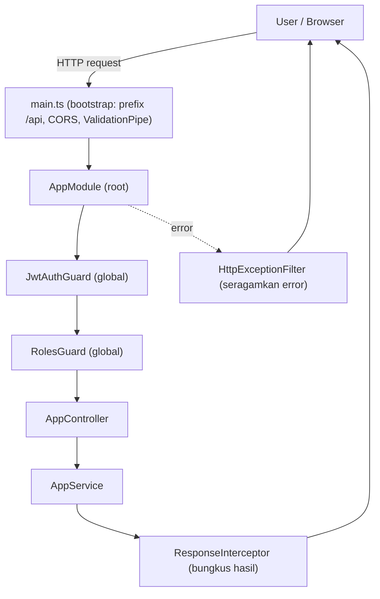

# Module: AppModule (Module Akar)

**Dibuat:** 2026-10-11
**File sumber yang dianalisis:**
- `apps/backend/src/main.ts`
- `apps/backend/src/app.module.ts`
- `apps/backend/src/app.controller.ts`
- `apps/backend/src/app.service.ts`
- `apps/backend/src/config/env.validation.ts` (rujukan, dibahas detail di module `config`)

## Daftar Isi
1. [Ringkasan Module](#1-ringkasan-module)
2. [Peta File di Module Ini](#2-peta-file-di-module-ini)
3. [Penjelasan Kode per File](#3-penjelasan-kode-per-file)
4. [Alur Kerja Lengkap](#4-alur-kerja-lengkap)
5. [Hubungan dengan Module Lain](#5-hubungan-dengan-module-lain)
6. [Kesalahan Umum & Tips Pemula](#6-kesalahan-umum--tips-pemula)
7. [Catatan Kualitas Kode](#7-catatan-kualitas-kode)
8. [Rangkuman & Cek Pemahaman](#8-rangkuman--cek-pemahaman)

---

## 1. Ringkasan Module

**AppModule** adalah module akar (root) aplikasi. Semua module lain di-import ke sini supaya dikenali oleh NestJS. File ini juga mendaftarkan "petugas lintas aplikasi": guard (penjaga), interceptor (pengubah bentuk response), dan filter (penangkap error).

Analogi: AppModule seperti **panel listrik utama sebuah gedung**. Dari situ, listrik dialirkan ke semua ruangan (module fitur). Di panel itu juga dipasang sekring utama (guard), penyeragam tegangan (interceptor), dan alarm pusat saat ada korsleting (exception filter). Kalau panel ini dimatikan, seluruh gedung mati.

**Istilah baru:**
- **Module** = paket kode yang membungkus controller + provider (service) yang saling berkaitan. Ibarat satu unit kerja di sebuah perusahaan.
- **Bootstrap** = proses menyalakan aplikasi pertama kali (fungsi `main()` yang menyalakan server).

---

## 2. Peta File di Module Ini

| Nama file | Jenis | Peran singkat |
|-----------|-------|---------------|
| `main.ts` | Entry point (bukan bagian Nest Module) | Menyalakan server, mengatur prefix, CORS, validasi global, Swagger |
| `app.module.ts` | Module (root) | Mengimpor semua module fitur & mendaftarkan guard/interceptor/filter global |
| `app.controller.ts` | Controller | Satu endpoint uji `GET /api/app` |
| `app.service.ts` | Service/Provider | Logika `getHello()` yang mengembalikan `'Hello World!'` |
| `config/env.validation.ts` | Validasi config (rujukan) | Memastikan environment variable wajib ada & formatnya benar |

Diagram alur sederhana:



Versi teks:

```
Request → main.ts (Pipa validasi) → JwtAuthGuard → RolesGuard
        → AppController → AppService → ResponseInterceptor → Response
                                     ↘ error → HttpExceptionFilter
```

---

## 3. Penjelasan Kode per File

### `main.ts`

**Peran file:** Titik start aplikasi. Semua pengaturan tingkat aplikasi (bukan per-modul) ditulis di sini. File ini dijalankan oleh Node.js, bukan oleh NestJS.

**Bagian 1 — Membuat aplikasi dan mengambil ConfigService**

```ts
const app = await NestFactory.create(AppModule);
const configService = app.get(ConfigService);
```

- **Fungsinya:** `NestFactory.create(AppModule)` membangun seluruh aplikasi dari AppModule (semua module dirakit). Lalu kita mengambil `ConfigService` untuk membaca environment variable.
- **Kenapa dibuat seperti ini:** Best practice NestJS: rakitan aplikasi dipilih dari sebuah root module. `app.get(...)` adalah cara resmi mengambil provider dari container, bukan `new ConfigService()`.
- **Dampaknya:** Kalau `AppModule` salah isinya, seluruh aplikasi gagal start. Kalau `ConfigService` tidak tersedia (mis. ConfigModule dilupakan), baris kedua error.
- **Analogi:** Membangun gedung dari cetak biru (`AppModule`), lalu mengambil kunci ruang listrik (`ConfigService`).
- **Istilah baru:** `async`/`await` = menjalankan tugas yang butuh waktu (I/O) tanpa menghentikan seluruh program; hasil `await` baru dipakai setelah selesai.

**Bagian 2 — Prefix global `/api`**

```ts
app.setGlobalPrefix('api');
```

- **Fungsinya:** Menambahkan `api/` di depan semua route. Jadi `@Get('/app')` dipanggil sebagai `GET /api/app`.
- **Kenapa dibuat seperti ini:** Menyeragamkan letak API dan memudahkan konfigurasi reverse proxy. Aturan project (AGENTS.md) melarang mengubah prefix ini tanpa izin.
- **Dampaknya:** Jika diubah, semua URL di frontend (`VITE_HOST_API`) harus ikut berubah atau semua request jadi 404.
- **Analogi:** Semua nomor telepon kantor diberi kode area yang sama.

**Bagian 3 — CORS**

```ts
app.enableCors({
  origin: configService.get<string>('CORS_ORIGIN'),
  methods: 'GET,HEAD,PUT,PATCH,POST,DELETE',
  credentials: true,
});
```

- **Fungsinya:** Mengizinkan browser dari domain lain (mis. `http://localhost:5173`, si frontend) memanggil API ini.
- **Kenapa dibuat seperti ini:** Secara default browser memblokir request lintas domain (CORS). `credentials: true` dibutuhkan agar cookie/Authorization header boleh dikirim.
- **Dampaknya:** Kalau `CORS_ORIGIN` salah, frontend akan gagal terhubung dan menampilkan error CORS di console.
- **Analogi:** Satpam yang hanya mengizinkan tamu dari daftar alamat tertentu.
- **Istilah baru:** **CORS** = aturan browser yang membolehkan/menolak request ke domain berbeda.

**Bagian 4 — ValidationPipe global**

```ts
app.useGlobalPipes(
  new ValidationPipe({
    whitelist: true,
    forbidNonWhitelisted: true,
    transform: true,
  }),
);
```

- **Fungsinya:** Memvalidasi (memeriksa) semua data yang masuk dari request.
  - `whitelist: true` → buang field yang tidak dideklarasikan di DTO.
  - `forbidNonWhitelisted: true` → bukan sekadar dibuang, tapi tolak dengan error kalau ada field asing.
  - `transform: true` → ubah tipe otomatis (mis. `"5"` dari URL menjadi `5`).
- **Kenapa dibuat seperti ini:** Best practice NestJS agar data selalu bersih & aman sebelum masuk ke service.
- **Dampaknya:** Jika dimatikan, sistem rentan menerima data sampah/berbahaya dan bug validasi akan lolos ke database.
- **Analogi:** Pintu bandara dengan metal detector: barang tak dikenal disita atau tamu ditolak masuk.
- **Istilah baru:** **Pipe** = komponen yang memproses data sebelum masuk ke handler (validasi/transformasi). **DTO** = Data Transfer Object, objek yang mendefinisikan bentuk data yang diterima.

**Bagian 5 — Dokumentasi Swagger**

```ts
if (configService.get<string>('SWAGGER_ENABLED') === 'true') {
  const config = new DocumentBuilder()
    .setTitle('Performance Appraisal API')
    .setDescription('API documentation for Performance Appraisal system')
    .setVersion('1.0')
    .addBearerAuth()
    .build();

  const document = SwaggerModule.createDocument(app, config);
  SwaggerModule.setup('api', app, document);
}
```

- **Fungsinya:** Membuat halaman dokumentasi interaktif untuk semua endpoint, dapat dimatikan lewat env `SWAGGER_ENABLED`.
- **Kenapa dibuat seperti ini:** Memudahkan developer mencoba API tanpa Postman. Menyala hanya saat dibutuhkan (aman untuk produksi karena bisa dimatikan).
- **Dampaknya:** Kalau `addBearerAuth` dihapus, tombol "Authorize" untuk token JWT hilang dari Swagger.
- **Analogi:** Papan petunjuk arah di lobi yang bisa dilipat saat gedung tutup.

**Bagian 6 — Menyalakan server**

```ts
await app.listen(Number(configService.get<string>('PORT') ?? 3000));
```

- **Fungsinya:** Menjalankan server pada port dari env `PORT` (default 3000).
- **Kenapa dibuat seperti ini:** Port dikonfigurasi, bukan di-hardcode, supaya fleksibel antar environment.
- **Dampaknya:** Jika port dipakai proses lain, aplikasi error `EADDRINUSE`.
- **Analogi:** Membuka pintu utama gedung supaya tamu (request) bisa masuk.

**Istilah baru:** `void bootstrap();` — memanggil fungsi `bootstrap` tanpa menunggu hasilnya. `void` dipakai agar linter tidak mengeluh tentang promise yang tidak di-await.

---

### `app.module.ts`

**Peran file:** Jantung perakitan aplikasi. Menentukan module apa saja yang aktif dan petugas global apa yang dipasang.

**Bagian 1 — Dekorator `@Module`**

```ts
@Module({
  imports: [ /* ... */ ],
  controllers: [AppController],
  providers: [ /* ... */ ],
})
export class AppModule {}
```

- **Fungsinya:** Menandai class ini sebagai module NestJS dan mendaftarkan import, controller, serta provider-nya.
- **Kenapa dibuat seperti ini:** Ini adalah pola wajib NestJS; framework membaca metadata ini untuk merakit aplikasi.
- **Dampaknya:** Menghapus `imports` berarti semua module fitur mati; menghapus `providers` berarti guard/filter/interceptor global tidak aktif.
- **Analogi:** Daftar undangan dan susunan acara pada sebuah pernikahan.
- **Istilah baru:** **Decorator** = tulisan berawalan `@` yang menempelkan "catatan" pada class/method; NestJS membacanya untuk tahu caranya memperlakukan kode itu.

**Bagian 2 — ConfigModule & ClsModule (infrastruktur)**

```ts
ConfigModule.forRoot({ isGlobal: true, validate: validateEnv }),
ClsModule.forRoot({
  global: true,
  middleware: {
    mount: true,
    generateId: true,
    idGenerator: (req) => (req.headers['x-request-id'] as string) ?? randomUUID(),
    setup: (cls, req) => { cls.set('ip', req.ip); },
  },
}),
```

- **Fungsinya:**
  - `ConfigModule.forRoot` memuat `.env` dan memvalidasinya lewat `validateEnv`. `isGlobal: true` membuatnya bisa dipakai di semua module tanpa import ulang.
  - `ClsModule.forRoot` membuat **AsyncLocalStorage**: tempat menyimpan data per-request (request id, IP) yang bisa diakses dari mana saja tanpa dioper manual.
- **Kenapa dibuat seperti ini:** Config global = praktis. CLS = cara elegan mengantarkan "konteks" (siapa, dari mana) ke seluruh lapisan kode.
- **Dampaknya:** Tanpa `validateEnv`, aplikasi bisa jalan dengan env yang salah dan error baru muncul jauh di dalam. Tanpa ClsModule, service yang butuh IP/request id harus menerimanya sebagai parameter.
- **Analogi:** Config global = pengumuman lewat pengeras suara ke seluruh gedung. ClsModule = gelang identitas tamu yang langsung tahu siapa & dari mana.
- **Istilah baru:** **Middleware** = kode yang jalan di antara request masuk dan handler. **AsyncLocalStorage (CLS)** = penyimpanan data yang otomatis mengikuti sebuah request, seperti loker pribadi per tamu.

**Bagian 3 — ThrottlerModule & ScheduleModule**

```ts
ThrottlerModule.forRoot([{ ttl: 60_000, limit: 20 }]),
ScheduleModule.forRoot(),
```

- **Fungsinya:**
  - `ThrottlerModule` membatasi jumlah request: maksimal 20 request per 60 detik per klien (anti-spam/brute force).
  - `ScheduleModule` mengaktifkan penjadwalan tugas (dipakai AppraisalsModule untuk job otomatis).
- **Kenapa dibuat seperti ini:** Fairness & keamanan dasar, serta kebutuhan job terjadwal (mis. auto-submit appraisal).
- **Dampaknya:** Menghapus Throttler → endpoint terbuka untuk brute force. Menghapus Schedule → penjadwal appraisal tidak jalan.
- **Analogi:** Throttler = pembatas antrean di loket. Schedule = jam weker kantor untuk tugas rutin.

**Bagian 4 — Daftar module fitur**

```ts
DbModule, UsersModule, AuthModule, DailyNotesModule, EmployeesModule,
ContractsModule, DepartmentsModule, PositionsModule, CriteriaModule,
AppraisalsModule, AuditModule, HealthModule, ImportsModule, DashboardModule,
```

- **Fungsinya:** Mengaktifkan semua module fitur agar route & provider-nya terdaftar.
- **Kenapa dibuat seperti ini:** NestJS hanya mengenal module yang di-import (langsung atau transitif).
- **Dampaknya:** Menghapus satu entry di sini membuat seluruh endpoint module tersebut hilang (404) tanpa peringatan besar.
- **Analogi:** Memasukkan semua unit ke dalam struktur organisasi; unit yang tak didaftarkan dianggap tidak ada.

**Bagian 5 — Guard, interceptor, filter global**

```ts
providers: [
  AppService,
  { provide: APP_GUARD, useClass: JwtAuthGuard },
  { provide: APP_GUARD, useClass: RolesGuard },
  { provide: APP_INTERCEPTOR, useClass: ResponseInterceptor },
  { provide: APP_FILTER, useClass: HttpExceptionFilter },
],
```

- **Fungsinya:**
  - `APP_GUARD` + `JwtAuthGuard` → semua endpoint wajib punya token JWT yang valid, kecuali ditandai `@Public()`.
  - `APP_GUARD` + `RolesGuard` → memeriksa role user (mis. hanya HR yang boleh impor) berdasarkan `@Roles()`.
  - `APP_INTERCEPTOR` + `ResponseInterceptor` → membungkus response sukses ke format seragam.
  - `APP_FILTER` + `HttpExceptionFilter` → menyeragamkan bentuk error.
- **Kenapa dibuat seperti ini:** Token khusus `APP_*` membuat petugas ini berlaku aplikasi-luas tanpa perlu ditulis ulang di tiap controller. Ini cara NestJS untuk "global provider yang tetap bisa DI (dependensi disuntikkan)".
- **Dampaknya:** Jika `JwtAuthGuard` dilepas, seluruh API terbuka tanpa login. Jika `HttpExceptionFilter` dilepas, format error berbeda-beda dan frontend bisa bingung.
- **Analogi:** Guard = satpam pintu masuk & satpam ruangan khusus. Interceptor = kasir yang mengemas barang. Filter = petugas customer service yang menangani keluhan dengan format baku.
- **Istilah baru:** **Guard** = penjaga yang memutuskan request boleh lanjut atau tidak. **Interceptor** = kode yang jalan sebelum/sesudah handler (untuk mengubah hasil). **Filter (Exception Filter)** = penangkap error terpusat.

**Urutan eksekusi (penting untuk pemula):**

```
Middleware → Guard → Interceptor (sebelum) → Pipe → Controller/Handler
           → Interceptor (sesudah) → Exception Filter (jika error) → Response
```

---

### `app.controller.ts`

**Peran file:** Controller contoh/baseline berisi satu endpoint uji kesehatan sederhana.

```ts
@ApiTags('app')
@Controller()
export class AppController {
  constructor(private readonly appService: AppService) { }

  @Public()
  @Get('/app')
  getHello(): string {
    return this.appService.getHello();
  }
}
```

- **Fungsinya:**
  - `@ApiTags('app')` → mengelompokkan endpoint ini di Swagger.
  - `@Controller()` → menandai class sebagai controller. Tanpa argumen, route dasarnya kosong (prefix `/api` tetap berlaku global).
  - `constructor(private readonly appService: AppService)` → menyuntikkan `AppService`.
  - `@Public()` → melewati `JwtAuthGuard`, jadi endpoint ini bisa diakses tanpa login.
  - `@Get('/app')` → menangani `GET /api/app`.
  - `getHello()` → mengembalikan hasil dari service.
- **Kenapa dibuat seperti ini:** Controller harus kurus; ia hanya mengatur route dan mendelegasikan logika ke service (pola "controller tipis, service gemuk").
- **Dampaknya:** Menghapus `@Public()` membuat endpoint ini butuh token. Mengubah `@Get('/app')` mengubah URL.
- **Analogi:** Controller = resepsionis yang menerima tamu lalu meneruskan ke bagian terkait. `@Public()` = pintu samping yang boleh dilewati tanpa kartu akses.
- **Istilah baru:** **Dependency Injection (DI)** = pola di mana sebuah class tidak membuat dependensinya sendiri dengan `new`, tetapi "diberi" oleh framework. Kenapa tidak `new`? Karena NestJS harus bisa mengatur urutan pembuatan, membagikan instance, dan memudahkan pengujian (mudah diganti mock).

---

### `app.service.ts`

**Peran file:** Menyimpan logika bisnis. Untuk module ini, isinya masih berupa contoh.

```ts
@Injectable()
export class AppService {
  getHello(): string {
    return 'Hello World!';
  }
}
```

- **Fungsinya:** `@Injectable()` menandai class ini bisa disuntikkan (di-inject) ke class lain. `getHello()` mengembalikan string tetap.
- **Kenapa dibuat seperti ini:** Best practice NestJS: logika bisnis berada di provider/service, bukan di controller. `@Injectable()` juga tempat NestJS tahu cara membuat dependensi class ini.
- **Dampaknya:** Mengubah isi `getHello()` mengubah response `GET /api/app`. Menghapus `@Injectable()` membuat DI gagal saat aplikasi start (error "Nest can't resolve dependencies").
- **Analogi:** Service = koki di dapur yang memasak pesanan; resepsionis (controller) cuma menyampaikan pesanan.
- **Istilah baru:** **Provider/Service** = class yang menyediakan fungsionalitas dan bisa disuntikkan. **`@Injectable()`** = tanda "class ini boleh di-DI".

---

## 4. Alur Kerja Lengkap

Skenario: **Pemanggilan `GET /api/app` untuk mengecek aplikasi masih hidup.**

1. **Server sudah menyala** karena `main.ts` menjalankan `bootstrap()` → `NestFactory.create(AppModule)` → semua module di AppModule dirakit.
2. **Browser/klien** mengirim `GET http://localhost:3000/api/app`.
3. **Middleware** dari ClsModule jalan: membuat/menyimpan `request-id` dan `ip` ke konteks.
4. **JwtAuthGuard** (global) memeriksa: karena handler punya `@Public()`, request dilewatkan tanpa token.
5. **RolesGuard** (global) jalan; karena tidak ada `@Roles()`, semua role diizinkan.
6. **ValidationPipe** memeriksa input (di sini tidak ada body/param).
7. **AppController.getHello()** dipanggil, lalu **AppService.getHello()** mengembalikan `'Hello World!'`.
8. **ResponseInterceptor** membungkus hasil ke format sukses yang seragam.
9. **Response** dikirim balik ke klien.
10. Jika di langkah mana pun error, **HttpExceptionFilter** menangkap dan mengubahnya ke format error baku (`statusCode`, `code`, `message`, `details`).

---

## 5. Hubungan dengan Module Lain

**Yang di-import AppModule dan alasannya:**
- `ConfigModule`, `ClsModule`, `ThrottlerModule`, `ScheduleModule` → infrastruktur lintas aplikasi.
- `ContextModule`, `ScopeModule` → utilitas konteks request & pembatasan akses per-departemen (dibahas di module `common`).
- Semua module fitur (`DbModule`, `UsersModule`, dst.) → agar route-nya aktif.

**Yang diekspos (exports):** `AppModule` tidak mengekspor apa pun; ia module teratas (root).

**Dampak jika diubah/dihapus:**
- Menghapus salah satu module fitur dari `imports` → endpoint-nya hilang (404).
- Menghapus guard global → celah keamanan (API terbuka).
- Menghapus interceptor/filter global → format response/error berubah dan frontend berpotensi rusak.
- Menghapus `AppModule` → aplikasi tidak bisa start sama sekali.

---

## 6. Kesalahan Umum & Tips Pemula

1. **Lupa menambahkan module baru ke `imports`.** Gejala: endpoint baru selalu 404. Solusi: daftarkan `XxxModule` di sini.
2. **Mengimpor `ConfigModule` berulang di banyak module.** Karena `isGlobal: true`, cukup sekali di root.
3. **Menganggap guard selalu urutan tertentu.** Urutan `APP_GUARD` mengikuti urutan pendaftaran: JwtAuthGuard dulu, baru RolesGuard. Jangan dibalik tanpa alasan.
4. **Menaruh logika bisnis di controller.** Semua logika sebaiknya di service; controller hanya routing.
5. **Mengubah prefix `/api` atau mengubah `main.ts` tanpa koordinasi frontend.** Bisa memutus seluruh komunikasi frontend–backend.

**Pesan error yang mungkin muncul:**
- `EADDRINUSE: address already in use :::3000` → port 3000 sedang dipakai. Ganti `PORT` atau matikan proses lain.
- `Nest can't resolve dependencies of ...` → ada provider yang lupa didaftarkan atau `@Injectable()` hilang.
- `Environment validation failed: ...` → env wajib (mis. `DATABASE_URL`, `JWT_SECRET`) tidak ada atau formatnya salah.
- `Error: Cannot find module './xxx.module'` → import path salah atau file module belum dibuat.

---

## 7. Catatan Kualitas Kode

- **`GET /api/app` diberi `@Public()` dan mengembalikan string.** Ini endpoint contoh. Tidak masalah, tapi pastikan tidak dipakai untuk data sensitif. Pertimbangkan menggantinya memakai `HealthModule` untuk health check.
- **Throttler global 20 req/menit** bisa terlalu ketat untuk beberapa endpoint berat (mis. impor). Perlu konfirmasi apakah ada pengecualian (`@SkipThrottle()`) yang direncanakan; saat ini tidak terlihat.
- **`@ApiTags('app')`** hanya nama tag dokumentasi; tidak berpengaruh ke runtime. Aman.
- Selain catatan di atas, **tidak ada masalah keamanan kritis** yang terlihat di file-file module ini.

---

## 8. Rangkuman & Cek Pemahaman

**Poin kunci:**
1. `main.ts` menyalakan server dan mengatur hal global (prefix `/api`, CORS, ValidationPipe, Swagger).
2. `app.module.ts` merakit semua module fitur dan memasang guard/interceptor/filter global.
3. Urutan eksekusi request: Middleware → Guard → Interceptor → Pipe → Controller → Interceptor → (Filter) → Response.
4. `JwtAuthGuard` global melindungi semua endpoint kecuali yang bertanda `@Public()`.
5. Pola controller tipis + service berisi logika + DI (`@Injectable()` + constructor injection) adalah inti gaya NestJS.

**Pertanyaan latihan:**

1. *Kenapa endpoint `GET /api/app` bisa diakses tanpa login?*
   → Karena handler-nya ditandai `@Public()`, sehingga `JwtAuthGuard` melewatinya.

2. *Apa yang terjadi kalau `AppModule` lupa mengimpor `AuthModule`?*
   → Semua endpoint auth (login/refresh) hilang dan request ke sana menghasilkan 404.

3. *Di mana sebaiknya logika validasi tanggal diletakkan dan kenapa bukan di controller?*
   → Di service (dan DTO/pipe untuk validasi bentuk input). Controller hanya meneruskan; memisahkan logika memudahkan pengujian dan menjaga controller tetap tipis.
