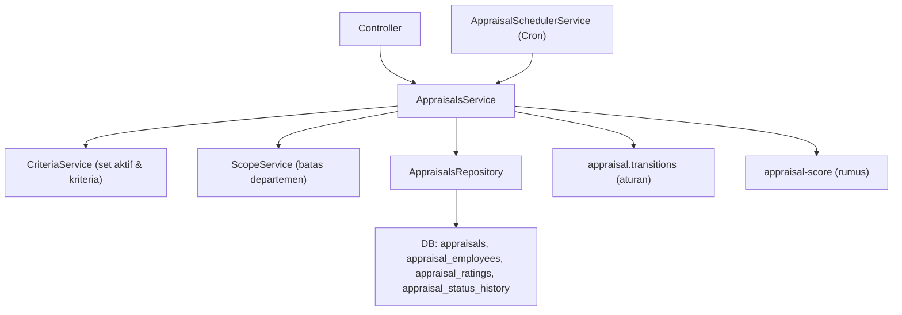

# Module: AppraisalsModule (Penilaian Kinerja — Inti Workflow)

**Dibuat:** 2026-10-11
**File sumber yang dianalisis:**
- `appraisals/appraisals.module.ts`, `appraisals.controller.ts`, `appraisals.service.ts`, `appraisals.repository.ts`
- `appraisals/appraisal.transitions.ts`, `appraisal.transitions.spec.ts`
- `appraisals/appraisal-score.ts`, `appraisal-score.spec.ts`
- `appraisals/appraisal-scheduler.service.ts`, `scheduler.controller.ts`
- `appraisals/dto/*.ts`
- `appraisals/interfaces/appraisal.interface.ts`
- Rujukan tipe: `packages/types/src/appraisals.ts`

## Daftar Isi
1. [Ringkasan Module](#1-ringkasan-module)
2. [Peta File di Module Ini](#2-peta-file-di-module-ini)
3. [Penjelasan Kode per File](#3-penjelasan-kode-per-file)
4. [Alur Kerja Lengkap](#4-alur-kerja-lengkap)
5. [Hubungan dengan Module Lain](#5-hubungan-dengan-module-lain)
6. [Kesalahan Umum & Tips Pemula](#6-kesalahan-umum--tips-pemula)
7. [Catatan Kualitas Kode](#7-catatan-kualitas-kode)
8. [Rangkuman & Cek Pemahaman](#8-rangkuman--cek-pemahaman)

---

## 1. Ringkasan Module

**AppraisalsModule** adalah jantung sistem. Ia mengelola penilaian kinerja per departemen per periode bulanan: memilih karyawan yang berhak dinilai, menyimpan rating tiap kriteria, menghitung skor, dan menjalankan **alur status** `DRAFT → PENDING → SUBMITTED → APPROVED → COMPLETE` (plus **send back** dan **reopen**). Ada juga penjadwal otomatis yang membuat appraisal tiap awal bulan.

Analogi: ini seperti **rapat penilaian tahunan dengan buku besar bertahap**. HR menyiapkan daftar peserta (DRAFT). Kepala Departemen mengisi nilai (PENDING → SUBMITTED). Manajer mengesahkan (APPROVED). General Manager menutup (COMPLETE). Jika ada yang salah, dokumen **dikembalikan** ke tahap sebelumnya dengan catatan; hanya Admin yang bisa membuka kembali yang sudah COMPLETE.

**Istilah baru:**
- **Workflow/transisi** = aturan perpindahan status yang diizinkan beserta siapa yang boleh.
- **Send back** = mengembalikan dokumen ke tahap sebelumnya (wajib catatan).
- **Reopen** = membuka kembali dokumen yang sudah selesai (wajib catatan).
- **Advisory lock** = kunci database agar satu job tak berjalan dua kali bersamaan.

---

## 2. Peta File di Module Ini

| Nama file | Jenis | Peran singkat |
|-----------|-------|---------------|
| `appraisals.module.ts` | Module | Merakit controller, service, repository, scheduler |
| `appraisals.controller.ts` | Controller | Endpoint `/api/appraisals*` |
| `scheduler.controller.ts` | Controller | Endpoint `/api/scheduler/appraisals/run` |
| `appraisals.service.ts` | Service | Aturan bisnis lengkap (preview, create, rating, transisi, scheduler) |
| `appraisals.repository.ts` | Repository | Query Drizzle (termasuk `FOR UPDATE`, advisory lock, upsert) |
| `appraisal.transitions.ts` | Tabel aturan | Daftar transisi status yang diizinkan |
| `appraisal.transitions.spec.ts` | Test | Uji tabel transisi |
| `appraisal-score.ts` | Pure function | Rumus skor |
| `appraisal-score.spec.ts` | Test | Uji rumus skor |
| `appraisal-scheduler.service.ts` | Job (`@Cron`) | Menjalankan penjadwal tiap awal bulan |
| `dto/*.ts` | DTO | Validasi input (preview, create, employees, ratings, transition, query, run) |
| `interfaces/appraisal.interface.ts` | Alias | `AppraisalPayload = AppraisalResponse` |

Diagram alur:



Versi teks:

```
Preview/Create → Service → CriteriaService + Repo(findEligible) → DB
Ratings        → Service (validasi range) → Repo.upsertRatings → recomputeScores(calculateScore)
Transition     → Service → lockAppraisal(FOR UPDATE) → findTransition → preconditions → updateStatus + history + audit
Scheduler      → Cron/API → runScheduler → advisory lock → for each department: create appraisal
```

---

## 3. Penjelasan Kode per File

### `appraisals.module.ts`

```ts
@Module({
  imports: [CriteriaModule],
  controllers: [AppraisalsController, SchedulerController],
  providers: [AppraisalsService, AppraisalsRepository, AppraisalSchedulerService],
  exports: [AppraisalsService],
})
export class AppraisalsModule {}
```

- **Fungsinya:** Mengimpor `CriteriaModule` (untuk mengambil set aktif & kriteria), mendaftarkan dua controller dan scheduler.
- **Kenapa:** Appraisals bergantung pada kriteria (versi). Dua controller karena ada route scheduler terpisah.
- **Dampaknya:** Tanpa `CriteriaModule`, appraisal tak bisa menentukan kriteria.
- **Analogi:** Unit penilaian yang mengambil kurikulum dari unit kriteria.

### `appraisals.controller.ts`

```ts
@ApiTags('appraisals')
@ApiBearerAuth()
@Controller('appraisals')
export class AppraisalsController {
  @Get() findAll(@Query() query: AppraisalQueryDto) { ... }                 // scoped
  @Get(':id') findOne(@Param('id', ParseUUIDPipe) id) { ... }
  @Get(':id/history') history(@Param('id', ParseUUIDPipe) id) { ... }
  @Post('preview') @Roles(HR) @HttpCode(200) preview(@Body() dto) { ... }
  @Post() @Roles(HR) @HttpCode(201) create(@Body() dto) { ... }
  @Put(':id/employees') @Roles(HR) updateEmployees(...) { ... }
  @Put(':id/ratings') @Roles(HEAD_DEPARTMENT) saveRatings(...) { ... }
  @Post(':id/transition') @HttpCode(200) transition(...) { ... }
  @Delete(':id') @Roles(HR) @HttpCode(204) remove(...) { ... }
}
```

- **Fungsinya:**
  - Read endpoints (list, detail, history) → semua user login, dibatasi scope di service.
  - `preview` & `create` → HR.
  - `updateEmployees` → HR (hanya DRAFT, dicek di service).
  - `saveRatings` → `HEAD_DEPARTMENT` (hanya PENDING).
  - `transition` → **tanpa `@Roles`**! Otorisasi dilakukan oleh **tabel transisi** (`findTransition` memeriksa role). Ini keputusan desain: aturan role ada di data transisi, bukan decorator.
  - `remove` → HR (hanya DRAFT).
- **Kenapa dibuat seperti ini:** Menempatkan otorisasi transisi di satu tempat (tabel) agar mudah diaudit & diuji. Endpoint selain transisi memakai `@Roles`.
- **Dampaknya:** Karena `transition` tanpa `@Roles`, keamanan sepenuhnya bergantung pada `findTransition`. Bila ada bug di tabel, transisi ilegal bisa terjadi.
- **Analogi:** Meja pelayanan dengan jalur berbeda: HR menyiapkan, Kepala Dept menilai, dan "petugas alur" mengecek apakah perpindahan tahap memang diizinkan.
- **Istilah baru:** **`@Put`** = method update; **`@Query`** = parameter query.

### `appraisals.service.ts` (inti)

`preview` / `create`:

```ts
const criteriaSet = await this.requireCriteriaSet(dto.criteriaSetId, dto.departmentId);
const start = periodStart(dto.period);
const eligible = await this.repository.findEligible(dto.departmentId, start, periodEnd(dto.period));

// create:
const byId = new Map(eligible.map((row) => [row.id, row]));
const chosen = dto.employeeIds.map((id) => byId.get(id)).filter((row): row is EligibleEmployee => Boolean(row));
if (chosen.length !== dto.employeeIds.length) throw new BusinessLogicException('Some employees are not eligible...', 'APPRAISAL_INELIGIBLE_EMPLOYEE');

const created = await this.dbService.transaction(async (tx) => {
  const appraisal = await this.repository.createAppraisal({ departmentId, period: start, criteriaSetId: criteriaSet.id, source: 'MANUAL', createdBy: userId }, tx);
  if (!appraisal) throw new ConflictException({ message: 'An appraisal already exists for this department and period', errorCode: 'APPRAISAL_ALREADY_EXISTS' });
  await this.repository.insertEmployees(chosen.map((e) => this.toSnapshot(appraisal.id, e)), tx);
  await this.audit.record(tx, { action: 'APPRAISAL_CREATED', entity: 'appraisal', entityId: appraisal.id, after: { departmentId, period: start, employees: chosen.length }, ...this.actor() });
  return appraisal;
});
return this.findOne(created.id);
```

- **Fungsinya:** Preview menampilkan kandidat; create membuat appraisal DRAFT + menyalin **snapshot** karyawan terpilih (nama, nomor, posisi, departemen, kontrak) ke `appraisal_employees`.
- **Kenapa dibuat seperti ini:**
  - Snapshot menjaga data historis tetap utuh walau master data berubah kelak.
  - `createAppraisal` memakai `onConflictDoNothing` → bentrok dengan unique index `(departmentId, period)` menghasilkan `null` → diubah menjadi 409 `APPRAISAL_ALREADY_EXISTS`.
  - Memvalidasi bahwa semua `employeeIds` benar-benar eligible (mencegah menambahkan orang luar scope).
- **Dampaknya:** Bila snapshot tak dibuat (mengandalkan join ke master), riwayat penilaian bisa "berubah" bila data karyawan diedit di masa depan.
- **Analogi:** Menyimpan salinan daftar hadir pada dokumen penilaian, bukan sekadar menunjuk ke daftar kepegawaian yang bisa berubah.
- **Istilah baru:** **Snapshot** = salinan nilai pada satu waktu. **`onConflictDoNothing`** = insert yang mengabaikan bentrok.

`findAll` / `findOne` / `history`:

```ts
async findAll(query) {
  const scope = await this.currentScope();
  const [rows, total] = await this.repository.listAppraisals(query, scope === 'ALL' ? undefined : scope);
  const data = rows.map((row) => this.toResponse(row, [], [], []));
  return paginated(data, { total, page: query.page ?? 1, limit: query.limit ?? 20 });
}
async findOne(id) {
  const appraisal = await this.repository.findAppraisal(id);
  if (!appraisal) throw new NotFoundException(`Appraisal with ID ${id} not found`);
  await this.assertScope(appraisal.departmentId);
  const criteria = await this.criteriaForSet(appraisal.criteriaSetId);
  const employees = await this.repository.findEmployees(id);
  const ratings = await this.repository.ratingsForAppraisal(id);
  const departmentName = await this.repository.departmentName(appraisal.departmentId);
  return ok(this.toResponse(appraisal, employees, ratings, criteria, departmentName));
}
```

- **Fungsinya:** `findAll` mengembalikan **ringkasan** (tanpa daftar karyawan/kriteria) dan dibatasi scope. `findOne` mengembalikan detail lengkap (kriteria + karyawan + rating). `history` mengembalikan riwayat status.
- **Kenapa:** Daftar dibuat ringan; detail baru mengambil data berat. `assertScope` memastikan user hanya melihat departemennya (kecuali role global → 404 bila di luar scope).
- **Dampaknya:** Bila scope dilepas, kepala departemen bisa melihat penilaian departemen lain.
- **Analogi:** Daftar isi ringkas vs. berkas lengkap; hanya yang berwenang boleh membuka berkas departemen tertentu.

`updateEmployees` (hanya DRAFT):

```ts
const appraisal = await this.findDraft(id);
await this.dbService.transaction(async (tx) => {
  if (dto.removeEmployeeIds?.length) await this.repository.removeEmployees(id, dto.removeEmployeeIds, tx);
  if (dto.addEmployeeIds?.length) {
    const eligible = await this.repository.findEligible(appraisal.departmentId, appraisal.period, periodEnd(appraisal.period));
    const byId = new Map(eligible.map((row) => [row.id, row]));
    const chosen = dto.addEmployeeIds.map((id) => byId.get(id)).filter((row): row is EligibleEmployee => Boolean(row));
    await this.repository.insertEmployees(chosen.map((e) => this.toSnapshot(id, e)), tx);
  }
  await this.audit.record(tx, { action: 'APPRAISAL_EMPLOYEES_UPDATED', ..., after: { added, removed }, ...this.actor() });
});
```

- **Fungsinya:** Menambah/menghapus karyawan dari appraisal **hanya saat DRAFT**. `removeEmployees` melakukan **soft delete** (isDeleted), `addEmployeeIds` divalidasi ulang terhadap eligibility.
- **Kenapa:** Daftar peserta dikunci setelah masuk tahap PENDING ke atas.
- **Dampaknya:** Menghapus `findDraft` → peserta bisa diubah di tengah proses.
- **Analogi:** Daftar hadir boleh diubah sebelum rapat dimulai; setelah dimulai, tidak.

`saveRatings` (hanya PENDING):

```ts
if (appraisal.status !== AppraisalStatus.PENDING) throw new BusinessLogicException('Ratings can only be edited while the appraisal is PENDING', 'APPRAISAL_RATINGS_NOT_EDITABLE');
await this.assertScope(appraisal.departmentId);

const criteria = await this.criteriaForSet(appraisal.criteriaSetId);
const criteriaById = new Map(criteria.map((c) => [c.id, c]));
const employees = await this.repository.findEmployees(id);
const employeeIds = new Set(employees.map((e) => e.id));

for (const rating of dto.ratings) {
  const criterion = criteriaById.get(rating.criterionId);
  if (!criterion) throw new BusinessLogicException('Rating references a criterion outside this appraisal', 'APPRAISAL_UNKNOWN_CRITERION');
  if (!employeeIds.has(rating.appraisalEmployeeId) || rating.rating < criterion.scaleMin || rating.rating > criterion.scaleMax)
    throw new BusinessLogicException(`Rating for ${criterion.code} is outside its scale`, 'APPRAISAL_RATING_OUT_OF_RANGE');
}

await this.dbService.transaction(async (tx) => {
  await this.repository.upsertRatings(dto.ratings.map(...), tx);
  for (const comment of dto.comments ?? []) await this.repository.updateEmployeeComment(comment.appraisalEmployeeId, comment.comment, tx);
  await this.recomputeScores(id, criteria, tx);
  await this.audit.record(tx, { action: 'APPRAISAL_RATINGS_SAVED', ..., metadata: { ratings: dto.ratings.length }, ...this.actor() });
});
```

- **Fungsinya:** Menyimpan rating secara massal (upsert) dengan validasi: kriteria harus milik set ini, karyawan harus ada di appraisal ini, dan rating dalam rentang skala. Setelah itu **menghitung ulang skor** tiap karyawan dan menyimpan komentar (bila ada).
- **Kenapa dibuat seperti ini:** Validasi menyeluruh sebelum menulis mencegah data tak konsisten. Upsert memungkinkan edit berulang. `recomputeScores` memusatkan perhitungan berbasis `calculateScore`.
- **Dampaknya:** Bila validasi range dilepas, rating 99 pada skala 1–5 bisa masuk dan skor jadi mustahil.
- **Analogi:** Mengisi lembar nilai dengan rambu: kolom harus sesuai, angka wajib dalam rentang, lalu total dihitung ulang otomatis.
- **Istilah baru:** **Upsert** = insert-or-update.

`transition` (inti workflow):

```ts
const user = this.requestContext.getUser();
const role = user?.roles?.[0] ?? '';

await this.dbService.transaction(async (tx) => {
  const appraisal = await this.repository.lockAppraisal(id, tx);      // SELECT ... FOR UPDATE
  if (!appraisal) throw new NotFoundException(...);

  const rule = findTransition(appraisal.status as AppraisalStatus, dto.to, role);
  if (!rule) throw new BusinessLogicException(`Cannot move from ${appraisal.status} to ${dto.to}`, 'APPRAISAL_INVALID_TRANSITION');

  if (rule.scoped && user) await this.scopeService.assertDepartmentAccess(user, appraisal.departmentId);
  if (rule.comment && !dto.comment?.trim()) throw new BusinessLogicException('A comment is required for this transition', 'APPRAISAL_COMMENT_REQUIRED');

  await this.checkPreconditions(id, appraisal.criteriaSetId, rule.requires ?? [], tx);
  await this.repository.updateStatus(id, dto.to, tx);
  await this.repository.insertHistory({ appraisalId: id, fromStatus: appraisal.status, toStatus: dto.to, action: rule.kind, comment: dto.comment ?? null, actorUserId: user?.userId ?? null }, tx);
  await this.audit.record(tx, { action: 'APPRAISAL_STATUS_CHANGED', ..., before: { status: appraisal.status }, after: { status: dto.to }, ...this.actor() });
});
return this.findOne(id);
```

- **Fungsinya:** Memindahkan status appraisal sesuai **aturan transisi**:
  1. Mengunci baris (`FOR UPDATE`) agar dua transisi bersamaan tidak bentrok.
  2. Mencari aturan `findTransition(from, to, role)`.
  3. Bila `rule.scoped`, mengecek akses departemen.
  4. Bila `rule.comment`, wajib komentar.
  5. Mengecek preconditions (`hasEmployees`, `allRatingsFilled`).
  6. Update status + catat riwayat (`appraisal_status_history`) + audit.
- **Kenapa dibuat seperti ini:** Semua aturan alur terpusat di tabel `TRANSITIONS` (mudah diuji). Mengunci baris menghindari race condition. Mencatat riwayat + audit memenuhi aturan kepatuhan.
- **Dampaknya:** Bila `lockAppraisal` dihapus, dua approver bisa memproses bersamaan dan menghasilkan riwayat ganda. Bila `checkPreconditions` dilepas, appraisal kosong/tanpa rating bisa diajukan.
- **Analogi:** Petugas alur yang mengunci berkas, lalu memeriksa: "apakah perpindahan ini diizinkan, oleh jabatan ini, dengan catatan lengkap, dan syarat terpenuhi?" baru memindahkan status.
- **Istilah baru:** **`FOR UPDATE`** = mengunci baris agar transaksi lain menunggu. **Precondition** = syarat yang harus dipenuhi sebelum aksi.

`checkPreconditions`:

```ts
if (requires.includes('hasEmployees')) { if (employees.length === 0) throw new BusinessLogicException('The appraisal has no employees', 'APPRAISAL_NO_EMPLOYEES'); }
if (requires.includes('allRatingsFilled')) {
  if (ratings.length < employees.length * criteria.length) throw new BusinessLogicException('All ratings must be filled before submitting', 'APPRAISAL_RATINGS_INCOMPLETE');
}
```

- **Fungsinya:** Sebelum DRAFT→PENDING, wajib ada karyawan. Sebelum PENDING→SUBMITTED, semua rating wajib terisi (`jumlahRating ≥ jumlahKaryawan × jumlahKriteria`).
- **Kenapa:** Menjamin kesempurnaan sebelum maju. Menghitung berdasarkan jumlah (bukan per-kriteria) — cukup cepat, tapi mengandalkan keunikan `(appraisalEmployeeId, criterionId)`.
- **Dampaknya:** Bila dilepas, appraisal setengah jadi bisa disubmit.
- **Analogi:** Tidak boleh menyerahkan formulir kalau masih ada kolom kosong.

`recomputeScores`:

```ts
const scoreCriteria = criteria.map((c) => ({ id: c.id, scaleMax: c.scaleMax, weight: c.weight }));
for (const employee of employees) {
  const employeeRatings = ratings.filter((r) => r.appraisalEmployeeId === employee.id).map((r) => ({ criterionId: r.criterionId, rating: r.rating }));
  const score = calculateScore(employeeRatings, scoreCriteria);
  await this.repository.updateEmployeeTotalScore(employee.id, score, executor);
}
```

- **Fungsinya:** Menghitung total skor tiap karyawan dan menyimpannya.
- **Kenapa:** Memakai fungsi murni `calculateScore` agar hasil konsisten dengan pengujian.
- **Dampaknya:** Bila `calculateScore` mengembalikan `null` (rating belum lengkap), `totalScore` di-set `null`.
- **Analogi:** Menghitung nilai akhir setiap peserta setelah lembar nilai terisi.

`runScheduler` (job bulanan):

```ts
const period = periodStart(targetPeriod ?? addMonths(currentPeriod(), 1));
const end = periodEnd(period);

return this.dbService.transaction(async (tx) => {
  const lockResult = await tx.execute(sql`SELECT pg_try_advisory_xact_lock(73001) AS locked`);
  const locked = (lockResult.rows[0] as { locked?: boolean } | undefined)?.locked;
  if (!locked) return { created: 0, skipped: 0, failed: 0, lockSkipped: true };

  const departments = await this.repository.findActiveDepartments(tx);
  for (const department of departments) {
    try {
      const criteriaSet = (await this.criteriaService.findActive(department.id)).data;
      if (!criteriaSet) { skipped += 1; continue; }
      const eligible = await this.repository.findEligible(department.id, period, end);
      if (eligible.length === 0) { skipped += 1; continue; }
      const appraisal = await this.repository.createAppraisal({ departmentId: department.id, period, criteriaSetId: criteriaSet.id, source: 'SCHEDULER', createdBy: null }, tx);
      if (!appraisal) { skipped += 1; continue; }
      await this.repository.insertEmployees(eligible.map((e) => this.toSnapshot(appraisal.id, e)), tx);
      await this.audit.record(tx, { actorType: 'SYSTEM', action: 'APPRAISAL_CREATED', ..., after: { source: 'SCHEDULER', departmentId: department.id, period } });
      created += 1;
    } catch { failed += 1; }
  }
  await this.audit.record(tx, { actorType: 'SYSTEM', action: 'SCHEDULER_RUN', entity: 'scheduler', metadata: { period, created, skipped, failed } });
  return { created, skipped, failed, lockSkipped: false };
});
```

- **Fungsinya:** Membuat appraisal otomatis untuk setiap departemen aktif pada suatu periode (default: bulan berikutnya). Dilindungi **advisory lock** (`pg_try_advisory_xact_lock(73001)`) sehingga aman dijalankan berulang/paralel — **idempotent** (bentrok unik → `skipped`). Semua dalam satu transaksi.
- **Kenapa dibuat seperti ini:** Sesuai AGENTS.md: job terjadwal harus idempotent & dilindungi advisory lock. Kegagalan satu departemen dihitung (`failed`) agar tidak menghentikan yang lain.
- **Dampaknya:** Bila lock dihapus, dua instance server bisa membuat appraisal ganda (meski unique index tetap mencegah duplikat). Departemen tanpa set `ACTIVE` (department maupun global) akan di-skip.
- **Analogi:** Petugas yang memegang kunci gudang (agar tak bentrok dengan petugas lain), lalu menyiapkan formulir penilaian untuk tiap divisi; yang sudah ada dilewati, yang gagal dicatat.

`toSnapshot` / `toResponse` / `actor` / `requireCriteriaSet` / `criteriaForSet` / `findDraft` / `currentScope` / `assertScope` → helper.

### `appraisal.transitions.ts` — Aturan Alur

```ts
export interface TransitionRule { from; to; roles; kind; scoped?; comment?; requires?; }

export const TRANSITIONS: TransitionRule[] = [
  { from: DRAFT,     to: [PENDING],   roles: [HR],              kind: TRANSITION, requires: ['hasEmployees'] },
  { from: PENDING,   to: [SUBMITTED], roles: [HEAD_DEPARTMENT], kind: TRANSITION, scoped: true, requires: ['allRatingsFilled'] },
  { from: SUBMITTED, to: [APPROVED],  roles: [MANAGER],         kind: TRANSITION, scoped: true },
  { from: APPROVED,  to: [COMPLETE],  roles: [GENERAL_MANAGER], kind: TRANSITION },

  { from: PENDING,   to: [DRAFT],                                   roles: [HEAD_DEPARTMENT], kind: SEND_BACK, comment: true, scoped: true },
  { from: SUBMITTED, to: [PENDING, DRAFT],                          roles: [MANAGER],         kind: SEND_BACK, comment: true, scoped: true },
  { from: APPROVED,  to: [SUBMITTED, PENDING, DRAFT],               roles: [GENERAL_MANAGER], kind: SEND_BACK, comment: true },

  { from: COMPLETE,  to: [APPROVED],  roles: [ADMIN], kind: REOPEN, comment: true },
];

export function findTransition(from, to, role) {
  return TRANSITIONS.find((rule) => rule.from === from && rule.to.includes(to) && rule.roles.includes(role as UserRole));
}
```

- **Fungsinya:** Mendefinisikan alur sebagai **data**: status asal → daftar status tujuan yang diizinkan, role yang boleh, jenis aksi (TRANSITION/SEND_BACK/REOPEN), apakah perlu scope, komentar, dan preconditions.
- **Kenapa dibuat seperti ini:** "Transition rules table" sesuai AGENTS.md: satu sumber kebenaran aturan alur, mudah ditambah/diuji. Ini juga menjadi sumber kebenaran otorisasi endpoint `transition`.
- **Dampaknya:** Salah entri di sini bisa membuka jalur ilegal atau memblokir jalur sah. Karena dipakai langsung untuk otorisasi, perubahan harus sangat hati-hati dan diselaraskan dengan PRD 5.5/5.8.
- **Analogi:** Bagan alur rapat yang menempel di dinding: dari tahap A boleh ke mana saja, oleh siapa, dengan syarat apa.

### `appraisal-score.ts` — Rumus Skor

```ts
/** total = Σ (rating / scaleMax × weight), rounded to 2 decimals. Returns null while any criterion is still unrated. */
export function calculateScore(ratings: ScoreRating[], criteria: ScoreCriterion[]): number | null {
  if (criteria.length === 0) return null;
  const byCriterion = new Map(ratings.map((e) => [e.criterionId, e.rating]));
  let total = 0;
  for (const criterion of criteria) {
    const rating = byCriterion.get(criterion.id);
    if (rating === undefined || rating === null || Number.isNaN(rating)) return null;
    total += (rating / criterion.scaleMax) * criterion.weight;
  }
  return Math.round(total * 100) / 100;
}
```

- **Fungsinya:** Menghitung skor total: tiap rating dinormalkan terhadap skala maksimum lalu dikali bobot, dijumlahkan, dibulatkan 2 desimal. Mengembalikan `null` bila ada kriteria belum dinilai.
- **Kenapa dibuat sebagai pure function:** Sama seperti validasi kriteria: mudah diuji & dipakai ulang. Rumus hidup di satu tempat.
- **Dampaknya:** Jika rumus diubah tanpa menyesuaikan PRD/test, hasil penilaian berubah. Jika `scaleMax` = 0, terjadi pembagian nol (dicegah karena `scaleMin < scaleMax` & `scaleMin ≥ 1` di master).
- **Analogi:** Rumus rapor: nilai tiap mapel diskalakan ke persentase, dikali bobot mapel, dijumlahkan.
- **Istilah baru:** **Normalisasi** = menyetarakan nilai ke skala yang sama.

### `appraisal-scheduler.service.ts`

```ts
@Injectable()
export class AppraisalSchedulerService {
  private readonly logger = new Logger(AppraisalSchedulerService.name);
  constructor(private appraisalsService: AppraisalsService, private configService: ConfigService) {}

  // Day 1 of every month at 01:00. Idempotent and protected by an advisory lock.
  @Cron('0 1 1 * *', { name: 'appraisal-day-1' })
  async handleMonthly() {
    if (this.configService.get<string>('SCHEDULER_ENABLED') === 'false') return;
    try { const summary = await this.appraisalsService.runScheduler(); this.logger.log(`Appraisal scheduler run: ${JSON.stringify(summary)}`); }
    catch (error) { this.logger.error('Appraisal scheduler run failed', error as Error); }
  }
}
```

- **Fungsinya:** Menjalankan `runScheduler` otomatis pada tanggal 1 tiap bulan pukul 01:00, hanya bila `SCHEDULER_ENABLED !== 'false'`.
- **Kenapa:** Automasi pembuatan appraisal bulanan tanpa intervensi manual.
- **Dampaknya:** Jika `SCHEDULER_ENABLED` salah, job tidak jalan. Error ditangkap & dicatat (tidak menjatuhkan aplikasi).
- **Analogi:** Weker kantor yang tiap awal bulan mengingatkan petugas untuk menyiapkan formulir.
- **Istilah baru:** **`@Cron`** = decorator penjadwalan (ekspresi cron `menit jam tanggal bulan hari`).

### `scheduler.controller.ts`

```ts
@Controller('scheduler')
export class SchedulerController {
  @Post('appraisals/run')
  @Roles(UserRole.ADMIN)
  @HttpCode(HttpStatus.OK)
  run(@Body() dto: RunSchedulerDto) { return this.appraisalsService.runScheduler(dto.period); }
}
```

- **Fungsinya:** Endpoint manual untuk menjalankan job (khusus ADMIN); `period` opsional.
- **Kenapa:** Memudahkan uji coba/operasional tanpa menunggu jadwal.
- **Dampaknya:** Karena idempotent + advisory lock, menjalankannya berulang aman (yang sudah ada → `skipped`).
- **Analogi:** Tombol "jalankan sekarang" di samping weker otomatis.

### Repository (`appraisals.repository.ts`) — Bagian Penting

`findEligible`:

```ts
.from(employees)
.leftJoin(departments, ...)
.leftJoin(positions, ...)
.innerJoin(contracts, and(eq(contracts.employeeId, employees.id), notDeleted(contracts), gte(contracts.endDate, start), lte(contracts.endDate, end)))
.where(and(
  eq(employees.departmentId, departmentId),
  eq(employees.status, 'ACTIVE'),
  notDeleted(employees),
  sql`NOT EXISTS (SELECT 1 FROM appraisal_employees ae JOIN appraisals a ON a.id = ae.appraisal_id
      WHERE ae.employee_id = ${employees.id} AND a.period = ${start} AND a.status <> 'COMPLETE' AND a.deleted_at IS NULL AND ae.deleted_at IS NULL)`,
))
.orderBy(asc(employees.fullName));
```

- **Fungsinya:** Menentukan karyawan eligible: aktif, di departemen itu, punya **kontrak yang berakhir dalam periode**, dan belum masuk appraisal non-COMPLETE untuk periode yang sama.
- **Kenapa:** Mencegah duplikasi peserta; memakai subquery `NOT EXISTS` lebih efisien daripada join.
- **Dampaknya & catatan penting (lihat bagian 7):** Karena memakai `gte(contracts.endDate, start)` dan `lte(contracts.endDate, end)`, karyawan dengan kontrak **PERMANENT** (`endDate` NULL) **tidak** akan pernah eligible. *Perlu konfirmasi:* apakah ini disengaja (hanya menilai mereka yang kontraknya berakhir di periode tertentu) atau bug.
- **Analogi:** Menyaring "siapa yang masa kontraknya habis bulan ini dan belum masuk daftar penilaian".

`lockAppraisal`:

```ts
const result = await executor.execute(sql`SELECT * FROM appraisals WHERE id = ${id} AND deleted_at IS NULL FOR UPDATE`);
```

- **Fungsinya:** Mengunci baris appraisal selama transisi (mencegah race condition).
- **Analogi:** Mengambil berkas dari lemari dan menguncinya selama diproses.

`createAppraisal` → `insert(...).onConflictDoNothing().returning()` (null = sudah ada).
`upsertRatings` → loop `insert(...).onConflictDoUpdate(...)` per baris (target `(appraisalEmployeeId, criterionId)`), sekaligus "menghidupkan kembali" baris yang ter-soft-delete (`isDeleted: false, deletedAt: null`).
`removeEmployees` → soft delete `appraisal_employees` berdasarkan `employeeId`.
`insertHistory` / `history` → tabel `appraisal_status_history` (append-only).
`softDelete` appraisal → mencatat `deletedBy`.

### DTO

| File | Isi penting |
|------|-------------|
| `preview-appraisal.dto.ts` | `departmentId` (UUID), `period` (date) |
| `create-appraisal.dto.ts` | + `employeeIds` (array non-kosong, UUID) |
| `update-appraisal-employees.dto.ts` | `addEmployeeIds?`, `removeEmployeeIds?` |
| `save-ratings.dto.ts` | `ratings[]` (nested: appraisalEmployeeId, criterionId, rating ≥ 0) + `comments?[]` |
| `appraisal-transition.dto.ts` | `to` (`@IsEnum(AppraisalStatus)`), `comment?` |
| `appraisal-query.dto.ts` | extends `QueryDto` + `status?`, `department?`, `periodFrom?`, `periodTo?` |
| `run-scheduler.dto.ts` | `period?` (date) |

- **Fungsinya:** Validasi input; `save-ratings` memakai validasi bersarang (`@ValidateNested` + `@Type`).
- **Dampaknya:** `AppraisalRatingDto.rating` hanya `@Min(0)` di DTO; **rentang skala sebenarnya divalidasi di service** (karena butuh data kriteria).
- **Analogi:** Formulir-formulir rapat penilaian dengan kolom wajib.

---

## 4. Alur Kerja Lengkap

Skenario: **Siklus penilaian bulanan penuh.**

1. **Scheduler/HR** membuat appraisal: entah otomatis (tanggal 1, `source: SCHEDULER`) atau manual via `POST /appraisals/preview` lalu `POST /appraisals` (`source: MANUAL`). Status **DRAFT**, peserta dari `findEligible`.
2. HR boleh menyesuaikan peserta (`PUT /:id/employees`) selama DRAFT, lalu `POST /:id/transition { to: PENDING }` (rule: HR, butuh `hasEmployees`, audit + history).
3. **Head Department** departemen terkait mengisi nilai: `PUT /:id/ratings` (hanya saat PENDING; validasi range; skor dihitung). Lalu `POST /:id/transition { to: SUBMITTED }` (rule: HEAD_DEPARTMENT, scoped, butuh `allRatingsFilled`).
4. **Manager** menyetujui: `POST /:id/transition { to: APPROVED }` (rule: MANAGER, scoped). Jika perlu, bisa **send back** ke PENDING/DRAFT dengan komentar.
5. **General Manager** menyelesaikan: `POST /:id/transition { to: COMPLETE }` (rule: GENERAL_MANAGER). Bisa juga send back dengan komentar.
6. **Admin** dapat **reopen**: `POST /:id/transition { to: APPROVED }` (rule: ADMIN, REOPEN, wajib komentar).
7. Setiap transisi: baris dikunci (`FOR UPDATE`), akses departemen dicek bila `scoped`, preconditions dicek, status & riwayat & audit ditulis dalam satu transaksi.

---

## 5. Hubungan dengan Module Lain

**Bergantung pada:**
- `CriteriaModule` → `CriteriaService` (`findActive`, `findOne`) untuk set & kriteria.
- `DbModule`, `AuditModule`, `common` (`ScopeService`, `period.util`, `BusinessLogicException`, context, decorators).

**Dipakai oleh:** `DashboardModule` (ringkasan penilaian). `AppraisalsService` diekspos.

**Dampak jika diubah/dihapus:**
- Menghapus module → fitur inti penilaian hilang.
- Mengubah `TRANSITIONS` → mengubah aturan alur & otorisasi (wajib selaras PRD 5.5/5.8 dan test).
- Mengubah `calculateScore` → mengubah hasil penilaian (harus selaras aplikasi lain & PRD).
- Mengubah `findEligible` → mengubah siapa yang dinilai.

---

## 6. Kesalahan Umum & Tips Pemula

1. **Memindahkan status lewat `PUT`/update biasa.** Jangan; satu-satunya jalan adalah `transition` dengan aturan tabel.
2. **Mencoba mengisi rating saat status bukan PENDING.** Ditolak `APPRAISAL_RATINGS_NOT_EDITABLE`.
3. **Submit tanpa mengisi semua rating.** Ditolak `APPRAISAL_RATINGS_INCOMPLETE`.
4. **Send back/reopen tanpa komentar.** Ditolak `APPRAISAL_COMMENT_REQUIRED`.
5. **Mengedit peserta setelah PENDING.** Ditolak `APPRAISAL_NOT_DRAFT`.
6. **Menjalankan scheduler tanpa set kriteria aktif.** Ditolak `APPRAISAL_NO_ACTIVE_CRITERIA_SET`.

**Pesan error yang mungkin muncul:**
- `422 APPRAISAL_INVALID_TRANSITION` / `APPRAISAL_COMMENT_REQUIRED` / `APPRAISAL_NO_EMPLOYEES` / `APPRAISAL_RATINGS_INCOMPLETE` / `APPRAISAL_NOT_DRAFT` / `APPRAISAL_RATINGS_NOT_EDITABLE` / `APPRAISAL_UNKNOWN_CRITERION` / `APPRAISAL_RATING_OUT_OF_RANGE` / `APPRAISAL_INELIGIBLE_EMPLOYEE` / `APPRAISAL_NO_ACTIVE_CRITERIA_SET`.
- `409 APPRAISAL_ALREADY_EXISTS` → sudah ada appraisal departemen+periode itu.
- `404 Appraisal with ID ... not found` → tidak ada **atau** di luar scope.
- `409 UNIQUE_VIOLATION` → bentrok periode/snapshot.

---

## 7. Catatan Kualitas Kode

- **`findEligible` mengecualikan kontrak PERMANENT.** Filter `endDate >= start AND endDate <= end` menghilangkan karyawan tanpa akhir kontrak (`endDate` NULL). Jika karyawan tetap (permanent) seharusnya juga dinilai, ini **bug logika kelayakan**. *Perlu konfirmasi* dengan PRD: apa definisi "eligible"?
- **Kemungkinan konflik `uq_appraisal_employee` saat re-add.** `removeEmployees` melakukan soft delete, tetapi unique index `(appraisalId, employeeId)` **tidak** parsial (tanpa `where deleted_at is null`). Menambah kembali karyawan yang baru dihapus akan gagal `unique violation` (bukan menghidupkan kembali baris). Saran: ubah `insertEmployees` menjadi upsert yang "menghidupkan" baris terhapus, atau jadikan index parsial.
- **`upsertRatings` melakukan loop insert satu-per-satu.** Bisa lambat untuk data besar. Saran: batch `insert ... values([...]).onConflictDoUpdate(...)` sekali jalan.
- **`allRatingsFilled` memakai perbandingan jumlah.** `ratings.length < employees.length * criteria.length` mengandalkan keunikan `(appraisalEmployeeId, criterionId)` dan tidak memperhitungkan rating "asing". Cukup aman, tapi lebih eksplisit bila divalidasi per karyawan/kriteria.
- **`transition` tanpa `@Roles`.** Otorisasi murni dari tabel transisi. Ini disengaja, tetapi berarti setiap role yang belum diatur di tabel otomatis tak bisa bertransisi (aman "fail closed"). Pastikan tabel lengkap.
- **`runScheduler` default periode = bulan berikutnya** (`addMonths(currentPeriod(), 1)`), dijalankan tanggal 1. *Perlu konfirmasi:* apakah maksudnya menilai bulan yang baru berjalan atau bulan lalu — per definisi ini membuat appraisal untuk bulan depan.
- **`toResponse` memakai cast `any`/`unknown`** untuk `criteriaSetVersion`. Daftar (`findAll`) menerima `criteriaSetVersion` dari join; `findOne` memakai `(appraisal as unknown as ...).criteriaSetVersion ?? 0` yang **selalu 0** karena `findAppraisal` tidak menyertakan versi. *Perlu konfirmasi:* apakah `criteriaSetVersion` pada detail memang harus 0, atau perlu query join.
- **Tidak ada masalah keamanan kritis** pada alur: lock, scope, validasi, riwayat, dan audit sudah diterapkan.

---

## 8. Rangkuman & Cek Pemahaman

**Poin kunci:**
1. AppraisalsModule = inti workflow penilaian; status DRAFT→PENDING→SUBMITTED→APPROVED→COMPLETE, plus send back & reopen.
2. Aturan alur tersimpan sebagai data (`TRANSITIONS`); otorisasi transisi berasal dari tabel ini.
3. Transisi selalu mengunci baris (`FOR UPDATE`), mengecek scope/komentar/precondition, lalu mencatat riwayat + audit.
4. Rating hanya bisa diisi saat PENDING; skor dihitung `calculateScore` (`Σ rating/scaleMax × weight`).
5. Scheduler bulanan idempotent, dilindungi advisory lock, membuat appraisal per departemen aktif.

**Pertanyaan latihan:**

1. *Di mana aturan "siapa boleh memindahkan status ke mana" didefinisikan, dan mengapa penting?*
   → Di `appraisal.transitions.ts` (`TRANSITIONS`) — sebagai data. Penting karena menjadi satu sumber kebenaran aturan alur sekaligus otorisasi endpoint `transition`, mudah diuji dan diselaraskan dengan PRD.

2. *Kenapa transisi memakai `lockAppraisal` (`FOR UPDATE`)?*
   → Mencegah dua permintaan memproses appraisal yang sama secara bersamaan (race condition) yang bisa menghasilkan transisi/riwayat ganda.

3. *Kapan `totalScore` seorang karyawan bernilai `null`?*
   → Ketika masih ada kriteria yang belum diberi rating; `calculateScore` mengembalikan `null` sampai semua kriteria terisi.
