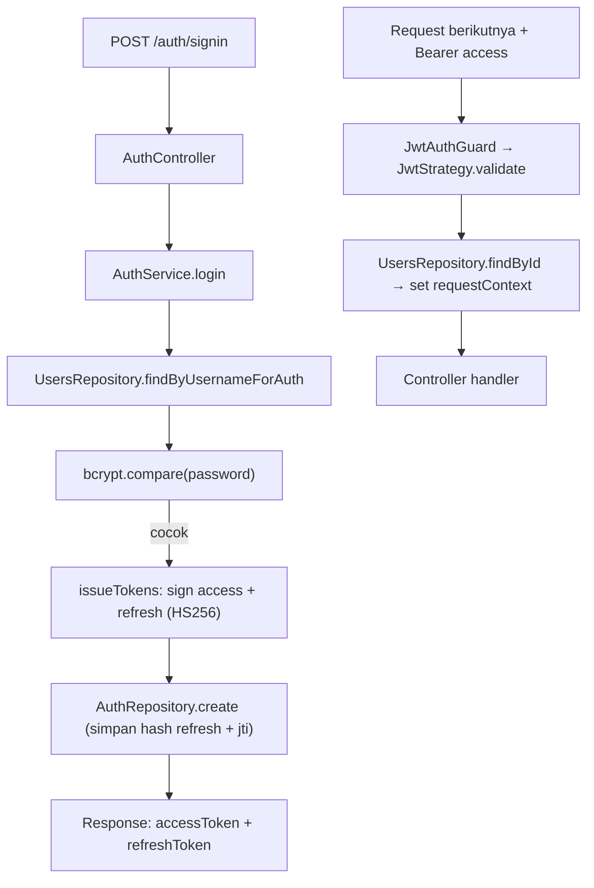
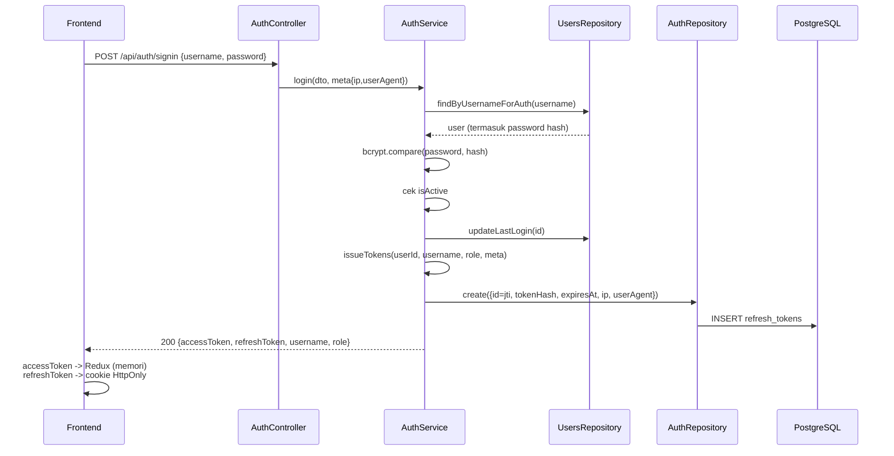
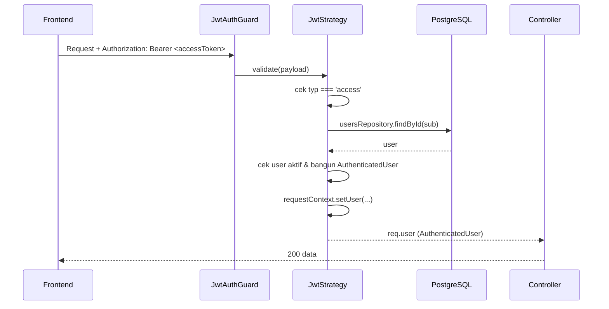

# Module: AuthModule (Autentikasi / Login)

**Dibuat:** 2026-10-11
**File sumber yang dianalisis:**
- `auth/auth.module.ts`, `auth/auth.controller.ts`, `auth/auth.service.ts`, `auth/auth.repository.ts`, `auth/jwt.strategy.ts`
- `auth/dto/signin.dto.ts`, `refresh-token.dto.ts`
- Rujukan: `common/guards/jwt-auth.guard.ts`, `common/decorators/public.decorator.ts`, `users/users.repository.ts`

## Daftar Isi
1. [Ringkasan Module](#1-ringkasan-module)
2. [Peta File di Module Ini](#2-peta-file-di-module-ini)
3. [Penjelasan Kode per File](#3-penjelasan-kode-per-file)
4. [Alur Kerja Lengkap](#4-alur-kerja-lengkap)
5. [Hubungan dengan Module Lain](#5-hubungan-dengan-module-lain)
6. [Kesalahan Umum & Tips Pemula](#6-kesalahan-umum--tips-pemula)
7. [Catatan Kualitas Kode](#7-catatan-kualitas-kode)
8. [Rangkuman & Cek Pemahaman](#8-rangkuman--cek-pemahaman)
9. [Lampiran: Anatomi Token & Diagram Sekuens](#9-lampiran-anatomi-token--diagram-sekuens)

---

## 1. Ringkasan Module

**AuthModule** menangani proses masuk (login), perpanjangan sesi (refresh token), dan keluar (logout). Ia menerbitkan dua token: **access token** (umur pendek, untuk tiap request) dan **refresh token** (umur panjang, disimpan di database untuk bisa dicabut).

Analogi: ini seperti **satpam gedung dan sistem kartu akses**. Login = menunjukkan identitas dan menerima kartu. Access token = **kartu tamu harian** (cepat kedaluwarsa). Refresh token = **kartu keanggotaan** yang bisa ditukar dengan kartu harian baru saat yang lama habis. Logout = mengembalikan kartu sehingga tidak bisa dipakai lagi.

**Istilah baru:**
- **JWT (JSON Web Token)** = token yang isinya (siapa, kapan kedaluwarsa) ditandatangani secara digital sehingga bisa dipercaya tanpa cek database tiap saat.
- **HS256** = algoritma tanda tangan JWT simetris (satu kunci untuk menandatangani dan memverifikasi).
- **Token rotation** = setiap refresh mengeluarkan refresh token baru dan mencabut yang lama. **Tidak dipakai di sistem ini:** refresh hanya menerbitkan access token baru, sehingga beberapa tab tidak saling membatalkan.

---

## 2. Peta File di Module Ini

| Nama file | Jenis | Peran singkat |
|-----------|-------|---------------|
| `auth.module.ts` | Module | Merakit controller, service, repository, strategy |
| `auth.controller.ts` | Controller | Endpoint `/api/auth/*` |
| `auth.service.ts` | Service | Logika token, verifikasi password, penerbitan & pencabutan token |
| `auth.repository.ts` | Repository | Query tabel `refresh_tokens` |
| `jwt.strategy.ts` | Strategy (Passport) | Memverifikasi access token & menempelkan user ke request |
| `dto/signin.dto.ts` | DTO | Body login |
| `dto/refresh-token.dto.ts` | DTO | Body berisi refresh token |

Diagram alur:



Versi teks:

```
Login:  Controller → Service → UsersRepo (cek password) → issueTokens → AuthRepo (simpan refresh) → token
Akses:  Bearer token → JwtStrategy.validate → RequestContext → Controller
Refresh: cookie → verify → cek DB (hash, revoked, expiry) → access token baru
```

---

## 3. Penjelasan Kode per File

### `auth.module.ts`

```ts
@Module({
  imports: [
    UsersModule,
    PassportModule.register({ defaultStrategy: 'jwt' }),
    JwtModule.register({}), // tanpa default secret: tiap token pakai secret & expiry sendiri
  ],
  providers: [AuthService, AuthRepository, JwtStrategy],
  controllers: [AuthController],
  exports: [JwtStrategy, PassportModule],
})
export class AuthModule {}
```

- **Fungsinya:** Mengimpor `UsersModule` (butuh repository user), mengaktifkan Passport dengan strategi default `jwt`, dan `JwtModule` tanpa kunci default (`{}`).
- **Kenapa dibuat seperti ini:** Karena access & refresh memakai **secret berbeda**, bukan satu default. Setiap panggilan `signAsync`/`verify` menyebut secret sendiri. Ini sesuai AGENTS.md ("separate secrets").
- **Dampaknya:** Jika `JwtModule.register` diberi secret default, risiko tertukarnya secret access/refresh.
- **Analogi:** Menerima dua jenis kartu dengan kunci berbeda; mesin penerbit kartu tidak dipatok ke satu kunci.
- **Istilah baru:** **Passport** = middleware autentikasi; **Strategy** = cara verifikasi tertentu (di sini JWT).

### `jwt.strategy.ts`

**Peran file:** Memverifikasi access token di setiap request dan mengisi data user.

```ts
@Injectable()
export class JwtStrategy extends PassportStrategy(Strategy) {
  constructor(configService, private usersRepository, private requestContext) {
    super({
      jwtFromRequest: ExtractJwt.fromAuthHeaderAsBearerToken(),
      ignoreExpiration: false,
      secretOrKey: configService.get<string>('JWT_SECRET')!,
      algorithms: ['HS256'],
    });
  }

  async validate(payload: AccessTokenPayload): Promise<AuthenticatedUser> {
    if (payload.typ !== 'access') throw new UnauthorizedException('Invalid token type. Please login again.');
    const user = await this.usersRepository.findById(payload.sub);
    if (!user || !user.isActive) throw new UnauthorizedException('Invalid token. Please login again.');
    const authenticated = { userId: user.id, username: user.username,
                           employeeId: user.employee?.id ?? null, roles: user.role ? [user.role] : [] };
    this.requestContext.setUser(authenticated);
    return authenticated;
  }
}
```

- **Fungsinya:**
  - `super({...})` mengatur cara mengambil token (header `Authorization: Bearer`), memverifikasi dengan `JWT_SECRET` dan algoritma HS256, serta menolak token kedaluwarsa.
  - `validate` dipanggil setelah token valid: cek `typ === 'access'` (supaya refresh token tidak bisa dipakai sebagai access), cek user masih ada & aktif, lalu bangun `AuthenticatedUser` dan simpan ke konteks request.
- **Kenapa dibuat seperti ini:** Best practice: token saja tak cukup; status user diambil ulang dari DB agar penonaktifan langsung berlaku. `typ` membedakan access vs refresh. Menyimpan user ke `RequestContextService` membuat audit mudah.
- **Dampaknya:** Jika `typ` tak dicek, refresh token bisa dipakai untuk mengakses API (celah). Jika `isActive` tak dicek, user nonaktif tetap bisa masuk.
- **Analogi:** Satpam yang memeriksa kartu harian di pintu, lalu memastikan orangnya masih terdaftar pegawai aktif, sebelum mempersilakan masuk.
- **Istilah baru:** **`ExtractJwt.fromAuthHeaderAsBearerToken()`** = cara mengambil token dari header Authorization. **`validate`** = hook Passport untuk memutuskan user sah/tidak.

### `auth.controller.ts`

```ts
@ApiTags('auth')
@UseGuards(ThrottlerGuard)
@Controller('auth')
export class AuthController {
  constructor(private readonly authService: AuthService) {}

  @Post('signin') @Public() @Throttle({ default: { limit: 5, ttl: 60_000 } })
  @HttpCode(HttpStatus.OK) signIn(@Body() dto: SignInDto, @Req() req) { return this.authService.login(dto, this.meta(req)); }

  @Post('refresh') @Public() @Throttle({ default: { limit: 10, ttl: 60_000 } })
  @HttpCode(HttpStatus.OK) refresh(@Body() dto, @Req() req) { return this.authService.refresh(dto.refreshToken, this.meta(req)); }

  @Post('logout') @Public() @HttpCode(HttpStatus.OK) logout(@Body() dto) { return this.authService.logout(dto.refreshToken); }

  @Get('me') @ApiBearerAuth() me(@Req() req) { return { message: 'Profile retrieved successfully', data: req.user }; }

  private meta(req: Request): RequestMeta { return { ip: req.ip, userAgent: req.headers['user-agent'] }; }
}
```

- **Fungsinya:**
  - `@UseGuards(ThrottlerGuard)` → membatasi jumlah request (anti brute force).
  - `signin`/`refresh`/`logout` → `@Public()` (tak perlu token) karena justru untuk mendapatkan/mengakhiri token.
  - `@Throttle({ default: { limit: 5, ttl: 60_000 } })` di `signin` → maksimal 5 percobaan/menit (melindungi dari menebak password).
  - `@Throttle({...limit:10...})` di `refresh`.
  - `me` → **tidak** `@Public()`, jadi wajib access token; mengembalikan `req.user`.
  - `meta(req)` → mengambil IP & User-Agent untuk disimpan pada refresh token.
- **Kenapa dibuat seperti ini:** Best practice keamanan: endpoint auth diberi rate limit lebih ketat. `me` memakai guard global (JwtAuthGuard) karena butuh login.
- **Dampaknya:** Jika `@Throttle` dihapus, penyerang bisa brute force login. Jika `@Public()` dihapus dari login, mustahil masuk.
- **Analogi:** Loket kartu akses dengan pembatas antrean (biar tidak ada yang mencoba berkali-kali menerka).
- **Istilah baru:** **`@Throttle`** = decorator pembatas laju. **`@Req()`** = mengambil objek request mentah.

> Perhatikan: `me` mengembalikan `{ message, data }` secara manual. Karena `ResponseInterceptor` global juga membungkus, bentuk akhirnya jadi `{ status, message, data, meta }` — di sini `data` = `req.user`. Konsisten.

### `auth.service.ts`

**Peran file:** Logika inti autentikasi.

`login`:

```ts
const user = await this.usersRepository.findByUsernameForAuth(signIn.username);
if (!user || !(await bcrypt.compare(signIn.password, user.password))) {
  throw new UnauthorizedException({ message: 'Please check your login credentials', errorCode: 'AUTH_INVALID_CREDENTIALS' });
}
if (!user.isActive) throw new UnauthorizedException({ message: 'This account is inactive', errorCode: 'AUTH_USER_INACTIVE' });
await this.usersRepository.updateLastLogin(user.id);
const tokens = await this.issueTokens(user.id, user.username, user.role, meta);
return { message: 'Login successful', data: { username: user.username, role: user.role || null, ...tokens } };
```

- **Fungsinya:** Verifikasi kredensial, tolak akun nonaktif, catat waktu login, terbitkan token.
- **Kenapa dibuat seperti ini:** Pesan error disamakan untuk username salah dan password salah (`AUTH_INVALID_CREDENTIALS`) agar penyerang tidak bisa menebak username mana yang ada (best practice keamanan).
- **Dampaknya:** Jika pengecekan `isActive` dihapus, akun yang dinonaktifkan tetap bisa login.
- **Analogi:** Petugas yang menolak masuk kalau identitas/password tak cocok, atau keanggotaan sudah dicabut.

`refresh` (tanpa rotasi):

```ts
const payload = await this.verifyRefreshToken(refreshToken); // tanda tangan + typ + jti
const stored = await this.authRepository.findById(payload.jti);
if (!stored || stored.revokedAt) throw this.invalidRefreshToken(); // dicabut = ditolak selamanya
if (stored.expiresAt.getTime() < Date.now() || stored.tokenHash !== this.hash(refreshToken)) {
  throw this.invalidRefreshToken();
}
const user = await this.usersRepository.findById(stored.userId);
const accessToken = await this.signAccessToken(stored.userId, user?.username ?? payload.username, user?.role ?? null);
return { message: 'Token refreshed', data: { accessToken } };
```

- **Fungsinya:** Memvalidasi refresh token di 3 lapis: tanda tangan JWT, keberadaan di DB, lalu hash & kedaluwarsa. Bila lolos, terbitkan **hanya access token baru**.
- **Kenapa dibuat seperti ini:** Refresh token **tidak dirotasi**. Token yang sama tetap berlaku sampai kedaluwarsa atau dicabut, sehingga beberapa tab yang me-refresh bersamaan sama-sama berhasil — tidak ada reuse detection yang bisa salah menuduh.
- **Dampaknya:** Menghapus cek `revokedAt` membuat token yang sudah logout tetap bisa dipakai. Tidak memeriksa `tokenHash` membuat token curian yang diubah bisa lolos. Karena tidak ada rotasi, pencurian token tidak terdeteksi otomatis; mitigasinya umur pendek (1 hari) dan cookie HttpOnly.
- **Analogi:** Kartu keanggotaan yang tetap sama sampai masa berlakunya habis; kartu yang sudah dikembalikan saat keluar tetap ditolak.
- **Istilah baru:** **jti** = id unik token (disimpan agar bisa dicabut). **tokenHash** = hash SHA-256 dari token, bukan token aslinya (aman walau DB bocor).

`logout`:

```ts
try {
  const payload = await this.jwtService.verifyAsync<{ jti?: string }>(refreshToken, { secret: this.refreshSecret, algorithms: ['HS256'] });
  if (payload.jti) await this.authRepository.revoke(payload.jti);
} catch { /* token tidak valid/kedaluwarsa = sudah logout */ }
return { message: 'Logout successful', data: null };
```

- **Fungsinya:** Mencabut refresh token. Bila token tak valid, tetap dianggap sukses (idempotent).
- **Kenapa:** Logout sebaiknya selalu "berhasil" dari sudut pengguna; token yang tak valid memang tak bisa dipakai.
- **Analogi:** Mengembalikan kartu akses; walau kartunya sudah rusak, pengguna tetap dianggap sudah keluar.

`issueTokens` (inti):

```ts
const accessToken = await this.jwtService.signAsync(
  { sub: userId, username, role, typ: 'access' },
  { secret: this.accessSecret, expiresIn: this.accessExpiresIn, algorithm: 'HS256' });

const jti = randomUUID();
const refreshToken = await this.jwtService.signAsync(
  { sub: userId, username, jti, typ: 'refresh' },
  { secret: this.refreshSecret, expiresIn: this.refreshExpiresIn, algorithm: 'HS256' });

const decoded = this.jwtService.decode(refreshToken) as { exp: number };
await this.authRepository.create({ id: jti, userId, tokenHash: this.hash(refreshToken),
  expiresAt: new Date(decoded.exp * 1000), ip: meta.ip ?? null, userAgent: meta.userAgent ?? null });
```

- **Fungsinya:** Membuat access token (`typ: 'access'`) dan refresh token (`typ: 'refresh'`, dengan `jti`), lalu menyimpan hash refresh + masa berlaku + IP/UA ke DB.
- **Kenapa dibuat seperti ini:** `typ` membedakan jenis token; `jti` memungkinkan pencabutan per sesi; menyimpan IP/UA membantu audit. Hanya dipanggil saat login — refresh tidak menerbitkan token baru.
- **Dampaknya:** Jika `expiresIn` salah, token bisa terlalu panjang umurnya (bahaya) atau terlalu pendek (user sering diminta login).
- **Analogi:** Menerbitkan kartu harian & kartu keanggotaan baru, lalu mencatat kartu keanggotaan di buku besar.

Getter konfigurasi:

```ts
private get accessSecret(): string { return this.configService.get<string>('JWT_SECRET')!; }
private get refreshSecret(): string {
  return this.configService.get<string>('JWT_REFRESH_SECRET') ?? this.accessSecret;
}
```

- **Fungsinya:** Mengambil secret & masa berlaku dari config. `refreshSecret` **fallback** ke access secret bila `JWT_REFRESH_SECRET` kosong.
- **Kenapa:** Env refresh secret bersifat opsional (lihat module `config`). Fallback menjaga aplikasi tetap jalan di dev.
- **Dampaknya:** Di produksi, jika `JWT_REFRESH_SECRET` tidak diisi, access & refresh memakai kunci sama → melemahkan pemisahan. Sebaiknya selalu diisi di produksi.
- **Analogi:** Kunci cadangan yang dipakai bila kunci khusus belum dipasang — praktis, tapi sebaiknya kunci khusus selalu dipasang.

### `auth.repository.ts`

```ts
async create(values: RefreshTokenInsert) { await this.db.insert(refreshTokens).values(values); }
async findById(id: string) { const [row] = await this.db.select().from(refreshTokens).where(eq(refreshTokens.id, id)).limit(1); return row ?? null; }
async revoke(id: string) {
  await this.db.update(refreshTokens).set({ revokedAt: new Date() }).where(eq(refreshTokens.id, id));
}
```

- **Fungsinya:** Menyimpan token baru, mencarinya, dan mencabut satu token.
- **Kenapa:** Memisahkan akses DB dari logika (pola repository). Pencabutan per token cukup karena refresh token tidak dirotasi.
- **Dampaknya:** Bila `revoke` tidak dipanggil saat logout, sesi di browser itu tetap hidup sampai token kedaluwarsa.
- **Analogi:** Buku besar kartu keanggotaan: mencatat kartu baru, mencari kartu, dan menandai kartu tertentu "dicabut".
- **Istilah baru:** **`eq(...)`** = kondisi SQL `=`. Kolom `replaced_by` tidak lagi diisi karena tidak ada rotasi.

### DTO

| File | Isi |
|------|-----|
| `signin.dto.ts` | `username` (wajib), `password` (wajib, min 6) |
| `refresh-token.dto.ts` | `refreshToken` (wajib) |

- **Fungsinya:** Validasi bentuk body. `implements SignInRequest` mengikat DTO ke tipe bersama.

---

## 4. Alur Kerja Lengkap

Skenario: **User login, memakai API, lalu refresh saat token habis.**

1. Frontend `POST /api/auth/signin` dengan `{ username, password }`.
2. `ThrottlerGuard` membatasi 5 percobaan/menit; `@Public()` melewati JwtAuthGuard.
3. `AuthService.login` mengambil user + password hash, `bcrypt.compare`.
4. Jika cocok & aktif → `issueTokens`: buat access token (5m) & refresh token (1d, dengan `jti`), simpan hash refresh ke DB.
5. Response: `{ accessToken, refreshToken, role, username }`.
6. Frontend menyimpan access token di memori; refresh token dikirim backend sebagai cookie HttpOnly.
7. Request berikutnya menyertakan `Authorization: Bearer <accessToken>`.
8. `JwtAuthGuard` → `JwtStrategy.validate` memverifikasi token, cek `typ === 'access'`, ambil user dari DB, isi `RequestContext` → handler jalan.
9. Saat access token kedaluwarsa (401), frontend `POST /api/auth/refresh` dengan refresh token.
10. `AuthService.refresh`: verifikasi tanda tangan → cek DB (ada, tidak dicabut, hash cocok, belum kedaluwarsa) → terbitkan **access token baru**; refresh token tidak dirotasi.
11. Login di device lain tidak mematikan sesi lain; token dicabut hanya lewat logout (atau tindakan admin, bila diimplementasikan).
12. `POST /api/auth/logout` mencabut refresh token.

---

## 5. Hubungan dengan Module Lain

**Bergantung pada:**
- `UsersModule` → `UsersRepository` (`findByUsernameForAuth`, `createAndSave`, `findById`, `updateLastLogin`).
- `DbModule` (global) → `DB_CONNECTION`.
- `ConfigService` → secret & expiry.
- `common` → `@Public`, `JwtAuthGuard` (global), `RequestContextService`.

**Dipakai oleh:**
- Seluruh aplikasi: `JwtAuthGuard` (didaftarkan di AppModule) memakai strategi `jwt` dari module ini.
- `AppModule` mengimpor `AuthModule`.

**Yang diekspos (exports):** `JwtStrategy`, `PassportModule`.

**Dampak jika diubah/dihapus:**
- Menghapus `AuthModule` (atau strategi) → `JwtAuthGuard` global tak menemukan strategi `jwt`; semua endpoint terproteksi jadi 401 → aplikasi lumpuh.
- Mengubah klaim token (`sub`, `typ`) tanpa menyesuaikan `JwtStrategy` → validasi gagal.
- Mengubah aturan refresh (mis. menambah rotasi) → perilaku sesi dan keamanan berubah; frontend dan test harus ikut disesuaikan.

---

## 6. Kesalahan Umum & Tips Pemula

1. **Memakai refresh token sebagai access token.** Dicegah `typ` di `JwtStrategy`; jangan melepas pengecekan itu.
2. **Menyimpan refresh token asli di DB.** Yang disimpan adalah `tokenHash`; jangan simpan token polos.
3. **Lupa `@Public()` di endpoint login.** Hasilnya 401 di endpoint yang seharusnya publik.
4. **Mengubah masa berlaku/secret tanpa memperbarui env.** Token lama jadi tak valid / user diminta login lagi.
5. **Menganggap login satu tempat = logout otomatis di tempat lain.** Tidak; login baru hanya menambah baris `refresh_tokens`, sesi lain tetap berlaku sampai logout atau kedaluwarsa.

**Pesan error yang mungkin muncul:**
- `401 AUTH_INVALID_CREDENTIALS` → username/password salah.
- `401 AUTH_USER_INACTIVE` → akun dinonaktifkan.
- `401 AUTH_INVALID_REFRESH_TOKEN` → refresh token tak valid/kedaluwarsa/dicabut/hash tak cocok.
- `409 AUTH_USERNAME_ALREADY_EXISTS` → username dipakai.
- `429 Too Many Requests` → kena throttle (mis. >5 login/menit).

---

## 7. Catatan Kualitas Kode

- **`refreshSecret` fallback ke `accessSecret`.** Berfungsi, tapi di produksi keduanya harus berbeda (AGENTS.md: "separate secrets"). Saran: di produksi, wajibkan `JWT_REFRESH_SECRET` (validasi env), atau tolak start bila kosong.
- **Tidak ada audit log untuk login/logout.** Modul ini tidak memanggil `AuditService`. AGENTS.md menekankan audit untuk perubahan, tetapi peristiwa login biasanya juga penting diaudit. *Perlu konfirmasi* apakah direncanakan.
- **`me` mengembalikan `req.user` langsung.** Karena `req.user` berasal dari `JwtStrategy.validate` (bukan data sensitif), ini aman.
- **Password `bcrypt` cost 10** konsisten dengan UsersService. Baik.

---

## 8. Rangkuman & Cek Pemahaman

**Poin kunci:**
1. Dua token: access (pendek, `typ: 'access'`) & refresh (panjang, `typ: 'refresh'`, punya `jti`), dengan secret berbeda.
2. Refresh token disimpan sebagai **hash** di `refresh_tokens`; bisa dicabut per sesi dan tidak dirotasi.
3. Token yang sudah dicabut (logout) ditolak dengan `AUTH_INVALID_REFRESH_TOKEN`; sesi lain tidak terpengaruh.
4. `JwtStrategy.validate` memeriksa tipe token, keberadaan & status aktif user, lalu mengisi `RequestContext`.
5. Endpoint auth diberi rate limit lebih ketat (`@Throttle`).

**Pertanyaan latihan:**

1. *Kenapa access token dan refresh token memakai secret berbeda?*
   → Agar keduanya tidak bisa saling dipertukarkan; kompromi satu jenis token tidak otomatis mengancam jenis lainnya.

2. *Apa gunanya `jti` pada refresh token?*
   → Id unik token yang disimpan di DB, sehingga token bisa dicari dan dicabut per sesi.

3. *Apa yang terjadi bila refresh token yang sudah dicabut dipakai lagi?*
   → Server menolak dengan `AUTH_INVALID_REFRESH_TOKEN`; sesi lain tidak terpengaruh.

---

## 9. Lampiran: Anatomi Token & Diagram Sekuens

Bagian ini memperdalam: **bagaimana token dibuat, atribut apa saja yang terlibat, dan bagaimana keduanya mengalir** dari login sampai refresh. Setiap klaim (claim) JWT dijelaskan satu per satu.

### 9.1 Peta Besar: Token, Penyimpanan, dan Umur

| Aspek | Access token | Refresh token |
|-------|--------------|---------------|
| Kegunaan | Mengakses API tiap request | Menukar access token baru saat kedaluwarsa |
| Umur (default) | `JWT_ACCESS_EXPIRES_IN` = **5 menit** | `JWT_REFRESH_EXPIRES_IN` = **1 hari** |
| Secret | `JWT_SECRET` | `JWT_REFRESH_SECRET` (fallback ke `JWT_SECRET`) |
| Algoritma | HS256 | HS256 |
| Penanda jenis | klaim `typ: 'access'` | klaim `typ: 'refresh'` |
| Disimpan di DB? | **Tidak** (stateless) | **Ya** — hash-nya di tabel `refresh_tokens` |
| Bisa dicabut? | Tidak (cukup kedaluwarsa) | Ya (`revokedAt`) |
| Di frontend | **Redux (memori)** saja | Cookie `appraisal_refresh_token` (HttpOnly, diurus browser) |
| Ada `jti`? | Tidak | Ya (UUID, jadi id baris di DB) |

### 9.2 Cara Access Token Dibuat (`issueTokens`)

```ts
const accessToken = await this.jwtService.signAsync(
  { sub: userId, username, role, typ: 'access' },
  { secret: this.accessSecret, expiresIn: this.accessExpiresIn, algorithm: 'HS256' },
);
```

**Proses di balik layar (langkah demi langkah):**
1. Menyusun **payload** (klaim): `sub`, `username`, `role`, `typ`.
2. `JwtService` (jsonwebtoken) menambahkan klaim standar `iat` (issued at) dan `exp` (expiry) dari `expiresIn`.
3. Payload + header (`{ alg: "HS256", typ: "JWT" }`) di-encode Base64URL.
4. Hasilnya ditandatangani dengan `JWT_SECRET` → membentuk token `header.payload.signature`.
5. Token dikembalikan ke klien **tanpa** disimpan di server (stateless).

**Atribut/klaim access token:**

| Klaim | Sumber | Arti | Dipakai di mana |
|-------|--------|------|-----------------|
| `sub` | `userId` | Subject = id user | `JwtStrategy.validate` → `usersRepository.findById(payload.sub)` |
| `username` | `username` | Nama login | Konteks/audit |
| `role` | `role` user | Peran (mis. HR) | Dasar otorisasi awal |
| `typ` | literal `'access'` | Jenis token | Dicek di `validate` (tolak bila bukan `'access'`) |
| `iat` | otomatis | Waktu diterbitkan | — |
| `exp` | otomatis (dari `expiresIn`) | Waktu kedaluwarsa | Diverifikasi `ignoreExpiration: false` |

> Penting: `typ` di atas adalah **klaim kustom di dalam payload**, berbeda dari `typ: "JWT"` di **header** JWT (yang standar). Yang dicek aplikasi adalah klaim payload.

### 9.3 Cara Refresh Token Dibuat (`issueTokens`)

```ts
const jti = randomUUID();
const refreshToken = await this.jwtService.signAsync(
  { sub: userId, username, jti, typ: 'refresh' },
  { secret: this.refreshSecret, expiresIn: this.refreshExpiresIn, algorithm: 'HS256' },
);
const decoded = this.jwtService.decode(refreshToken) as { exp: number };
await this.authRepository.create({
  id: jti,                                  // = jti (PK)
  userId,
  tokenHash: this.hash(refreshToken),       // SHA-256 hex
  expiresAt: new Date(decoded.exp * 1000),  // dari klaim exp token
  ip: meta.ip ?? null,
  userAgent: meta.userAgent ?? null,
});
```

**Proses:**
1. Membuat `jti` (UUID) sebagai **id unik** token.
2. Menyusun payload: `sub`, `username`, `jti`, `typ: 'refresh'` (+ `iat`/`exp` otomatis).
3. Menandatangani dengan `JWT_REFRESH_SECRET`.
4. Meng-`decode` (bukan `verify`) untuk membaca `exp`, lalu menyimpan **hash SHA-256** token ke DB — token asli **tidak** disimpan.

**Atribut/klaim refresh token:**

| Klaim | Sumber | Arti |
|-------|--------|------|
| `sub` | `userId` | Pemilik token |
| `username` | `username` | Nama login |
| `jti` | `randomUUID()` | Id unik; **sama dengan** kolom `id` di `refresh_tokens` |
| `typ` | literal `'refresh'` | Dicek di `verifyRefreshToken` (tolak bila bukan `'refresh'`) |
| `iat` | otomatis | Waktu diterbitkan |
| `exp` | otomatis (dari `expiresIn`) | Kedaluwarsa; disalin ke kolom `expiresAt` |

**Kolom tabel `refresh_tokens` (atribut yang tersimpan di server):**

| Kolom | Isi | Kenapa |
|-------|-----|--------|
| `id` | = `jti` | Kunci utama; memungkinkan pencarian & pencabutan per token |
| `user_id` | id user | Mengelompokkan sesi per user |
| `token_hash` | SHA-256 hex dari token | Verifikasi keaslian **tanpa** menyimpan token asli (aman bila DB bocor) |
| `expires_at` | dari klaim `exp` | Cek kedaluwarsa di sisi server |
| `revoked_at` | timestamp / NULL | Penanda token sudah dicabut (logout) |
| `replaced_by` | kosong | Tidak lagi diisi: rotasi dihapus |
| `created_at` | otomatis | Waktu dibuat |
| `ip` | IP saat login | Audit |
| `user_agent` | UA saat login | Audit |

### 9.4 Atribut Konfigurasi (Environment) yang Terlibat

| Env | Dipakai untuk | Default |
|-----|---------------|---------|
| `JWT_SECRET` | Menandatangani & memverifikasi **access** token | — (wajib) |
| `JWT_ACCESS_EXPIRES_IN` | Umur access token | `5m` |
| `JWT_REFRESH_SECRET` | Menandatangani & memverifikasi **refresh** token | fallback ke `JWT_SECRET` |
| `JWT_REFRESH_EXPIRES_IN` | Umur refresh token | `1d` |

### 9.5 Diagram Sekuens

**A. Login (menerbitkan pasangan token)**



**B. Akses API (memakai access token)**



**C. Refresh (tanpa rotasi)**

```mermaid
sequenceDiagram
    participant FE as Frontend
    participant AC as AuthController
    participant AS as AuthService
    participant AR as AuthRepository
    participant DB as PostgreSQL

    FE->>AC: POST /api/auth/refresh (cookie HttpOnly)
    AC->>AS: refresh(token)
    AS->>AS: verifyRefreshToken (HS256, cek typ==='refresh' & ada jti)
    AS->>AR: findById(jti)
    AR->>DB: SELECT refresh_tokens
    DB-->>AS: stored (revokedAt?, tokenHash, expiresAt, userId)
    alt baris tidak ada atau revokedAt != NULL
        AS-->>FE: 401 AUTH_INVALID_REFRESH_TOKEN
    else token valid
        AS->>AS: cek expiresAt & tokenHash cocok
        AS->>AS: signAccessToken(...)
        AS-->>FE: 200 {accessToken baru}; cookie tidak berubah
    end
```

### 9.6 Ringkasan Alur di Frontend

- **Access token**: disimpan **hanya di memori** (Redux `authSlice.accessToken`) → tidak bisa dicuri lewat XSS persistent karena hilang saat tab ditutup.
- **Refresh token**: disimpan di cookie **HttpOnly** `appraisal_refresh_token` (path `/api/auth`) → JavaScript tidak bisa membaca/menulisnya; browser mengirimnya otomatis.
- **Menempelkan token**: `prepareHeaders` di `apiSlice` menambahkan `Authorization: Bearer <accessToken>` pada setiap request.
- **Auto-refresh**: saat respons `401`, `baseQueryWithReauth` memanggil `/auth/refresh`. Refresh bersifat **single-flight** — beberapa 401 bersamaan berbagi satu permintaan refresh (`refreshPromise`). Bila sukses, request awal diulang; bila gagal, `deleteAuth()` (user diminta login lagi).

### 9.7 Kenapa "stateless access + stateful refresh"?

- Access token **stateless** → verifikasi cepat, tanpa query DB tiap request (hanya `findById` untuk cek user masih aktif).
- Refresh token **stateful** → memberi kemampuan **mencabut sesi** (logout) yang tidak bisa dilakukan token stateless.
- Kombinasi ini adalah pola umum: kartu harian cepat (access) + buku keanggotaan yang bisa diblokir (refresh).
