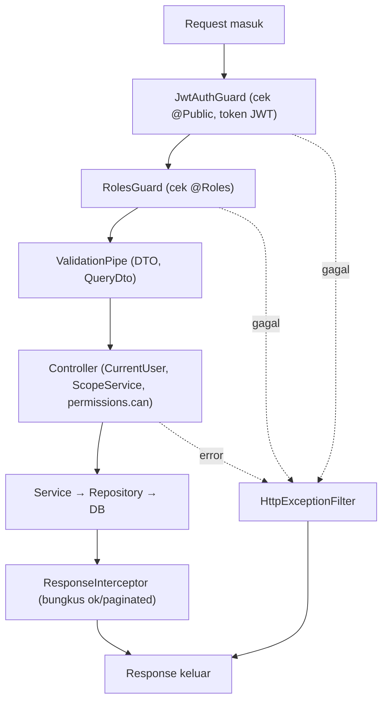

# Module: Common (Shared / Utilitas Bersama)

**Dibuat:** 2026-10-11
**File sumber yang dianalisis:**
- `common/context/context.module.ts`, `common/context/request-context.service.ts`
- `common/scope/scope.module.ts`, `common/scope/scope.service.ts`
- `common/guards/jwt-auth.guard.ts`, `common/guards/roles.guard.ts`
- `common/decorators/current-user.decorator.ts`, `public.decorator.ts`, `response.decorator.ts`, `roles.decorator.ts`
- `common/exceptions/custom.exceptions.ts`
- `common/filters/http-exception.filter.ts`
- `common/interceptors/response.interceptor.ts`
- `common/permissions/permissions.ts`, `common/permissions/permissions.spec.ts`
- `common/query/query.dto.ts`
- `common/utils/period.util.ts`, `response.util.ts`, `string.util.ts`
- Rujukan tipe: `packages/types/src/common.ts`, `enums.ts`, `auth.ts`

## Daftar Isi
1. [Ringkasan Module](#1-ringkasan-module)
2. [Peta File di Module Ini](#2-peta-file-di-module-ini)
3. [Penjelasan Kode per File](#3-penjelasan-kode-per-file)
4. [Alur Kerja Lengkap](#4-alur-kerja-lengkap)
5. [Hubungan dengan Module Lain](#5-hubungan-dengan-module-lain)
6. [Kesalahan Umum & Tips Pemula](#6-kesalahan-umum--tips-pemula)
7. [Catatan Kualitas Kode](#7-catatan-kualitas-kode)
8. [Rangkuman & Cek Pemahaman](#8-rangkuman--cek-pemahaman)

---

## 1. Ringkasan Module

**Common** bukan satu module fitur, melainkan kumpulan "perlengkapan bersama" yang dipakai hampir semua module lain: penjaga pintu (guard), penyeragam bentuk jawaban (interceptor), penangkap error (filter), dekorator, matriks izin, DTO umum, dan fungsi bantu.

Analogi: Common adalah **meja resepsionis pusat dan gudang perlengkapan kantor**. Di gedung mana pun, ada satu meja resepsionis yang dipakai semua divisi (guard), satu formulir baku untuk semua surat keluar (interceptor), satu prosedur penanganan keluhan (filter), dan satu lemari alat tulis bersama (utils). Tak ada satupun "divisi proyek", tapi tanpa ini setiap divisi harus membuat perlengkapannya sendiri.

Dua di antaranya adalah module NestJS asli (`ContextModule` dan `ScopeModule`, keduanya `@Global()`), sedangkan sisanya file-file bebas yang di-import langsung.

**Istilah baru:**
- **Shared/global module** = module yang menyediakan barang ke seluruh aplikasi tanpa perlu diimpor berulang.
- **Decorator** = anotasi `@...` yang menempelkan metadata/perilaku; NestJS membacanya saat runtime.

---

## 2. Peta File di Module Ini

| Nama file | Jenis | Peran singkat |
|-----------|-------|---------------|
| `context/context.module.ts` | Module (`@Global`) | Menyediakan `RequestContextService` secara global |
| `context/request-context.service.ts` | Service | Membaca/menulis data per-request (user, IP, request id) |
| `scope/scope.module.ts` | Module (`@Global`) | Menyediakan `ScopeService` secara global |
| `scope/scope.service.ts` | Service | Membatasi akses berdasarkan departemen |
| `guards/jwt-auth.guard.ts` | Guard | Wajib token JWT, kecuali `@Public()` |
| `guards/roles.guard.ts` | Guard | Cek role wajib dari `@Roles()` |
| `decorators/public.decorator.ts` | Decorator | Menandai route publik |
| `decorators/roles.decorator.ts` | Decorator | Menempelkan daftar role wajib |
| `decorators/current-user.decorator.ts` | Decorator param | Mengambil user yang login di controller |
| `decorators/response.decorator.ts` | Decorator | Menentukan pesan & status sukses |
| `exceptions/custom.exceptions.ts` | Exception classes | Jenis error kustom (database, validasi, bisnis) |
| `filters/http-exception.filter.ts` | Exception filter | Menyeragamkan semua bentuk error |
| `interceptors/response.interceptor.ts` | Interceptor | Menyeragamkan bentuk response sukses |
| `permissions/permissions.ts` | Data + helper | Matriks izin (PRD 5.8) sebagai data |
| `permissions/permissions.spec.ts` | Test | Menguji matriks izin |
| `query/query.dto.ts` | DTO | Parameter query paginasi standar |
| `utils/period.util.ts` | Util | Bantu hitung periode bulan |
| `utils/response.util.ts` | Util | Helper bentuk response (`ok`, `paginated`) |
| `utils/string.util.ts` | Util | Helper string (`capitalizeString`) |

Diagram alur request melewati perlengkapan common:



Versi teks:

```
Request → JwtAuthGuard → RolesGuard → ValidationPipe → Controller → Service → DB
        → ResponseInterceptor → Response
   (error di mana pun) → HttpExceptionFilter → Response error baku
```

---

## 3. Penjelasan Kode per File

### `context/context.module.ts`

**Peran file:** Membungkus `RequestContextService` menjadi module global.

```ts
@Global()
@Module({
  providers: [RequestContextService],
  exports: [RequestContextService],
})
export class ContextModule {}
```

- **Fungsinya:** `@Global()` membuat provider di dalamnya tersedia di seluruh aplikasi tanpa impor ulang. `exports` memastikan ia bisa disuntikkan ke module lain.
- **Kenapa dibuat seperti ini:** Karena hampir semua service butuh tahu "siapa yang sedang request", mendaftarkannya sekali sebagai global lebih praktis daripada mengimpor di puluhan tempat.
- **Dampaknya:** Menghapus `exports` membuat `RequestContextService` tidak bisa disuntikkan, walau global — error "can't resolve dependencies".
- **Analogi:** Menaruh satu meja resepsionis di lobi; semua divisi bisa memakainya tanpa membangun meja sendiri.
- **Istilah baru:** `@Global()` = penanda agar module berlaku di seluruh aplikasi.

### `context/request-context.service.ts`

**Peran file:** Jembatan ke penyimpanan data per-request (AsyncLocalStorage dari `nestjs-cls`).

```ts
const USER_KEY = 'user';
const IP_KEY = 'ip';

@Injectable()
export class RequestContextService {
  constructor(private readonly cls: ClsService) {}

  setUser(user: AuthenticatedUser): void { this.cls.set(USER_KEY, user); }
  getUser(): AuthenticatedUser | undefined { return this.cls.get(USER_KEY); }
  getIp(): string | undefined { return this.cls.get(IP_KEY); }
  getRequestId(): string | undefined { return this.cls.getId() || undefined; }
}
```

- **Fungsinya:** Menyimpan dan mengambil user yang login, IP, serta request id — semuanya spesifik untuk request yang sedang berjalan.
- **Kenapa dibuat seperti ini:** Tanpa ini, tiap service harus menerima user/IP sebagai parameter dari controller (merepotkan saat dipakai di banyak lapisan). `ClsService` menyimpannya otomatis mengikuti request. Ini pola yang rapi untuk audit logging.
- **Dampaknya:** Kalau `setUser` tidak pernah dipanggil (mis. guard tidak mengisinya), `getUser()` mengembalikan `undefined` dan fitur audit bisa kehilangan pelaku.
- **Analogi:** Gelang identitas tamu. Sekali dipasang di pintu, petugas mana pun bisa tahu siapa tamu itu tanpa bertanya lagi.
- **Istilah baru:** **AsyncLocalStorage/CLS** = penyimpanan yang otomatis mengikuti satu request, aman walau banyak request berjalan bersamaan. **`AuthenticatedUser`** = bentuk data user yang login (`userId`, `username`, `employeeId`, `roles`).

### `scope/scope.module.ts`

**Peran file:** Sama polanya dengan ContextModule, tapi untuk `ScopeService`.

```ts
@Global()
@Module({ providers: [ScopeService], exports: [ScopeService] })
export class ScopeModule {}
```

- **Fungsinya/Kenapa:** Lihat penjelasan ContextModule. Alasan sama: dipakai luas, jadi dijadikan global.
- **Dampaknya:** Jika dihapus dari `AppModule.imports`, semua pengecekan departemen gagal (dependency tak tersedia).
- **Analogi:** Meja khusus yang menyimpan daftar departemen yang boleh diakses tiap pegawai.

### `scope/scope.service.ts`

**Peran file:** Menentukan dan menegakkan batas akses per-departemen.

```ts
export type DepartmentScope = 'ALL' | string[];

@Injectable()
export class ScopeService {
  constructor(@Inject(DB_CONNECTION) private readonly db: Database) {}

  async getDepartmentScope(user: AuthenticatedUser): Promise<DepartmentScope> {
    const role = user.roles[0];
    if (role && GLOBAL_SCOPE_ROLES.includes(role as never)) return 'ALL';
    const rows = await this.db
      .select({ departmentId: userDepartments.departmentId })
      .from(userDepartments)
      .where(eq(userDepartments.userId, user.userId));
    return rows.map((row) => row.departmentId);
  }

  async canAccessDepartment(user, departmentId): Promise<boolean> {
    const scope = await this.getDepartmentScope(user);
    return scope === 'ALL' || scope.includes(departmentId);
  }

  async assertDepartmentAccess(user, departmentId): Promise<void> {
    if (!(await this.canAccessDepartment(user, departmentId))) {
      throw new NotFoundException();
    }
  }
}
```

- **Fungsinya:**
  - `getDepartmentScope` → mengembalikan `'ALL'` untuk role global (ADMIN, HR, GENERAL_MANAGER), atau daftar id departemen yang dimiliki user lain (dibaca dari tabel `user_departments`).
  - `canAccessDepartment` → cek apakah sebuah departemen boleh diakses.
  - `assertDepartmentAccess` → melempar `NotFoundException` (404) jika tidak boleh.
- **Kenapa dibuat seperti ini:** Memusatkan aturan scope di satu tempat (aman & konsisten). Sengaja melempar **404 bukan 403** agar keberadaan record di luar wewenang tidak "bocor" (best practice keamanan, sesuai AGENTS.md).
- **Dampaknya:** Jika logika ini salah, HEAD_DEPARTMENT bisa melihat departemen lain, atau sebaliknya tidak bisa melihat miliknya sendiri.
- **Analogi:** Kunci pintu per-ruangan. Pegawai umum cuma bisa masuk ruangannya; manajer gedung punya master key (`'ALL'`).
- **Istilah baru:** **`@Inject(DB_CONNECTION)`** = cara menyuntikkan koneksi database memakai token kustom (didefinisikan di DbModule). **repository vs service**: service memutuskan aturan, repository yang menembak ke DB — di sini ScopeService menyentuh DB langsung lewat Drizzle (catatan: sedikit menyimpang dari pola "hanya repository yang import tabel", lihat bagian 7).

### `guards/jwt-auth.guard.ts`

**Peran file:** Gerbang utamanya keamanan: memastikan request punya token JWT valid.

```ts
@Injectable()
export class JwtAuthGuard extends AuthGuard('jwt') {
  constructor(private readonly reflector: Reflector) { super(); }

  canActivate(context: ExecutionContext) {
    const isPublic = this.reflector.getAllAndOverride<boolean>(IS_PUBLIC_KEY, [
      context.getHandler(),
      context.getClass(),
    ]);
    if (isPublic) return true;
    return super.canActivate(context);
  }
}
```

- **Fungsinya:** Mewarisi `AuthGuard('jwt')` (yang mengecek token lewat strategi bernama `'jwt'`). Sebelum itu, ia cek metadata `@Public()`; kalau ada, langsung izinkan.
- **Kenapa dibuat seperti ini:** Best practice NestJS untuk "guard yang bisa dilewati route tertentu". `getAllAndOverride` mengecek method dulu, baru class (jadi `@Public()` di method menimpa class).
- **Dampaknya:** Kalau `super.canActivate` tidak dipanggil, semua route jadi publik (bahaya). Kalau `reflector` salah kunci, `@Public()` tak berfungsi.
- **Analogi:** Satpam gedung yang mengecek kartu akses, kecuali ruang resepsionis yang memang boleh dimasuki siapa saja.
- **Istilah baru:** **Guard** = penjaga; memutuskan boleh/tidak sebelum handler jalan. **AuthGuard('jwt')** = guard bawaan `@nestjs/passport` yang memicu strategi JWT. **`@Public()`** = penanda route publik.

### `guards/roles.guard.ts`

**Peran file:** Memeriksa apakah role user mengizinkan route yang diminta.

```ts
@Injectable()
export class RolesGuard implements CanActivate {
  constructor(private reflector: Reflector) {}

  canActivate(context: ExecutionContext): boolean {
    const requiredRoles = this.reflector.getAllAndOverride<string[]>('roles', [
      context.getHandler(),
      context.getClass(),
    ]);
    if (!requiredRoles) return true;
    const { user } = context.switchToHttp().getRequest();
    return requiredRoles.some((role) => user.roles?.includes(role));
  }
}
```

- **Fungsinya:** Membaca metadata `@Roles(...)`; kalau ada, pastikan user punya minimal satu role di antaranya. Kalau tidak ada `@Roles`, izinkan.
- **Kenapa dibuat seperti ini:** Memisahkan "siapa yang boleh" dari logika controller. `getAllAndOverride` memberi fleksibilitas: `@Roles` di method mengalahkan yang di class.
- **Dampaknya:** Menghapus guard ini membuat route bertanda `@Roles()` jadi bebas diakses semua user yang login.
- **Analogi:** Satpam ruangan khusus yang mencocokkan jabatan di tanda pengenal dengan daftar tamu yang diizinkan masuk.
- **Istilah baru:** **CanActivate** = antarmuka guard yang mengembalikan `true`/`false`. **`switchToHttp().getRequest()`** = mengambil objek request untuk membaca `user`.

> Catatan: `RolesGuard` dan `permissions.ts` punya dua cara berbeda untuk mengecek izin (role langsung vs matrix `can()`). Lihat bagian 7.

### `decorators/public.decorator.ts`

```ts
export const IS_PUBLIC_KEY = 'isPublic';
export const Public = () => SetMetadata(IS_PUBLIC_KEY, true);
```

- **Fungsinya:** Menempelkan metadata `isPublic = true` pada route/class, dibaca oleh `JwtAuthGuard`.
- **Kenapa dibuat seperti ini:** Aliases kecil yang membuat kode controller enak dibaca (`@Public()` ketimbang `SetMetadata('isPublic', true)`).
- **Dampaknya:** Menghapusnya menghilangkan kemampuan melewatkan login pada route (mis. login/register jadi ikut butuh token).
- **Analogi:** Stiker "Ruangan ini boleh dimasuki siapa saja" di pintu.

### `decorators/roles.decorator.ts`

```ts
export const Roles = (...roles: string[]) => SetMetadata('roles', roles);
```

- **Fungsinya:** Menyimpan daftar role wajib di metadata `'roles'`, dibaca `RolesGuard`.
- **Kenapa:** Sama seperti `@Public()`: alias praktis. `...roles` = rest parameter (menerima jumlah argumen bebas).
- **Dampaknya:** Menghapusnya membuat `@Roles()` tak bisa dipakai; `RolesGuard` tak menemukan metadata dan mengizinkan semua.
- **Analogi:** Daftar tamu yang diizinkan masuk ruangan.

### `decorators/current-user.decorator.ts`

```ts
export const CurrentUser = createParamDecorator(
  (_data: unknown, ctx: ExecutionContext): AuthenticatedUser => {
    const request = ctx.switchToHttp().getRequest();
    return request.user;
  },
);
```

- **Fungsinya:** Menyuntikkan objek user yang Login ke parameter method controller: `@CurrentUser() user: AuthenticatedUser`.
- **Kenapa dibuat seperti ini:** Best practice NestJS untuk menghindari `req.user` mentah di tiap controller dan membuat signature method jelas.
- **Dampaknya:** Kalau `request.user` tidak diisi (mis. guard dilewati), nilainya `undefined` → error saat dipakai.
- **Analogi:** Resepsionis menyerahkan kartu identitas tamu langsung ke tangan petugas, tanpa petugas menggeledah dompet tamu sendiri.

### `decorators/response.decorator.ts`

```ts
export const MESSAGE_KEY = 'response_message';
export const ResponseMessage = (message: string) => SetMetadata(MESSAGE_KEY, message);
export function ApiSuccess(message: string, status = HttpStatus.OK) {
  return applyDecorators(HttpCode(status), SetMetadata(MESSAGE_KEY, message));
}
```

- **Fungsinya:** Menentukan pesan sukses (`message`) dan status HTTP untuk response, dibaca oleh `ResponseInterceptor`.
- **Kenapa dibuat seperti ini:** Memisahkan "pesan bisnis" dari kode supaya response konsisten. `applyDecorators` menggabungkan beberapa decorator jadi satu.
- **Dampaknya:** Tanpa dekorator ini, semua response memakai pesan default `'Action completed succesfully'` dan status default.
- **Analogi:** Template surat kantor: "Yang terhormat ..., operasi X berhasil dengan status 200".

### `exceptions/custom.exceptions.ts`

```ts
export class DatabaseException extends HttpException { ... }
export class ValidationException extends HttpException { ... }
export class BusinessLogicException extends HttpException { ... }
```

- **Fungsinya:** Tiga jenis error kustom dengan bentuk konsisten:
  - `DatabaseException` → pesan + errorCode, default 500.
  - `ValidationException` → 400 dengan daftar `errors`.
  - `BusinessLogicException` → 422 untuk pelanggaran aturan bisnis.
- **Kenapa dibuat seperti ini:** Agar service bisa melempar error bermakna yang nanti diseragamkan `HttpExceptionFilter`. Semua extends `HttpException` agar tertangkap filter.
- **Dampaknya:** Kalau dilempar tapi tak ada filter yang menangkap, bentuknya bisa default NestJS. `errorCode`-nya dipakai filter untuk mengisi `code`.
- **Analogi:** Tiga warna amplop keluhan: merah (kesalahan sistem/database), kuning (isian salah), oranye (aturan dilanggar).
- **Istilah baru:** **HttpException** = error bawaan NestJS yang membawa status HTTP.

### `filters/http-exception.filter.ts`

**Peran file:** Penangkap semua error aplikasi agar bentuknya seragam.

```ts
@Catch()
export class HttpExceptionFilter implements ExceptionFilter {
  private readonly logger = new Logger(HttpExceptionFilter.name);

  catch(exception: unknown, host: ArgumentsHost) {
    const ctx = host.switchToHttp();
    const response = ctx.getResponse<Response>();
    const { status, code, message, details } = this.resolve(exception);
    response.status(status).json({ statusCode: status, code, message, details });
  }
}
```

- **Fungsinya:** `@Catch()` tanpa argumen = menangkap segalanya. `resolve()` mengubah exception apa pun menjadi `{ status, code, message, details }`.
- **Kenapa dibuat seperti ini:** Agar frontend selalu menerima bentuk error sama (sesuai AGENTS.md). Menangani juga error Drizzle/PostgreSQL (menerjemahkan kode error database ke pesan manusiawi).
- **Dampaknya:** Menghapus filter ini membuat format error tak konsisten dan frontend bisa salah menampilkan.
- **Analogi:** Customer service yang menormalkan semua keluhan ke format tiket standar, apa pun sumber keluhannya.
- **Istilah baru:** **Exception Filter** = penangkap error terpusat. **`@Catch()`** = menentukan jenis exception yang ditangkap (kosong = semua).

Bagian penting `resolve` — menerjemahkan error database:

```ts
case '23505': // unique_violation
  return { status: 409, code: 'UNIQUE_VIOLATION',
           message: this.extractDatabaseErrorMessage(dbError.detail) ?? 'Duplicate entry found', ... };
case '23503': // foreign_key_violation
  return { status: 400, code: 'FOREIGN_KEY_VIOLATION', ... };
case '23502': // not_null_violation
  return { status: 400, code: 'NOT_NULL_VIOLATION', message: `Missing required field: ${dbError.column}`, ... };
case '23P01': // exclusion_violation
  return { status: 422, code: 'CONTRACT_OVERLAP', ... };
```

- **Fungsinya:** Mengubah kode error PostgreSQL menjadi HTTP status + kode + pesan yang ramah.
  - `23505` = duplikat data (mis. username sama) → 409 Conflict.
  - `23503` = referensi ke record yang tak ada → 400.
  - `23502` = field wajib kosong → 400.
  - `23P01` = kontrak aktif tumpang-tindih (exclusion constraint) → 422.
- **Kenapa dibuat seperti ini:** Developer/frontend tidak perlu tahu kode mentah PostgreSQL; mereka cukup membaca `code`. `extractDatabaseErrorMessage` mengubah detail teknis jadi `"kolom 'nilai' already exists"`.
- **Dampaknya:** Menghapus salah satu case membuat error itu jatuh ke default `DATABASE_ERROR` 500 — membingungkan pengguna.
- **Analogi:** Penerjemah yang mengubah pesan error mesin berbahasa asing menjadi kalimat yang dapat dimengerti pelanggan.

### `interceptors/response.interceptor.ts`

**Peran file:** Membungkus semua response sukses ke bentuk seragam.

```ts
@Injectable()
export class ResponseInterceptor<T> implements NestInterceptor<T, CustomResponse<T>> {
  constructor(private reflector: Reflector) {}

  intercept(context, next) {
    const response = context.switchToHttp().getResponse();
    const statusCode = this.reflector.get<number>(HTTP_CODE_METADATA, context.getHandler())
      ?? response.statusCode ?? HttpStatus.OK;
    const message = this.reflector.get<string>(MESSAGE_KEY, context.getHandler())
      || 'Action completed succesfully';

    return next.handle().pipe(
      map((data) => ({
        status: statusCode,
        message,
        data: data?.data !== undefined ? data.data : null,
        meta: data?.meta !== undefined ? data.meta : null,
      })),
    );
  }
}
```

- **Fungsinya:** Mengambil status dari `@HttpCode()` dan pesan dari `@ResponseMessage()`/`@ApiSuccess()`, lalu membungkus hasil handler menjadi `{ status, message, data, meta }`. Handler cukup mengembalikan `ok(...)`/`paginated(...)` dari `response.util`.
- **Kenapa dibuat seperti ini:** Konsistensi response (best practice). `pipe(map(...))` adalah cara RxJS "mengubah" nilai yang mengalir dari handler.
- **Dampaknya:** Kalau handler mengembalikan bentuk yang bukan `{ data, meta }`, `data` bisa `null`. Menghapus interceptor mengubah semua bentuk response.
- **Analogi:** Petugas pengepakan yang memasukkan barang apa pun ke kotak standar sebelum dikirim.
- **Istilah baru:** **Interceptor** = kode yang jalan sebelum & sesudah handler. **RxJS Observable & `map`** = aliran data async; `map` mengubah tiap item.
- Typos: pesan default `'Action completed succesfully'` (kurang satu `s` di "successfully"). Catatan kecil.

### `permissions/permissions.ts`

**Peran file:** Matriks izin PRD 5.8 sebagai data, plus fungsi `can()`.

```ts
export const GLOBAL_SCOPE_ROLES: UserRole[] = [UserRole.ADMIN, UserRole.HR, UserRole.GENERAL_MANAGER];

export type Permission = 'department:manage' | 'position:manage' | 'employee:write' | ... ;

export const PERMISSIONS: Record<Permission, UserRole[]> = {
  'department:manage': [UserRole.ADMIN],
  'employee:write': [UserRole.ADMIN, UserRole.HR],
  'appraisal:rate': [UserRole.HEAD_DEPARTMENT],
  'appraisal:approve': [UserRole.MANAGER],
  'appraisal:complete': [UserRole.GENERAL_MANAGER],
  'note:manage': [UserRole.HEAD_DEPARTMENT, UserRole.SUPERVISOR],
  'audit:read': [UserRole.ADMIN, UserRole.HR],
  // ...
};

export function can(role, permission): boolean {
  if (!role) return false;
  return PERMISSIONS[permission].includes(role as UserRole);
}
```

- **Fungsinya:**
  - `GLOBAL_SCOPE_ROLES` → role yang melihat seluruh departemen (dipakai `ScopeService`).
  - `Permission` → daftar nama izin yang dikenal.
  - `PERMISSIONS` → pemetaan izin → role yang boleh.
  - `can(role, permission)` → cek cepat.
- **Kenapa dibuat seperti ini:** Menyimpan aturan sebagai data (bukan `if` bertebaran) membuat aturan mudah dibaca, diubah, dan diuji. Ini persis satu sumber kebenaran izin di backend.
- **Dampaknya:** Kalau matriks di sini berbeda dari PRD/backend/frontend, akan ada ketidaksesuaian aturan. AGENTS.md mewajibkan update semua salinan saat mengubah izin.
- **Analogi:** Buku aturan akses ruangan: setiap "jenis aktivitas" punya daftar jabatan yang boleh melakukannya.

### `permissions/permissions.spec.ts`

```ts
const cases: Array<[UserRole | null, Permission, boolean]> = [
  [UserRole.ADMIN, 'department:manage', true],
  [UserRole.HR, 'department:manage', false],
  [UserRole.HEAD_DEPARTMENT, 'appraisal:rate', true],
  [UserRole.SUPERVISOR, 'appraisal:rate', false],
  [null, 'employee:write', false],
  // ...
];
it.each(cases)('role %s -> %s = %s', ...);
it('every permission has at least one role', ...);
```

- **Fungsinya:** Menguji matriks izin secara table-driven (data sebagai kasus uji). `it.each` menjalankan satu test per baris.
- **Kenapa dibuat seperti ini:** Best practice: menguji aturan penting dengan sedikit kode, mudah menambah kasus baru.
- **Dampaknya:** Kalau izin diubah tanpa menyesuaikan test, test gagal (membantu mencegah regresi).
- **Analogi:** Daftar periksa audit yang memastikan setiap pintu benar-benar hanya bisa dibuka jabatan yang seharusnya.

### `query/query.dto.ts`

```ts
export class QueryDto implements PaginationQuery {
  @IsOptional() @IsInt() @Min(1) @Type(() => Number)
  page: number = 1;

  @IsOptional() @IsInt() @Min(1) @Max(50) @Type(() => Number)
  limit: number = 10;

  @IsOptional() @IsIn(['asc', 'desc'])
  orderBy: 'asc' | 'desc' = 'desc';

  @IsOptional() @IsString()
  search?: string;
}
```

- **Fungsinya:** Bentuk parameter query standar untuk paginasi & pencarian. `@Type(() => Number)` mengubah `"2"` (dari URL) menjadi angka 2. `@Max(50)` membatasi limit agar server tidak kebanjiran data.
- **Kenapa dibuat seperti ini:** Semua endpoint list pakai bentuk sama → konsisten dan tervalidasi otomatis oleh `ValidationPipe` global.
- **Dampaknya:** Kalau `@Max(50)` dinaikkan terlalu tinggi, satu request bisa menarik data besar (beban DB).
- **Analogi:** Formulir pesanan baku: halaman ke berapa, seberapa banyak per halaman, urutannya, kata kuncinya.

### `utils/period.util.ts`

**Peran file:** Fungsi bantu hitung "periode" bulanan (`YYYY-MM-01`).

```ts
export function toPeriod(date: Date): string {
  return new Date(Date.UTC(date.getUTCFullYear(), date.getUTCMonth(), 1)).toISOString().slice(0, 10);
}
export function currentPeriod(): string { return toPeriod(new Date()); }
export function addMonths(period: string, months: number): string { ... }
export function periodStart(period: string): string { return toPeriod(new Date(period)); }
export function periodEnd(period: string): string {
  const date = new Date(period);
  const last = new Date(Date.UTC(date.getUTCFullYear(), date.getUTCMonth() + 1, 0));
  return last.toISOString().slice(0, 10);
}
```

- **Fungsinya:** Menormalkan tanggal ke awal bulan (periode), menghitung bulan berikutnya/awal/akhir bulan. Trik `getUTCMonth() + 1, hari ke-0` = hari terakhir bulan ini.
- **Kenapa dibuat seperti ini:** Aturan domain "satu appraisal per departemen per bulan" butuh representasi periode yang konsisten. Semua pakai UTC agar tidak goyang karena zona waktu.
- **Dampaknya:** Kalau tidak dinormalkan, dua tanggal beda di bulan yang sama dianggap periode berbeda → bisa muncul dua appraisal.
- **Analogi:** Membulatkan tanggal ke "bulan penerbitan" seperti tagihan listrik yang selalu bertanggal 1.

### `utils/response.util.ts`

```ts
export interface CustomResponse<T> extends ApiResponse<T> {
  status: number; message: string; errors?: unknown;
}
export function ok<T>(data: T): ApiResponse<T> { return { data }; }
export function paginated<T>(data, meta): ApiResponse<T[]> {
  const total = meta.total ?? 0; const page = meta.page ?? 0; const limit = meta.limit ?? 0;
  return { data, meta: { total, page, limit, totalPages: Math.ceil(total / limit) } };
}
```

- **Fungsinya:** Helper agar handler mengembalikan bentuk yang seragam sebelum dibungkus `ResponseInterceptor`. `paginated` juga menghitung `totalPages`.
- **Kenapa dibuat seperti ini:** Mencegah setiap service menulis bentuk `{ data, meta }` manual (rawan beda-beda).
- **Dampaknya:** Jika `limit` bernilai 0, `Math.ceil(total/0)` = `Infinity` (lihat bagian 7).
- **Analogi:** Dua jenis kotak standar: kotak kecil (satu barang) dan kotak daftar (banyak barang + label jumlah halaman).

### `utils/string.util.ts`

```ts
export const capitalizeString = (input: string) => {
  return input.charAt(0).toUpperCase() + input.substring(1).toLowerCase();
};
```

- **Fungsinya:** Mengubah `"bUDI"` menjadi `"Budi"`.
- **Kenapa dibuat seperti ini:** Menormalkan nama/tulisan yang berasal dari input user atau impor Excel.
- **Dampaknya:** Kalau input kosong, `charAt(0)` = `''` dan hasilnya `''` (aman, tak error). Catatan: hanya mengubah huruf pertama, singkatan seperti "HRD" jadi "Hrd".
- **Analogi:** Penata tulisan nama di papan nama agar rapi.

---

## 4. Alur Kerja Lengkap

Skenario: **HR memanggil `GET /api/employees?page=1` untuk melihat daftar karyawan.**

1. **Request masuk** ke server (prefix `/api`).
2. **ClsModule middleware** membuat request id & menyimpan IP ke konteks (`RequestContextService.getIp()` siap dipakai).
3. **JwtAuthGuard** memeriksa: route bukan `@Public()` → token access JWT diverifikasi memakai strategi `'jwt'`. Setelah valid, user ditempelkan ke `request.user`.
4. **RolesGuard** membaca metadata `@Roles('ADMIN','HR')` di controller; user HR → diizinkan (`requiredRoles.some(...)`).
5. **ValidationPipe** mengubah query `page=1` menjadi instance `QueryDto` bertipe angka, dan memvalidasi `limit <= 50`.
6. **Controller** memakai `@CurrentUser() user` dan memanggil service. Service memakai `ScopeService.getDepartmentScope(user)` untuk menyaring data departemen, dan/atau `permissions.can()` untuk memutuskan aksi.
7. **Service → Repository → PostgreSQL** (Drizzle) mengambil data.
8. **Service** mengembalikan `paginated(data, { total, page, limit })`.
9. **ResponseInterceptor** membungkusnya menjadi `{ status: 200, message: ..., data: [...], meta: { total, page, limit, totalPages } }`.
10. **Jika ada error di langkah mana pun** (mis. duplikat dari DB, validasi gagal), **HttpExceptionFilter** menangkap dan mengembalikan `{ statusCode, code, message, details }` dengan status yang sesuai.

---

## 5. Hubungan dengan Module Lain

**Di-import/dipakai oleh (hampir semua):**
- `AppModule` mengimpor `ContextModule` dan `ScopeModule`, dan mendaftarkan `JwtAuthGuard`, `RolesGuard`, `ResponseInterceptor`, `HttpExceptionFilter` sebagai global.
- Semua controller memakai `@Public`, `@Roles`, `@CurrentUser`, `@ApiSuccess`.
- Hampir semua service memakai `permissions.can(...)` dan `ScopeService`.
- Repository memakai `QueryDto` untuk paginasi, dan `period.util` untuk periode.

**Yang diekspos (exports):**
- `ContextModule` → `RequestContextService`.
- `ScopeModule` → `ScopeService`.
- Sisanya diimpor langsung sebagai file (bukan sebagai Nest module).

**Dampak jika diubah/dihapus:**
- Menghapus `JwtAuthGuard`/`RolesGuard` → celah keamanan besar (API terbuka).
- Menghapus `HttpExceptionFilter`/`ResponseInterceptor` → bentuk response/error tak konsisten.
- Mengubah `PERMISSIONS` tanpa menyelaraskan PRD, backend, frontend, & test → aturan izin jadi tidak sinkron (dilarang oleh AGENTS.md).
- Mengubah `period.util` → perilaku appraisal bulanan bisa berubah.

---

## 6. Kesalahan Umum & Tips Pemula

1. **Menulis `@Public()` di class controller alih-alih method** (atau sebaliknya) dan bingung kenapa efeknya beda. Ingat: `getAllAndOverride` → method menang atas class.
2. **Mengakses `req.user` langsung, bukan `@CurrentUser()`.** Lebih rawan dan tidak konsisten.
3. **Melempar error biasa (`throw new Error(...)`) alih-alih `BusinessLogicException`/`HttpException`.** Filter tetap menangkapnya, tapi hasilnya jadi 500 generik, bukan pesan bermakna.
4. **Menambah izin baru di `PERMISSIONS` tanpa menambahkannya ke tipe `Permission`, PRD, dan frontend.** Bisa bikin aturan backend & frontend berbeda.
5. **Lupa memakai `ok()`/`paginated()`** sehingga `ResponseInterceptor` menaruh `data: null` (karena bentuk tak dikenali).

**Pesan error yang mungkin muncul:**
- `401 Unauthorized` → token tidak ada/kadaluarsa, atau route seharusnya `@Public()`.
- `403 Forbidden` → login tapi role tidak diizinkan (`RolesGuard`).
- `404 Not Found` (dari `assertDepartmentAccess`) → record di luar wewenang departemen (sengaja disamarkan).
- `409 UNIQUE_VIOLATION` → data duplikat (diterjemahkan oleh filter).
- `422 CONTRACT_OVERLAP` → kontrak aktif tumpang-tindih (exclusion constraint).

---

## 7. Catatan Kualitas Kode

- **Dua mekanisme izin.** `RolesGuard` mengecek `@Roles(...)` langsung, sedangkan `permissions.ts` menyediakan matriks `can()`. Ada risiko keduanya tidak sinkron. Saran: pilih satu, mis. buat guard yang memakai `can(role, permission)` supaya satu sumber kebenaran.
- **`ScopeService` mengimpor tabel Drizzle langsung** (`userDepartments`), padahal konvensi AGENTS.md mengatakan "hanya repository yang import tabel Drizzle". Saran: pindahkan query ke repository atau service khas, agar konsisten.
- **`paginated` membagi dengan `limit`.** Jika `limit = 0`, `totalPages` menjadi `Infinity`. Karena `QueryDto` mewajibkan `limit >= 1`, ini aman **asalkan** selalu lewat DTO. Saran: tambahkan penjaga `limit > 0` untuk pertahanan ekstra.
- **`SUPERVISOR` muncul di `UserRole` dan dipakai `note:manage`**, sedangkan AGENTS.md hanya menyebut 5 role (ADMIN, HR, HEAD_DEPARTMENT, MANAGER, GENERAL_MANAGER) dan "one role per user". `AuthenticatedUser.roles` juga berupa array. *Perlu konfirmasi:* apakah SUPERVISOR memang peran sah, dan apakah multi-role diizinkan? Jika tidak, ini bisa jadi sumber bug otorisasi.
- **Salah ejaan pesan default.** `'Action completed succesfully'` di `ResponseInterceptor` ("succesfully" seharusnya "successfully"). Sepele, tapi tampil di semua response default.
- **`DatabaseException`/`ValidationException` tampaknya jarang/tidak dipakai.** *Perlu konfirmasi* apakah masih dipakai; jika tidak, pertimbangkan menghapus agar tidak menimbulkan kebingungan.

---

## 8. Rangkuman & Cek Pemahaman

**Poin kunci:**
1. Common menyediakan penjaga (guard), penyeragam response (interceptor), penangkap error (filter), dekorator, matriks izin, DTO, dan util — dipakai lintas module.
2. Urutan: Guard → Pipe → Controller → Service → Interceptor → (Filter jika error) → Response.
3. `JwtAuthGuard` melindungi semua route kecuali yang bertanda `@Public()`; `RolesGuard` memeriksa `@Roles()`.
4. `ScopeService` membatasi data per-departemen dan sengaja mengembalikan 404 untuk data di luar wewenang.
5. `permissions.ts` adalah matriks izin (PRD 5.8) sebagai data, diuji lewat test table-driven.

**Pertanyaan latihan:**

1. *Kalau saya menaruh `@Roles('ADMIN')` di atas sebuah method dan `@Roles('HR')` di class, role mana yang berlaku?*
   → `@Roles('ADMIN')` di method, karena `getAllAndOverride` memprioritaskan handler (method) di atas class.

2. *Kenapa record di luar departemen user mengembalikan 404, bukan 403?*
   → Agar keberadaan record tersebut tidak bocor; penyerang tidak bisa membedakan "tidak ada" dan "tidak boleh diakses".

3. *Ke mana saya menaruh aturan "hanya HR yang boleh membuat appraisal"?*
   → Di matriks `permissions.ts` (`'appraisal:create': [UserRole.HR]`), lalu ditegakkan lewat guard/service yang memanggil `can()`.
