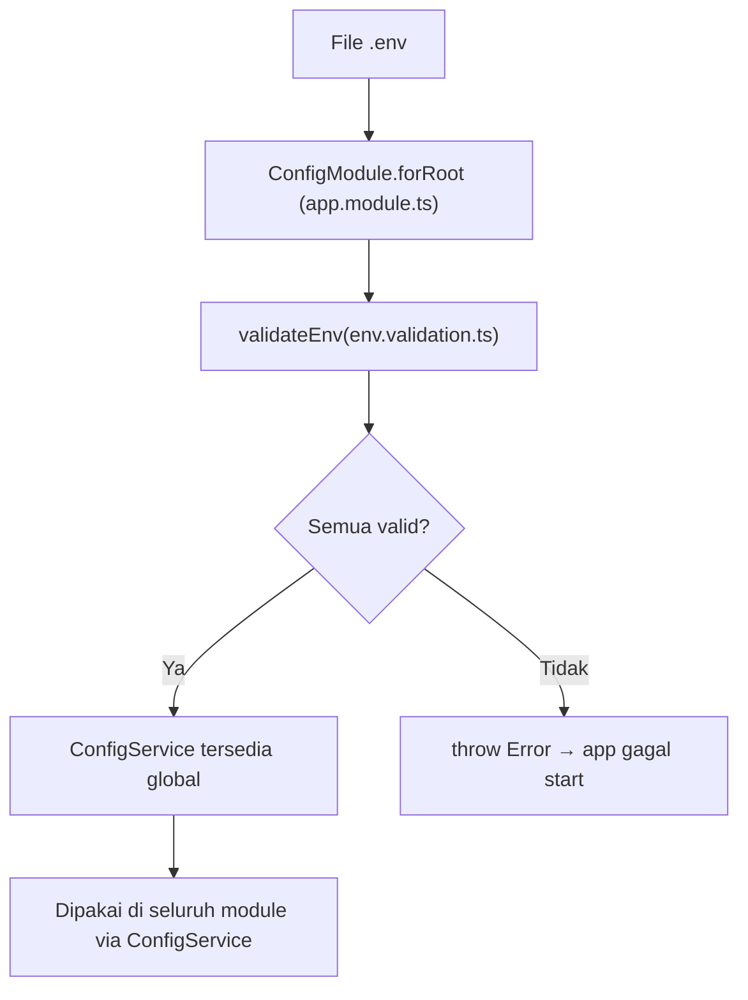

# Module: Config (Konfigurasi & Environment)

**Dibuat:** 2026-10-11
**File sumber yang dianalisis:**
- `apps/backend/src/config/env.validation.ts`
- `apps/backend/.env.example`
- Pemakaian di `apps/backend/src/app.module.ts` (`ConfigModule.forRoot`)

> Catatan penting: folder `src/config/` **tidak** punya file `config.module.ts`. Module ini memakai `ConfigModule` bawaan paket `@nestjs/config`. Jadi yang benar-benar ditulis tim di sini hanyalah **skema validasi environment** (`env.validation.ts`).

## Daftar Isi
1. [Ringkasan Module](#1-ringkasan-module)
2. [Peta File di Module Ini](#2-peta-file-di-module-ini)
3. [Penjelasan Kode per File](#3-penjelasan-kode-per-file)
4. [Alur Kerja Lengkap](#4-alur-kerja-lengkap)
5. [Hubungan dengan Module Lain](#5-hubungan-dengan-module-lain)
6. [Kesalahan Umum & Tips Pemula](#6-kesalahan-umum--tips-pemula)
7. [Catatan Kualitas Kode](#7-catatan-kualitas-kode)
8. [Rangkuman & Cek Pemahaman](#8-rangkuman--cek-pemahaman)

---

## 1. Ringkasan Module

Module **Config** bertugas membaca file `.env`, memvalidasi isinya, dan menyediakannya ke seluruh aplikasi secara aman. Kalau ada variabel wajib yang hilang atau formatnya salah, aplikasi **langsung gagal start** dengan pesan yang jelas.

Analogi: ini seperti **petugas administrasi sebelum gedung dibuka**. Sebelum pintu dibuka (server menyala), petugas memeriksa semua dokumen wajib (KTP listrik, izin air, kontrak). Kalau ada yang kurang, gedung tidak dibuka sama sekali — lebih baik berhenti di awal daripada bermasalah di tengah operasi.

**Istilah baru:**
- **Environment variable (env)** = nilai konfigurasi yang disimpan di luar kode (file `.env`), seperti nomor telepon atau password database. Tujuannya agar kode tidak perlu diubah saat beda server.
- **Validation** = pemeriksaan otomatis apakah data sesuai aturan.

---

## 2. Peta File di Module Ini

| Nama file | Jenis | Peran singkat |
|-----------|-------|---------------|
| `config/env.validation.ts` | Skema validasi + fungsi | Mendefinisikan daftar env wajib/opsional dan memvalidasinya |
| `.env.example` | Template (bukan kode) | Contoh isi `.env` — untuk ditiru developer, tidak berisi rahasia asli |
| `app.module.ts` | (di module App) | Memanggil `ConfigModule.forRoot({ isGlobal: true, validate: validateEnv })` |

Diagram alur:



Versi teks:

```
.env → ConfigModule.forRoot → validateEnv → (valid?) → ConfigService (global)
                                          ↘ (invalid) → Error, aplikasi berhenti
```

---

## 3. Penjelasan Kode per File

### `env.validation.ts`

**Peran file:** Mendefinisikan "daftar field env" beserta aturannya, lalu menyediakan fungsi `validateEnv` yang dipanggil NestJS saat aplikasi menyala.

#### Bagian 1 — Class `EnvironmentVariables`

```ts
export class EnvironmentVariables {
  @IsIn(['development', 'test', 'production'])
  @IsOptional()
  NODE_ENV: string = 'development';

  @IsNumberString()
  @IsOptional()
  PORT: string = '3000';

  @IsString()
  @IsNotEmpty()
  DATABASE_URL!: string;

  @IsString()
  @IsNotEmpty()
  JWT_SECRET!: string;
  // ... field lain
}
```

- **Fungsinya:** Ini adalah **DTO** (Data Transfer Object) yang menggambarkan bentuk env yang diharapkan. Setiap property diberi **decorator validasi** `class-validator`:
  - `@IsString()` → harus teks.
  - `@IsNotEmpty()` → tidak boleh kosong (wajib).
  - `@IsNumberString()` → harus berupa angka (dalam bentuk teks, mis. `"3000"`).
  - `@IsIn([...])` → nilainya harus salah satu dari daftar (mis. hanya `development`, `test`, `production`).
  - `@IsOptional()` → boleh tidak ada. Kalau tidak ada, nilai default (yang ditulis di kanan `=`) dipakai.
- **Kenapa dibuat seperti ini:** Karena env dari file `.env` **selalu berupa teks** dan mudah salah ketik. Dengan class + decorator, kita mendeklarasikan kontraknya di satu tempat. `!` pada `DATABASE_URL!: string` artinya "TypeScript, percaya saja ini akan terisi" (definite assignment).
- **Dampaknya:** Kalau `DATABASE_URL` dihapus dari `.env`, aplikasi gagal start dengan pesan jelas alih-alih error misterius saat query database.
- **Analogi:** Formulir pendaftaran dengan kolom bertanda "wajib diisi" dan aturan tipe data di tiap kolom.
- **Istilah baru:**
  - **Decorator** = anotasi `@...` yang menempelkan perilaku/metadata ke class atau property.
  - **DTO** = objek yang mendefinisikan bentuk data yang diterima/dikirim, di sini bentuk env yang diharapkan.

#### Bagian 2 — Field env, satu per satu

| Env | Aturan | Default | Arti |
|-----|--------|---------|------|
| `NODE_ENV` | salah satu dari development/test/production | `development` | Mode aplikasi |
| `PORT` | angka (teks) | `3000` | Port server |
| `TZ` | teks | `Asia/Jakarta` | Zona waktu |
| `DATABASE_URL` | teks, wajib | — | Alamat koneksi PostgreSQL |
| `JWT_SECRET` | teks, wajib | — | Kunci tanda-tangan access token |
| `JWT_ACCESS_EXPIRES_IN` | teks | `5m` | Umur access token |
| `JWT_REFRESH_SECRET` | teks, opsional | — | Kunci refresh token |
| `JWT_REFRESH_EXPIRES_IN` | teks | `1d` | Umur refresh token |
| `CORS_ORIGIN` | teks | `http://localhost:5173` | Domain frontend yang diizinkan |
| `SWAGGER_ENABLED` | `true`/`false` | `true` | Nyalakan dokumentasi Swagger |
| `SCHEDULER_ENABLED` | `true`/`false` | `true` | Nyalakan job terjadwal |
| `IMPORT_MAX_FILE_SIZE_MB` | angka (teks) | `5` | Batas ukuran file impor |
| `IMPORT_MAX_ROWS` | angka (teks) | `5000` | Batas baris impor |

- **Kenapa dibuat seperti ini:** Memisahkan konfigurasi dari kode (aturan 12-factor app). Nilai default membuat aplikasi tetap bisa jalan di lingkungan development tanpa mengisi semua env.
- **Dampaknya:** Mengubah default (mis. `PORT`) mengubah perilaku saat env tidak diisi. Menghapus field wajib dari skema melonggarkan validasi (berisiko).
- **Analogi:** Daftar pengaturan alat kantor di papan kontrol: mana yang wajib disetel, mana yang sudah ada nilai pabriknya.

> Perlu konfirmasi: `.env.example` memuat juga `SEED_ADMIN_USERNAME` dan `SEED_ADMIN_PASSWORD`, tetapi keduanya **tidak dideklarasikan** di `EnvironmentVariables`. Dugaan: ini hanya dipakai skrip seeding (`db/seed*.ts`) dan sengaja tidak divalidasi. Bukan bug, tapi perlu konfirmasi apakah memang disengaja.

#### Bagian 3 — Fungsi `validateEnv`

```ts
export function validateEnv(config: Record<string, unknown>) {
  const validated = plainToInstance(EnvironmentVariables, config, {
    enableImplicitConversion: true,
  });

  const errors = validateSync(validated, { skipMissingProperties: false });

  if (errors.length > 0) {
    const details = errors
      .map((error) => Object.values(error.constraints ?? {}).join(', '))
      .join('; ');
    throw new Error(`Environment validation failed: ${details}`);
  }

  return validated;
}
```

- **Fungsinya:**
  1. `plainToInstance` mengubah objek env biasa menjadi instance `EnvironmentVariables` (mengisi default sekaligus menyiapkan decorator validasi). `enableImplicitConversion` memaksa tipe dasar ikut dikonversi.
  2. `validateSync` menjalankan semua aturan decorator dan mengembalikan daftar error.
  3. Jika ada error, semua pesan digabung lalu dilempar sebagai `Error` berbahasa jelas.
  4. Jika bersih, nilai yang sudah tervalidasi dikembalikan (dipakai NestJS).
- **Kenapa dibuat seperti ini:** NestJS `ConfigModule` menerima opsi `validate` berupa fungsi. Ini adalah pola resmi NestJS ("environment variables validation") agar aplikasi **fail fast** (gagal cepat) saat konfigurasi salah.
- **Dampaknya:** Kalau fungsi ini dihapus dari `forRoot`, env yang salah tidak akan terdeteksi di awal. Kalau dibuat terlalu ketat, developer bisa kesulitan start di lokal.
- **Analogi:** Pemeriksa kelayakan sebelum penerbangan: kalau checklist tidak lengkap, pesawat tidak boleh lepas landas.
- **Istilah baru:** `plainToInstance` = mengubah objek biasa menjadi instance class agar decorator berlaku. `validateSync` = menjalankan validasi secara langsung (versi "sinkron" dari async).

---

## 4. Alur Kerja Lengkap

Skenario: **Menjalankan `pnpm --filter backend dev`.**

1. Node.js menjalankan `main.ts`.
2. `NestFactory.create(AppModule)` membaca `imports` di `app.module.ts`.
3. Ketemu `ConfigModule.forRoot({ isGlobal: true, validate: validateEnv })`.
4. `@nestjs/config` membaca file `.env` (dan `process.env`), menggabungkannya jadi satu objek.
5. Objek itu dikirim ke `validateEnv`.
6. `plainToInstance` mengubahnya menjadi instance `EnvironmentVariables`, mengisi default untuk field kosong.
7. `validateSync` memeriksa semua decorator.
8. **Jika ada error** → `throw new Error("Environment validation failed: ...")` → NestJS menampilkan error ini dan server **tidak menyala**.
9. **Jika valid** → nilai dikembalikan, ConfigModule menyimpannya, dan `ConfigService` tersedia di seluruh module (karena `isGlobal: true`).
10. Kode lain (mis. `main.ts`, `jwt.strategy.ts`) mengambil nilai lewat `configService.get('PORT')`.

---

## 5. Hubungan dengan Module Lain

**Di-import oleh:** `AppModule` (satu-satunya tempat `ConfigModule.forRoot` dipanggil).

**Diekspos ke module lain:** Karena `isGlobal: true`, semua module bisa menyuntikkan `ConfigService` tanpa mengimpot ConfigModule lagi.

**Contoh pemakai:**
- `main.ts` → `ConfigService.get('CORS_ORIGIN')`, `get('PORT')`, `get('SWAGGER_ENABLED')`.
- `auth` (`jwt.strategy.ts`, `auth.service.ts`) → `JWT_SECRET`, `JWT_ACCESS_EXPIRES_IN`, `JWT_REFRESH_SECRET`, `JWT_REFRESH_EXPIRES_IN`.
- `imports` → `IMPORT_MAX_FILE_SIZE_MB`, `IMPORT_MAX_ROWS`.
- `appraisals` (scheduler) → `SCHEDULER_ENABLED`.

**Dampak jika diubah/dihapus:**
- Menghapus `validate` dari `forRoot` → tidak ada validasi env; error baru muncul jauh di belakang.
- Menghilangkan `isGlobal: true` → setiap module yang butuh config harus `imports: [ConfigModule]` sendiri (merepotkan).
- Menambah field wajib tanpa menambahkannya di `.env` → aplikasi gagal start di semua developer.

---

## 6. Kesalahan Umum & Tips Pemula

1. **Menambah field wajib di `EnvironmentVariables` tapi lupa menaruhnya di `.env.example` dan `.env`.** Gejala: `Environment validation failed: ... should not be empty`.
2. **Mengisi env `true`/`false` sebagai boolean.** Karena env selalu teks, tulis `"true"`, bukan `true`.
3. **Mengira `.env` otomatis ikut Git.** Tidak; `.env` di-gitignore. Yang di-commit hanya `.env.example`.
4. **Menaruh tipe angka lalu memakai `@IsNumber()`.** Env berupa teks, jadi gunakan `@IsNumberString()` seperti pada `PORT`.
5. **Mengakses `process.env.X` langsung di kode.** Aturan project melarang ini; gunakan `ConfigService` agar tervalidasi dan mudah diuji.

**Pesan error yang mungkin muncul:**
- `Environment validation failed: DATABASE_URL should not be empty` → env wajib belum diisi.
- `Environment validation failed: PORT must be a number string` → `PORT` diisi bukan angka.
- `Environment validation failed: SWAGGER_ENABLED must be one of the following values: true, false` → nilai bukan `true`/`false`.

---

## 7. Catatan Kualitas Kode

- **`JWT_REFRESH_SECRET` opsional tanpa default.** Aturan project menyebut "separate secrets" (access & refresh pakai kunci berbeda). Karena opsional, ada risiko aplikasi jalan tanpa secret refresh dan jatuh ke perilaku tak terduga. *Perlu konfirmasi* apakah `auth.service.ts` punya fallback; bila tidak, pertimbangkan menjadikannya wajib.
- **`SEED_ADMIN_USERNAME`/`SEED_ADMIN_PASSWORD` tidak divalidasi** (lihat catatan "Perlu konfirmasi" di atas).
- **Tidak ada masalah keamanan kritis** di file ini. Validasi env yang fail-fast justru praktik yang baik.

---

## 8. Rangkuman & Cek Pemahaman

**Poin kunci:**
1. `ConfigModule` berasal dari paket `@nestjs/config`; tim hanya menulis skema validasinya.
2. `EnvironmentVariables` mendeklarasikan semua env beserta aturannya lewat decorator `class-validator`.
3. `validateEnv` dipanggil saat startup; gagal validasi = aplikasi tidak menyala (fail fast).
4. `isGlobal: true` membuat `ConfigService` tersedia di semua module.
5. Env selalu berupa teks — pakai `@IsNumberString` untuk angka, dan `"true"`/`"false"` untuk boolean.

**Pertanyaan latihan:**

1. *Apa yang terjadi bila `JWT_SECRET` dihapus dari `.env`?*
   → Aplikasi gagal start dengan pesan `Environment validation failed: JWT_SECRET should not be empty`.

2. *Kenapa field env memakai `@IsNumberString()` bukannya `@IsNumber()`?*
   → Karena nilai environment variable selalu berupa teks, jadi divalidasi sebagai teks yang isinya angka.

3. *Kenapa kita mengakses config lewat `ConfigService` dan bukan `process.env` langsung?*
   → Supaya nilai sudah tervalidasi di satu tempat, konsisten, dan mudah diganti saat pengujian.
