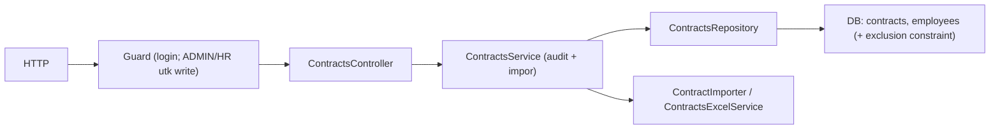

# Module: ContractsModule (Kontrak Kerja)

**Dibuat:** 2026-10-11
**File sumber yang dianalisis:**
- `contracts/contracts.module.ts`, `contracts.controller.ts`, `contracts.service.ts`, `contracts.repository.ts`
- `contracts/contracts.importer.ts`, `contracts/contracts.importer.spec.ts`, `contracts/contracts.excel.ts`
- `contracts/dto/create-contract.dto.ts`, `update-contract.dto.ts`, `contract-query.dto.ts`
- `contracts/interfaces/contract.interface.ts`
- Rujukan: `drizzle/0001_constraints.sql`, `drizzle/0002_drop_contract_status.sql`, `packages/types/src/contracts.ts`

## Daftar Isi
1. [Ringkasan Module](#1-ringkasan-module)
2. [Peta File di Module Ini](#2-peta-file-di-module-ini)
3. [Penjelasan Kode per File](#3-penjelasan-kode-per-file)
4. [Alur Kerja Lengkap](#4-alur-kerja-lengkap)
5. [Hubungan dengan Module Lain](#5-hubungan-dengan-module-lain)
6. [Kesalahan Umum & Tips Pemula](#6-kesalahan-umum--tips-pemula)
7. [Catatan Kualitas Kode](#7-catatan-kualitas-kode)
8. [Rangkuman & Cek Pemahaman](#8-rangkuman--cek-pemahaman)

---

## 1. Ringkasan Module

**ContractsModule** mengelola kontrak kerja karyawan: daftar (filter & paginasi), detail, buat, ubah, hapus (soft delete), plus impor/ekspor Excel. Aturan utamanya: **satu karyawan tidak boleh punya dua kontrak dengan tanggal yang tumpang-tindih**, dan kontrak **PERMANENT tidak punya tanggal berakhir**.

Analogi: ini seperti **bagian administrasi masa kerja**. Setiap pegawai bisa punya beberapa periode kerja (kontrak), tapi periodenya tidak boleh saling tumpang-tindih — seperti jadwal sewa yang tidak boleh dobel di rentang waktu yang sama.

**Istilah baru:**
- **Interval/tumpang-tindih** = dua rentang tanggal yang saling menimpa.
- **Exclusion constraint** = aturan database yang mencegah dua baris memiliki rentang yang tumpang-tindih.

---

## 2. Peta File di Module Ini

| Nama file | Jenis | Peran singkat |
|-----------|-------|---------------|
| `contracts.module.ts` | Module | Merakit controller, service, repository, importer, excel |
| `contracts.controller.ts` | Controller | Endpoint `/api/contracts*` |
| `contracts.service.ts` | Service | Aturan bisnis + audit + orkestrasi impor/ekspor |
| `contracts.repository.ts` | Repository | Query Drizzle (list+count, CRUD, deteksi existing) |
| `contracts.importer.ts` | Import strategy | Validasi (termasuk overlap) & commit |
| `contracts.importer.spec.ts` | Test | Uji validasi importer |
| `contracts.excel.ts` | Excel helper | Ekspor & template `.xlsx` |
| `dto/create-contract.dto.ts`, `update-contract.dto.ts`, `contract-query.dto.ts` | DTO | Validasi input |
| `interfaces/contract.interface.ts` | Alias | `ContractPayload = ContractResponse` |

Diagram alur:



Versi teks:

```
Write: Request → Guard(ADMIN/HR) → Controller → Service (transaksi+audit) → Repository → DB
Import:Controller → Service → ImportService → ContractImporter(validate→commit) → DB
Export:Controller → Service → ExcelService → Buffer (.xlsx)
```

---

## 3. Penjelasan Kode per File

### `contracts.module.ts`

```ts
@Module({
  controllers: [ContractsController],
  providers: [ContractsService, ContractsRepository, ContractImporter, ContractsExcelService],
  exports: [ContractsService],
})
export class ContractsModule {}
```

- **Fungsinya:** Merakit module; importer & excel service didaftarkan sebagai provider.
- **Kenapa:** Sama pola dengan EmployeesModule. `exports` agar service dipakai module lain (mis. appraisals).
- **Dampaknya:** Jika `ContractImporter` tidak terdaftar, DI gagal.
- **Analogi:** Menyiapkan seluruh meja & petugas di bagian administrasi masa kerja.

### `contracts.controller.ts`

```ts
@ApiTags('contracts')
@ApiBearerAuth()
@Controller('contracts')
export class ContractsController {
  @Get() findAll(@Query() query: ContractQueryDto) { ... }
  @Get('export') @Roles(ADMIN, HR) export(@Query() query, @Res() res) { ... }
  @Get('import-template') @Roles(ADMIN, HR) template(@Res() res) { ... }
  @Get(':id') findOne(@Param('id', ParseUUIDPipe) id) { ... }
  @Post('import') @Roles(ADMIN, HR) @UseInterceptors(FileInterceptor('file', {...20MB})) import(@UploadedFile() file) { ... }
  @Post() @Roles(ADMIN, HR) @HttpCode(201) create(@Body() dto) { ... }
  @Patch(':id') @Roles(ADMIN, HR) update(...) { ... }
  @Delete(':id') @Roles(ADMIN, HR) @HttpCode(204) remove(...) { ... }
}
```

- **Fungsinya:**
  - `findAll`/`findOne` → baca (semua user login).
  - `export` (menerima `query` untuk menyaring ekspor), `import-template` → kirim file `.xlsx` via `@Res()`.
  - `import` → upload file (memori, batas 20MB di interceptor; batas ukuran sebenarnya juga dicek `ImportService` dari env).
  - create/update/delete → `@Roles(ADMIN, HR)`.
- **Kenapa dibuat seperti ini:** Sama pola dengan EmployeesController. Urutan route `export`/`import-template` **sebelum** `:id` penting.
- **Dampaknya:** Menghapus `@Roles` → penulisan kontrak terbuka. Menghapus `@Res()` → bentuk respons file rusak.
- **Analogi:** Loket administrasi dengan jalur khusus untuk menyerahkan/menerima dokumen.

### `contracts.service.ts`

`findAll` / `findOne` → pola standar (paginated / ok), memakai `toPayload`.

`create` / `update` / `remove`:

```ts
const created = await this.dbService.transaction(async (tx) => {
  const row = await this.contractsRepository.createAndSave(dto, tx);
  if (!row) throw new BadRequestException('Contract could not be created');
  await this.audit.record(tx, { action: 'CONTRACT_CREATED', entity: 'contract', entityId: row.id, after: this.toPayload(row), ...this.actor() });
  return row;
});

async remove(id: string) {
  const existing = await this.findOneOrFail(id);
  await this.dbService.transaction(async (tx) => {
    await this.contractsRepository.softDelete(id, tx);
    await this.audit.record(tx, { action: 'CONTRACT_DELETED', entity: 'contract', entityId: id, before: this.toPayload(existing), ...this.actor() });
  });
}
```

- **Fungsinya:** Menulis dalam transaksi + audit; penghapusan soft delete.
- **Kenapa:** Konsistensi & jejak audit. Berbeda dari departments/positions, di sini `remove` **tidak** mengecek keterkaitan lain (kontrak memang boleh dihapus; relasinya ke employee bercascade lewat DB).
- **Dampaknya:** Jika kontrak yang masih dipakai appraisal dihapus, *perlu konfirmasi* bagaimana appraisal menanganinya (appraisal menyimpan snapshot, jadi kemungkinan aman).
- **Analogi:** Mencabut satu catatan periode kerja, tetap tercatat di register perubahan.

Impor/ekspor:

```ts
async exportContracts(query) { return this.excel.buildExport(await this.contractsRepository.findForExport(query)); }
async buildTemplate() { return this.excel.buildTemplate(); }
async importContracts(file) { const result = await this.importService.run(file, this.contractImporter, 'contract'); return ok(result); }
```

- **Fungsinya:** Mendelegasikan ke Excel service / pipeline impor.
- **Kenapa:** Sama pola dengan employees — memisahkan tanggung jawab.
- **Analogi:** Kurir yang menyampaikan dokumen ke petugas data setelah diperiksa.

`toPayload`:

```ts
private toPayload(contract: any): ContractPayload {
  return { id, employeeId, contractType: contract.contractType, startDate, endDate: contract.endDate ?? null, employee: contract.employee ?? null };
}
```

- **Fungsinya:** Menyusun respons; `employee` opsional (ada saat query list dengan join).
- **Dampaknya:** Menghapus `?? null` bisa membuat field `undefined` hilang dari JSON.
- **Catatan:** memakai `any` (lihat bagian 7).

### `contracts.repository.ts`

`findAllWithCount`:

```ts
const filters: SQL[] = [notDeleted(contracts)];
if (employeeId) filters.push(eq(contracts.employeeId, employeeId));
if (contractType) filters.push(eq(contracts.contractType, contractType));
const where = and(...filters);

const rows = await this.db.select({ id, employeeId, contractType, startDate, endDate,
    employee: { id: employees.id, fullName: employees.fullName, employeeNumber: employees.employeeNumber } })
  .from(contracts).leftJoin(employees, eq(contracts.employeeId, employees.id))
  .where(where).orderBy(desc(contracts.startDate)).limit(limit).offset((page - 1) * limit);
const [total] = await this.db.select({ count: sql<number>`count(*)` }).from(contracts).where(where);
return [rows, Number(total?.count ?? 0)] as const;
```

- **Fungsinya:** Daftar kontrak (join nama karyawan), filter employee/tipe, urut tanggal mulai terbaru, + total.
- **Kenapa:** Mengembalikan `[rows, total]` agar service bisa menyusun meta paginasi.
- **Dampaknya:** Tanpa `notDeleted`, kontrak terhapus muncul.
- **Analogi:** Menyusun halaman daftar periode kerja, terbaru di atas.

Method penting lain:

```ts
async findByEmployeeAndStart(employeeId, startDate, executor = this.db) {
  const [row] = await executor.select().from(contracts)
    .where(and(eq(contracts.employeeId, employeeId), eq(contracts.startDate, startDate), notDeleted(contracts))).limit(1);
  return row ?? null;
}
```

- **Fungsinya:** Mencari kontrak karyawan pada tanggal mulai tertentu → dipakai importer untuk memutuskan create vs update (kunci "upsert" kontrak).
- **Kenapa:** Kunci alami kontrak = `(employeeId, startDate)`; baris yang sama akan di-update, bukan diduplikasi.
- **Analogi:** Memeriksa apakah "periode mulai tanggal X" sudah tercatat sebelum menambahkan.

Juga: `findEmployeesByNumbers` (terjemahkan nomor karyawan → id), `findByEmployeeIds` (ambil kontrak existing untuk cek overlap), `findForExport` (join + filter search), `createAndSave`/`updateAndSave`/`softDelete`/`findById`.

### `contracts.importer.ts` — Strategi Impor Kontrak

`expectedHeaders = ['employee_number','contract_type','start_date','end_date']`.

`validate` — aturan penting:

```ts
if (!CONTRACT_TYPES.includes(p.contractType)) importError(... 'Invalid contract type' ...);
if (!this.isDate(p.startDate)) importError(... 'Invalid start date' ...);

if (p.contractType === 'PERMANENT') {
  if (p.endDate) importError(p.row, 'end_date', 'Permanent contracts cannot have an end date');
} else {
  if (!p.endDate) importError(p.row, 'end_date', 'End date is required');
  if (p.endDate && !this.isDate(p.endDate)) importError(... 'Invalid end date' ...);
  if (p.endDate && p.endDate < p.startDate) importError(... 'End date must be on or after start date' ...);
}
```

- **Fungsinya:** Memvalidasi tipe kontrak, format tanggal, dan aturan PERMANENT vs berjangka.
- **Kenapa dibuat seperti ini:** Menegakkan aturan domain (PERMANENT tanpa akhir; non-permanent wajib punya akhir ≥ mulai).
- **Dampaknya:** Jika dilepas, kontrak tidak masuk akal bisa lolos.
- **Analogi:** Petugas yang memastikan kertas kontrak lengkap sebelum diarsipkan.

Deteksi tumpang-tindih (overlap):

```ts
// kumpulkan interval existing dari DB
const existingIntervals = new Map<string, { start: string; end: string }[]>();
for (const contract of existing) {
  const intervals = existingIntervals.get(contract.employeeId) ?? [];
  intervals.push({ start: contract.startDate, end: contract.endDate ?? '9999-12-31' });
  existingIntervals.set(contract.employeeId, intervals);
}

for (const p of parsed) {
  const start = p.startDate;
  const end = p.contractType === 'PERMANENT' ? '9999-12-31' : p.endDate;
  const dbCandidates = (existingIntervals.get(employeeId) ?? []).filter((c) => c.start !== start); // baris yang sama = update
  const fileCandidates = parsed.filter((o) => o !== p && o.employeeNumber === p.employeeNumber).map((o) => ({ start: o.startDate, end: o.contractType === 'PERMANENT' ? '9999-12-31' : o.endDate }));
  for (const candidate of [...dbCandidates, ...fileCandidates]) {
    if (start <= candidate.end && candidate.start <= end) importError(p.row, 'start_date', 'Overlaps another contract for this employee');
  }
}
```

- **Fungsinya:** Memeriksa tumpang-tindih terhadap kontrak yang **sudah ada di DB** dan **antar-baris di dalam file** yang sama.
- **Kenapa dibuat seperti ini:** Mencegah konflik lebih awal dengan pesan jelas (bukan baru gagal di constraint DB). Memakai sentinel `'9999-12-31'` untuk kontrak tanpa akhir.
- **Dampaknya:** Jika overlap dilepas, impor akan gagal di tingkat DB (exclusion constraint → `422 CONTRACT_OVERLAP`) tanpa pesan ramah.
- **Analogi:** Memeriksa kalender pemakaian ruangan: jangan sampai ada dua pemesanan di rentang yang sama.
- **Istilah baru:** **Sentinel value** = nilai penanda khusus (di sini tanggal jauh di masa depan).

`commit`:

```ts
for (const p of parsed) {
  const existing = await this.repository.findByEmployeeAndStart(employeeId, p.startDate, tx);
  if (existing) { await this.repository.updateAndSave(existing.id, { contractType, endDate: values.endDate ?? undefined }, tx); updated += 1; }
  else { await this.repository.createAndSave({ employeeId, contractType, startDate, endDate: values.endDate ?? undefined }, tx); created += 1; }
}
```

- **Fungsinya:** Upsert per baris: jika kontrak `(employee, startDate)` sudah ada → update; jika belum → create.
- **Kenapa:** Impor bersifat idempotent-ish: mengubah data lama yang sama, menambah yang baru.
- **Dampaknya:** Kunci `(employeeId, startDate)` harus unik (dipenuhi oleh unique index di DB).
- **Analogi:** Menambal berkas periode yang sudah ada, menambah yang belum.

### `contracts.excel.ts`

- `buildExport` / `buildTemplate` (dengan sheet `Notes` berisi aturan) memakai `exceljs`.
- `sanitize(value)` menambahkan `'` di depan sel berawalan `=`, `+`, `-`, `@` (anti formula injection), sama seperti employees.

- **Dampaknya:** Tanpa `sanitize`, file ekspor bisa membahayakan saat dibuka di Excel.
- **Analogi:** Menandai catatan agar tidak disalahartikan Excel sebagai perintah.

### `contracts.importer.spec.ts`

```ts
it('accepts a valid row', ...);
it('rejects an unknown employee number', ...);
it('rejects an invalid contract type', ...);
it('requires an end date for non-permanent contracts', ...);
it('rejects duplicate employee number and start date in the file', ...);
it('rejects a row overlapping an existing contract', ...);
```

- **Fungsinya:** Menguji validasi importer (mock repository).
- **Kenapa:** Aturan overlap & tipe kontrak adalah aturan penting yang mudah rusak; test melindunginya.
- **Analogi:** Daftar periksa audit untuk memastikan aturan kontrak tetap ditegakkan.

### DTO

| File | Isi penting |
|------|-------------|
| `create-contract.dto.ts` | `employeeId` (UUID, wajib), `contractType` (`@IsEnum`), `startDate` (`@IsDateString`), `endDate?` |
| `update-contract.dto.ts` | `PartialType(OmitType(CreateContractDto, ['employeeId']))` — `employeeId` tidak boleh diubah |
| `contract-query.dto.ts` | extends `QueryDto` + `employeeId?`, `contractType?` |

- **Fungsinya:** `OmitType` menghapus `employeeId` dari payload update — kontrak tidak boleh dipindah ke karyawan lain (harus buat kontrak baru).
- **Kenapa:** Menjaga integritas: memindah kepemilikan kontrak akan mengacaukan riwayat.
- **Dampaknya:** Jika `OmitType` dilepas, `employeeId` bisa diubah dan merusak aturan kepemilikan.
- **Istilah baru:** **OmitType** = helper membuat DTO baru tanpa properti tertentu.

---

## 4. Alur Kerja Lengkap

Skenario A: **HR membuat kontrak FIXED_TERM untuk karyawan.**

1. `POST /api/contracts` + token HR, body `{ employeeId, contractType: "FIXED_TERM", startDate, endDate }`.
2. Guard: login + `@Roles(ADMIN, HR)`.
3. `ValidationPipe`: `@IsEnum`, `@IsDateString`, `@IsUUID`.
4. `ContractsService.create`: transaksi → insert → audit `CONTRACT_CREATED` → payload.
5. Jika tanggal tumpang-tindih dengan kontrak aktif lain, DB menolak via exclusion constraint → `HttpExceptionFilter` → `422 CONTRACT_OVERLAP`.

Skenario B: **HR mengimpor kontrak massal.**

1. `POST /api/contracts/import` (multipart).
2. `ImportService.run`: cek file, header, baris, batas.
3. `ContractImporter.validate`: cek tipe, tanggal, aturan PERMANENT, duplikat dalam file, **overlap vs DB & antar-baris**. Gagal pertama → 422.
4. Transaksi: `commit` → upsert per `(employee, startDate)` → audit `CONTRACT_IMPORTED`.
5. Respons `{ created, updated, skipped }`.

Skenario C: **Ekspor.** `GET /api/contracts/export?contractType=FIXED_TERM` → service ambil baris terfilter → Excel → buffer `.xlsx` (sanitize) via `@Res()`.

---

## 5. Hubungan dengan Module Lain

**Bergantung pada:**
- `DbModule`, `AuditModule`, `ImportsModule` (`ImportService`), `common`.

**Dipakai oleh:** `AppraisalsModule` (menentukan kontrak karyawan yang dinilai; employees menampilkan `contract` terbaru), `DashboardModule`.

**Dampak jika diubah/dihapus:**
- Menghapus module → endpoint hilang; appraisal kehilangan sumber data kontrak.
- Mengubah aturan overlap (baik di importer maupun migrasi SQL) → risiko tumpang-tindih kontrak aktif.
- Mengubah `employeeId` pada update → merusak kepemilikan.

---

## 6. Kesalahan Umum & Tips Pemula

1. **Memberi `endDate` untuk kontrak PERMANENT.** Ditolak (validasi/impor) karena permanent tidak berakhir.
2. **Lupa `endDate` untuk FIXED_TERM/PROBATION.** Ditolak.
3. **Mengimpor dua kontrak dengan rentang tumpang-tindih.** Ditolak (importer), atau jika lolos, DB menolak (`422 CONTRACT_OVERLAP`).
4. **Mencoba memindah kontrak ke karyawan lain lewat PATCH.** Tidak bisa — `employeeId` sengaja di-omit.
5. **Mengubah `fromClause`/kunci importer tanpa menyelaraskan unique index.** Upsert bisa gagal/menduplikasi.

**Pesan error yang mungkin muncul:**
- `422 CONTRACT_OVERLAP` ("This contract overlaps another active contract for the employee") → tumpang-tindih (dari exclusion constraint).
- `422 IMPORT_VALIDATION_FAILED` → baris impor tak valid (tipe/tanggal/overlap/duplikat).
- `23503 FOREIGN_KEY_VIOLATION` (400) → `employeeId` tidak ada.
- `409 UNIQUE_VIOLATION` → kombinasi `(employeeId, startDate)` duplikat.
- `404 Contract with ID ... not found`.

---

## 7. Catatan Kualitas Kode

- **`toPayload(contract: any)`** memakai `any` (melanggar aturan "no any"). Saran: beri tipe eksplisit (mis. `ContractRow & { employee?: ... }`).
- **Konflik aturan overlap ganda:** diimpor dari importer **dan** dari exclusion constraint DB. Ini baik (berlapis), tetapi pesan keduanya berbeda; pastikan frontend menangani `CONTRACT_OVERLAP` (DB) dan `IMPORT_VALIDATION_FAILED` (importer) dengan baik.
- **`commit` importer tidak memvalidasi ulang overlap** (mengandalkan `validate` + constraint DB). Karena pipeline selalu `validate` dulu, ini aman; tapi bila `commit` dipanggil tanpa `validate`, DB yang jadi jaring terakhir.
- **Perubahan `endDate` pada update/permanent:** update memakai `endDate: values.endDate ?? undefined`; mengirim `undefined` berarti tidak mengubah, sedangkan untuk menjadikan permanent perlu `endDate` null. *Perlu konfirmasi* apakah perilaku "ubah jadi PERMANENT" sudah diinginkan lewat DTO (saat ini `endDate` opsional, `null` tidak eksplisit).
- Selain itu, pola transaksi & audit konsisten. **Tidak ada masalah keamanan kritis.**

---

## 8. Rangkuman & Cek Pemahaman

**Poin kunci:**
1. ContractsModule mengelola kontrak kerja; tulis hanya ADMIN/HR, baca untuk user login.
2. Aturan domain: PERMANENT tanpa `endDate`; selain itu wajib berakhir; periode tidak boleh tumpang-tindih.
3. Tumpang-tindih dijaga **dua lapis**: importer dan exclusion constraint DB.
4. Kunci alami kontrak = `(employeeId, startDate)`; importer melakukan upsert berdasar kunci ini.
5. `employeeId` tidak bisa diubah saat update (`OmitType`).

**Pertanyaan latihan:**

1. *Mengapa `UpdateContractDto` meng-omit `employeeId`?*
   → Agar kontrak tidak bisa dipindah ke karyawan lain; kepemilikan kontrak harus tetap. Untuk "pindah", buat kontrak baru.

2. *Bagaimana sistem mencegah dua kontrak tumpang-tindih?*
   → Dua lapis: `ContractImporter.validate` mendeteksi lebih awal (pesan ramah), dan exclusion constraint `contracts_no_overlap` di PostgreSQL menolak di tingkat database (`CONTRACT_OVERLAP`).

3. *Apa yang terjadi bila kontrak PERMANENT diberi `endDate` saat impor?*
   → Validasi menolak dengan error "Permanent contracts cannot have an end date".
