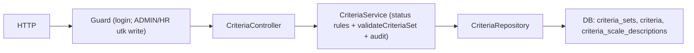

# Module: CriteriaModule (Versi Kriteria Penilaian)

**Dibuat:** 2026-10-11
**File sumber yang dianalisis:**
- `criteria/criteria.module.ts`, `criteria.controller.ts`, `criteria.service.ts`, `criteria.repository.ts`
- `criteria/criteria.validation.ts`, `criteria/criteria.validation.spec.ts`
- `criteria/dto/create-criteria-set.dto.ts`, `update-criteria-set.dto.ts`
- `criteria/interfaces/criteria-set.interface.ts`, `criterion.interface.ts`
- Rujukan tipe: `packages/types/src/criteria.ts`, `enums.ts`

## Daftar Isi
1. [Ringkasan Module](#1-ringkasan-module)
2. [Peta File di Module Ini](#2-peta-file-di-module-ini)
3. [Penjelasan Kode per File](#3-penjelasan-kode-per-file)
4. [Alur Kerja Lengkap](#4-alur-kerja-lengkap)
5. [Hubungan dengan Module Lain](#5-hubungan-dengan-module-lain)
6. [Kesalahan Umum & Tips Pemula](#6-kesalahan-umum--tips-pemula)
7. [Catatan Kualitas Kode](#7-catatan-kualitas-kode)
8. [Rangkuman & Cek Pemahaman](#8-rangkuman--cek-pemahaman)

---

## 1. Ringkasan Module

**CriteriaModule** mengelola **versi set kriteria penilaian**. Satu set berisi beberapa kriteria (mis. Kualitas, Kuantitas, Disiplin) yang total bobotnya harus tepat 100. Set memiliki siklus status: `DRAFT → ACTIVE → SUPERSEDED`. Hanya set `DRAFT` yang boleh diedit; saat sebuah set di-aktifkan, set `ACTIVE` lama otomatis menjadi `SUPERSEDED`. Set lama tidak pernah diubah atau dihapus.

Analogi: ini seperti **kurikulum sekolah yang diberlakukan per tahun ajaran**. Kurikulum 2023 yang sedang berlaku tidak boleh diubah-ubah. Kalau mau perubahan, buat draf kurikulum baru (2024), susun sampai rapi, baru "diberlakukan" — dan kurikulum lama otomatis berstatus "tidak berlaku lagi".

**Istilah baru:**
- **Versioning** = sistem penyimpanan versi; versi lama tetap tersimpan utuh.
- **DRAFT/ACTIVE/SUPERSEDED** = status draf, sedang berlaku, dan sudah digantikan.
- **Bobot (weight)** = kontribusi tiap kriteria; totalnya harus 100.

---

## 2. Peta File di Module Ini

| Nama file | Jenis | Peran singkat |
|-----------|-------|---------------|
| `criteria.module.ts` | Module | Merakit controller, service, repository |
| `criteria.controller.ts` | Controller | Endpoint `/api/criteria-sets*` |
| `criteria.service.ts` | Service | Aturan versi/status + audit |
| `criteria.repository.ts` | Repository | Query Drizzle ke `criteria_sets`, `criteria`, `criteria_scale_descriptions` |
| `criteria.validation.ts` | Pure function | Validasi keseluruhan set kriteria |
| `criteria.validation.spec.ts` | Test | Uji fungsi validasi |
| `dto/create-criteria-set.dto.ts`, `update-criteria-set.dto.ts` | DTO | Validasi input (nested) |
| `interfaces/criteria-set.interface.ts`, `criterion.interface.ts` | Alias | Tipe payload |

Diagram alur:



Versi teks:

```
Create draft: Controller → Service (version+1, copy active) → Repo → DB → audit
Update:       Controller → Service (cek DRAFT) → validateCriteriaSet → Repo.replace → audit
Activate:     Controller → Service (cek DRAFT, validasi) → supersedeActive + activate → audit
```

---

## 3. Penjelasan Kode per File

### `criteria.module.ts`

```ts
@Module({
  controllers: [CriteriaController],
  providers: [CriteriaService, CriteriaRepository],
  exports: [CriteriaService],
})
export class CriteriaModule {}
```

- **Fungsinya:** Merakit module dan mengekspos `CriteriaService`.
- **Kenapa:** Pola standar NestJS.
- **Dampaknya:** Tanpa didaftarkan di `AppModule`, endpoint hilang dan module yang butuh kriteria kehilangan layanan.
- **Analogi:** Mencatat unit penyusun kurikulum dalam struktur organisasi.

### `criteria.controller.ts`

```ts
@ApiTags('criteria-sets')
@ApiBearerAuth()
@Controller('criteria-sets')
export class CriteriaController {
  @Get() findAll() { ... }
  @Get('active') findActive() { ... }
  @Get(':id') findOne(@Param('id', ParseUUIDPipe) id) { ... }
  @Post() @Roles(ADMIN, HR) @HttpCode(201) create(@Body() dto) { ... }        // buat DRAFT
  @Put(':id') @Roles(ADMIN, HR) update(@Param('id', ParseUUIDPipe) id, @Body() dto) { ... } // edit DRAFT
  @Post(':id/activate') @Roles(ADMIN, HR) @HttpCode(200) activate(@Param('id', ParseUUIDPipe) id) { ... }
}
```

- **Fungsinya:**
  - `GET /criteria-sets` → daftar semua versi (terbaru dulu).
  - `GET /criteria-sets/active` → set yang sedang berlaku (bisa `null`).
  - `POST` → membuat draf baru (menyalin set aktif bila `criteria` tidak dikirim).
  - `PUT /:id` → mengedit draf.
  - `POST /:id/activate` → mengaktifkan draf.
- **Kenapa dibuat seperti ini:**
  - **Tidak ada endpoint DELETE.** Sesuai aturan "set yang aktif/superseded tidak pernah dihapus". Yang bisa dihapus hanyalah isi kriteria di dalam draf (via PUT).
  - `POST /:id/activate` memakai POST karena ini **aksi** (mengubah status), bukan sekadar mengganti resource.
- **Dampaknya:** Menghapus `@Roles(ADMIN, HR)` → siapa pun yang login bisa mengubah kurikulum. Menambah endpoint DELETE berpotensi melanggar aturan versioning.
- **Analogi:** Panitia kurikulum: hanya anggota berwenang yang boleh menyusun/memberlakukan; tidak ada tombol "hapus kurikulum".
- **Istilah baru:** **`@Put`** = HTTP method untuk mengganti seluruh resource (di sini dipakai untuk update draf).

### `criteria.service.ts`

`findAll` / `findActive` / `findOne`:

```ts
async findAll() {
  const sets = await this.criteriaRepository.findAllSets();
  const criteriaBySet = await this.criteriaRepository.criteriaBySetIds(sets.map((s) => s.id));
  return ok(sets.map((set) => this.toResponse(set, criteriaBySet[set.id] ?? [])));
}
async findActive() {
  const set = await this.criteriaRepository.findActiveSet();
  if (!set) return ok(null);
  ...
}
```

- **Fungsinya:** Mengambil daftar set + kriteria-nya (batch, bukan per-set), atau set aktif.
- **Kenapa:** `criteriaBySetIds` mengambil kriteria **banyak set sekaligus** (menghindari N+1). `findActive` mengembalikan `null` bila belum ada set aktif (bukan error).
- **Dampaknya:** Tanpa batch, setiap set memicu query tambahan.
- **Analogi:** Mengambil seluruh kurikulum dari lemari dalam sekali angkut, bukan satu per satu.

`createDraft`:

```ts
const version = (await this.criteriaRepository.getMaxVersion()) + 1;
const created = await this.dbService.transaction(async (tx) => {
  const set = await this.criteriaRepository.createSet({ version, note: dto.note, createdBy: this.requestContext.getUser()?.userId }, tx);
  if (!set) throw new BadRequestException('Criteria set could not be created');

  let list = dto.criteria;
  if (!list) {                        // bila tak dikirim, salin dari set ACTIVE
    const active = await this.criteriaRepository.findActiveSet(tx);
    if (active) {
      const bySet = await this.criteriaRepository.criteriaBySetIds([active.id], tx);
      list = (bySet[active.id] ?? []).map((c) => this.toInput(c));
    }
  }
  await this.criteriaRepository.replaceCriteria(set.id, list ?? [], tx);
  await this.audit.record(tx, { action: 'CRITERIA_SET_CREATED', ..., after: { version, status: 'DRAFT' }, ...this.actor() });
  return set;
});
return this.findOne(created.id);
```

- **Fungsinya:** Membuat set baru dengan `version = maxVersion + 1`, status default `DRAFT`. Bila `criteria` tidak dikirim, isinya **disalin dari set ACTIVE** (memudahkan "buat draf perubahan kecil").
- **Kenapa dibuat seperti ini:** Nomor versi dihitung dari yang tertinggi agar unik & berurutan. Copy-on-create mempercepat penyusunan versi berikutnya.
- **Dampaknya:** Bila `getMaxVersion`/`version+1` tidak dalam perilaku yang benar, bisa bentrok dengan unique index `version`. Copy-on-create memudahkan tapi juga bisa "menyalin kesalahan" set lama (disengaja).
- **Analogi:** Membuat draf kurikulum baru dengan menyalin kurikulum yang berlaku, lalu tinggal menyesuaikan.
- **Istilah baru:** **Copy-on-create** = menyalin data lama saat membuat record baru.

`update`:

```ts
const set = await this.findSetOrFail(id);
if (set.status !== 'DRAFT') throw new BusinessLogicException('Only DRAFT criteria sets can be edited', 'CRITERIA_SET_NOT_EDITABLE');
if (dto.criteria !== undefined) validateCriteriaSet(dto.criteria);
await this.dbService.transaction(async (tx) => {
  if (dto.note !== undefined) await this.criteriaRepository.updateSet(id, { note: dto.note }, tx);
  if (dto.criteria !== undefined) await this.criteriaRepository.replaceCriteria(id, dto.criteria, tx);
  await this.audit.record(tx, { action: 'CRITERIA_SET_UPDATED', ... });
});
```

- **Fungsinya:** Hanya mengizinkan edit bila status `DRAFT`. Bila kriteria dikirim, divalidasi dulu (`validateCriteriaSet`), lalu diganti (replace).
- **Kenapa dibuat seperti ini:** Menegakkan aturan domain: set ACTIVE/SUPERSEDED tidak boleh diubah. Validasi sebelum menulis mencegah set tidak sah.
- **Dampaknya:** Bila cek status dihapus, kurikulum yang sedang berlaku bisa diubah — melanggar aturan dan membingungkan nilai yang sudah ada.
- **Analogi:** Kurikulum yang sudah diberlakukan di-"kunci"; hanya draf yang bisa diedit.

`activate`:

```ts
const set = await this.findSetOrFail(id);
if (set.status !== 'DRAFT') throw new BusinessLogicException('Only DRAFT criteria sets can be activated', 'CRITERIA_SET_NOT_ACTIVATABLE');
const list = (bySet[id] ?? []).map((c) => this.toInput(c));
if (list.length === 0) throw new BusinessLogicException('A criteria set needs at least one criterion', 'CRITERIA_SET_EMPTY');
validateCriteriaSet(list);
await this.dbService.transaction(async (tx) => {
  await this.criteriaRepository.supersedeActive(tx);   // semua ACTIVE → SUPERSEDED
  await this.criteriaRepository.activate(id, this.requestContext.getUser()?.userId ?? null, null, tx);
  await this.audit.record(tx, { action: 'CRITERIA_SET_ACTIVATED', ..., after: { status: 'ACTIVE' }, ... });
});
```

- **Fungsinya:** Mengaktifkan draf: set ACTIVE lama di-`SUPERSEDED`, lalu draf menjadi `ACTIVE` (mencatat `activatedBy`/`activatedAt`). Sebelumnya, isi set divalidasi (tidak boleh kosong; bobot total 100, dsb).
- **Kenapa dibuat seperti ini:** Menjaga "satu set aktif" (didukung unique index parsial di DB). Urutan `supersedeActive` dulu penting agar tidak melanggar index `uq_criteria_sets_active`.
- **Dampaknya:** Kalau urutan dibalik, aktivasi bisa gagal karena dua baris ACTIVE sekaligus. Kalau validasi dilepas, set tidak sah bisa berlaku.
- **Analogi:** Memberlakukan kurikulum baru: yang lama otomatis dicabut status berlakunya, dalam satu langkah.
- **Istilah baru:** **Supersede** = menggantikan versi lama.

`toResponse` / `toInput` / `actor` / `findSetOrFail` → helper pemetaan & pelaku audit (pola sama dengan module lain).

### `criteria.repository.ts`

- `getMaxVersion` → `coalesce(max(version), 0)` (0 bila belum ada set).
- `findAllSets` → semua set, `notDeleted`, urut `version` desc.
- `findSetById` / `findActiveSet` → satu set (aktif difilter `status = 'ACTIVE'`).
- `criteriaBySetIds(setIds)` → mengambil kriteria + `scaleDescriptions` secara batch, dikelompokkan per set, diurutkan `displayOrder`.
- `createSet` / `updateSet` → insert/update set (selalu `notDeleted`).
- `replaceCriteria` → hapus semua kriteria set lalu insert ulang (plus deskripsi skala).
- `supersedeActive` → semua `ACTIVE` → `SUPERSEDED`.
- `activate` → set status `ACTIVE`, `activatedBy`, `activatedAt`.

```ts
async replaceCriteria(setId, list, executor = this.db) {
  await executor.delete(criteria).where(eq(criteria.criteriaSetId, setId));
  if (list.length === 0) return;
  const inserted = await executor.insert(criteria).values(list.map((c, index) => ({ ... }))).returning({ id: criteria.id });
  const descriptions = inserted.flatMap((row, index) => (list[index]?.scaleDescriptions ?? []).map((d) => ({ criterionId: row.id, score: d.score, description: d.description })));
  if (descriptions.length > 0) await executor.insert(criteriaScaleDescriptions).values(descriptions);
}
```

- **Fungsinya:** "Ganti seluruh kriteria" dari sebuah set (delete-then-insert), lalu tautkan deskripsi skala ke id kriteria baru.
- **Kenapa dibuat seperti ini:** Lebih sederhana daripada diffing. Aman karena hanya dipanggil untuk set DRAFT. `.flatMap` + index memasangkan kembali hasil `returning` dengan input (urutan terjaga).
- **Dampaknya:** Kalau `replaceCriteria` dipanggil di set ACTIVE, riwayat kriteria hilang. Karena validasi status ada di service, ini terlindungi.
- **Analogi:** Menyusun ulang seluruh daftar kriteria draf dari awal, mengganti halaman lama.

> Perhatian: `replaceCriteria` memakai `delete` (hard delete) untuk baris kriteria draf. Ini bukan "set" yang aktif/superseded, jadi tidak melanggar aturan "set aktif tidak diubah/dihapus". Namun baris kriteria juga punya `isDeleted` (dari `baseFields`); menghapus permanen baris draf wajar, tetapi perlu diingat untuk audit historis.

### `criteria.validation.ts` — Validasi Set

```ts
export function validateCriteriaSet(list: CriterionInput[]): void {
  const codes = new Set<string>();
  let total = 0;
  for (const criterion of list) {
    if (codes.has(criterion.code)) throw new BusinessLogicException(`Duplicate criterion code: ${criterion.code}`, 'CRITERIA_DUPLICATE_CODE');
    codes.add(criterion.code);
    if (criterion.scaleMin >= criterion.scaleMax) throw new BusinessLogicException(`Criterion ${criterion.code} must have scaleMin < scaleMax`, 'CRITERIA_INVALID_SCALE');
    const described = new Set((criterion.scaleDescriptions ?? []).map((d) => d.score));
    for (let score = criterion.scaleMin; score <= criterion.scaleMax; score++) {
      if (!described.has(score)) throw new BusinessLogicException(`Criterion ${criterion.code} is missing a description for score ${score}`, 'CRITERIA_SCALE_DESCRIPTION_MISSING');
    }
    total += criterion.weight;
  }
  if (Math.abs(total - 100) > 0.01) throw new BusinessLogicException(`Criteria weights must total 100 (currently ${total})`, 'CRITERIA_WEIGHTS_NOT_100');
}
```

- **Fungsinya (aturan set):**
  1. Kode kriteria tidak boleh duplikat.
  2. `scaleMin < scaleMax`.
  3. Setiap skor dari min sampai max **wajib** punya deskripsi.
  4. Total bobot harus 100 (toleransi 0.01 untuk pembulatan desimal).
- **Kenapa dibuat sebagai **pure function** (bukan method service):** Bisa diuji langsung tanpa NestJS dan dipakai ulang oleh seed/importer. Ini best practice pemisahan logika murni dari efek samping.
- **Dampaknya:** Bila validasi dilepas, set tidak sah (mis. bobot 90) bisa aktif dan merusak perhitungan skor.
- **Analogi:** Pemeriksa kurikulum: pastikan tiap mata pelajaran punya rubrik tiap nilai, tidak ada duplikat, dan total porsi 100%.
- **Istilah baru:** **Pure function** = fungsi yang hasilnya hanya bergantung pada input, tanpa efek samping.

### `criteria.validation.spec.ts`

```ts
it('accepts a valid set that totals 100', ...);
it('rejects weights that do not total 100', ...);
it('rejects a missing score description', ...);
it('rejects scaleMin >= scaleMax', ...);
it('rejects duplicate codes', ...);
```

- **Fungsinya:** Menguji keempat aturan + kasus valid.
- **Kenapa:** Aturan kriteria adalah inti kualitas penilaian; test melindunginya dari regresi.
- **Analogi:** Daftar periksa audit yang memverifikasi setiap aturan kurikulum.

### DTO (validasi bersarang)

```ts
export class CriterionDto implements CriterionInput {
  @IsString() @IsNotEmpty() @MaxLength(50) code!: string;
  @IsString() @IsNotEmpty() @MaxLength(255) name!: string;
  @IsOptional() @IsString() description?: string;
  @IsInt() scaleMin!: number;
  @IsInt() scaleMax!: number;
  @IsNumber() @Min(0) weight!: number;
  @IsOptional() @IsInt() displayOrder?: number;
  @IsArray() @ValidateNested({ each: true }) @Type(() => CriteriaScaleDescriptionDto) scaleDescriptions!: CriteriaScaleDescriptionDto[];
}
export class CreateCriteriaSetDto { note?: string; @IsArray() @ValidateNested({ each: true }) @Type(() => CriterionDto) criteria?: CriterionDto[]; }
```

- **Fungsinya:** Validasi struktur bersarang (array kriteria berisi array deskripsi skala). `@ValidateNested` + `@Type` memberi tahu `class-transformer` class yang dipakai untuk tiap elemen.
- **Kenapa:** Tanpa `@Type`, elemen array tidak divalidasi sebagai instance DTO (validasi bersarang gagal).
- **Dampaknya:** Bila `@Type` dihapus, validasi naratif tidak jalan — data keliru bisa masuk.
- **Analogi:** Formulir kurikulum yang memvalidasi tiap baris mata pelajaran, termasuk rubrik di dalamnya.
- **Istilah baru:** **`@ValidateNested`** = validasi objek di dalam objek/array. **`@Type`** = memberi tahu class target saat transformasi.

---

## 4. Alur Kerja Lengkap

Skenario: **HR memperbarui bobot kriteria untuk periode berikutnya.**

1. HR `POST /api/criteria-sets` (tanpa `criteria`) → service menghitung `version = max + 1`, **menyalin** kriteria dari set ACTIVE, membuat set `DRAFT`, audit `CRITERIA_SET_CREATED`.
2. HR `PUT /api/criteria-sets/<id>` dengan `criteria` baru → service memastikan status `DRAFT`, memanggil `validateCriteriaSet` (kode unik, skala valid, semua skor punya deskripsi, total bobot 100), lalu `replaceCriteria` (hapus+insert) dan audit `CRITERIA_SET_UPDATED`.
3. HR `POST /api/criteria-sets/<id>/activate` → service memastikan masih `DRAFT` & tidak kosong, validasi ulang, lalu dalam transaksi: `supersedeActive` (ACTIVE lama → SUPERSEDED) + `activate` (draf → ACTIVE, catat `activatedBy`/`activatedAt`), audit `CRITERIA_SET_ACTIVATED`.
4. Set baru kini berlaku; appraisal baru akan memakai set ACTIVE ini (via `criteriaSetId`).

---

## 5. Hubungan dengan Module Lain

**Bergantung pada:**
- `DbModule`, `AuditModule`, `common` (`BusinessLogicException`, context, decorators).

**Dipakai oleh:** `AppraisalsModule` (setiap appraisal menunjuk `criteriaSetId` dari set yang berlaku), `DashboardModule` (mungkin menampilkan set aktif). `CriteriaService` diekspos.

**Dampaknya jika diubah/dihapus:**
- Menghapus module → appraisal tak bisa menentukan kriteria.
- Mengubah `validateCriteriaSet` → aturan bobot/skala berubah (harus diselaraskan dengan PRD & perhitungan skor).
- Mengizinkan edit set ACTIVE → melanggar aturan versioning dan membingungkan nilai lama.

---

## 6. Kesalahan Umum & Tips Pemula

1. **Mencoba mengedit set ACTIVE/SUPERSEDED.** Ditolak `CRITERIA_SET_NOT_EDITABLE`.
2. **Bobot tidak total 100.** Ditolak `CRITERIA_WEIGHTS_NOT_100`.
3. **Lupa deskripsi untuk salah satu skor** (mis. skala 1–5 hanya diisi 1,2,3). Ditolak `CRITERIA_SCALE_DESCRIPTION_MISSING`.
4. **Kode kriteria duplikat.** Ditolak `CRITERIA_DUPLICATE_CODE`.
5. **Mengaktifkan set kosong.** Ditolak `CRITERIA_SET_EMPTY`.

**Pesan error yang mungkin muncul:**
- `422 CRITERIA_SET_NOT_EDITABLE` / `CRITERIA_SET_NOT_ACTIVATABLE` → status bukan DRAFT.
- `422 CRITERIA_WEIGHTS_NOT_100` / `CRITERIA_INVALID_SCALE` / `CRITERIA_DUPLICATE_CODE` / `CRITERIA_SCALE_DESCRIPTION_MISSING` / `CRITERIA_SET_EMPTY`.
- `404 Criteria set with ID ... not found`.
- `409 UNIQUE_VIOLATION` pada `version` bila perhitungan versi bentrok (jarang terjadi karena transaksi).

---

## 7. Catatan Kualitas Kode

- **`createDraft` menyalin kriteria tanpa validasi.** Bila set ACTIVE lama sudah lolos validasi, ini aman; tetapi bila ada data lama tak valid, draf mewarisinya hingga `PUT`/`activate`. Umumnya aman karena aktivasi memvalidasi ulang.
- **Hanya satu kriteria "skor total 100" lewat toleransi 0.01.** Bagus untuk mengakomodasi desimal, tapi pastikan bobot di DTO (`@IsNumber`, `@Min(0)`) tidak memungkinkan nilai sangat kecil yang membingungkan.
- **`replaceCriteria` hard-delete baris draf.** Wajar untuk draf, tapi baris kriteria historis dari set SUPERSEDED tidak pernah disentuh (baik, karena set superseded tidak diedit).
- **Tidak ada masalah keamanan kritis.** Pola versioning + validasi murni + audit konsisten dan sesuai aturan AGENTS.md.

---

## 8. Rangkuman & Cek Pemahaman

**Poin kunci:**
1. CriteriaModule mengelola set kriteria ber-versi dengan status DRAFT/ACTIVE/SUPERSEDED.
2. Hanya DRAFT yang boleh diedit; aktivasi menggantikan set aktive lama (supersede).
3. `validateCriteriaSet` (pure function) menegakkan: kode unik, `scaleMin < scaleMax`, semua skor punya deskripsi, bobot total 100.
4. Tidak ada endpoint delete set — hanya edit isi draf.
5. Setiap perubahan dibungkus transaksi + audit.

**Pertanyaan latihan:**

1. *Kenapa mengedit set ACTIVE dilarang?*
   → Agar kurikulum yang sedang berlaku tidak berubah di tengah jalan; perubahan harus lewat draf versi baru sehingga penilaian tetap konsisten & dapat dilacak.

2. *Apa yang dilakukan `activate` terhadap set ACTIVE sebelumnya?*
   → Menjadikannya `SUPERSEDED` (tidak berlaku lagi), lalu draf menjadi satu-satunya set `ACTIVE`.

3. *Kenapa validasi dipisah ke fungsi murni `validateCriteriaSet`?*
   → Agar bisa diuji tanpa NestJS dan dipakai ulang (seed/importer), sekaligus memisahkan aturan murni dari efek samping.
