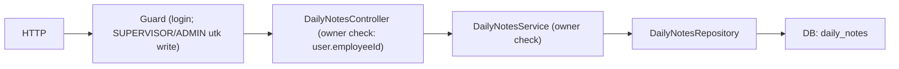

# Module: DailyNotesModule (Catatan Harian)

**Dibuat:** 2026-10-11
**File sumber yang dianalisis:**
- `daily-notes/daily-notes.module.ts`, `daily-notes.controller.ts`, `daily-notes.service.ts`, `daily-notes.repository.ts`
- `daily-notes/dto/create-daily-note.dto.ts`, `update-daily-note.dto.ts`
- `daily-notes/interfaces/daily-note.interface.ts`
- `daily-notes/daily-records.http`
- Rujukan tipe: `packages/types/src/daily-notes.ts`

## Daftar Isi
1. [Ringkasan Module](#1-ringkasan-module)
2. [Peta File di Module Ini](#2-peta-file-di-module-ini)
3. [Penjelasan Kode per File](#3-penjelasan-kode-per-file)
4. [Alur Kerja Lengkap](#4-alur-kerja-lengkap)
5. [Hubungan dengan Module Lain](#5-hubungan-dengan-module-lain)
6. [Kesalahan Umum & Tips Pemula](#6-kesalahan-umum--tips-pemula)
7. [Catatan Kualitas Kode](#7-catatan-kualitas-kode)
8. [Rangkuman & Cek Pemahaman](#8-rangkuman--cek-pemahaman)

---

## 1. Ringkasan Module

**DailyNotesModule** mencatat catatan harian tentang karyawan — biasanya oleh atasan/supervisor sebagai bahan masukan penilaian. Supervisor bisa membuat, melihat, mengubah, dan menghapus catatannya sendiri.

Analogi: ini seperti **buku harian pengawas lapangan**. Setiap pengawas menuliskan catatan tentang bawahannya (mis. "menyelesaikan tugas X dengan baik"). Pengawas hanya boleh mengubah/menghapus catatan buatannya sendiri; catatan pengawas lain tidak boleh disentuh.

**Istilah baru:**
- **Owner check** = pemeriksaan bahwa hanya pembuat data yang boleh mengubah/menghapusnya.

---

## 2. Peta File di Module Ini

| Nama file | Jenis | Peran singkat |
|-----------|-------|---------------|
| `daily-notes.module.ts` | Module | Merakit controller, service, repository |
| `daily-notes.controller.ts` | Controller | Endpoint `/api/daily-notes*` |
| `daily-notes.service.ts` | Service | Aturan owner + pemetaan payload |
| `daily-notes.repository.ts` | Repository | Query Drizzle ke `daily_notes` |
| `daily-notes.repository.spec.ts` | Test | Uji filter list (search employee, department, tanggal, scope) |
| `dto/create-daily-note.dto.ts`, `update-daily-note.dto.ts` | DTO | Validasi input |
| `interfaces/daily-note.interface.ts` | Alias | `DailyNotePayload = DailyNoteResponse` |
| `daily-records.http` | Contoh request (manual) | Berisi sample HTTP (lihat catatan: sudah usang) |

Diagram alur:



Versi teks:

```
Write: Request → Guard → Controller (cek employeeId) → Service (cek owner) → Repository → DB
Read : Request → Controller → Service → Repository → DB
```

---

## 3. Penjelasan Kode per File

### `daily-notes.module.ts`

```ts
@Module({
  controllers: [DailyNotesController],
  providers: [DailyNotesService, DailyNotesRepository],
  exports: [DailyNotesService],
})
export class DailyNotesModule {}
```

- **Fungsinya:** Merakit module.
- **Kenapa:** Pola standar NestJS.
- **Dampaknya:** Tanpa didaftarkan di `AppModule`, endpoint hilang.
- **Analogi:** Menyiapkan satu unit kerja dengan staf & mejanya.

### `daily-notes.controller.ts`

```ts
@ApiTags('daily-notes')
@ApiBearerAuth()
// @UseGuards(JwtAuthGuard, RolesGuard)
@Controller('daily-notes')
export class DailyNotesController {
  constructor(private readonly dailyNotesService: DailyNotesService) {}

  @Post() @Roles(UserRole.SUPERVISOR, UserRole.ADMIN) @HttpCode(201)
  create(@CurrentUser() user: AuthenticatedUser, @Body() dto: CreateDailyNoteDto) {
    if (!user.employeeId) throw new BadRequestException('User is not linked to an employee');
    return this.dailyNotesService.create(user.employeeId, dto);
  }

  @Get(':id') findOne(@Param('id', ParseUUIDPipe) id) { ... }
  @Patch(':id') @Roles(SUPERVISOR, ADMIN) update(@Param('id', ParseUUIDPipe) id, @CurrentUser() user, @Body() dto) { ... }
  @Delete(':id') @Roles(SUPERVISOR, ADMIN) @HttpCode(204) remove(@Param('id', ParseUUIDPipe) id, @CurrentUser() user) { ... }
}
```

- **Fungsinya:**
  - `@Roles(SUPERVISOR, ADMIN)` pada create/update/delete → hanya role ini yang boleh menulis.
  - `@CurrentUser()` mengambil user yang login; controller memastikan user **tertaut ke karyawan** (`user.employeeId`), karena catatan memakai `supervisorId` = employeeId.
  - Baris `// @UseGuards(JwtAuthGuard, RolesGuard)` dikomentari (guard sudah global).
- **Kenapa dibuat seperti ini:** Validasi "user harus tertaut karyawan" dicek di controller karena itu prasyarat untuk menyimpan `supervisorId`. Ini juga jadi pengaman agar tidak menyimpan `undefined`.
- **Dampaknya:** Jika `!user.employeeId` tidak dicek, insert bisa gagal (supervisor_id NOT NULL) atau menyimpan data tak valid.
- **Analogi:** Pengawas harus punya nomor pegawai resmi sebelum boleh menulis di buku harian.
- **Istilah baru:** **`@CurrentUser()`** = decorator param kustom yang mengambil user dari request.

### `daily-notes.service.ts`

```ts
async create(supervisorId: string, dto: CreateDailyNoteDto) {
  const result = await this.dailyNotesRepository.createAndSave(supervisorId, dto);
  return ok(this.toPayload(result));
}

async update(id: string, supervisorId: string, dto: UpdateDailyNoteDto) {
  const record = await this.findOneOrFail(id);
  if (record.supervisorId !== supervisorId) {
    throw new ForbiddenException('You can only update your own daily notes');
  }
  const updated = await this.dailyNotesRepository.updateAndSave(id, dto);
  return ok(this.toPayload(updated));
}

async remove(id: string, supervisorId: string) {
  const record = await this.findOneOrFail(id);
  if (record.supervisorId !== supervisorId) {
    throw new ForbiddenException('You can only delete your own daily notes');
  }
  await this.dailyNotesRepository.delete(id);
}
```

- **Fungsinya:**
  - `create` menyimpan `supervisorId` dari user login.
  - `update`/`remove` memeriksa owner: jika `record.supervisorId !== supervisorId` → `ForbiddenException` (403).
- **Kenapa dibuat seperti ini:** Menegakkan kepemilikan (hanya pembuat yang boleh mengubah). Catatan `SUPERVISOR` divalidasi via role guard + owner check.
- **Dampaknya:** Menghapus owner check → supervisor bisa mengubah/menghapus catatan supervisor lain.
- **Analogi:** Buku harian pribadi: hanya penulisnya yang boleh mengedit halamannya.

> Catatan penting: Berbeda dari module lain, di sini **tidak ada transaksi** dan **tidak ada audit** (`AuditService` tidak dipakai). Lihat bagian 7.

`findAllByEmployee` / `findAllBySupervisor` ada di service, tetapi **tidak ada route** di controller (lihat bagian 7).

`findOneOrFail` dan `toPayload`:

```ts
private toPayload(record: any): DailyNotePayload {
  return { id, employeeId, supervisorId, recordDate, description,
           createdAt: new Date(record.createdAt).toISOString(),
           updatedAt: new Date(record.updatedAt).toISOString() };
}
```

- **Fungsinya:** Memilih field respons (tanpa `score`, `note`, `isDeleted`).
- **Dampaknya:** Field `score`/`note` di skema tidak ikut dikirim — *perlu konfirmasi* apakah memang belum dipakai.

### `daily-notes.repository.ts`

```ts
@Injectable()
export class DailyNotesRepository {
  constructor(@Inject(DB_CONNECTION) private readonly db: NodePgDatabase<typeof schema>) {}

  async findById(id: string) { const [r] = await this.db.select().from(schema.dailyNotes).where(eq(schema.dailyNotes.id, id)).limit(1); return r || null; }
  async findAllByEmployee(employeeId: string) { return this.db.select().from(schema.dailyNotes).where(eq(schema.dailyNotes.employeeId, employeeId)); }
  async findAllBySupervisor(supervisorId: string) { return this.db.select().from(schema.dailyNotes).where(eq(schema.dailyNotes.supervisorId, supervisorId)); }
  async createAndSave(supervisorId, dto) { const [r] = await this.db.insert(schema.dailyNotes).values({ ...dto, supervisorId }).returning(); return r; }
  async updateAndSave(id, dto) { const [r] = await this.db.update(schema.dailyNotes).set({ ...dto }).where(eq(schema.dailyNotes.id, id)).returning(); return r || null; }
  async delete(id) { const [r] = await this.db.delete(schema.dailyNotes).where(eq(schema.dailyNotes.id, id)).returning(); return r || null; }
}
```

- **Fungsinya:** Query CRUD ke `daily_notes`. `delete` di sini adalah **hard delete** (`DELETE` sungguhan).
- **Kenapa dibuat seperti ini:** Sederhana dan langsung. Menyimpan `supervisorId` dari argumen (bukan dari DTO) mencegah klien memalsukan pelaku.
- **Dampaknya:** Hard delete berarti data hilang permanen dan tidak bisa dipulihkan/diaudit.
- **Analogi:** Merobek halaman buku harian (bukan menandainya "dibatalkan").
- **Istilah baru:** **Hard delete** = `DELETE` permanen; lawan dari soft delete.
- **Catatan tipe:** constructor memakai `NodePgDatabase<typeof schema>` langsung, bukan `Database` dari `db.type.ts` (inkonsistensi kecil dengan module lain).

> **Pembaruan list (2026-10-27):** `listNotes` memakai `buildDailyNoteFilters(query, scope)`. Filter yang didukung: `employeeId`, `departmentId`, `dateFrom`/`dateTo` pada `daily_notes.record_date`, `search` pada `employees.employee_number`/`employees.full_name`, lalu scope role (`employee`/`department`/`all`). Karena `search` mereferensikan `employees`, count query ikut `leftJoin(employees, eq(dailyNotes.employeeId, employees.id))`. Search ditambahkan agar daftar bisa dicari berdasarkan nomor atau nama karyawan.

> **Daily note sum:** perhitungan sum ada di `AppraisalsRepository.dailyNoteSums`, bukan di module ini. Window-nya adalah `contract_start_date`–`contract_end_date` snapshot appraisal employee, hanya field `NUMBER`, department yang sama, dan hasilnya informational (tidak mengubah skor).

### DTO

| File | Isi |
|------|-----|
| `create-daily-note.dto.ts` | `employeeId` (UUID, wajib), `recordDate` (`@IsDateString`), `description` (string, wajib) |
| `update-daily-note.dto.ts` | `PartialType(CreateDailyNoteDto)` — semua opsional |

- **Fungsinya:** Validasi input. `implements CreateDailyNoteRequest` mengikat ke tipe bersama.
- **Dampaknya:** Pada update, `employeeId` **masih bisa** diubah (tidak di-omit) — *perlu konfirmasi* apakah itu diinginkan.

### `daily-records.http`

- **Fungsinya:** File contoh request manual (bukan kode runtime).
- **Catatan penting:** Isinya sudah **usang/tidak sinkron** dengan kode sekarang: memakai path `/daily-records/bulk`, `email`, `category`, `access_token`, `my-records`, sedangkan controller kini memakai `/daily-notes`, `username`, dan tanpa bulk. Anggap ini hanya referensi lama.

---

## 4. Alur Kerja Lengkap

Skenario: **Supervisor membuat catatan harian.**

1. Supervisor login → `JwtStrategy.validate` mengisi `AuthenticatedUser` (termasuk `employeeId`).
2. Supervisor mengirim `POST /api/daily-notes` dengan `{ employeeId, recordDate, description }`.
3. `RolesGuard` memeriksa `@Roles(SUPERVISOR, ADMIN)` → cocok.
4. Controller memastikan `user.employeeId` ada; jika tidak → 400.
5. `DailyNotesService.create(user.employeeId, dto)` → repository menyimpan dengan `supervisorId` = user.
6. Response 201 `ok(payload)`.

Skenario update: `PATCH /api/daily-notes/<id>` → service ambil catatan → jika `supervisorId` bukan pembuat → **403** → jika cocok, update.

Skenario delete: `DELETE /api/daily-notes/<id>` → cek owner → hard delete → 204.

---

## 5. Hubungan dengan Module Lain

**Bergantung pada:**
- `DbModule` (global) → `DB_CONNECTION`.
- `common` → `@Roles`, `@CurrentUser`, `ResponseInterceptor`.
- **Tidak** memakai `AuditModule` (lihat bagian 7).

**Diekspos (exports):** `DailyNotesService` (mungkin untuk dipakai appraisals/dashboard, meski belum terlihat dipakai).

**Dampak jika diubah/dihapus:**
- Menghapus module → fitur catatan harian hilang.
- Mengubah owner check → risiko supervisor lain mengubah catatan Anda.

---

## 6. Kesalahan Umum & Tips Pemula

1. **User tidak tertaut ke karyawan.** `user.employeeId` kosong → 400 "User is not linked to an employee".
2. **Mengedit/menghapus catatan milik supervisor lain.** Ditolak 403.
3. **Mengira catatan bisa dibatalkan (soft delete).** Tidak; di sini hard delete.
4. **Mengandalkan tidak ada audit.** Saat ini tidak ada jejak audit untuk catatan harian — perhatikan bila kepatuhan mensyaratkan audit.
5. **Menggunakan endpoint list.** `findAllByEmployee`/`findAllBySupervisor` ada di service tapi tidak ada route-nya.

**Pesan error yang mungkin muncul:**
- `400 User is not linked to an employee` → akun tak terhubung karyawan.
- `403 You can only update/delete your own daily notes` → bukan pemilik.
- `404 Daily note with ID ... not found` → id tidak ada.
- `400` dari `ParseUUIDPipe` → id bukan UUID.

---

## 7. Catatan Kualitas Kode

> Bagian ini berisi temuan yang cukup banyak. Sebagian besar karena module ini tampak belum mengikuti konvensi yang dipakai module lain.

- **Tidak ada audit.** AGENTS.md menyebut "Every write ... creates an audit entry". `DailyNotesService` tidak memanggil `AuditService`. *Perlu konfirmasi:* apakah catatan harian memang dikecualikan dari audit, atau ini celah yang harus diperbaiki.
- **Hard delete, bukan soft delete.** `schema.dailyNotes` punya `isDeleted`/`deletedAt` (basis `baseFields`), tetapi repository memakai `delete()` sungguhan dan **tidak** memfilter `notDeleted`. Bertentangan dengan semangat "tidak ada hard delete". Saran: ubah ke soft delete + filter `notDeleted`.
- **Tidak ada scope departemen.** Berbeda dari employees, catatan tidak dibatasi departemen. Siapa pun yang tahu `id` bisa `GET` catatan apa pun (owner check hanya untuk write). *Perlu konfirmasi* apakah read memang untuk semua user login.
- **Route list tidak ada.** `findAllByEmployee`/`findAllBySupervisor` tak terpakai controller — kode mati atau fitur belum selesai.
- **`any` dipakai** di `findOneOrFail(): Promise<any>` dan `toPayload(record: any)` (melanggar aturan "no any").
- **`UpdateDailyNoteDto` mengizinkan ubah `employeeId`.** Bisa memindahkan catatan ke karyawan lain (mengubah makna catatan). Saran: `OmitType(CreateDailyNoteDto, ['employeeId'])`.
- **`daily-records.http` usang** dan menyesatkan. Saran: perbarui atau hapus.
- **Role `SUPERVISOR`** dipakai di `@Roles`, sedangkan AGENTS.md tidak menyebut role ini. Lihat catatan serupa di module `common`.
- **Constructor repository** memakai tipe `NodePgDatabase<typeof schema>` langsung, bukan `Database` dari `db.type.ts`. Sebaiknya diseragamkan.

---

## 8. Rangkuman & Cek Pemahaman

**Poin kunci:**
1. DailyNotesModule = catatan harian karyawan oleh supervisor.
2. Hanya SUPERVISOR/ADMIN yang boleh menulis; hanya pembuat yang boleh mengubah/menghapus (owner check → 403).
3. `supervisorId` diambil dari user login (`employeeId`), bukan dari body.
4. Endpoint: create, findOne, update, delete (tanpa list).
5. Berbeda dari module lain: tanpa transaksi/audit dan memakai hard delete — ini temuan utama.

**Pertanyaan latihan:**

1. *Kenapa `supervisorId` diambil dari `user.employeeId`, bukan dari body request?*
   → Agar tidak bisa dipalsukan; pelaku harus tercatat sesuai identitas yang sudah terautentikasi.

2. *Apa yang terjadi bila user login tidak tertaut ke karyawan?*
   → Controller menolak dengan 400 "User is not linked to an employee".

3. *Apa perbedaan perilaku delete di module ini dibanding departments/positions?*
   → Di sini hard delete (data hilang permanen), di sana soft delete (data ditandai terhapus dan tetap tersimpan).
