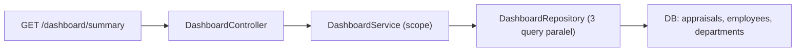

# Module: DashboardModule (Ringkasan / Statistik)

**Dibuat:** 2026-10-11
**File sumber yang dianalisis:**
- `dashboard/dashboard.module.ts`, `dashboard.controller.ts`, `dashboard.service.ts`, `dashboard.repository.ts`, `dashboard.service.spec.ts`
- Rujukan tipe: `packages/types/src/dashboard.ts`

## Daftar Isi
1. [Ringkasan Module](#1-ringkasan-module)
2. [Peta File di Module Ini](#2-peta-file-di-module-ini)
3. [Penjelasan Kode per File](#3-penjelasan-kode-per-file)
4. [Alur Kerja Lengkap](#4-alur-kerja-lengkap)
5. [Hubungan dengan Module Lain](#5-hubungan-dengan-module-lain)
6. [Kesalahan Umum & Tips Pemula](#6-kesalahan-umum--tips-pemula)
7. [Catatan Kualitas Kode](#7-catatan-kualitas-kode)
8. [Rangkuman & Cek Pemahaman](#8-rangkuman--cek-pemahaman)

---

## 1. Ringkasan Module

**DashboardModule** menyediakan satu endpoint ringkasan (read-only) untuk halaman utama: jumlah appraisal per status, total karyawan, dan jumlah karyawan per departemen — semuanya dibatasi sesuai scope departemen pengguna. Tidak ada operasi tulis.

Analogi: ini seperti **papan informasi di lobby kantor** yang menampilkan angka-angka ringkas ("berapa dokumen di tahap mana", "berapa pegawai"). Papan ini hanya menampilkan; ia tidak mengubah apa pun. Dan isinya disesuaikan: kepala departemen hanya melihat angka departemennya.

**Istilah baru:**
- **Agregasi** = merangkum banyak baris menjadi angka ringkas (mis. COUNT, GROUP BY).
- **Read-only** = hanya membaca, tidak mengubah.

---

## 2. Peta File di Module Ini

| Nama file | Jenis | Peran singkat |
|-----------|-------|---------------|
| `dashboard.module.ts` | Module | Merakit controller, service, repository |
| `dashboard.controller.ts` | Controller | Endpoint `GET /api/dashboard/summary` |
| `dashboard.service.ts` | Service | Menyusun ringkasan + scope |
| `dashboard.repository.ts` | Repository | Query agregasi (COUNT, GROUP BY) |
| `dashboard.service.spec.ts` | Test | Uji service (zero-fill + scope) |

Diagram alur:



Versi teks:

```
Request → Controller → Service (hitung scope) → Repository (Promise.all 3 query) → DB → DashboardSummary
```

---

## 3. Penjelasan Kode per File

### `dashboard.module.ts`

```ts
@Module({
  controllers: [DashboardController],
  providers: [DashboardService, DashboardRepository],
})
export class DashboardModule {}
```

- **Fungsinya:** Merakit module; tidak mengekspor apa pun (hanya dipakai lewat HTTP).
- **Kenapa:** Pola standar. Dashboard tidak menyediakan layanan untuk module lain.
- **Dampaknya:** Tanpa didaftarkan di `AppModule`, endpoint hilang.
- **Analogi:** Memasang papan informasi di lobby.

### `dashboard.controller.ts`

```ts
@ApiTags('dashboard')
@ApiBearerAuth()
@Controller('dashboard')
export class DashboardController {
  constructor(private readonly dashboardService: DashboardService) {}

  @Get('summary')
  @ApiOperation({ summary: 'Dashboard summary (scoped)' })
  summary(): Promise<ApiResponse<DashboardSummary>> {
    return this.dashboardService.summary();
  }
}
```

- **Fungsinya:** Satu endpoint `GET /api/dashboard/summary` (wajib login; tanpa `@Roles`, jadi semua user login boleh). Pembatasan dikerjakan di service.
- **Kenapa:** Ringkasan dibutuhkan semua peran (dengan isi disesuaikan scope). Tidak ada `@Roles` karena bukan operasi sensitif.
- **Dampaknya:** Bila scope di service dilepas, semua user melihat angka seluruh perusahaan.
- **Analogi:** Papan yang boleh dilihat siapa pun, tapi isinya disaring sesuai hak akses.

### `dashboard.service.ts`

```ts
async summary(): Promise<ApiResponse<DashboardSummary>> {
  const user = this.requestContext.getUser();
  let departmentIds: string[] | undefined;
  if (user) {
    const scope = await this.scopeService.getDepartmentScope(user);
    if (scope !== 'ALL') departmentIds = scope;
  }

  const [statusCounts, total, byDepartment] = await Promise.all([
    this.repository.appraisalsByStatus(departmentIds),
    this.repository.employeeTotal(departmentIds),
    this.repository.employeesByDepartment(departmentIds),
  ]);

  const countByStatus = new Map(statusCounts.map((row) => [row.status, row.count]));
  const appraisalsByStatus = Object.values(AppraisalStatus).map((status) => ({
    status,
    count: countByStatus.get(status) ?? 0,
  }));

  return ok({ appraisalsByStatus, employees: { total, byDepartment } });
}
```

- **Fungsinya:**
  1. Menentukan scope: role global (`'ALL'`) → `departmentIds = undefined` (tanpa filter); role terbatas → daftar id departemen.
  2. Menjalankan **tiga query agregasi secara paralel** (`Promise.all`).
  3. **Zero-fill**: memastikan kelima status (`DRAFT..COMPLETE`) selalu muncul walau hitungan 0.
  4. Mengembalikan `{ appraisalsByStatus, employees: { total, byDepartment } }`.
- **Kenapa dibuat seperti ini:**
  - `undefined` untuk global scope adalah pola "tanpa filter departemen".
  - `Promise.all` mempercepat karena tiga query independen.
  - Zero-fill memudahkan frontend menggambar grafik (semua kategori selalu ada).
- **Dampaknya:** Bila zero-fill dihapus, status dengan hitungan 0 hilang dari respons (grafik bisa berubah). Bila scope diabaikan, kebocoran data lintas departemen.
- **Analogi:** Petugas papan yang menghitung: berapa dokumen di tiap tahap, berapa pegawai, per departemen — hanya untuk departemen yang boleh dia lihat.
- **Istilah baru:** **`Promise.all`** = menjalankan beberapa promise bersamaan lalu menunggu semuanya.

### `dashboard.repository.ts`

```ts
async appraisalsByStatus(departmentIds?: string[]) {
  const filters: SQL[] = [notDeleted(appraisals)];
  if (departmentIds) filters.push(departmentIds.length === 0 ? sql`1 = 0` : inArray(appraisals.departmentId, departmentIds));
  const rows = await this.db.select({ status: appraisals.status, count: sql<number>`count(*)` })
    .from(appraisals).where(and(...filters)).groupBy(appraisals.status);
  return rows.map((row) => ({ status: row.status, count: Number(row.count) }));
}
```

- **Fungsinya:** `COUNT(*) GROUP BY status` untuk appraisal, dengan filter scope. Bila scope kosong (`[]`) → kondisi `1 = 0` (tidak ada hasil).
- **Kenapa:** Mengagregasi di database jauh lebih efisien daripada mengambil semua baris ke aplikasi.
- **Dampaknya:** Bila `notDeleted` dihilangkan, appraisal terhapus ikut terhitung.
- **Analogi:** Menghitung dokumen per status langsung di lemari arsip, bukan membawanya ke meja.

```ts
async employeeTotal(departmentIds?: string[]): Promise<number> { ... COUNT(*) employees ... }

async employeesByDepartment(departmentIds?: string[]) {
  const filters: SQL[] = [notDeleted(departments), eq(departments.isActive, true)];
  if (departmentIds) filters.push(departmentIds.length === 0 ? sql`1 = 0` : inArray(departments.id, departmentIds));
  const rows = await this.db
    .select({ departmentId: departments.id, department: departments.name, total: sql<number>`count(${employees.id})` })
    .from(departments)
    .leftJoin(employees, and(eq(employees.departmentId, departments.id), notDeleted(employees)))
    .where(and(...filters))
    .groupBy(departments.id, departments.name)
    .orderBy(asc(departments.name));
  return rows.map((row) => ({ departmentId: row.departmentId, department: row.department, total: Number(row.total) }));
}
```

- **Fungsinya:** Total karyawan (global/scope) dan jumlah karyawan per departemen aktif. `leftJoin` + `count(employees.id)` memastikan departemen tanpa karyawan tetap muncul dengan `total = 0` (karena `count(kolom)` menghitung nilai non-null).
- **Kenapa:** Laporan per departemen butuh semua departemen (termasuk yang kosong). Urut nama agar stabil.
- **Dampaknya:** Bila memakai `count(*)` bersama `leftJoin`, departemen kosong akan salah terhitung 1. Di sini memakai `count(employees.id)` — benar.
- **Analogi:** Menghitung pegawai tiap departemen, tetap menampilkan departemen yang kebetulan belum punya pegawai (0).
- **Istilah baru:** **leftJoin** = gabungan yang mempertahankan baris kiri walau tanpa pasangan. **`count(kolom)`** = menghitung nilai non-null.

### `dashboard.service.spec.ts`

```ts
it('zero-fills all five statuses', ...);                      // 5 status muncul, PENDING = 0
it('passes department ids to the repository for scoped roles', ...); // scope ['d1'] diteruskan ke repo
```

- **Fungsinya:** Menguji (1) kelima status selalu muncul dengan nilai 0 bila kosong, dan (2) scope departemen diteruskan ke repository untuk role terbatas.
- **Kenapa:** Menjaga perilaku zero-fill & pembatasan scope dari regresi.
- **Analogi:** Daftar periksa yang memverifikasi papan menampilkan semua kategori & menyaring sesuai wewenang.

---

## 4. Alur Kerja Lengkap

Skenario: **Head Department membuka halaman dashboard.**

1. Frontend memanggil `GET /api/dashboard/summary` dengan token.
2. `JwtAuthGuard` memverifikasi token; user (Head Department) ditempelkan.
3. `DashboardService.summary` meminta scope user → `ScopeService` mengembalikan daftar id departemen miliknya (bukan `'ALL'`).
4. Tiga query dijalankan paralel dengan filter departemen tersebut.
5. Hasil di-zero-fill (kelima status) dan dibungkus `ok()`.
6. `ResponseInterceptor` membungkus ke format standar; frontend menggambar kartu/grafik.

Untuk role global (ADMIN/HR/GENERAL_MANAGER): `departmentIds = undefined` → angka seluruh perusahaan.

---

## 5. Hubungan dengan Module Lain

**Bergantung pada:**
- `DbModule` (global), `common` (`ScopeService`, `RequestContextService`, `ResponseInterceptor`).

**Tidak dipakai module lain** (read-only, hanya lewat HTTP).

**Dampak jika diubah/dihapus:**
- Menghapus module → halaman dashboard kehilangan data.
- Mengubah bentuk `DashboardSummary` → frontend perlu menyesuaikan.
- Melepas filter `notDeleted`/scope → angka salah atau bocor.

---

## 6. Kesalahan Umum & Tips Pemula

1. **Lupa filter `notDeleted`.** Data terhapus ikut terhitung.
2. **Memakai `count(*)` dengan `leftJoin` untuk per-departemen.** Departemen kosong salah terhitung. Gunakan `count(kolom)`.
3. **Menghapus zero-fill.** Frontend mungkin gagal menampilkan semua kategori.
4. **Mengira dashboard menampilkan semua.** Untuk role terbatas, angkanya hanya departemennya.
5. **Menambah query baru tanpa `Promise.all`.** Bisa memperlambat respons (seharusnya paralel).

**Pesan error yang mungkin muncul:**
- `401` bila belum login.
- `500` bila query agregasi gagal (mis. skema berubah).

---

## 7. Catatan Kualitas Kode

- **Tidak ada `@Roles`, sengaja.** Ringkasan boleh dilihat semua user login, dengan scope. Wajar, tapi pastikan angka agregat tidak dianggap sensitif.
- **`employeesByDepartment` berbagi filter scope `departmentIds` untuk `departments.id`.** Konsisten dengan cara `appraisalsByStatus` memfilter `appraisals.departmentId`. Baik.
- **Terdapat test** untuk zero-fill & scope; praktik bagus.
- **Tidak ada masalah keamanan kritis.** Query memakai parameter Drizzle (`inArray`) — aman.

---

## 8. Rangkuman & Cek Pemahaman

**Poin kunci:**
1. DashboardModule menyediakan satu endpoint ringkasan read-only (`GET /api/dashboard/summary`).
2. Isinya dibatasi scope departemen pengguna (role global melihat semua).
3. Tiga query agregasi dijalankan paralel (`Promise.all`).
4. Kelima status appraisal selalu ditampilkan (zero-fill).
5. Per-departemen memakai `leftJoin` + `count(kolom)` supaya departemen kosong tetap muncul 0.

**Pertanyaan latihan:**

1. *Kenapa perhitungan dilakukan di database, bukan mengambil semua baris lalu menghitung di service?*
   → Agregasi di DB (COUNT, GROUP BY) jauh lebih efisien dan mengurangi data yang dipindahkan.

2. *Apa fungsi zero-fill pada `appraisalsByStatus`?*
   → Memastikan kelima status selalu ada di respons (dengan 0 bila kosong), sehingga frontend dapat menampilkan semua kategori secara konsisten.

3. *Bagaimana scope departemen memengaruhi hasil?*
   → Untuk role terbatas, `departmentIds` diisi daftar departemen user sehingga query hanya menghitung data departemen itu; role global memakai `undefined` (tanpa filter).
