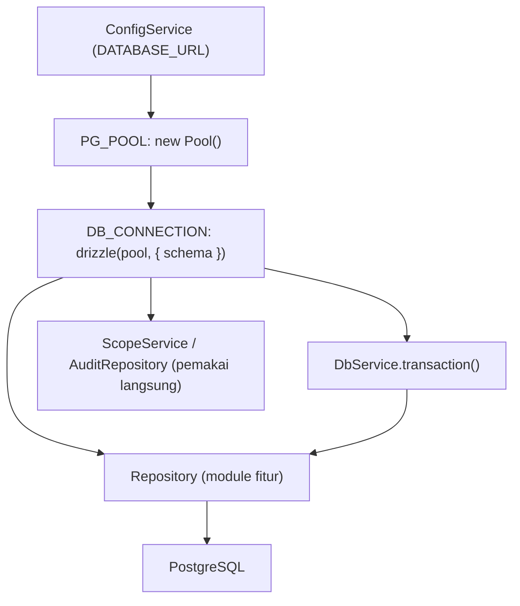

# Module: DbModule (Database & Skema)

**Dibuat:** 2026-10-11
**File sumber yang dianalisis:**
- `db/db.module.ts`, `db/db.service.ts`, `db/db.constants.ts`, `db/db.type.ts`
- `db/schema.ts` (semua tabel & relasi)
- `db/audit-logs.schema.ts`
- `db/helpers/soft-delete.ts`
- `db/migrate.ts`, `db/seed.ts`, `db/seed-employees.ts`
- Migrasi SQL: `drizzle/0000_init.sql`, `drizzle/0001_constraints.sql`, `drizzle/0002_drop_contract_status.sql`

## Daftar Isi
1. [Ringkasan Module](#1-ringkasan-module)
2. [Peta File di Module Ini](#2-peta-file-di-module-ini)
3. [Penjelasan Kode per File](#3-penjelasan-kode-per-file)
4. [Alur Kerja Lengkap](#4-alur-kerja-lengkap)
5. [Hubungan dengan Module Lain](#5-hubungan-dengan-module-lain)
6. [Kesalahan Umum & Tips Pemula](#6-kesalahan-umum--tips-pemula)
7. [Catatan Kualitas Kode](#7-catatan-kualitas-kode)
8. [Rangkuman & Cek Pemahaman](#8-rangkuman--cek-pemahaman)

---

## 1. Ringkasan Module

**DbModule** adalah satu-satunya pintu ke database. Ia membuat kolam koneksi PostgreSQL, membungkusnya dengan Drizzle ORM, dan menyediakannya ke seluruh aplikasi lewat token `DB_CONNECTION`. Module ini juga memuat definisi skema (tabel, enum, relasi) dan skrip migrasi/seeding.

Analogi: ini seperti **ruang arsip pusat gedung**. Semua divisi (module) tidak menyimpan lemari sendiri; mereka datang ke ruang arsip (repository) dan meminta dokumen. DbModule adalah kunci ruang arsip, rak-raknya (tabel), serta prosedur pengarsipan (migration & seeding).

**Istilah baru:**
- **ORM** = Object-Relational Mapping: alat yang menerjemahkan tabel database menjadi objek TypeScript sehingga kita tak menulis SQL mentah terus-menerus. Di sini dipakai **Drizzle ORM**.
- **Pool (kolam koneksi)** = sekumpulan koneksi database yang dipakai ulang. Membuka koneksi baru tiap query itu lambat, jadi koneksinya "dipinjam" dari kolam.
- **Migration** = file berisi perubahan struktur database (buat tabel, ubah kolom) yang dijalankan berurutan.

---

## 2. Peta File di Module Ini

| Nama file | Jenis | Peran singkat |
|-----------|-------|---------------|
| `db.module.ts` | Module (`@Global`) | Membuat Pool + Drizzle, menyediakannya, menutup pool saat shutdown |
| `db.service.ts` | Service | Membungkus `db` dan menyediakan helper `transaction()` |
| `db.constants.ts` | Konstanta | Token DI: `DB_CONNECTION`, `PG_POOL` |
| `db.type.ts` | Type | Tipe `Database`, `Transaction`, `DbExecutor` |
| `schema.ts` | Skema | Semua tabel, enum, index, relasi Drizzle |
| `audit-logs.schema.ts` | Skema (khusus) | Definisi tabel `audit_logs` untuk query (tidak digenerate Drizzle) |
| `helpers/soft-delete.ts` | Util | Helper `notDeleted()` untuk filter baris terhapus |
| `migrate.ts` | Skrip CLI | Menjalankan migrasi di produksi |
| `seed.ts` | Skrip CLI | Membuat admin & criteria set v1 (idempotent) |
| `seed-employees.ts` | Skrip CLI | Membuat data dummy departemen/posisi/karyawan/kontrak |
| `drizzle/*.sql` | Migrasi | SQL (termasuk constraint & partisi yang tak bisa ekspresikan Drizzle) |

Diagram alur:



Versi teks:

```
Env DATABASE_URL → Pool → Drizzle (DB_CONNECTION) → Repository → PostgreSQL
                                            ↘ transaction() untuk operasi atomik
```

---

## 3. Penjelasan Kode per File

### `db.constants.ts`

```ts
export const DB_CONNECTION = 'DB_CONNECTION';
export const PG_POOL = 'PG_POOL';
```

- **Fungsinya:** Dua token (string unik) sebagai "nama" provider DI. Dipakai dengan `@Inject(DB_CONNECTION)`.
- **Kenapa dibuat seperti ini:** Karena koneksi database dibuat lewat factory (bukan class biasa), NestJS butuh token untuk mengidentifikasinya. Token berupa konstanta mencegah salah ketik string.
- **Dampaknya:** Jika nilainya diubah, semua `@Inject(DB_CONNECTION)` harus ikut berubah atau error "can't resolve".
- **Analogi:** Nomor loker di ruang arsip; tiap loker punya label unik.
- **Istilah baru:** **DI token** = kunci yang dipakai NestJS untuk mencocokkan permintaan dependensi dengan provider-nya.

### `db.type.ts`

```ts
export type Database = NodePgDatabase<typeof schema>;
export type Transaction = Parameters<Parameters<Database['transaction']>[0]>[0];
export type DbExecutor = Database | Transaction;
```

- **Fungsinya:** Mendefinisikan tipe database yang sudah "tahu" skema, plus tipe transaksi dan tipe gabungan (`DbExecutor`).
- **Kenapa dibuat seperti ini:** Repository bisa menerima `Database` (query biasa) atau `Transaction` (di dalam transaksi) lewat `DbExecutor`, sehingga kode query bisa dipakai ulang dalam dua konteks.
- **Dampaknya:** Kalau `DbExecutor` tidak dipakai konsisten, repository jadi terpaksa membuat fungsi duplikat untuk transaksi.
- **Analogi:** Gagang pintu yang bisa dipasang di pintu biasa maupun pintu geser — bentuknya sama, tetap bisa dibuka.
- **Istilah baru:** `Parameters<...>` = tipe bawaan TypeScript untuk mengekstrak bentuk parameter sebuah fungsi.

### `db.module.ts`

**Peran file:** Assembly koneksi database.

```ts
@Global()
@Module({
  imports: [ConfigModule],
  providers: [
    {
      provide: PG_POOL,
      useFactory: (configService: ConfigService) =>
        new Pool({ connectionString: configService.get<string>('DATABASE_URL') }),
      inject: [ConfigService],
    },
    {
      provide: DB_CONNECTION,
      useFactory: (pool: Pool) => drizzle(pool, { schema }) as Database,
      inject: [PG_POOL],
    },
    DbService,
  ],
  exports: [DB_CONNECTION, PG_POOL, DbService],
})
export class DbModule implements OnModuleDestroy {
  constructor(@Inject(PG_POOL) private readonly pool: Pool) {}
  async onModuleDestroy() { await this.pool.end(); }
}
```

- **Fungsinya:**
  - `PG_POOL` dibuat dari `DATABASE_URL` memakai `useFactory` (karena butuh ConfigService).
  - `DB_CONNECTION` dibuat dari pool memakai `drizzle(pool, { schema })`.
  - `onModuleDestroy` menutup pool saat aplikasi berhenti (mencegah koneksi menggantung).
  - `@Global()` membuatnya tersedia di semua module.
- **Kenapa dibuat seperti ini:** `useFactory` adalah best practice NestJS saat provider butuh dikonfigurasi dari nilai lain. `onModuleDestroy` memastikan resource dibersihkan.
- **Dampaknya:** Menghapus `pool.end()` bisa membuat proses test/deploy "menggantung". Menghapus `@Global()` memaksa setiap module mengimpor DbModule.
- **Analogi:** Membuka ruang arsip saat kantor buka, dan mengunci serta merapikan saat kantor tutup.
- **Istilah baru:** **useFactory** = cara membuat provider memakai fungsi. **`onModuleDestroy`** = hook lifecycle NestJS yang dipanggil saat module dibongkar.

### `db.service.ts`

```ts
@Injectable()
export class DbService {
  constructor(@Inject(DB_CONNECTION) private readonly db: Database) {}
  get client(): Database { return this.db; }
  transaction<T>(callback: (tx: Transaction) => Promise<T>): Promise<T> {
    return this.db.transaction(callback);
  }
}
```

- **Fungsinya:** Menyediakan `client` (akses DB langsung) dan `transaction()` (menjalankan beberapa query dalam satu transaksi atomik).
- **Kenapa dibuat seperti ini:** Transaksi penting untuk aturan "tulis perubahan + catat audit dalam satu transaksi". DbService membungkusnya agar pemakaian konsisten.
- **Dampaknya:** Jika sebuah operasi multi-langkah tidak memakai `transaction()`, bisa terjadi data setengah tersimpan saat error di tengah jalan.
- **Analogi:** Kasir yang membungkus beberapa item dalam satu struk: semua berhasil, atau semua batal.
- **Istilah baru:** **Transaction** = satu unit kerja database: semua langkah berhasil, atau tidak ada yang disimpan (rollback).

### `schema.ts` — Tabel & Struktur

**Peran file:** Mendefinisikan seluruh tabel database dalam kode TypeScript. Ini sumber kebenaran struktur DB.

**Base fields (dipakai hampir semua tabel):**

```ts
const baseFields = {
  createdAt: timestamp('created_at').defaultNow().notNull(),
  updatedAt: timestamp('updated_at').defaultNow().$onUpdateFn(() => new Date()).notNull(),
  isDeleted: boolean('is_deleted').default(false).notNull(),
  deletedAt: timestamp('deleted_at'),
};
```

- **Fungsinya:** Menambahkan kolom standar: waktu dibuat, waktu diubah, penanda terhapus (soft delete), dan waktu dihapus.
- **Kenapa dibuat seperti ini:** Aturan domain "tidak ada hard delete" butuh penanda `is_deleted`/`deleted_at`. `$onUpdateFn` otomatis memperbarui `updated_at` saat row diubah.
- **Dampaknya:** Menghapus `deletedAt` dari baseFields akan merusak `notDeleted()` dan semua filter soft delete.
- **Analogi:** Cap tanggal masuk-keluar-arsip di setiap dokumen.
- **Istilah baru:** **Soft delete** = "menghapus" dengan menandai, bukan membuang permanen, agar data bisa dilacak.

**Tabel-tabel utama (ringkasan):**

| Tabel | Isi | Catatan penting |
|-------|-----|-----------------|
| `users` | Akun login | `username` unik, `role` enum, `employeeId` (opsional), `lastLoginAt` |
| `refresh_tokens` | Sesi refresh | `id` = JWT `jti`, `tokenHash` (hash, bukan token asli), `revokedAt`, `replacedBy` |
| `user_departments` | Scope departemen user | Primary key gabungan `(userId, departmentId)` |
| `departments` | Master departemen | `code` unik, `headEmployeeId` (self-ref ke employees) |
| `positions` | Master jabatan | `code` unik, `level` angka |
| `employees` | Karyawan | `employeeNumber` unik (hanya untuk baris aktif), `superiorId` self-ref |
| `contracts` | Kontrak karyawan | Tipe varchar, `startDate`/`endDate`, index unik `(employeeId, startDate)` untuk baris aktif |
| `criteria_sets` | Versi set kriteria | `version` unik; hanya satu `ACTIVE` (unique index parsial) |
| `criteria` | Item kriteria | `weight` numeric, check `scaleMin < scaleMax`, `weight > 0` |
| `criteria_scale_descriptions` | Deskripsi tiap skor | Unik `(criterionId, score)` |
| `dynamic_inputs` | Metadata input dinamis | `formId`, `field`, `type`, `rules` (jsonb) |
| `daily_notes` | Catatan harian | `employeeId`, `supervisorId`, `score` (jsonb), `description` |
| `appraisals` | Penilaian per departemen/periode | Unik `(departmentId, period)` untuk baris aktif |
| `appraisal_employees` | Karyawan dalam satu appraisal | Menyimpan snapshot nama/no/posisi + `totalScore` |
| `appraisal_ratings` | Rating per kriteria | Unik `(appraisalEmployeeId, criterionId)` |
| `appraisal_status_history` | Riwayat perubahan status | PK bigint identity, `fromStatus`→`toStatus`, `action` |

**Contoh pola penting — unique index parsial (soft delete aware):**

```ts
uniqueIndex('uq_appraisals_department_period')
  .on(table.departmentId, table.period)
  .where(sql`deleted_at is null`),
```

- **Fungsinya:** "Satu appraisal per departemen per periode" hanya berlaku untuk baris yang **belum dihapus**. Jadi baris yang sudah di-soft-delete tidak menghalangi pembuatan baru.
- **Kenapa dibuat seperti ini:** Kombinasi soft delete + aturan unik. Ini pola yang tidak bisa ditulis dengan `unique()` biasa.
- **Dampaknya:** Tanpa syarat `where deleted_at is null`, membuat appraisal baru setelah menghapus yang lama akan gagal (duplikat).
- **Analogi:** Kursi yang sudah "direservasi-silang" tidak lagi dihitung sebagai terisi.

**Contoh pola — check constraint:**

```ts
check('criteria_scale_check', sql`${table.scaleMin} < ${table.scaleMax}`),
check('criteria_weight_check', sql`${table.weight} > 0`),
```

- **Fungsinya:** Aturan tingkat database: skala minimum harus lebih kecil dari maksimum, dan bobot harus > 0.
- **Kenapa dibuat seperti ini:** Pertahanan lapis terakhir; walau kode aplikasi punya bug, DB tetap menolak data tak masuk akal.
- **Analogi:** Palang pintu yang tidak bisa dilewati kalau barang melebihi ukuran.

**Relasi (`relations`)** — mendefinisikan keterkaitan antar tabel (mis. `employees.superior`, `appraisals.employees`) agar bisa dipakai query relasional Drizzle. Tidak mengubah struktur DB, hanya metadata untuk ORM.

> Perlu konfirmasi: `schema.ts` masih memuat enum `userRoleEnum` dengan `SUPERVISOR`, sedangkan AGENTS.md menyebut 5 role tanpa SUPERVISOR. Lihat juga catatan di module `common`.

### `audit-logs.schema.ts`

```ts
/**
 * `audit_logs` dibuat oleh migrasi SQL kustom (partitioned, grants terbatas).
 * Sengaja TIDAK dimasukkan ke `src/db/schema.ts` supaya `drizzle-kit generate`
 * tidak mencoba membuatnya ulang.
 */
export const auditLogs = pgTable('audit_logs', { ... });
export type AuditLogInsert = typeof auditLogs.$inferInsert;
```

- **Fungsinya:** Mendefinisikan bentuk tabel `audit_logs` **untuk kebutuhan query** saja, tanpa membuat Drizzle mengelolanya.
- **Kenapa dibuat seperti ini:** Tabel ini punya fitur yang tak dapat diekspresikan Drizzle (partisi bulanan, PK gabungan dengan `occurred_at`, grant khusus). Kalau dimasukkan ke `schema.ts`, `drizzle-kit generate` bisa mencoba membuat ulang dan berbenturan.
- **Dampaknya:** Kalau file ini dihapus, kode yang membaca `audit_logs` kehilangan tipe. Kalau tabel ini dipindah ke `schema.ts`, migrasi jadi kacau.
- **Analogi:** Buku catatan tamu khusus yang disimpan terpisah dengan aturan sendiri, tidak ikut katalog rak biasa.

### `helpers/soft-delete.ts`

```ts
export function notDeleted(table: { deletedAt: PgColumn }): SQL {
  return isNull(table.deletedAt);
}
```

- **Fungsinya:** Mengembalikan kondisi `deleted_at IS NULL` untuk sebuah tabel.
- **Kenapa dibuat seperti ini:** Aturan AGENTS.md: "selalu filter baris soft-deleted dengan helper `notDeleted()`". Menyatukan cara filter agar konsisten dan tidak lupa.
- **Dampaknya:** Kalau repository lupa memakainya, data yang sudah "dihapus" tetap muncul di hasil → bug serius.
- **Analogi:** Stempel "AKTIF" yang wajib dicek sebelum dokumen dipakai.
- **Istilah baru:** **PgColumn** = tipe kolom Drizzle. **SQL** = tipe potongan kondisi query.

### `migrate.ts`

```ts
import 'dotenv/config';
async function main() {
  const pool = new Pool({ connectionString: process.env.DATABASE_URL });
  const db = drizzle(pool);
  await migrate(db, { migrationsFolder: './drizzle' });
  await pool.end();
  console.log('Migrations applied');
}
main().catch((error) => { console.error('Migration failed', error); process.exit(1); });
```

- **Fungsinya:** Menjalankan semua file migrasi di folder `drizzle/` pada database produksi.
- **Kenapa dibuat seperti ini:** Terpisah dari `drizzle-kit` (yang hanya alat dev). Image produksi cukup pakai skrip ini tanpa memasang tooling dev. Ini catatan desain di komentar file.
- **Dampaknya:** Jika dijalankan dua kali, migrasi yang sudah diterapkan dilewati (aman). Jika `DATABASE_URL` salah, migrasi gagal dengan exit code 1.
- **Analogi:** Petugas yang memasang rak baru di ruang arsip sesuai cetak biru terbaru, satu per satu, dan berhenti kalau ada yang salah.

### `seed.ts`

```ts
const INITIAL_CRITERIA = [
  { code: 'QUALITY', name: 'Quality of Work' },
  { code: 'QUANTITY', name: 'Quantity of Work' },
  { code: 'DISCIPLINE', name: 'Discipline' },
  { code: 'RESPONSIBILITY', name: 'Responsibility' },
  { code: 'INSTRUCTIONS', name: 'Running of Instructions' },
];
// 1) buat admin bila belum ada (bcrypt.hash)
// 2) buat criteria set v1 ACTIVE + 5 kriteria + deskripsi skor 1..5
```

- **Fungsinya:** Mengisi data awal: user admin dan set kriteria v1 (dengan bobot placeholder 20 masing-masing).
- **Kenapa dibuat seperti ini:** **Idempotent** — aman dijalankan berkali-kali; ia cek dulu apakah data sudah ada. Password di-hash dengan `bcrypt` (bukan plaintext).
- **Dampaknya:** Kalau dihapus, environment baru tidak punya admin/kriteria awal dan fitur penilaian tak bisa dimulai. Kalau idempotensi hilang, menjalankan ulang bisa menimbulkan duplikat.
- **Analogi:** Set pengisian awal ruang arsip: kalau rak sudah ada, tidak dipasang lagi.
- **Istilah baru:** **Idempotent** = operasi yang hasilnya sama walau dijalankan berulang. **bcrypt hash** = mengubah password jadi kode acak satu arah, tak bisa dibalik.

### `seed-employees.ts`

- **Fungsinya:** Membuat data dummy: 5 departemen, 5 posisi, N karyawan (`SEED_EMPLOYEE_COUNT`/argumen, default 300), plus satu kontrak per karyawan.
- **Kenapa dibuat seperti ini:** Memudahkan pengujian/demo. Juga idempotent: nomor karyawan yang sudah ada dilewati; departemen/posisi hanya dibuat kalau belum ada.
- **Dampaknya:** Menjalankannya di database produksi akan menambah data palsu — jangan dilakukan.
- **Analogi:** Mengisi contoh buku di rak perpustakaan untuk latihan.

> Perlu konfirmasi: `seed-employees.ts` menetapkan kontrak `PERMANENT`/`FIXED_TERM`, padahal migrasi `0002` menghapus kolom `status` kontrak. Karena itu seeding memakai tanggal (`endDate` diisi hanya untuk yang bukan permanen atau sebaliknya) — tampak sudah disesuaikan. Verifikasi: kolom `contract_type` menyimpan tipe, sedangkan "aktif/tidak" kini diturunkan dari tanggal (lihat komentar migrasi 0002).

### Migrasi SQL Kustom (`drizzle/`)

| File | Inti isi | Kenapa di SQL, bukan Drizzle |
|------|----------|------------------------------|
| `0000_init.sql` | Pembuatan tabel awal | Hasil generate `drizzle-kit` |
| `0001_constraints.sql` | Ext `btree_gist`, exclusion constraint kontrak, check period, tabel `audit_logs` berpartisi + grants | Fitur PostgreSQL yang tak bisa diekspresikan Drizzle |
| `0002_drop_contract_status.sql` | Hapus kolom `status` kontrak, ganti aturan overlap berbasis tanggal | Perubahan skema khusus |

Kunci yang perlu dipahami dari `0001`:

```sql
CREATE EXTENSION IF NOT EXISTS "btree_gist";
ALTER TABLE "contracts" ADD CONSTRAINT "contracts_no_overlapping_active" EXCLUDE USING gist (
  "employee_id" WITH =,
  daterange("start_date", COALESCE("end_date", 'infinity'::date), '[]') WITH &&
) WHERE ("status" = 'ACTIVE' AND "deleted_at" IS NULL);
ALTER TABLE "appraisals" ADD CONSTRAINT "appraisals_period_first_day"
  CHECK ("period" = date_trunc('month', "period")::date);
CREATE TABLE "audit_logs" ( ... ) PARTITION BY RANGE ("occurred_at");
DO $$ BEGIN
  IF EXISTS (SELECT 1 FROM pg_roles WHERE rolname = 'app_user') THEN
    REVOKE ALL ON "audit_logs" FROM app_user;
    GRANT SELECT, INSERT ON "audit_logs" TO app_user;
  END IF;
END $$;
```

- **Fungsinya:**
  - **Exclusion constraint** → mencegah dua kontrak aktif seorang karyawan saling tumpang-tindih tanggalnya (aturan domain penting).
  - **Check period** → memaksa `period` selalu tanggal 1 (konsisten dengan `period.util`).
  - **`audit_logs` berpartisi** per bulan → tabel besar tetap cepat; `app_user` hanya boleh `SELECT`+`INSERT` (tidak bisa update/delete).
- **Kenapa dibuat seperti ini:** Hal-hal di atas berada di luar kemampuan Drizzle; sesuai AGENTS.md ditaruh di migrasi SQL kustom.
- **Dampaknya:** Menghapus exclusion constraint melenyapkan perlindungan anti-tumpang-tindih kontrak. Menghapus grant membuat audit bisa diubah dari aplikasi (melanggar aturan).
- **Analogi:** Peraturan tanda tangan ganda untuk dokumen penting yang tak bisa ditiru di katalog biasa.

---

## 4. Alur Kerja Lengkap

Skenario: **Menyimpan appraisal baru (beserta audit) dalam satu transaksi.**

1. Saat startup, `DbModule` membuat `Pool` dari `DATABASE_URL` dan `DB_CONNECTION` = Drizzle.
2. Sebuah service (mis. `appraisals.service.ts`) memanggil `DbService.transaction(tx => ...)` atau memakai `DB_CONNECTION` yang disuntikkan.
3. Di dalam transaksi, repository menjalankan beberapa query via `tx`: cek existing, insert appraisal, insert appraisal_employees, insert audit.
4. Semua query memakai `notDeleted(table)` untuk menyaring baris terhapus.
5. Jika semua sukses → commit. Jika salah satu melempar error → rollback (tidak ada perubahan tersimpan).
6. Bila database melempar error (mis. `23505` duplikat, `23P01` kontrak overlap), error itu naik ke `HttpExceptionFilter` yang menerjemahkannya ke response HTTP yang tepat.

---

## 5. Hubungan dengan Module Lain

**Di-import oleh:** `AppModule` (sekali). Karena `@Global()`, semua module bisa menyuntikkan `DB_CONNECTION`, `PG_POOL`, atau `DbService`.

**Yang diekspos (exports):** `DB_CONNECTION`, `PG_POOL`, `DbService`.

**Pemakai:**
- Semua repository module fitur (`users`, `employees`, `appraisals`, dst.) → `@Inject(DB_CONNECTION)`.
- `ScopeService` (module `common`) → `@Inject(DB_CONNECTION)`.
- `audit` → repository yang menulis/membaca `audit_logs` (memakai `audit-logs.schema.ts`).

**Dampak jika diubah/dihapus:**
- Menghapus DbModule → seluruh aplikasi tak bisa mengakses database; semua endpoint gagal.
- Mengubah `DATABASE_URL` requirement → semua proses (server, migrate, seed) terpengaruh.
- Mengubah `schema.ts` **tanpa** membuat migrasi via `drizzle-kit generate` → kode dan DB jadi tidak sinkron (query error kolom tak ada).

---

## 6. Kesalahan Umum & Tips Pemula

1. **Mengubah `schema.ts` lalu lupa generate migrasi.** Gejala: `column ... does not exist`. Solusi: `pnpm --filter backend exec drizzle-kit generate`.
2. **Hand-edit migrasi lama atau `meta/`.** Dilarang AGENTS.md; bisa merusak jejak migrasi.
3. **Memakai `drizzle-kit push` di database bersama.** Dilarang; bisa menghapus/mengubah data tanpa terkendali.
4. **Lupa `notDeleted()` di query.** Data terhapus muncul lagi.
5. **Menjalankan `seed:employees` di produksi.** Menimbulkan data dummy yang sulit dibersihkan.

**Pesan error yang mungkin muncul:**
- `ECONNREFUSED 127.0.0.1:5432` → PostgreSQL belum jalan / `DATABASE_URL` salah.
- `duplicate key value violates unique constraint "uq_appraisals_department_period"` → sudah ada appraisal periode itu.
- `conflicting key value violates exclusion constraint "contracts_no_overlap"` → kontrak tumpang-tindih → di-filter jadi `422 CONTRACT_OVERLAP`.
- `relation "audit_logs" does not exist` → migrasi `0001` belum dijalankan.
- `Migration failed ...` → cek `DATABASE_URL` & hak akses user DB.

---

## 7. Catatan Kualitas Kode

- **Sinkronisasi skema vs migrasi.** `schema.ts` (Drizzle) dan `drizzle/*.sql` harus konsisten. Mis. `contracts` kini tanpa kolom `status` setelah migrasi `0002` — pastikan `schema.ts` (yang memang tak punya `status`) selaras. Perlu diingat saat mengubah.
- **`audit_logs` sengaja di luar `schema.ts`.** Ini keputusan bagus, tapi rawan: developer baru bisa tak sadar dan menambahkannya ke `schema.ts`. Beri komentar tegas (sudah ada).
- **Role `SUPERVISOR`** di enum DB — lihat catatan di module `common`; perlu konfirmasi kesesuaian dengan definisi peran di dokumen.
- **`seed.ts` memakai bobot placeholder 20 untuk 5 kriteria** (total 100). Ini sesuai aturan "weight total 100", tapi komentarnya menyebut "placeholder weights — confirm with HR".
- **Tidak ada masalah keamanan kritis.** Grant `audit_logs` yang hanya `SELECT/INSERT` adalah praktik yang baik.

---

## 8. Rangkuman & Cek Pemahaman

**Poin kunci:**
1. DbModule adalah satu-satunya pintu database, global, membuat Pool + Drizzle.
2. `DB_CONNECTION` & `PG_POOL` adalah DI token; `DbService.transaction()` membungkus operasi atomik.
3. `schema.ts` mendefinisikan tabel/enum/relasi; hal yang tak bisa diekspresikan Drizzle masuk migrasi SQL kustom.
4. Soft delete dijaga lewat `baseFields` + helper `notDeleted()` + unique index parsial (`where deleted_at is null`).
5. `audit_logs` berpartisi & read-append-only lewat migrasi SQL, sengaja di luar `schema.ts`.

**Pertanyaan latihan:**

1. *Kenapa `audit_logs` tidak dimasukkan ke `schema.ts`?*
   → Karena dibuat lewat migrasi SQL kustom (partisi, PK gabungan, grant) yang tak bisa diekspresikan Drizzle; jika dimasukkan, `drizzle-kit generate` bisa mencoba membuatnya ulang.

2. *Apa fungsi `notDeleted()` dan apa risikonya kalau lupa dipakai?*
   → Menyaring baris soft-deleted (`deleted_at IS NULL`). Kalau lupa, data yang sudah dihapus tetap muncul di hasil.

3. *Bagaimana cara membuat perubahan skema dengan benar?*
   → Ubah `schema.ts`, jalankan `drizzle-kit generate` untuk membuat file migrasi (atau `--custom` untuk SQL manual bila perlu), lalu terapkan lewat migrasi — jangan hand-edit migrasi lama.
