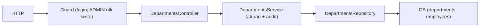

# Module: DepartmentsModule (Master Data Departemen)

**Dibuat:** 2026-10-11
**File sumber yang dianalisis:**
- `departments/departments.module.ts`, `departments.controller.ts`, `departments.service.ts`, `departments.repository.ts`, `departments.service.spec.ts`
- `departments/dto/create-department.dto.ts`, `update-department.dto.ts`, `department-query.dto.ts`, `department-response.dto.ts`
- `departments/interfaces/department.interface.ts`
- Rujukan tipe: `packages/types/src/departments.ts`

## Daftar Isi
1. [Ringkasan Module](#1-ringkasan-module)
2. [Peta File di Module Ini](#2-peta-file-di-module-ini)
3. [Penjelasan Kode per File](#3-penjelasan-kode-per-file)
4. [Alur Kerja Lengkap](#4-alur-kerja-lengkap)
5. [Hubungan dengan Module Lain](#5-hubungan-dengan-module-lain)
6. [Kesalahan Umum & Tips Pemula](#6-kesalahan-umum--tips-pemula)
7. [Catatan Kualitas Kode](#7-catatan-kualitas-kode)
8. [Rangkuman & Cek Pemahaman](#8-rangkuman--cek-pemahaman)

---

## 1. Ringkasan Module

**DepartmentsModule** mengelola master data departemen (unit kerja): menampilkan daftar (dengan pencarian & paginasi), detail, membuat, mengubah, dan menghapus (soft delete). Hanya ADMIN yang boleh menulis; semua user yang login boleh membaca.

Analogi: ini seperti **buku daftar resmi unit/departemen di perusahaan**. HR/Admin boleh menambah atau menghapus unit, tapi departemen hanya bisa dihapus kalau **tidak ada pegawai** yang masih terdaftar di dalamnya — seperti tidak bisa membubarkan unit yang masih berisi orang.

**Istilah baru:**
- **Master data** = data referensi inti (departemen, jabatan) yang dipakai data lain. Tidak sering berubah.
- **Soft delete** = menandai "terhapus" tanpa membuang barisnya.

---

## 2. Peta File di Module Ini

| Nama file | Jenis | Peran singkat |
|-----------|-------|---------------|
| `departments.module.ts` | Module | Merakit controller, service, repository |
| `departments.controller.ts` | Controller | Endpoint `/api/departments*` |
| `departments.service.ts` | Service | Aturan bisnis + audit |
| `departments.repository.ts` | Repository | Query Drizzle (list+count, CRUD, cek keterkaitan) |
| `departments.service.spec.ts` | Test | Uji service (mock repository/audit) |
| `dto/create-department.dto.ts` | DTO | Payload buat departemen |
| `dto/update-department.dto.ts` | DTO | `PartialType` dari Create (semua opsional) |
| `dto/department-query.dto.ts` | DTO | Query paginasi + pencarian (extends `QueryDto`) |
| `dto/department-response.dto.ts` | DTO Response | Contoh bentuk response untuk Swagger |
| `interfaces/department.interface.ts` | Alias | `DepartmentPayload = DepartmentResponse` |

Diagram alur:



Versi teks:

```
Request → Controller → Service → Repository → DB
                              ↘ AuditService (transaksi sama) → audit_logs
```

---

## 3. Penjelasan Kode per File

### `departments.module.ts`

```ts
@Module({
  controllers: [DepartmentsController],
  providers: [DepartmentsService, DepartmentsRepository],
  exports: [DepartmentsService],
})
export class DepartmentsModule {}
```

- **Fungsinya:** Merakit module dan mengekspos `DepartmentsService` ke module lain.
- **Kenapa:** Pola standar NestJS. `exports` memungkinkan module lain (mis. dashboard) memakai service ini.
- **Dampaknya:** Menghapus dari `AppModule.imports` → endpoint `/api/departments` hilang.
- **Analogi:** Mencatat unit kepegawaian dalam struktur organisasi sekaligus membuka layanannya untuk unit lain.

### `departments.controller.ts`

```ts
@ApiTags('departments')
@ApiBearerAuth()
// @UseGuards(JwtAuthGuard, RolesGuard)
@Controller('departments')
export class DepartmentsController {
  @Post() @Roles(UserRole.ADMIN) @HttpCode(201) create(@Body() dto) { ... }
  @Get() findAll(@Query() query: DepartmentQueryDto) { ... }
  @Get(':id') findOne(@Param('id', ParseUUIDPipe) id) { ... }
  @Patch(':id') @Roles(UserRole.ADMIN) update(@Param('id', ParseUUIDPipe) id, @Body() dto) { ... }
  @Delete(':id') @Roles(UserRole.ADMIN) @HttpCode(204) remove(@Param('id', ParseUUIDPipe) id) { ... }
}
```

- **Fungsinya:**
  - `@Roles(UserRole.ADMIN)` ditaruh di **method** create/update/delete → hanya ADMIN yang boleh menulis. `findAll`/`findOne` tanpa `@Roles` → cukup login (guard global tetap aktif).
  - Baris `// @UseGuards(JwtAuthGuard, RolesGuard)` **dikomentari** karena kedua guard sudah didaftarkan global di `AppModule`. Membiarkannya aktif hanya akan menduplikasi kerja.
  - `ParseUUIDPipe` memvalidasi format id → id ngawur dapat 400, bukan 500.
- **Kenapa dibuat seperti ini:** Membedakan izin baca vs tulis lewat `@Roles` di method. Mengandalkan guard global mengurangi pengulangan.
- **Dampaknya:** Menghapus `@Roles(ADMIN)` → semua user login bisa membuat/menghapus departemen (bahaya).
- **Analogi:** Lemari departemen: siapa pun yang punya akses gedung boleh melihat isinya, tapi hanya petugas berwenang yang boleh menambah/menghapus.
- **Istilah baru:** **`@Query`** = mengambil parameter query string (mis. `?page=1&search=eng`).

### `departments.service.ts`

`findAll` dan `findOne`:

```ts
async findAll(query: DepartmentQueryDto) {
  const [departments, total] = await this.departmentsRepository.findAllWithCount(query);
  return paginated(departments.map((d) => this.toPayload(d)), { total, limit: query.limit, page: query.page });
}
async findOne(id: string) {
  const department = await this.findOneOrFail(id);
  return ok(this.toPayload(department));
}
```

- **Fungsinya:** Ambil data + jumlah total → bungkus dengan `paginated` (mengisi `totalPages`). `findOne` mengembalikan satu item dengan `ok`.
- **Kenapa:** Konsisten dengan `ResponseInterceptor`. `toPayload` memetakan baris DB ke bentuk respons.
- **Analogi:** Menyiapkan halaman katalog departemen; tiap halaman menyebutkan jumlah total halaman.

`create` / `update`:

```ts
async create(dto: CreateDepartmentDto) {
  const created = await this.dbService.transaction(async (tx) => {
    const row = await this.departmentsRepository.createAndSave(dto, tx);
    if (!row) throw new BadRequestException('Department could not be created');
    await this.audit.record(tx, { action: 'DEPARTMENT_CREATED', entity: 'department', entityId: row.id, after: this.toPayload(row), ...this.actor() });
    return row;
  });
  return ok(this.toPayload(created));
}
```

- **Fungsinya:** Membuat departemen dan menulis audit **dalam satu transaksi**. `update` serupa tetapi mencatat `before` dan `after`.
- **Kenapa dibuat seperti ini:** Aturan AGENTS.md "tulis perubahan + audit dalam satu transaksi". Mencatat `before`/`after` memudahkan penelusuran.
- **Dampaknya:** Jika audit gagal, pembuatan departemen juga dibatalkan (atomik) — konsisten, tapi artinya kegagalan audit memblokir operasi (memang disengaja).
- **Analogi:** Menambah unit baru langsung disertai catatan di buku register; kalau catatan gagal, penambahan batal.

`remove`:

```ts
async remove(id: string) {
  const existing = await this.findOneOrFail(id);
  const isLinked = await this.departmentsRepository.isLinkedToEmployees(id);
  if (isLinked) throw new BadRequestException('Cannot delete department linked to employees');
  await this.dbService.transaction(async (tx) => {
    await this.departmentsRepository.softDelete(id, tx);
    await this.audit.record(tx, { action: 'DEPARTMENT_DELETED', entity: 'department', entityId: id, before: this.toPayload(existing), ...this.actor() });
  });
}
```

- **Fungsinya:** Mencegah penghapusan bila masih ada karyawan (belum terhapus) di departemen itu; jika aman, lakukan soft delete + audit.
- **Kenapa dibuat seperti ini:** Menjaga integritas referensi. Soft delete (bukan `DELETE`) menjaga riwayat.
- **Dampaknya:** Menghapus pengecekan `isLinkedToEmployees` → departemen bisa "hilang" padahal masih ada karyawan → data menggantung.
- **Analogi:** Tidak boleh menutup unit yang masih berpenghuni; kalau kosong, unit "dinonaktifkan" tanpa dirobohkan.

Helper `toPayload`, `actor`, `findOneOrFail`:

```ts
private toPayload(department: DepartmentRow): DepartmentPayload {
  return { id, code, name, headEmployeeId: department.headEmployeeId ?? null, isActive,
           createdAt: new Date(department.createdAt).toISOString(),
           updatedAt: new Date(department.updatedAt).toISOString() };
}
```

- **Fungsinya:** Memilih field yang keluar (tak membocorkan kolom internal seperti `isDeleted`), dan menormalkan tanggal ke string ISO (sesuai aturan frontend: tanggal = string).
- **Dampaknya:** Jika `isDeleted` ikut keluar, bisa membingungkan klien.
- **Analogi:** Format baku pada kartu katalog: hanya kolom yang relevan dicetak.

### `departments.repository.ts`

`findById`, `createAndSave`, `updateAndSave`, `softDelete` → pola umum dengan `notDeleted(departments)` dan `executor: DbExecutor`.

`findAllWithCount` — pencarian + paginasi + hitung total:

```ts
async findAllWithCount(query: DepartmentQueryDto): Promise<[DepartmentRow[], number]> {
  const { page = 1, limit = 20, search } = query;
  const filters: SQL[] = [notDeleted(departments)];
  if (search) {
    const searchFilter = or(ilike(departments.name, `%${search}%`), ilike(departments.code, `%${search}%`));
    if (searchFilter) filters.push(searchFilter);
  }
  const where = and(...filters);
  const data = await this.db.select().from(departments).where(where).limit(limit).offset((page - 1) * limit);
  const [totalResult] = await this.db.select({ count: sql<number>`count(*)` }).from(departments).where(where);
  return [data, Number(totalResult?.count ?? 0)];
}
```

- **Fungsinya:** Mengambil halaman data dan total baris. `ilike` = pencarian tidak peduli huruf besar/kecil (case-insensitive) pada `name` dan `code`. `offset = (page-1)*limit` untuk melompati halaman sebelumnya.
- **Kenapa dibuat seperti ini:** Mengembalikan tuple `[data, total]` agar service bisa membangun meta paginasi tanpa query kedua di service.
- **Dampaknya:** `%${search}%` rentan bila input tidak divalidasi — tapi `ValidationPipe` + `QueryDto` menanganinya (search adalah string). Perlu diperhatikan: `%` dan `_` di dalam `search` tidak di-escape (lihat bagian 7).
- **Analogi:** Mencari departemen dari katalog, menampilkan satu halaman sekaligus, plus menghitung total halaman.
- **Istilah baru:** **ilike** = SQL `LIKE` yang tidak peka huruf besar/kecil. **offset** = melewati sejumlah baris.

`isLinkedToEmployees`:

```ts
async isLinkedToEmployees(id, executor = this.db): Promise<boolean> {
  const [employee] = await executor.select({ id: employees.id }).from(employees)
    .where(and(eq(employees.departmentId, id), notDeleted(employees))).limit(1);
  return !!employee;
}
```

- **Fungsinya:** Cek apakah ada karyawan aktif di departemen ini.
- **Dampaknya:** Jika tidak memfilter `notDeleted(employees)`, departemen yang hanya berisi karyawan terhapus akan terblokir penghapusannya (padahal seharusnya bisa).
- **Analogi:** Mengetuk ruangan untuk memastikan sudah kosong sebelum menutupnya.

### DTO & Interface

| File | Isi penting |
|------|-------------|
| `create-department.dto.ts` | `code` (wajib, ≤50), `name` (wajib, ≤255), `headEmployeeId?` (UUID), `isActive?` (bool) |
| `update-department.dto.ts` | `PartialType(CreateDepartmentDto)` — semua field jadi opsional |
| `department-query.dto.ts` | `extends QueryDto` (page, limit, orderBy, search) |
| `department-response.dto.ts` | Contoh bentuk respons (id, name) untuk Swagger |
| `interfaces/department.interface.ts` | `DepartmentPayload = DepartmentResponse` |

- **Fungsinya:** `PartialType` (dari `@nestjs/swagger`, sesuai konvensi) membuat versi "semua opsional" untuk update, sekaligus tetap terdocumentasi di Swagger.
- **Kenapa:** Menghindari menulis ulang DTO update; konsisten dan hemat.
- **Dampaknya:** `PartialType` dari `@nestjs/swagger` (bukan `@nestjs/mapped-types`) penting agar metadata validasi & Swagger ikut tersalin.
- **Istilah baru:** **PartialType** = helper yang membuat semua properti sebuah DTO menjadi opsional.

---

## 4. Alur Kerja Lengkap

Skenario: **ADMIN menghapus departemen kosong.**

1. ADMIN memanggil `DELETE /api/departments/<id>` dengan token.
2. `JwtAuthGuard` (global) memverifikasi token → user ditempelkan.
3. `RolesGuard` memeriksa `@Roles(ADMIN)` di method `remove` → cocok.
4. `ParseUUIDPipe` memastikan `id` valid.
5. `DepartmentsController.remove` → `DepartmentsService.remove`.
6. Service memastikan departemen ada (`findOneOrFail`) → jika tidak, 404.
7. Service cek `isLinkedToEmployees` → jika ada karyawan, 400 `"Cannot delete department linked to employees"`.
8. Jika aman, dalam transaksi: `softDelete` + audit `DEPARTMENT_DELETED` (mencatat `before`).
9. Respons 204 No Content dikembalikan.

Skenario baca: `GET /api/departments?page=2&search=eng` → controller meneruskan `DepartmentQueryDto` → service memakai `findAllWithCount` → `paginated` → `{ data, meta: { total, page, limit, totalPages } }`.

---

## 5. Hubungan dengan Module Lain

**Bergantung pada:**
- `DbModule` (global) → akses DB.
- `AuditModule` (global) → `AuditService.record`.
- `common` → `@Roles`, `QueryDto`, `ResponseInterceptor`, `RequestContextService`.

**Dipakai oleh:** `EmployeesModule` (departemen adalah referensi karyawan), `AppraisalsModule` (appraisal per departemen), `DashboardModule`. `DepartmentsService` diekspos untuk kebutuhan lintas module.

**Dampak jika diubah/dihapus:**
- Menghapus module → endpoint hilang; modul yang mereferensikan departemen kehilangan sumber datanya.
- Mengubah aturan "tidak bisa hapus bila berisi karyawan" → risiko data menggantung.

---

## 6. Kesalahan Umum & Tips Pemula

1. **Menghapus departemen yang masih berisi karyawan.** Akan ditolak 400 — pindahkan karyawan dulu.
2. **Lupa `notDeleted` di query.** Departemen terhapus muncul lagi.
3. **Menggunakan `@UseGuards` lokal padahal guard global sudah ada.** Duplikasi; di sini sudah dikomentari dengan benar.
4. **Membuat `code` duplikat.** Kolom `code` unik di DB → memicu `23505` → diterjemahkan jadi 409.
5. **Mengubah `PartialType` dari `@nestjs/swagger` ke `@nestjs/mapped-types`.** Swagger & validasi bisa tidak sinkron (aturan project melarang).

**Pesan error yang mungkin muncul:**
- `400 Cannot delete department linked to employees` → masih ada karyawan.
- `404 Department with ID ... not found` → id tidak ada / sudah dihapus.
- `409 UNIQUE_VIOLATION` → `code` (atau field unik lain) duplikat.
- `400` dari `ParseUUIDPipe` → id bukan UUID.

---

## 7. Catatan Kualitas Kode

- **Pencarian `ilike` tanpa escape wildcard.** `%`/`_` pada `search` diperlakukan sebagai wildcard SQL. Umumnya tidak berbahaya di sini (hanya pencarian), tapi bila ingin presisi, escape karakter tersebut.
- **`headEmployeeId` tidak divalidasi keberadaannya** sebelum disimpan. Jika diisi UUID yang tidak ada, akan memicu foreign key violation (diterjemahkan filter jadi 400). Bisa lebih ramah bila dicek dulu dengan pesan jelas.
- **`department-response.dto.ts` tampaknya tidak dipakai** di controller (respons memakai `DepartmentPayload`). *Perlu konfirmasi* apakah masih diperlukan; jika tidak, bisa dihapus agar tidak membingungkan.
- **`@Query` tanpa validasi tambahan** mengandalkan `QueryDto` global; sudah ok karena `page`/`limit` dibatasi.
- Secara umum, pola service/repository/audit konsisten dengan module lain. **Tidak ada masalah keamanan kritis.**

---

## 8. Rangkuman & Cek Pemahaman

**Poin kunci:**
1. DepartmentsModule = master data departemen; baca untuk semua user login, tulis hanya ADMIN.
2. Setiap write dibungkus transaksi & menulis audit (dengan `before`/`after` saat update/delete).
3. Departemen tidak boleh dihapus bila masih punya karyawan (`isLinkedToEmployees`).
4. Penghapusan bersifat soft delete; query selalu memfilter `notDeleted`.
5. `PartialType` membuat DTO update otomatis dari DTO create.

**Pertanyaan latihan:**

1. *Kenapa `@Roles(ADMIN)` diletakkan di method, bukan di class?*
   → Karena `findAll`/`findOne` harus bisa diakses semua user login, sementara create/update/delete hanya ADMIN. `@Roles` di method memberi kontrol per-endpoint.

2. *Apa yang terjadi jika `isLinkedToEmployees` dihapus dari `remove`?*
   → Departemen yang masih berisi karyawan bisa di-soft-delete, meninggalkan karyawan yang merujuk departemen terhapus (data menggantung).

3. *Kenapa `findAllWithCount` mengembalikan tuple `[data, total]`?*
   → Agar service bisa menyusun meta paginasi (termasuk `totalPages`) tanpa perlu query hitung terpisah.
