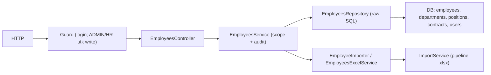

# Module: EmployeesModule (Data Karyawan)

**Dibuat:** 2026-10-11
**File sumber yang dianalisis:**
- `employees/employees.module.ts`, `employees.controller.ts`, `employees.service.ts`, `employees.repository.ts`
- `employees/employees.importer.ts`, `employees/employees.excel.ts`
- `employees/dto/create-employee.dto.ts`, `update-employee.dto.ts`, `query-employee.dto.ts`
- `employees/enums/gender.enum.ts`, `column-employee.enum.ts`
- `employees/interfaces/employee.interface.ts`
- Rujukan: `imports/import.types.ts`, `imports/import.service.ts`, `packages/types/src/employees.ts`

## Daftar Isi
1. [Ringkasan Module](#1-ringkasan-module)
2. [Peta File di Module Ini](#2-peta-file-di-module-ini)
3. [Penjelasan Kode per File](#3-penjelasan-kode-per-file)
4. [Alur Kerja Lengkap](#4-alur-kerja-lengkap)
5. [Hubungan dengan Module Lain](#5-hubungan-dengan-module-lain)
6. [Kesalahan Umum & Tips Pemula](#6-kesalahan-umum--tips-pemula)
7. [Catatan Kualitas Kode](#7-catatan-kualitas-kode)
8. [Rangkuman & Cek Pemahaman](#8-rangkuman--cek-pemahaman)

---

## 1. Ringkasan Module

**EmployeesModule** mengelola data karyawan: daftar (paginasi + filter + pencarian), detail, buat, ubah, hapus (soft delete), impor dari Excel, dan ekspor ke Excel. Ini salah satu module paling "berat" karena menyatukan data karyawan dengan departemen, jabatan, atasan, dan kontrak terbaru.

Analogi: ini seperti **kantor catatan sipil kepegawaian**. Setiap orang punya lembar data (nomor, nama, tanggal lahir, unit, jabatan, atasan). Kantor juga bisa menerima setoran data massal (impor Excel) dan mencetak daftar lengkap (ekspor).

**Istilah baru:**
- **Soft delete** = menandai terhapus, bukan membuang.
- **Scope** = batas data yang boleh dilihat user (per departemen).
- **Importer/Excel service** = komponen yang menangani baca/tulis file `.xlsx`.

---

## 2. Peta File di Module Ini

| Nama file | Jenis | Peran singkat |
|-----------|-------|---------------|
| `employees.module.ts` | Module | Merakit controller, service, repository, importer, excel |
| `employees.controller.ts` | Controller | Endpoint `/api/employees*` |
| `employees.service.ts` | Service | Aturan bisnis, scope, audit, orkestrasi impor/ekspor |
| `employees.repository.ts` | Repository | Query (raw SQL + Drizzle) ke `employees`, `departments`, `positions`, `contracts`, `users` |
| `employees.importer.ts` | Import strategy | Validasi & commit impor karyawan dari Excel |
| `employees.excel.ts` | Excel helper | Bangun file ekspor & template |
| `dto/create-employee.dto.ts` | DTO | Payload buat karyawan |
| `dto/update-employee.dto.ts` | DTO | `PartialType` dari Create |
| `dto/query-employee.dto.ts` | DTO | Query list (sort, filter, search, rentang tanggal) |
| `enums/gender.enum.ts`, `column-employee.enum.ts` | Re-export | Enum bersama |
| `interfaces/employee.interface.ts` | Re-export | Tipe `EmployeePayload`, dll. |

Diagram alur:



Versi teks:

```
List:  Request → Controller → Service (scope) → Repository(raw SQL) → DB → paginated
Write: Request → Guard(ADMIN/HR) → Controller → Service (transaksi+audit) → Repository → DB
Import:Controller → Service → ImportService → EmployeeImporter(validate→commit) → DB
Export:Controller → Service → ExcelService → Buffer (.xlsx)
```

---

## 3. Penjelasan Kode per File

### `employees.module.ts`

```ts
@Module({
  controllers: [EmployeesController],
  providers: [EmployeesService, EmployeesRepository, EmployeeImporter, EmployeesExcelService],
  exports: [EmployeesService, EmployeesRepository],
})
export class EmployeesModule {}
```

- **Fungsinya:** Merakit module dan menyediakan `EmployeeImporter` serta `EmployeesExcelService` sebagai provider (dipakai service).
- **Kenapa:** `EmployeeImporter` dan Excel service adalah class `@Injectable`, jadi didaftarkan sebagai provider. `exports` membuat service/repository dipakai module lain (mis. contracts, appraisals).
- **Dampaknya:** Jika `EmployeeImporter` tidak terdaftar, DI gagal saat `EmployeesService` dibuat (error resolve dependencies).
- **Analogi:** Menyiapkan semua meja & petugas di kantor data karyawan.

### `employees.controller.ts`

```ts
@ApiTags('employees')
@Controller('employees')
export class EmployeesController {
  @Get() findAll(@Query() query: QueryEmployeeDto) { ... }
  @Get('export') @Roles(ADMIN, HR) export(@Res() res) { ... }
  @Get('import-template') @Roles(ADMIN, HR) template(@Res() res) { ... }
  @Get(':id') findOne(@Param('id', ParseUUIDPipe) id) { ... }
  @Post('import') @Roles(ADMIN, HR) @UseInterceptors(FileInterceptor('file', {...})) import(@UploadedFile() file) { ... }
  @Post() @Roles(ADMIN, HR) create(@Body() dto) { ... }
  @Patch(':id') @Roles(ADMIN, HR) update(...) { ... }
  @Delete(':id') @Roles(ADMIN, HR) remove(...) { ... }
}
```

- **Fungsinya:**
  - `findAll`/`findOne` → baca (semua user login; scope dibatasi di service).
  - `export`/`import-template` → mengirim file, memakai `@Res()` (response mentah Express) untuk mengatur header file.
  - `import` → menerima upload file; `FileInterceptor('file', { limits: { fileSize: 20MB } })` menangani multipart.
  - Tulis (create/update/delete) → `@Roles(ADMIN, HR)`.
- **Kenapa dibuat seperti ini:**
  - `@Res()` dipakai karena mengirim biner `.xlsx` (bukan JSON yang dibungkus `ResponseInterceptor`).
  - `FileInterceptor` (Multer) menyimpan file di **memori** (`buffer`), bukan disk, karena diproses langsung oleh `ImportService`.
- **Dampaknya:** Menghapus `@Roles` → tulis data karyawan terbuka untuk semua user login. Menghapus `@Res()` mengubah bentuk respons file.
- **Analogi:** Loket yang punya jalur khusus untuk menyerahkan (impor) dan menerima (ekspor) dokumen.
- **Istilah baru:** **Interceptor (FileInterceptor)** = middleware Multer yang menangani upload. **`@UploadedFile()`** = mengambil file terupload. **`@Res()`** = mengakses objek response langsung.
- Urutan route penting: `@Get('export')` dan `@Get('import-template')` harus didefinisikan **sebelum** `@Get(':id')` agar tidak tertangkap sebagai id.

### `employees.service.ts`

`findAllEmployees` — daftar dengan filter, sort, dan scope:

```ts
const column = SORT_COLUMNS[sortBy] ?? 'e.employee_number';
const direction = orderBy === 'asc' ? sql`ASC` : sql`DESC`;
const orderClause = sql`${sql.raw(column)} ${direction}`;

const whereParts: SQL[] = [sql`e.deleted_at IS NULL`];
if (search) whereParts.push(sql`(e.full_name ILIKE ${'%' + search + '%'} OR e.employee_number ILIKE ${'%' + search + '%'})`);
if (department) whereParts.push(sql`d.name = ${department}`);
if (position) whereParts.push(sql`p.name = ${position}`);
if (status) whereParts.push(sql`e.status = ${status}`);

const user = this.requestContext.getUser();
if (user) {
  const scope = await this.scopeService.getDepartmentScope(user);
  if (scope !== 'ALL') {
    whereParts.push(scope.length === 0 ? sql`1 = 0` : sql`e.department_id IN (${sql.join(scope.map((id) => sql`${id}`), sql`, `)})`);
  }
}
const whereClause = sql.join(whereParts, sql` AND `);
const [result, total] = await Promise.all([
  this.employeesRepository.findAllWithRelationAndQuery(whereClause, orderClause, limit, offset),
  this.employeesRepository.countEmployees(whereClause),
]);
return paginated(result as unknown as EmployeePayload[], { total, page, limit });
```

- **Fungsinya:** Membangun klausa `WHERE` dinamis, menerapkan **pembatasan scope departemen**, lalu mengambil data + total secara paralel.
- **Kenapa dibuat seperti ini:**
  - `SORT_COLUMNS` adalah **whitelist** nama kolom: input user (`sortBy`) hanya dipetakan ke string kolom yang aman, mencegah **SQL injection** lewat `ORDER BY`.
  - `sql.join(...)` menyusun daftar id agar tetap ter-parameter (aman).
  - `scope === ''` (tanpa departemen) → `1 = 0` supaya tidak ada data bocor.
- **Dampaknya:** Jika whitelist dilepas dan input langsung dimasukkan ke SQL, celah injeksi terbuka. Jika scope dilepas, HEAD_DEPARTMENT bisa melihat karyawan departemen lain.
- **Analogi:** Petugas yang hanya mengizinkan "urutkan menurut kolom resmi", dan hanya menampilkan karyawan sesuai wewenang.
- **Istilah baru:** **Whitelist** = daftar nilai yang diizinkan. **`sql.raw`** = menyisipkan teks SQL mentah (dipakai HANYA untuk kolom dari whitelist).

`findOneEmployee` / `findOneRowOrFail` (dengan scope):

```ts
private async findOneRowOrFail(id: string) {
  const employee = await this.employeesRepository.findOneWithRelations(id);
  if (!employee) throw new NotFoundException(...);
  const user = this.requestContext.getUser();
  if (user) {
    const scope = await this.scopeService.getDepartmentScope(user);
    if (scope !== 'ALL') {
      const department = employee.department as { id?: string } | null;
      if (!department?.id || !scope.includes(department.id)) {
        throw new NotFoundException(`Employee with ID ${id} not found`);
      }
    }
  }
  return employee;
}
```

- **Fungsinya:** Mengambil detail karyawan, dan menolak dengan **404** bila di luar scope departemen user.
- **Kenapa:** Menyamarkan keberadaan data di luar wewenang (konsisten dengan `ScopeService`), bukan 403.
- **Dampaknya:** Bila scope dilepas, data karyawan semua departemen bisa dibuka siapa pun.
- **Analogi:** Petugas yang berpura-pura "tidak menemukan" berkas yang memang bukan wewenangnya.

`createEmployee` / `updateEmployee` / `removeEmployee`:

```ts
const saved = await this.dbService.transaction(async (tx) => {
  const employee = await this.employeesRepository.createAndSave(dto, tx);
  if (!employee) throw new BadRequestException('Failed to create employee');
  const full = await this.employeesRepository.findOneWithRelations(employee.id, tx);
  await this.audit.record(tx, { action: 'EMPLOYEE_CREATED', entity: 'employee', entityId: employee.id, after: full, ...this.actor() });
  return full;
});

async removeEmployee(id: string) {
  const existing = await this.findOneRowOrFail(id);
  const isLinked = await this.employeesRepository.isLinkedToUsers(id);
  if (isLinked) throw new BadRequestException('Cannot delete employee linked to users');
  await this.dbService.transaction(async (tx) => {
    await this.employeesRepository.softDelete(id, tx);
    await this.audit.record(tx, { action: 'EMPLOYEE_DELETED', entity: 'employee', entityId: id, before: existing, ...this.actor() });
  });
}
```

- **Fungsinya:** Menulis dalam transaksi + audit. `remove` mencegah penghapusan bila karyawan masih tertaut ke user (akun login).
- **Kenapa:** Konsistensi & integritas referensi (sama pola dengan departments/positions).
- **Dampaknya:** Bila cek `isLinkedToUsers` dihapus, user bisa menunjuk karyawan yang sudah dihapus.
- **Analogi:** Tidak bisa mencabut berkas karyawan yang masih punya kartu akses aktif.

Impor/Ekspor:

```ts
async exportEmployees(): Promise<Buffer> { return this.excel.buildExport(await this.employeesRepository.findForExport()); }
async buildTemplate(): Promise<Buffer> { return this.excel.buildTemplate(); }
async importEmployees(file) { const result = await this.importService.run(file, this.employeeImporter, 'employee'); return ok(result); }
```

- **Fungsinya:** Mendelegasikan ekspor ke Excel service dan impor ke **pipeline** `ImportService` (validasi seluruh file → commit dalam satu transaksi → audit).
- **Kenapa:** Memisahkan "cara baca/tulis Excel" (importer/excel) dari "aturan pipeline impor" (`ImportService`), sehingga modul lain bisa memakai pipeline yang sama.
- **Analogi:** Kurir (ImportService) yang mengantar setoran ke petugas data (EmployeeImporter) setelah memeriksa seluruh berkas dulu.

Helper `actor()` dan `toResponseEmployee()` → sama polanya dengan module lain; `toResponseEmployee` menyusun bentuk respons (tanpa kolom internal), memakai objek `supervisor`/`position`/`department`/`contract` yang sudah dibentuk repository.

### `employees.repository.ts`

**Peran file:** Repository dengan **raw SQL** (karena query butuh join rumit + subquery kontrak terbaru).

`selectClause` & `fromClause`:

```ts
private readonly selectClause = sql`
  SELECT e.id, e.employee_number AS "employeeNumber", e.full_name AS "fullName",
    e.birth_date AS "birthDate", e.join_date AS "joinDate", e.status, e.address, e.gender,
    json_build_object('id', m.id, 'fullName', m.full_name) AS supervisor,
    json_build_object('id', p.id, 'name', p.name) AS position,
    json_build_object('id', d.id, 'name', d.name) AS department,
    json_build_object('id', c.id, 'contractType', c.contract_type, 'startDate', c.start_date, 'endDate', c.end_date) AS contract
`;

private readonly fromClause = sql`
  FROM employees e
  LEFT JOIN employees m ON m.id = e.supervisor_id
  LEFT JOIN positions p ON p.id = e.position_id
  LEFT JOIN departments d ON d.id = e.department_id
  LEFT JOIN (
    SELECT employee_id, MAX(start_date) AS latest_start_date FROM contracts GROUP BY employee_id
  ) latest ON latest.employee_id = e.id
  LEFT JOIN contracts c ON c.employee_id = latest.employee_id AND c.start_date = latest.latest_start_date
`;
```

- **Fungsinya:** Satu query mengambil karyawan + atasan (self-join alias `m`) + posisi + departemen + **kontrak terbaru** (subquery `MAX(start_date)`). `json_build_object` menyusun objek terstruktur langsung di DB.
- **Kenapa dibuat seperti ini:** Menghindari N+1 query (mengambil kontrak per karyawan satu-satu). Menyusun bentuk respons di DB mengurangi mapping di kode.
- **Dampaknya:** Mengubah `fromClause` memengaruhi `findAllWithRelationAndQuery`, `countEmployees`, dan `findOneWithRelations` sekaligus (mereka berbagi klausa).
- **Analogi:** Merangkum satu berkas karyawan lengkap (termasuk atasan & kontrak terbaru) dalam satu kali pengambilan.
- **Istilah baru:** **N+1 query** = masalah performa ketika satu query utama memicu banyak query tambahan. **json_build_object** = fungsi PostgreSQL untuk membentuk objek JSON.

> Catatan: subquery memilih kontrak dengan `start_date` maksimum tanpa memfilter `deleted_at IS NULL`, sehingga kontrak yang sudah di-soft-delete masih bisa terpilih sebagai "terbaru". Lihat bagian 7.

Method lain:
- `countEmployees(whereClause)` → `count(*)::int` dengan `fromClause` + `whereClause` sama (konsisten dengan list).
- `findOneWithRelations(id, executor)` → `... WHERE e.id = ? AND e.deleted_at IS NULL LIMIT 1`.
- `createAndSave`/`updateAndSave`/`softDelete` → Drizzle biasa (bukan raw).
- `isLinkedToUsers(id)` → cek user aktif yang menunjuk karyawan ini.
- `findIdsByNumbers(numbers)` → dipakai importer untuk menentukan create vs update.
- `findDepartmentIdsByCodes` / `findPositionIdsByCodes` → menerjemahkan kode dari Excel ke id.
- `findForExport()` → query join terurut nomor untuk ekspor.

### `employees.importer.ts` — Strategi Impor Excel

```ts
@Injectable()
export class EmployeeImporter implements ImportStrategy {
  readonly expectedHeaders = ['employee_number','full_name','gender','birth_date','join_date','address','department_code','position_code','status','supervisor_number'];

  async validate(rows: ImportRow[]) { /* validasi seluruh file, lempar error baris pertama */ }
  async commit(rows: ImportRow[], tx: DbExecutor): Promise<ImportResult> { /* upsert 2 tahap */ }
  private parse(rows) { ... }
  private isDate(value: string): boolean { return ISO_DATE.test(value) && !Number.isNaN(new Date(value).getTime()); }
}
```

- **Fungsinya:**
  - `validate` → memeriksa **seluruh** baris: wajib isi, gender valid, tanggal format `YYYY-MM-DD`, departemen/posisi harus ada di DB, status valid, atasan dikenal (ada di DB atau di file). Gagal → `importError` (422) untuk **baris pertama** yang salah.
  - `commit` → 2 tahap: (1) upsert semua karyawan (tanpa atasan), (2) selesaikan `supervisorId` (karena atasan bisa jadi ikut diimpor di file yang sama).
- **Kenapa dibuat seperti ini:** Sesuai aturan domain "validasi seluruh file dulu, tolak seluruhnya bila ada error, laporkan error pertama, commit dalam satu transaksi". Dua tahap menangani **ketergantungan antar-baris** (atasan yang belum ada saat pass 1).
- **Dampaknya:** Jika validasi dihilangkan, data rusak bisa masuk. Jika dua tahap digabung, atasan yang baru diimpor tak bisa dirujuk.
- **Analogi:** Pramuniaga yang memeriksa seluruh lembar setoran sebelum mengetik, lalu mengetik dalam dua babak karena "atasan" mungkin ada di lembar yang sama.
- **Istilah baru:** **Upsert** = update jika sudah ada, insert jika belum. **Strategy pattern** = pola di mana aturan spesifik dikemas dalam objek yang bisa ditukar.

### `employees.excel.ts` — Ekspor & Template

```ts
function sanitize(value: string): string { return /^[=+\-@]/.test(value) ? `'${value}` : value; }

async buildExport(rows) {
  const workbook = new ExcelJS.Workbook();
  const sheet = workbook.addWorksheet('Employees');
  sheet.columns = HEADERS;
  for (const row of rows) sheet.addRow({ employeeNumber: sanitize(row.employeeNumber), fullName: sanitize(row.fullName), ... });
  return await workbook.xlsx.writeBuffer();
}
```

- **Fungsinya:** Membuat file `.xlsx` (ekspor & template). `sanitize` menambahkan `'` di depan sel yang dimulai `=`, `+`, `-`, `@`.
- **Kenapa dibuat seperti ini:** Mencegah **CSV/Formula injection** — bila sel dimulai `=`, Excel bisa menjalankannya sebagai rumus. Ini aturan AGENTS.md ("sanitize cells starting with =,+,-,@").
- **Dampaknya:** Jika `sanitize` dihapus, file ekspor bisa memicu eksekusi rumus berbahaya saat dibuka di Excel.
- **Analogi:** Memberi tanda kutip pada catatan yang bisa disalahartikan Excel sebagai perintah.
- **Istilah baru:** **Formula injection** = serangan lewat rumus spreadsheet.

### DTO & Enum

| File | Isi penting |
|------|-------------|
| `create-employee.dto.ts` | `employeeNumber`, `fullName`, `gender` (`@IsEnum`), `birthDate`/`joinDate` (`@IsDateString`), `departmentId`/`positionId` (UUID), `supervisorId?`, `status` (default ACTIVE), `address` |
| `update-employee.dto.ts` | `PartialType(CreateEmployeeDto)` |
| `query-employee.dto.ts` | extends `QueryDto` + `sortBy` (`@IsEnum(ColumnEmployee)`), `department?`, `position?`, `status?`, `startDate?`, `endDate?` |
| `enums/gender.enum.ts`, `column-employee.enum.ts` | Re-export dari `@appraisal/types` |
| `interfaces/employee.interface.ts` | Re-export `EmployeeStatus`, `EmployeePayload`, `SupervisorPayload` |

- **Fungsinya:** Validasi input. `@Transform(({value}) => value?.trim())` membersihkan spasi di `employeeNumber`/`fullName`. `@IsDateString()` memastikan format tanggal ISO.
- **Kenapa:** Mencegah input kotor & format tanggal salah sedini mungkin.
- **Dampaknya:** Menghapus `@IsEnum` membuat gender/status bisa berisi nilai tak dikenal.
- **Istilah baru:** **`@Transform`** = mengubah nilai input sebelum validasi (dari `class-transformer`).

---

## 4. Alur Kerja Lengkap

Skenario A: **HR mengimpor 200 karyawan dari Excel.**

1. HR mengirim `POST /api/employees/import` (multipart, field `file`).
2. `RolesGuard` memeriksa `@Roles(ADMIN, HR)` → cocok. `FileInterceptor` menaruh file di memori.
3. `EmployeesController.import` → `EmployeesService.importEmployees` → `ImportService.run(file, employeeImporter, 'employee')`.
4. `ImportService` memeriksa file (ada, `.xlsx`, ukuran ≤ limit), membaca sheet, memastikan semua header wajib ada, lalu mengubah baris menjadi `ImportRow[]` (dengan nomor baris `__row`).
5. Cek jumlah baris ≤ `IMPORT_MAX_ROWS`.
6. `EmployeeImporter.validate(rows)` → memeriksa **seluruh** baris. Jika ada yang salah, lempar 422 dengan `{ row, column, message }` baris pertama.
7. `dbService.transaction` → `EmployeeImporter.commit(rows, tx)`:
   - Pass 1: upsert tiap karyawan (nama, gender, tanggal, departemen/posisi dari kode, status).
   - Pass 2: isi `supervisorId` berdasarkan `supervisor_number`.
   - `ImportService` mencatat audit `EMPLOYEE_IMPORTED` dengan metadata file & hasil.
8. Respons: `{ created, updated, skipped }`.

Skenario B: **Melihat daftar karyawan (dibatasi scope).**

1. `GET /api/employees?page=1&limit=10&search=bud&sortBy=fullName`.
2. Service membangun `WHERE` (deleted null + pencarian + filter) dan menambahkan filter scope departemen user.
3. Ambil data + total (paralel) → `paginated`.
4. `ResponseInterceptor` membungkus hasil.

Skenario C: **Ekspor.** `GET /api/employees/export` → service ambil data → `ExcelService.buildExport` → buffer `.xlsx` (dengan sanitize) dikirim via `@Res()`.

---

## 5. Hubungan dengan Module Lain

**Bergantung pada:**
- `DbModule`, `AuditModule`, `ImportsModule` (`ImportService`), `common` (`ScopeService`, decorators, context).
- `ScopeService` (global) untuk pembatasan departemen.

**Dipakai oleh:** `ContractsModule` (kontrak milik karyawan), `AppraisalsModule` (karyawan dinilai), `DailyNotesModule` (catatan per karyawan), `DashboardModule`. `EmployeesService`/`EmployeesRepository` diekspos.

**Dampak jika diubah/dihapus:**
- Menghapus module → endpoint hilang dan module lain yang merujuk karyawan rusak.
- Mengubah `fromClause`/bentuk respons → berpotensi merusak konsumen (contracts, appraisals, dashboard).
- Mengubah aturan scope → celah/kekakuan akses data.

---

## 6. Kesalahan Umum & Tips Pemula

1. **Menambah kolom sort tanpa memperbarui `SORT_COLUMNS`.** Input `sortBy` baru akan jatuh ke default `employee_number`.
2. **Menyisipkan input user langsung ke SQL** (bukan lewat parameter/whitelist) → celah injeksi.
3. **Mengimpor file dengan departemen/posisi yang belum ada.** Validasi menolak (422) — buat master data dulu.
4. **Lupa urutan route** (`export`/`import-template` harus sebelum `:id`) → bisa tertangkap sebagai id.
5. **Mengharapkan impor parsial.** Impor bersifat "semua atau tidak sama sekali" (transaksi), bukan sebagian.

**Pesan error yang mungkin muncul:**
- `422 IMPORT_VALIDATION_FAILED` → ada baris tak valid (detail memuat row/column/message).
- `400 IMPORT_FILE_TYPE` → file bukan `.xlsx`.
- `400 IMPORT_FILE_TOO_LARGE` / `IMPORT_TOO_MANY_ROWS` → melebihi batas.
- `404 Employee with ID ... not found` → tidak ada **atau** di luar scope departemen.
- `400 Cannot delete employee linked to users` → masih tertaut akun user.
- `409 UNIQUE_VIOLATION (employee_number)` → nomor karyawan duplikat.

---

## 7. Catatan Kualitas Kode

- **Subquery kontrak terbaru tidak memfilter soft delete.** `fromClause` mengambil `MAX(start_date)` dari `contracts` **tanpa** `deleted_at IS NULL`, sehingga kontrak yang sudah di-soft-delete masih bisa muncul sebagai kontrak terbaru. Saran: tambahkan `WHERE deleted_at IS NULL` pada subquery `latest`.
- **`toResponseEmployee(employee: any)`** memakai `any` — melanggar aturan "no any" (AGENTS.md), dan melemahkan tipe. Saran: definisikan tipe baris hasil query dan pakai itu.
- **Kombinasi raw SQL + Drizzle** di satu repository menambah beban perawatan. Karena `employees` sangat sering dibaca, ini trade-off yang wajar, tetapi perlu kehati-hatian saat mengubah `fromClause`.
- **Scope pada `findAllEmployees`** memakai `requestContext.getUser()`; jika `user` undefined (mis. endpoint publik), filter scope tidak diterapkan. Kini endpoint tidak publik, jadi aman, tapi perlu diingat.
- **`QueryEmployeeDto` punya `startDate`/`endDate`** tetapi service `findAllEmployees` tidak memakainya. *Perlu konfirmasi:* apakah filter rentang tanggal memang belum diimplementasikan.
- **Tidak ada masalah keamanan kritis** pada transaksi/audit. Whitelist kolom sort adalah praktik yang baik.

---

## 8. Rangkuman & Cek Pemahaman

**Poin kunci:**
1. EmployeesModule = data karyawan; baca semua user login (dibatasi scope), tulis hanya ADMIN/HR.
2. Repository memakai raw SQL untuk menggabungkan karyawan, atasan, posisi, departemen, dan kontrak terbaru dalam satu query.
3. Pencarian/pengurutan dibangun aman via parameter + whitelist `SORT_COLUMNS`.
4. Impor Excel: validasi seluruh file → commit dalam satu transaksi (2 tahap untuk atasan) → audit.
5. Ekspor `.xlsx` memakai `exceljs` dengan `sanitize` anti formula injection.

**Pertanyaan latihan:**

1. *Kenapa `commit` dilakukan dalam dua tahap?*
   → Karena `supervisorId` bisa merujuk karyawan yang baru ikut diimpor; pass 1 membuat semua karyawan dulu, pass 2 baru menghubungkan atasan.

2. *Apa fungsi `SORT_COLUMNS` dan risiko bila dihapus?*
   → Memetakan input `sortBy` ke nama kolom SQL yang aman (whitelist). Tanpa itu, input bisa disisipkan ke `ORDER BY` dan membuka celah SQL injection.

3. *Kenapa sel yang diawali `=` perlu di-sanitize sebelum ekspor?*
   → Untuk mencegah formula injection: Excel bisa mengeksekusi isi sel sebagai rumus saat file dibuka.
