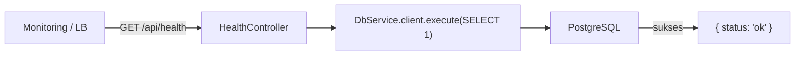

# Module: HealthModule (Pemeriksa Kesehatan Sistem)

**Dibuat:** 2026-10-11
**File sumber yang dianalisis:**
- `health/health.module.ts`
- `health/health.controller.ts`

## Daftar Isi
1. [Ringkasan Module](#1-ringkasan-module)
2. [Peta File di Module Ini](#2-peta-file-di-module-ini)
3. [Penjelasan Kode per File](#3-penjelasan-kode-per-file)
4. [Alur Kerja Lengkap](#4-alur-kerja-lengkap)
5. [Hubungan dengan Module Lain](#5-hubungan-dengan-module-lain)
6. [Kesalahan Umum & Tips Pemula](#6-kesalahan-umum--tips-pemula)
7. [Catatan Kualitas Kode](#7-catatan-kualitas-kode)
8. [Rangkuman & Cek Pemahaman](#8-rangkuman--cek-pemahaman)

---

## 1. Ringkasan Module

**HealthModule** menyediakan satu endpoint untuk mengecek apakah aplikasi dan koneksi database masih hidup. Berguna untuk monitoring, load balancer, dan Kubernetes.

Analogi: ini seperti **lampu hijau "SEDANG BUKA"** di depan toko. Sekali lihat, orang tahu toko (server) dan gudangnya (database) masih berfungsi. Tidak perlu masuk dan bertanya satu-satu.

**Istilah baru:**
- **Health check** = endpoint ringan untuk memverifikasi layanan hidup.
- **Load balancer** = penjaga lalu lintas yang membagi request ke beberapa server; ia butuh health check untuk tahu server mana yang sehat.

---

## 2. Peta File di Module Ini

| Nama file | Jenis | Peran singkat |
|-----------|-------|---------------|
| `health.module.ts` | Module | Mendaftarkan `HealthController` |
| `health.controller.ts` | Controller | Endpoint `GET /api/health` yang mengecek DB |

Diagram alur:



Versi teks:

```
Request GET /api/health → HealthController → DB (SELECT 1) → { status: 'ok' }
```

---

## 3. Penjelasan Kode per File

### `health.module.ts`

```ts
@Module({
  controllers: [HealthController],
})
export class HealthModule {}
```

- **Fungsinya:** Mendaftarkan `HealthController` ke aplikasi. Tidak ada provider/service karena logikanya cukup di controller.
- **Kenapa dibuat seperti ini:** Module minimalis. `HealthController` memakai `DbService` yang sudah tersedia global (dari `DbModule`), jadi tak perlu import apa pun.
- **Dampaknya:** Kalau `HealthModule` dihapus dari `AppModule.imports`, endpoint `/api/health` hilang (404).
- **Analogi:** Memasang lampu "SEDANG BUKA" di daftar perlengkapan toko.

### `health.controller.ts`

```ts
@ApiTags('health')
@Controller('health')
export class HealthController {
  constructor(private readonly dbService: DbService) {}

  @Public()
  @Get()
  async check() {
    await this.dbService.client.execute(sql`SELECT 1`);
    return { status: 'ok' };
  }
}
```

- **Fungsinya:**
  - `@Controller('health')` → route dasar `/api/health`.
  - `constructor(private readonly dbService: DbService)` → menyuntikkan layanan database.
  - `@Public()` → bisa diakses tanpa login (wajib untuk monitoring).
  - `@Get()` → menangani `GET /api/health`.
  - `await this.dbService.client.execute(sql`SELECT 1`)` → menjalankan query paling ringan ke DB untuk memastikan koneksi hidup.
  - `return { status: 'ok' }` → balasan sederhana. (Dibungkus `ResponseInterceptor` jadi `{ status, message, data: { status: 'ok' }, meta }`.)
- **Kenapa dibuat seperti ini:** Best practice health check: selain "proses hidup", cek juga dependensi kritikal (di sini database). `async/await` dipakai karena query DB butuh waktu.
- **Dampaknya:** Jika `SELECT 1` gagal (DB mati), endpoint ini error dan load balancer tahu server tak sehat. Menghapus `@Public()` membuat monitoring harus login (merepotkan).
- **Analogi:** Pegawai yang mengecek "apakah gudang masih bisa dibuka?" dengan mencoba satu putaran kunci, lalu melaporkan "semua normal".
- **Istilah baru:** **`async/await`** = menunggu operasi yang butuh waktu (I/O) tanpa menghentikan seluruh server. **Tagged template SQL** (`sql\`SELECT 1\``) = cara Drizzle menulis SQL aman.

---

## 4. Alur Kerja Lengkap

Skenario: **Load balancer memeriksa apakah server masih sehat.**

1. Load balancer mengirim `GET /api/health`.
2. `JwtAuthGuard` melihat `@Public()` → dilewatkan tanpa token.
3. `RolesGuard` tidak menemukan `@Roles()` → diizinkan.
4. `HealthController.check()` dipanggil.
5. `DbService.client.execute(sql\`SELECT 1\`)` menjalankan query trivial ke PostgreSQL.
6. Jika DB menjawab → kembalikan `{ status: 'ok' }`; `ResponseInterceptor` membungkusnya.
7. Jika DB mati → error naik ke `HttpExceptionFilter` (kemungkinan 500), dan load balancer menganggap server tak sehat.

---

## 5. Hubungan dengan Module Lain

**Di-import oleh:** `AppModule` (agar route aktif).

**Bergantung pada:** `DbModule` (global) untuk `DbService`; `common` untuk `@Public()`.

**Yang diekspos (exports):** Tidak ada.

**Dampak jika diubah/dihapus:**
- Menghapus module → monitoring/health check hilang; load balancer bisa salah menandai semua server mati.
- Menghapus `@Public()` → monitoring gagal (401) dan server tampak "tidak sehat" padahal sehat.
- Menghapus cek DB → health check cuma bilang proses hidup, padahal DB bisa sedang mati.

---

## 6. Kesalahan Umum & Tips Pemula

1. **Menambah `@UseGuards` atau menghapus `@Public()`.** Health check harus bebas autentikasi.
2. **Membuat query health yang berat** (mis. join besar). Health check harus cepat dan ringan.
3. **Mengembalikan data sensitif** (versi, env, kredensial). Cukup status minimal.
4. **Mengubah route dari `/health`** tanpa menyesuaikan konfigurasi monitoring.
5. **Menganggap health check mengecek semuanya.** Ia hanya cek DB; dependensi lain (mis. layanan eksternal) tidak diperiksa.

**Pesan error yang mungkin muncul:**
- `401 Unauthorized` → `@Public()` terhapus.
- `500` saat DB mati → query `SELECT 1` gagal (ini memang tujuannya: menandai tak sehat).
- `404` → `HealthModule` tidak di-import di `AppModule` atau route diubah.

---

## 7. Catatan Kualitas Kode

- **Endpoint `/api/health` tanpa throttling khusus** — tetapi karena `ThrottlerModule` global membatasi 20 req/menit, monitoring berinterval sangat rapat bisa terkena limit. *Perlu konfirmasi* apakah monitoring memanggil lebih sering dari itu; jika ya, pertimbangkan `@SkipThrottle()`.
- **Tidak mengembalikan detail versi/uptime.** Bukan masalah; sesuai tujuan minimalis.
- Selain di atas, **tidak ada catatan khusus**.

---

## 8. Rangkuman & Cek Pemahaman

**Poin kunci:**
1. HealthModule cuma punya satu endpoint: `GET /api/health`.
2. Endpoint bersifat publik dan mengecek koneksi database lewat `SELECT 1`.
3. Dipakai untuk monitoring/load balancer.
4. Tidak memiliki service sendiri; memakai `DbService` global.
5. Kegagalan query = sinyal "tidak sehat".

**Pertanyaan latihan:**

1. *Kenapa endpoint health harus `@Public()`?*
   → Agar alat monitoring bisa memanggilnya tanpa kredensial; kalau butuh login, health check tak praktis.

2. *Apa yang dicek `SELECT 1` dan kenapa bukan query berat?*
   → Hanya memastikan koneksi DB hidup. Query ringan agar cepat dan tidak membebani database.

3. *Apa yang terjadi kalau `HealthModule` dihapus dari `AppModule`?*
   → Endpoint `/api/health` tak terdaftar → semua request ke sana 404, dan monitoring kehilangan sinyal.
