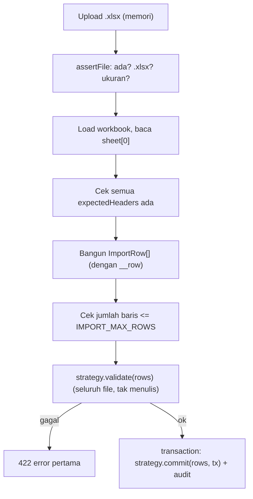

# Module: ImportsModule (Pipeline Impor Excel Bersama)

**Dibuat:** 2026-10-11
**File sumber yang dianalisis:**
- `imports/imports.module.ts`, `imports/import.service.ts`, `imports/import.types.ts`
- Rujukan tipe: `packages/types/src/imports.ts`
- Pemakai: `employees/employees.importer.ts`, `contracts/contracts.importer.ts`

## Daftar Isi
1. [Ringkasan Module](#1-ringkasan-module)
2. [Peta File di Module Ini](#2-peta-file-di-module-ini)
3. [Penjelasan Kode per File](#3-penjelasan-kode-per-file)
4. [Alur Kerja Lengkap](#4-alur-kerja-lengkap)
5. [Hubungan dengan Module Lain](#5-hubungan-dengan-module-lain)
6. [Kesalahan Umum & Tips Pemula](#6-kesalahan-umum--tips-pemula)
7. [Catatan Kualitas Kode](#7-catatan-kualitas-kode)
8. [Rangkuman & Cek Pemahaman](#8-rangkuman--cek-pemahaman)

---

## 1. Ringkasan Module

**ImportsModule** menyediakan **pipeline impor Excel yang bisa dipakai ulang**. Ia menangani hal-hal umum: memeriksa file, membaca sheet, memastikan header benar, membatasi jumlah baris, memvalidasi seluruh file sebelum menulis, lalu melakukan commit dalam **satu transaksi** + audit. Module fitur cukup menyediakan "strategi" (aturan spesifik bentuk datanya).

Analogi: ini seperti **mesin pemroses setoran massal** di bank. Mesinnya sama untuk semua jenis setoran (transfer, tabungan, dll): periksa file, cek format, baca isi, validasi **seluruh** lembar dulu, baru "booking" semua transaksi sekaligus. Yang berbeda hanyalah cara membaca satu jenis formulir (strategi).

**Istilah baru:**
- **Pipeline** = rangkaian langkah pemrosesan berurutan.
- **Strategy pattern** = pola di mana bagian spesifik dikemas dalam objek yang bisa ditukar (`ImportStrategy`).
- **First-error** = hanya melaporkan error pertama.

---

## 2. Peta File di Module Ini

| Nama file | Jenis | Peran singkat |
|-----------|-------|---------------|
| `imports.module.ts` | Module (`@Global`) | Menyediakan `ImportService` global |
| `import.service.ts` | Service | Pipeline impor (assert, read, validate, commit, audit) |
| `import.types.ts` | Tipe + helper | `ImportStrategy`, `UploadedFileLike`, `ImportRow`, `importError` |

Diagram alur:



Versi teks:

```
File → assertFile → baca sheet → cek header → rows → cek maxRows → validate (readonly) → tx: commit + audit
```

---

## 3. Penjelasan Kode per File

### `imports.module.ts`

```ts
@Global()
@Module({
  providers: [ImportService],
  exports: [ImportService],
})
export class ImportsModule {}
```

- **Fungsinya:** Menyediakan `ImportService` di seluruh aplikasi.
- **Kenapa:** Dipakai beberapa module (employees, contracts, mungkin lebih) → jadikan global.
- **Dampaknya:** Tanpa `exports`, module fitur tak bisa memakai `ImportService`.
- **Analogi:** Satu mesin setoran massal untuk seluruh bank.

### `import.types.ts`

```ts
export type ImportRow = Record<string, unknown>;

export interface UploadedFileLike { originalname: string; size: number; buffer: Buffer; }

export interface ImportStrategy {
  expectedHeaders: string[];                              // header wajib di baris 1
  validate(rows: ImportRow[]): Promise<void>;             // error di baris pertama, tidak menulis
  commit(rows: ImportRow[], tx: DbExecutor): Promise<ImportResult>;  // menulis dalam transaksi pemanggil
}

export function importError(row: number, column: string, message: string): never {
  throw new HttpException({ message, errorCode: 'IMPORT_VALIDATION_FAILED', details: { row, column, message } }, HttpStatus.UNPROCESSABLE_ENTITY);
}
```

- **Fungsinya:**
  - `ImportStrategy` mendefinisikan kontrak untuk module fitur: header wajib + `validate` + `commit`.
  - `UploadedFileLike` = bentuk file yang dibutuhkan (memori, dari Multer).
  - `importError` melempar error 422 dengan detail `{ row, column, message }` — dan **hanya boleh dipanggil sekali** (menghentikan validasi pada error pertama).
- **Kenapa dibuat seperti ini:** Memisahkan "aturan spesifik tiap entitas" (strategi) dari "mesin pipeline" (ImportService). `importError` menstandarkan pelaporan error impor.
- **Dampaknya:** Menghapus `importError` memaksa setiap strategi membuat error sendiri (tak konsisten). Mengubah bentuk `details` memengaruhi frontend.
- **Analogi:** Cetak biru formulir yang harus dipatuhi semua jenis setoran + cara melaporkan kesalahan setoran.
- **Istilah baru:** **`: never`** = tipe yang menandakan fungsi tak pernah kembali normal (selalu melempar error).

### `import.service.ts`

`run` — inti pipeline:

```ts
async run(file, strategy, entity): Promise<ImportResult> {
  this.assertFile(file);
  const workbook = new ExcelJS.Workbook();
  await workbook.xlsx.load(file.buffer as unknown as ExcelLoadInput);

  const sheet = workbook.worksheets[0];
  if (!sheet) throw new HttpException({ message: 'The file has no sheet', errorCode: 'IMPORT_EMPTY_FILE' }, HttpStatus.BAD_REQUEST);

  const headerValues = sheet.getRow(1).values as ExcelJS.CellValue[];
  const headers = (headerValues ?? []).map((value) => cellText(value));
  const columnIndex = new Map<string, number>();
  headers.forEach((header, index) => { if (header) columnIndex.set(header, index); });

  for (const expected of strategy.expectedHeaders) {
    if (!columnIndex.has(expected)) importError(1, expected, `Missing column "${expected}"`);
  }

  const rows: ImportRow[] = [];
  for (let rowNumber = 2; rowNumber <= sheet.rowCount; rowNumber++) {
    const row = sheet.getRow(rowNumber);
    const record: ImportRow = { __row: rowNumber };
    let hasValue = false;
    for (const header of strategy.expectedHeaders) {
      const index = columnIndex.get(header) ?? 0;
      const text = cellText(row.getCell(index).value);
      record[header] = text;
      if (text !== '') hasValue = true;
    }
    if (hasValue) rows.push(record);
  }

  const maxRows = Number(this.configService.get('IMPORT_MAX_ROWS') ?? 5000);
  if (rows.length > maxRows) throw new HttpException({ message: `The file has more than ${maxRows} rows`, errorCode: 'IMPORT_TOO_MANY_ROWS' }, HttpStatus.BAD_REQUEST);

  // Validate the whole file first — nothing is written during validation.
  await strategy.validate(rows);

  return this.dbService.transaction(async (tx) => {
    const result = await strategy.commit(rows, tx);
    await this.audit.record(tx, { action: `${entity.toUpperCase()}_IMPORTED`, entity, metadata: { file: file.originalname, ...result }, ...this.actor() });
    return result;
  });
}
```

- **Fungsinya (berurutan):**
  1. **`assertFile`** — pastikan ada, berekstensi `.xlsx`, dan ukurannya ≤ limit.
  2. Memuat workbook & mengambil sheet pertama.
  3. Membangun indeks kolom dari baris header, memastikan **semua** `expectedHeaders` ada (else 422 error baris 1).
  4. Membaca baris dari baris ke-2, mengubah tiap sel menjadi teks via `cellText`, menandai nomor baris (`__row`), dan melewati baris yang kosong (tak ada nilai).
  5. Membatasi jumlah baris (`IMPORT_MAX_ROWS`).
  6. **Validasi seluruh file** (`strategy.validate`) — **tanpa menulis apa pun**.
  7. Baru **commit** di dalam satu transaksi + catat audit `${ENTITY}_IMPORTED`.
- **Kenapa dibuat seperti ini:** Ini penerapan langsung aturan AGENTS.md: "validate the whole file first, reject the whole file on any error, report only the first error, commit in one transaction." Struktur membuat tiap strategi tetap fokus pada datanya.
- **Dampaknya:**
  - Bila validasi dijalankan setelah commit, data rusak bisa tersimpan.
  - Bila tidak satu transaksi, impor bisa setengah jalan.
  - Bila `__row` tak disertakan, pesan error tak bisa menyebut baris.
- **Analogi:** Mesin yang membaca seluruh lembar setoran, memverifikasi semuanya, lalu mem-booking semua dalam satu kali proses; kalau ada satu kesalahan, seluruh setoran ditolak dan error pertama dilaporkan.
- **Istilah baru:** **`cellText`** = fungsi normalisasi nilai sel (menangani Date, rich text, hasil rumus). **`IMPORT_MAX_ROWS`** = env batas baris.

`assertFile`:

```ts
private assertFile(file): asserts file is UploadedFileLike {
  if (!file) throw new HttpException({ message: 'No file uploaded', errorCode: 'IMPORT_FILE_REQUIRED' }, HttpStatus.BAD_REQUEST);
  if (!file.originalname.toLowerCase().endsWith('.xlsx')) throw new HttpException({ message: 'Only .xlsx files are allowed', errorCode: 'IMPORT_FILE_TYPE' }, HttpStatus.BAD_REQUEST);
  const maxBytes = Number(this.configService.get('IMPORT_MAX_FILE_SIZE_MB') ?? 5) * 1024 * 1024;
  if (file.size > maxBytes) throw new HttpException({ message: `File exceeds the ${maxBytes / (1024 * 1024)} MB limit`, errorCode: 'IMPORT_FILE_TOO_LARGE' }, HttpStatus.BAD_REQUEST);
}
```

- **Fungsinya:** Validasi file dasar. Memakai **type assertion function** (`asserts file is UploadedFileLike`) sehingga TypeScript tahu `file` tidak `undefined` setelah pemanggilan.
- **Kenapa:** Memusatkan pengecekan file sebelum parsing. Batas ukuran dari env (`IMPORT_MAX_FILE_SIZE_MB`), default 5MB — ingat interceptor controller mengizinkan 20MB, jadi batas efektif bisa lebih kecil di sini (lihat bagian 7).
- **Dampaknya:** Bila `.xlsx` tak dicek, file lain bisa memicu error parsing membingungkan.
- **Analogi:** Petugas loket yang menolak berkas bukan format resmi atau terlalu tebal.

`cellText`:

```ts
function cellText(value: ExcelJS.CellValue): string {
  if (value === null || value === undefined) return '';
  if (value instanceof Date) return value.toISOString().slice(0, 10);
  if (typeof value === 'object') {
    const record = value as unknown as Record<string, unknown>;
    if (Array.isArray(record.richText)) return (record.richText as { text: string }[]).map((part) => part.text).join('').trim();
    if (typeof record.text === 'string') return record.text.trim();
    if (record.result !== undefined) return String(record.result).trim();
    return '';
  }
  return String(value).trim();
}
```

- **Fungsinya:** Mengubah nilai sel apa pun menjadi string: `Date` → `YYYY-MM-DD`, rich text → gabungan teks, sel dengan rumus → hasil (`result`), sel biasa → string ter-trim.
- **Kenapa dibuat seperti ini:** Sel Excel bisa bertipe macam-macam (tanggal asli, teks berformat, hasil rumus). Menormalkan di satu tempat membuat strategi cukup menerima teks.
- **Dampaknya:** Bila tanggal tidak dinormalkan, `Date` mentah bisa lolos dan mengacaukan validasi format `YYYY-MM-DD`.
- **Analogi:** Penerjemah yang menyamakan semua jenis isian sel menjadi "teks biasa" sebelum diperiksa.

`actor()` → menyusun pelaku audit dari konteks request (pola sama dengan module lain).

---

## 4. Alur Kerja Lengkap

Skenario: **Admin mengimpor kontrak dari Excel.**

1. Controller (mis. `ContractsController.import`) memakai `FileInterceptor` → file ada di memori (buffer).
2. Memanggil `ImportService.run(file, contractImporter, 'contract')`.
3. `assertFile` → cek ada/`.xlsx`/ukuran.
4. Memuat workbook, ambil sheet pertama, bangun indeks header, pastikan header wajib (`employee_number`, `contract_type`, `start_date`, `end_date`) ada.
5. Bangun `ImportRow[]` (tiap baris berisi header yang diharapkan + `__row`); baris kosong dilewati.
6. Cek jumlah baris ≤ `IMPORT_MAX_ROWS`.
7. `ContractImporter.validate(rows)` → memeriksa seluruh baris; error pertama → 422 `{ row, column, message }`.
8. `dbService.transaction`: `ContractImporter.commit(rows, tx)` (upsert) → `audit.record(tx, { action: 'CONTRACT_IMPORTED', ... })`.
9. Mengembalikan `{ created, updated, skipped }` → dibungkus `ok()` oleh service pemanggil.

---

## 5. Hubungan dengan Module Lain

**Bergantung pada:** `DbModule` (`DbService`, transaksi), `AuditModule` (`AuditService`), `ConfigService`.

**Dipakai oleh:** `EmployeesService.importEmployees` (strategi `EmployeeImporter`), `ContractsService.importContracts` (strategi `ContractImporter`). `ImportService` diekspos (global).

**Dampak jika diubah/dihapus:**
- Menghapus module → fitur impor employees/contracts rusak.
- Mengubah kontrak `ImportStrategy` → semua strategi harus menyesuaikan.
- Mengubah urutan (mis. validasi setelah commit) → melanggar aturan impor.

---

## 6. Kesalahan Umum & Tips Pemula

1. **Header tidak persis sama dengan `expectedHeaders`.** Nama kolom berbeda (mis. `Employee Number` vs `employee_number`) → 422 "Missing column".
2. **Menganggap impor parsial.** Tidak; impor "semua atau tidak sama sekali".
3. **File bukan `.xlsx`** → `IMPORT_FILE_TYPE`.
4. **File melebihi batas** → `IMPORT_FILE_TOO_LARGE` / `IMPORT_TOO_MANY_ROWS`.
5. **Menaruh logika tulis di dalam `validate`.** Dilarang; `validate` harus murni baca.

**Pesan error yang mungkin muncul:**
- `400 IMPORT_FILE_REQUIRED` / `IMPORT_FILE_TYPE` / `IMPORT_FILE_TOO_LARGE` / `IMPORT_EMPTY_FILE` / `IMPORT_TOO_MANY_ROWS`.
- `422 IMPORT_VALIDATION_FAILED` dengan `details { row, column, message }`.
- `500` bila file `.xlsx` rusak/tak bisa diparsing.

---

## 7. Catatan Kualitas Kode

- **Dua batas ukuran berbeda.** Interceptor di controller mengizinkan **20MB**, tetapi `ImportService.assertFile` memakai `IMPORT_MAX_FILE_SIZE_MB` (default **5MB**). Artinya file 6–20MB akan diterima Multer lalu ditolak 400. Bukan bug, tapi membingungkan; sebaiknya selaraskan (interceptor membaca env yang sama) atau beri komentar.
- **Ekstensi `.xlsx` saja** (bukan `.xls`). Wajar karena memakai `exceljs` untuk OOXML, tapi perlu diketahui pengguna.
- **Membaca seluruh file ke memori.** Untuk file besar, konsumsi memori signifikan; batas baris/ukuran membantu membatasi.
- **`importError` hanya melaporkan error pertama.** Sesuai aturan, tetapi pengguna harus memperbaiki satu per satu.
- **Tidak ada masalah keamanan kritis** pada pipeline; `cellText` mencegah kebocoran tipe sel.

---

## 8. Rangkuman & Cek Pemahaman

**Poin kunci:**
1. ImportsModule = pipeline impor Excel generik yang dipakai ulang via `ImportStrategy`.
2. Urutan: assert file → baca sheet → cek header → rows → batas baris → **validate seluruh file** → commit dalam satu transaksi + audit.
3. Hanya error pertama yang dilaporkan (`importError` → 422 dengan `{ row, column, message }`).
4. `cellText` menormalkan sel (tanggal, rich text, hasil rumus) menjadi teks.
5. `validate` tidak boleh menulis; `commit` menulis dalam `tx` pemanggil.

**Pertanyaan latihan:**

1. *Kenapa validasi harus dijalankan sebelum commit?*
   → Agar file ditolak seluruhnya bila ada error, tidak ada data setengah masuk — sesuai aturan "validate the whole file first, commit in one transaction".

2. *Apa peran `expectedHeaders`?*
   → Menentukan kolom wajib di baris 1; bila ada yang hilang, impor langsung ditolak (422) sebelum memproses data.

3. *Apa yang dilakukan `cellText` dan mengapa penting?*
   → Menormalkan nilai sel (tanggal → `YYYY-MM-DD`, rich text → teks, rumus → hasil) menjadi string, sehingga aturan validasi pada strategi dapat bekerja konsisten.
