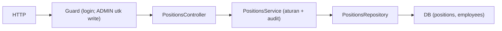

# Module: PositionsModule (Master Data Jabatan)

**Dibuat:** 2026-10-11
**File sumber yang dianalisis:**
- `positions/positions.module.ts`, `positions.controller.ts`, `positions.service.ts`, `positions.repository.ts`
- `positions/dto/create-position.dto.ts`, `update-position.dto.ts`, `position-query.dto.ts`
- `positions/interfaces/position.interface.ts`
- Rujukan tipe: `packages/types/src/positions.ts`

## Daftar Isi
1. [Ringkasan Module](#1-ringkasan-module)
2. [Peta File di Module Ini](#2-peta-file-di-module-ini)
3. [Penjelasan Kode per File](#3-penjelasan-kode-per-file)
4. [Alur Kerja Lengkap](#4-alur-kerja-lengkap)
5. [Hubungan dengan Module Lain](#5-hubungan-dengan-module-lain)
6. [Kesalahan Umum & Tips Pemula](#6-kesalahan-umum--tips-pemula)
7. [Catatan Kualitas Kode](#7-catatan-kualitas-kode)
8. [Rangkuman & Cek Pemahaman](#8-rangkuman--cek-pemahaman)

---

## 1. Ringkasan Module

**PositionsModule** mengelola master data jabatan/posisi (mis. Staff, Supervisor, Manager), lengkap dengan **level** numerik. Menyediakan lihat daftar, detail, buat, ubah, dan hapus (soft delete). Sama seperti departemen: baca untuk semua user login, tulis hanya ADMIN.

Analogi: ini seperti **papan daftar pangkat/jabatan di kantor**. Level menunjukkan tingkatan (1 = paling bawah). Jabatan yang masih dipakai pegawai tidak bisa dihapus — seperti tidak bisa menghapus pangkat yang masih disandang seseorang.

**Istilah baru:**
- **Level** = angka yang menandakan tingkatan jabatan (contoh: Staff=1, Manager=4).

---

## 2. Peta File di Module Ini

| Nama file | Jenis | Peran singkat |
|-----------|-------|---------------|
| `positions.module.ts` | Module | Merakit controller, service, repository |
| `positions.controller.ts` | Controller | Endpoint `/api/positions*` |
| `positions.service.ts` | Service | Aturan bisnis + audit |
| `positions.repository.ts` | Repository | Query Drizzle |
| `dto/create-position.dto.ts` | DTO | Payload buat jabatan |
| `dto/update-position.dto.ts` | DTO | `PartialType` dari Create |
| `dto/position-query.dto.ts` | DTO | Query paginasi (saat ini belum dipakai) |
| `interfaces/position.interface.ts` | Alias | `PositionPayload = PositionResponse` |

Diagram alur:



Versi teks:

```
Request → Controller → Service → Repository → DB
                              ↘ AuditService (transaksi sama) → audit_logs
```

---

## 3. Penjelasan Kode per File

### `positions.module.ts`

```ts
@Module({
  controllers: [PositionsController],
  providers: [PositionsService, PositionsRepository],
  exports: [PositionsService],
})
export class PositionsModule {}
```

- **Fungsinya:** Merakit module dan mengekspos `PositionsService`.
- **Kenapa:** Pola standar NestJS. Strukturnya identik dengan `DepartmentsModule`.
- **Dampaknya:** Tanpa didaftarkan di `AppModule`, endpoint hilang (404).
- **Analogi:** Mencatat unit pengelola jabatan dalam struktur organisasi.

### `positions.controller.ts`

```ts
@ApiTags('positions')
@ApiBearerAuth()
@Controller('positions')
export class PositionsController {
  @Post() @Roles(UserRole.ADMIN) @HttpCode(201) create(@Body() dto) { ... }
  @Get() findAll() { ... }
  @Get(':id') findOne(@Param('id', ParseUUIDPipe) id) { ... }
  @Patch(':id') @Roles(UserRole.ADMIN) update(@Param('id', ParseUUIDPipe) id, @Body() dto) { ... }
  @Delete(':id') @Roles(UserRole.ADMIN) @HttpCode(204) remove(@Param('id', ParseUUIDPipe) id) { ... }
}
```

- **Fungsinya:** Sama polanya dengan DepartmentsController: baca terbuka untuk user login, tulis khusus ADMIN (`@Roles` di method). `ParseUUIDPipe` memvalidasi id.
- **Kenapa dibuat seperti ini:** Konsisten dengan module master data lain; mengurangi pengulangan guard karena `JwtAuthGuard`/`RolesGuard` sudah global.
- **Dampaknya:** Menghapus `@Roles(ADMIN)` membuka penulisan jabatan ke semua user login.
- **Analogi:** Papan jabatan: semua pegawai boleh melihat, hanya petugas berwenang yang boleh mengubah daftar.

> Perhatikan: `findAll()` tidak menerima parameter `@Query()`. Jadi `PositionQueryDto` ada tapi belum dipakai (lihat bagian 7).

### `positions.service.ts`

`findAll` / `findOne`:

```ts
async findAll() { const positions = await this.positionsRepository.findAll(); return ok(positions.map((p) => this.toPayload(p))); }
async findOne(id: string) { const position = await this.findOneOrFail(id); return ok(this.toPayload(position)); }
```

- **Fungsinya:** Mengembalikan semua jabatan (tanpa paginasi) atau satu jabatan. Dibungkus `ok()`.
- **Kenapa:** Jabatan biasanya berjumlah sedikit, jadi diambil sekaligus (cocok untuk dropdown). `findOneOrFail` memastikan 404 bila tak ada.
- **Analogi:** Mengambil seluruh daftar pangkat dari papan sekaligus.

`create` / `update` / `remove`:

```ts
async create(dto) {
  const created = await this.dbService.transaction(async (tx) => {
    const row = await this.positionsRepository.createAndSave(dto, tx);
    if (!row) throw new BadRequestException('Position could not be created');
    await this.audit.record(tx, { action: 'POSITION_CREATED', entity: 'position', entityId: row.id, after: this.toPayload(row), ...this.actor() });
    return row;
  });
  return ok(this.toPayload(created));
}

async remove(id) {
  const existing = await this.findOneOrFail(id);
  const isLinked = await this.positionsRepository.isLinkedToEmployees(id);
  if (isLinked) throw new BadRequestException('Cannot delete position linked to employees');
  await this.dbService.transaction(async (tx) => {
    await this.positionsRepository.softDelete(id, tx);
    await this.audit.record(tx, { action: 'POSITION_DELETED', entity: 'position', entityId: id, before: this.toPayload(existing), ...this.actor() });
  });
}
```

- **Fungsinya:** Create/update/delete selalu dalam transaksi + audit. `update` mencatat `before` & `after`. `remove` mencegah penghapusan bila jabatan masih dipakai karyawan, lalu soft delete.
- **Kenapa dibuat seperti ini:** Mengikuti aturan domain (soft delete, audit atomik) dan integritas referensi.
- **Dampaknya:** Bila `isLinkedToEmployees` dihapus, jabatan bisa hilang padahal masih dipakai.
- **Analogi:** Tidak bisa mencoret pangkat dari papan kalau masih ada pegawai yang menyandangnya.

Helper `toPayload`, `actor`, `findOneOrFail`:

```ts
private toPayload(position: PositionRow): PositionPayload {
  return { id: position.id, code: position.code, name: position.name, level: position.level, isActive: position.isActive };
}
```

- **Fungsinya:** Memilih field yang keluar (tanpa `isDeleted`, `deletedAt`, timestamps internal).
- **Dampaknya:** Menambahkan `isDeleted` akan membocorkan detail internal.
- **Analogi:** Format baku pada kartu pangkat di papan.

### `positions.repository.ts`

- `findById`, `createAndSave`, `updateAndSave`, `softDelete` → pola umum dengan `notDeleted(positions)` + `executor: DbExecutor`.
- `findAll` → mengambil semua posisi aktif, **diurutkan berdasarkan nama** (`orderBy(asc(positions.name))`) agar konsisten untuk dropdown.
- `isLinkedToEmployees` → cek apakah ada karyawan aktif dengan `positionId` ini.

```ts
async findAll(executor: DbExecutor = this.db): Promise<PositionRow[]> {
  return executor.select().from(positions).where(notDeleted(positions)).orderBy(asc(positions.name));
}
```

- **Kenapa diurutkan:** Best practice UX: daftar dropdown harus stabil & mudah dicari mata.
- **Analogi:** Menyusun kartu pangkat di papan secara alfabetis.

### DTO & Interface

| File | Isi penting |
|------|-------------|
| `create-position.dto.ts` | `code` (wajib, ≤50), `name` (wajib, ≤255), `level` (int, `@Min(1)`), `isActive?` |
| `update-position.dto.ts` | `PartialType(CreatePositionDto)` — semua opsional |
| `position-query.dto.ts` | `extends QueryDto` (belum dipakai controller) |
| `interfaces/position.interface.ts` | `PositionPayload = PositionResponse` |

- **Fungsinya:** Validasi input; `level` wajib integer ≥ 1.
- **Kenapa:** Mencegah level 0/negatif. `PartialType` (dari `@nestjs/swagger`) untuk update.
- **Dampaknya:** Jika `@Min(1)` dilepas, level bisa bernilai tak masuk akal.
- **Analogi:** Formulir pangkat dengan kolom "tingkat" yang wajib angka positif.

---

## 4. Alur Kerja Lengkap

Skenario: **ADMIN menambah jabatan "Senior Staff" level 2.**

1. ADMIN mengirim `POST /api/positions` dengan `{ code: "SS", name: "Senior Staff", level: 2 }` + token.
2. `JwtAuthGuard` memverifikasi token → user ditempelkan.
3. `RolesGuard` memeriksa `@Roles(ADMIN)` di method `create` → cocok.
4. `ValidationPipe` memvalidasi terhadap `CreatePositionDto` (code/name wajib, level integer ≥ 1).
5. `PositionsService.create`: dalam transaksi → insert posisi → audit `POSITION_CREATED`.
6. Response 201 dengan payload posisi (dibungkus `ResponseInterceptor`).
7. Jika `code` sudah dipakai → error unik DB → diterjemahkan `HttpExceptionFilter` jadi 409.

Skenario hapus: `DELETE /api/positions/<id>` → cek ada → cek tidak dipakai karyawan → soft delete + audit → 204. Jika masih dipakai → 400.

---

## 5. Hubungan dengan Module Lain

**Bergantung pada:**
- `DbModule` (global), `AuditModule` (global), `common` (`@Roles`, `ResponseInterceptor`, `RequestContextService`).

**Dipakai oleh:** `EmployeesModule` (posisi referensi karyawan), `DashboardModule`.

**Dampak jika diubah/dihapus:**
- Menghapus module → endpoint hilang; module yang butuh daftar jabatan kehilangan sumbernya.
- Mengubah bentuk `PositionResponse` → frontend perlu menyesuaikan.

---

## 6. Kesalahan Umum & Tips Pemula

1. **Menghapus jabatan yang masih dipakai karyawan.** Ditolak 400 — pindahkan karyawan dulu.
2. **Lupa `notDeleted` di query.** Jabatan terhapus muncul lagi.
3. **Membuat `code` duplikat.** Kolom `code` unik → 409.
4. **Mengirim `level` sebagai string** (mis. `"2"`). `@IsInt()` menolak karena tidak ditransformasi; kirim angka.
5. **Mengharapkan paginasi di `GET /positions`.** Saat ini mengembalikan semua (tanpa meta paginasi).

**Pesan error yang mungkin muncul:**
- `400 Cannot delete position linked to employees` → jabatan masih dipakai.
- `404 Position with ID ... not found` → id tidak ada/sudah dihapus.
- `409 UNIQUE_VIOLATION` → `code` duplikat.
- `400` dari `ParseUUIDPipe` → id bukan UUID.

---

## 7. Catatan Kualitas Kode

- **`PositionQueryDto` tidak dipakai.** `findAll` tidak menerima `@Query()`, sehingga paginasi/pencarian tak tersedia. Konsisten dengan "jabatan jumlahnya sedikit", tapi DTO-nya jadi kode mati. *Perlu konfirmasi:* apakah akan ditambahkan paginasi, atau DTO ini boleh dihapus.
- **Tidak ada `response DTO`** seperti di departments. Tidak masalah karena Swagger memakai tipe dari `PositionPayload`.
- **Perbedaan kecil dengan DepartmentsModule:** di sini `toPayload` tidak mengembalikan `createdAt`/`updatedAt`, sedangkan departments mengembalikannya. Bukan bug, hanya inkonsistensi respons antar master data yang mungkin perlu diseragamkan.
- **Tidak ada masalah keamanan kritis.** Pola transaksi+audit konsisten.

---

## 8. Rangkuman & Cek Pemahaman

**Poin kunci:**
1. PositionsModule = master data jabatan (dengan `level`), baca untuk user login, tulis hanya ADMIN.
2. Setiap write dibungkus transaksi + audit.
3. Jabatan tidak bisa dihapus bila masih dipakai karyawan (`isLinkedToEmployees`).
4. `findAll` mengembalikan semua jabatan terurut nama (tanpa paginasi).
5. Soft delete + `notDeleted` dipakai konsisten.

**Pertanyaan latihan:**

1. *Mengapa `findAll` di sini tidak memakai paginasi seperti departments?*
   → Karena jumlah jabatan biasanya sedikit dan dipakai untuk dropdown; mengambil semuanya lebih praktis. Namun `PositionQueryDto` yang ada menunjukkan niat paginasi yang belum diimplementasikan.

2. *Apa fungsi `isLinkedToEmployees` pada `remove`?*
   → Mencegah penghapusan jabatan yang masih dipakai karyawan, menjaga integritas referensi.

3. *Apa bedanya `ok()` di sini dengan `paginated()` di departments?*
   → `ok()` untuk data tunggal/daftar tanpa paginasi; `paginated()` menambahkan `meta` (total, page, limit, totalPages).
