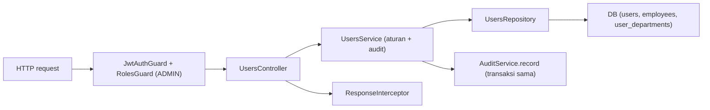

# Module: UsersModule (Manajemen Akun)

**Dibuat:** 2026-10-11
**File sumber yang dianalisis:**
- `users/users.module.ts`, `users/users.controller.ts`, `users/users.service.ts`, `users/users.repository.ts`
- `users/dto/create-user.dto.ts`, `update-user.dto.ts`, `reset-password.dto.ts`, `set-user-status.dto.ts`
- `users/enums/user-role.enum.ts`, `users/interfaces/user.interface.ts`
- Rujukan tipe: `packages/types/src/users.ts`

## Daftar Isi
1. [Ringkasan Module](#1-ringkasan-module)
2. [Peta File di Module Ini](#2-peta-file-di-module-ini)
3. [Penjelasan Kode per File](#3-penjelasan-kode-per-file)
4. [Alur Kerja Lengkap](#4-alur-kerja-lengkap)
5. [Hubungan dengan Module Lain](#5-hubungan-dengan-module-lain)
6. [Kesalahan Umum & Tips Pemula](#6-kesalahan-umum--tips-pemula)
7. [Catatan Kualitas Kode](#7-catatan-kualitas-kode)
8. [Rangkuman & Cek Pemahaman](#8-rangkuman--cek-pemahaman)

---

## 1. Ringkasan Module

**UsersModule** mengelola akun pengguna: membuat, melihat, mengubah, menonaktifkan, mereset password, dan menghapus (soft delete) user. Semua endpoint di sini hanya boleh diakses **ADMIN**. Setiap perubahan wajib menulis jejak audit.

Analogi: ini seperti **bagian kepegawaian/HR administrasi yang mengurus kartu pegawai**. Hanya petugas khusus (ADMIN) yang boleh membuat kartu baru, mengganti jabatan di kartu, atau mencabut kartu. Setiap tindakan dicatat di buku register (audit).

**Istilah baru:**
- **DTO** = Data Transfer Object: class yang mendefinisikan bentuk data yang boleh masuk dari request, lengkap dengan aturan validasi.
- **Repository** = lapisan yang khusus bicara dengan database. Hanya di sinilah query Drizzle ditulis.
- **Soft delete** = menandai data "terhapus" tanpa membuangnya.

---

## 2. Peta File di Module Ini

| Nama file | Jenis | Peran singkat |
|-----------|-------|---------------|
| `users.module.ts` | Module | Merakit controller, service, repository |
| `users.controller.ts` | Controller | Endpoint REST `/api/users*` (khusus ADMIN) |
| `users.service.ts` | Service | Aturan bisnis: cek unik, hash password, transaksi + audit |
| `users.repository.ts` | Repository | Query Drizzle ke tabel `users`, `employees`, `user_departments` |
| `dto/create-user.dto.ts` | DTO | Payload buat user baru |
| `dto/update-user.dto.ts` | DTO | Payload ubah user |
| `dto/reset-password.dto.ts` | DTO | Payload reset password |
| `dto/set-user-status.dto.ts` | DTO | Payload aktif/nonaktif |
| `enums/user-role.enum.ts` | Re-export | Menyediakan `UserRole` |
| `interfaces/user.interface.ts` | Re-export | Alias `UserPayload` |

Diagram alur:



Versi teks:

```
Request → Guard(ADMIN) → Controller → Service → Repository → DB
                                       ↘ AuditService (transaksi sama) 
       ← Response (dibungkus ResponseInterceptor) ←
```

---

## 3. Penjelasan Kode per File

### `users.module.ts`

```ts
@Module({
  imports: [DbModule],
  controllers: [UsersController],
  providers: [UsersService, UsersRepository],
  exports: [UsersService, UsersRepository],
})
export class UsersModule {}
```

- **Fungsinya:** Merakit module. `imports: [DbModule]` untuk akses DB (walau DbModule global, ini eksplisit). `exports` membuat `UsersService`/`UsersRepository` bisa dipakai module lain (mis. Auth).
- **Kenapa dibuat seperti ini:** Pola standar NestJS: module mendeklarasikan apa yang dipakai & dibagikan.
- **Dampaknya:** Menghapus `exports` akan membuat AuthModule tak bisa memakai `UsersRepository` (dipakai untuk login).
- **Analogi:** Struktur unit kepegawaian: menyatakan ruangan, staf, dan layanan yang bisa dipakai unit lain.

### `users.controller.ts`

**Peran file:** Mendefinisikan endpoint HTTP. Tanpa logika bisnis.

```ts
@ApiTags('users')
@ApiBearerAuth()
@Roles(UserRole.ADMIN)
@Controller('users')
export class UsersController {
  constructor(private readonly usersService: UsersService) {}
  ...
}
```

- **Fungsinya:**
  - `@ApiBearerAuth()` → di Swagger, endpoint perlu token Bearer.
  - `@Roles(UserRole.ADMIN)` di level class → `RolesGuard` mengizinkan hanya ADMIN untuk **semua** endpoint di controller ini.
  - `constructor(...)` → menyuntikkan `UsersService`.
- **Kenapa dibuat seperti ini:** Menaruh `@Roles` di class menghindari pengulangan di tiap method. Controller tipis, logika di service.
- **Dampaknya:** Menghapus `@Roles(ADMIN)` membuka manajemen user ke peran lain (bahaya besar).
- **Analogi:** Papan "Hanya petugas berwenang" di depan pintu bagian kepegawaian.

Method demi method:

```ts
@Get() findAll(): Promise<ApiResponse<UserPayload[]>> { return this.usersService.findAll(); }

@Get(':id') findOne(@Param('id', ParseUUIDPipe) id: string) { ... }

@Post() @HttpCode(HttpStatus.CREATED)
create(@Body() dto: CreateUserDto) { ... }

@Patch(':id') update(@Param('id', ParseUUIDPipe) id, @Body() dto: UpdateUserDto) { ... }

@Patch(':id/status') setStatus(@Param('id', ParseUUIDPipe) id, @Body() dto: SetUserStatusDto) { ... }

@Post(':id/reset-password') @HttpCode(HttpStatus.OK)
resetPassword(@Param('id', ParseUUIDPipe) id, @Body() dto: ResetPasswordDto) { ... }

@Delete(':id') @HttpCode(HttpStatus.NO_CONTENT)
remove(@Param('id', ParseUUIDPipe) id) { ... }
```

- **Fungsinya:** Masing-masing meneruskan ke service.
  - `@Get()` → daftar user.
  - `@Get(':id')` → detail user; `ParseUUIDPipe` memastikan `id` berformat UUID (kalau tidak → 400 otomatis).
  - `@Post()` + `@HttpCode(201)` → buat user (default POST 201, ditulis eksplisit).
  - `@Patch(':id')` → ubah user.
  - `@Patch(':id/status')` → aktif/nonaktif.
  - `@Post(':id/reset-password')` → reset password (POST dipakai untuk aksi, bukan sekadar mengganti).
  - `@Delete(':id')` + `@HttpCode(204)` → soft delete; 204 = "sukses tanpa isi".
- **Kenapa dibuat seperti ini:** Best practice REST + validasi id sedini mungkin. `ParseUUIDPipe` mencegah id ngawur sampai ke database.
- **Dampaknya:** Menghapus pipe → id ngawur bisa memicu error DB 500 alih-alih 400.
- **Analogi:** Resepsionis yang memastikan nomor kartu tamu benar formatnya sebelum diteruskan ke staf.
- **Istilah baru:** **Pipe** = pengubah/validator data sebelum masuk handler. **`@Param`/`@Body`** = mengambil bagian request (parameter URL / isi body). **ParseUUIDPipe** = pipe bawaan NestJS khusus format UUID.

### `users.service.ts`

**Peran file:** Aturan bisnis + orkestrasi transaksi & audit.

```ts
constructor(
  private readonly usersRepository: UsersRepository,
  private readonly dbService: DbService,
  private readonly audit: AuditService,
  private readonly requestContext: RequestContextService,
) {}
```

- **Fungsinya:** Menyuntikkan repository (query), `DbService` (transaksi), `AuditService` (jejak), `RequestContextService` (siapa yang melakukan).
- **Kenapa:** Dependency Injection memisahkan tanggung jawab dan memudahkan pengujian.
- **Analogi:** Staf kepegawaian yang punya akses ke lemari arsip, mesin ketik, buku register, dan kartu identitas dirinya.

`create` — pola paling penting:

```ts
async create(dto: CreateUserDto) {
  if (await this.usersRepository.existsByUsername(dto.username)) {
    throw new ConflictException({ message: 'Username already exists',
                                  errorCode: 'USER_USERNAME_ALREADY_EXISTS' });
  }
  const password = await bcrypt.hash(dto.password, 10);

  const created = await this.dbService.transaction(async (tx) => {
    const user = await this.usersRepository.createAndSave({ ...dto, password }, tx);
    if (!user) throw new ConflictException({ message: 'User registration failed' });
    await this.usersRepository.setDepartments(user.id, dto.departmentIds ?? [], tx);
    await this.audit.record(tx, { action: 'USER_CREATED', entity: 'user',
      entityId: user.id, after: { username: dto.username, role: dto.role }, ...this.actor() });
    return user.id;
  });

  return this.findOne(created);
}
```

- **Fungsinya:** Cek username unik → hash password → dalam **satu transaksi**: buat user, set departemen, catat audit → ambil & kembalikan payload.
- **Kenapa dibuat seperti ini:** Aturan AGENTS.md "tulis perubahan + audit dalam satu transaksi". Password di-hash (bcrypt, cost 10) agar tidak disimpan mentah.
- **Dampaknya:** Jika transaksi gagal, tak ada user setengah jadi. Jika hash dihapus, password tersimpan polos (bahaya). Jika audit dilewati, melanggar aturan audit.
- **Analogi:** Membuat kartu pegawai sekaligus mencatatnya di register, dalam satu proses; kalau salah satu langkah gagal, semua dibatalkan.
- **Istilah baru:** **ConflictException** = error 409 (bentrok, mis. duplikat). **bcrypt.hash** = mengubah password jadi hash satu arah.

`update`:

```ts
await this.dbService.transaction(async (tx) => {
  const values: UserUpdate = {};
  if (dto.role !== undefined) values.role = dto.role;
  if (dto.employeeId !== undefined) values.employeeId = dto.employeeId ?? null;
  if (dto.isActive !== undefined) values.isActive = dto.isActive;
  if (Object.keys(values).length > 0) await this.usersRepository.updateAndSave(id, values, tx);
  if (dto.departmentIds !== undefined) await this.usersRepository.setDepartments(id, dto.departmentIds, tx);
  await this.audit.record(tx, { action: 'USER_UPDATED', entity: 'user', entityId: id, after: values, ...this.actor() });
});
```

- **Fungsinya:** Hanya mengubah field yang dikirim (`!== undefined`), sehingga PATCH bisa parsial. Departemen hanya diganti kalau `departmentIds` disebut.
- **Kenapa dibuat seperti ini:** Pola PATCH yang benar: bedakan "tidak dikirim" vs "dikirim null". Mencegah field tak diisi tertimpa nilai kosong.
- **Dampaknya:** Kalau memakai pola `dto.field ?? existing`, sulit mengosongkan nilai secara sengaja.
- **Analogi:** Mengedit kartu pegawai hanya pada kolom yang memang mau diubah.

`setStatus`, `resetPassword`, `remove`, helper `actor()`, `findOneOrFail`, `toPayload`:

```ts
private actor() {
  const user = this.requestContext.getUser();
  return { userId: user?.userId ?? null, username: user?.username ?? null,
           role: user?.roles?.[0] ?? null, ipAddress: this.requestContext.getIp() ?? null,
           requestId: this.requestContext.getRequestId() ?? null };
}
```

- **Fungsinya:** Menyusun info pelaku audit dari konteks request (dipakai semua aksi).
- **Kenapa:** Memusatkan pengambilan pelaku agar konsisten; memanfaatkan `RequestContextService` alih-alih mengoper user ke mana-mana.
- **Dampaknya:** Kalau `actor()` salah, audit kehilangan pelaku/IP → jejak tak berguna.
- **Analogi:** Setiap catatan di register selalu disertai tanda tangan petugas yang mencatat.
- **Istilah baru:** **`?? null` (nullish coalescing)** = pakai nilai kanan jika kiri `null`/`undefined`.
- `findOneOrFail` → cari user, lempar `NotFoundException` (404) bila tak ada.
- `toPayload` → mengubah baris DB menjadi bentuk respons aman (tanpa password!). Ini penting: password sama sekali tidak ikut keluar.

### `users.repository.ts`

**Peran file:** Satu-satunya tempat menulis query Drizzle untuk user.

```ts
private readonly baseSelect = {
  id: users.id, username: users.username,
  role: users.role, isActive: users.isActive,
  employee: { id: employees.id, fullName: employees.fullName },
};
```

- **Fungsinya:** Definisi kolom yang di-select ulang di banyak query (dengan join ke `employees`).
- **Kenapa:** Menghindari pengulangan; sekaligus jadi pengaman **tidak memilih kolom password**.
- **Dampaknya:** Kalau `password` ditambahkan ke `baseSelect`, password (hash) bisa bocor ke API.
- **Analogi:** Daftar kolom baku yang boleh dicetak di kartu pegawai.

Method penting:
- `findAll` / `findById` → ambil user (join employee) dengan filter `notDeleted(users)`.
- `findByUsernameForAuth` → khusus login; **sengaja** mengambil kolom `password` (dipakai Auth).
- `existsByUsername` → cek duplikat (tanpa filter deleted, agar username lama yang dihapus tetap dianggap terpakai — perlu konfirmasi apakah ini diinginkan).
- `departmentsByUserIds` / `departmentsByUserId` → mengambil departemen milik user (untuk respons).
- `createAndSave`, `updateAndSave`, `setDepartments`, `softDelete`, `updateLastLogin`.

```ts
async findById(id: string, executor: DbExecutor = this.db) {
  const [row] = await executor
    .select(this.baseSelect).from(users)
    .leftJoin(employees, eq(users.employeeId, employees.id))
    .where(and(eq(users.id, id), notDeleted(users))).limit(1);
  return row ?? null;
}
```

- **Fungsinya:** Mencari user aktif (belum dihapus) berdasarkan id; `leftJoin` ke employees supaya user tanpa karyawan tetap muncul.
- **Kenapa dibuat seperti ini:** Parameter `executor: DbExecutor = this.db` memungkinkan method ini dipakai di dalam transaksi (`tx`) maupun biasa. Ini teknik kunci agar kode tak terduplikasi.
- **Dampaknya:** Tanpa `notDeleted(users)`, user yang sudah dihapus tetap muncul.
- **Analogi:** Mencari kartu pegawai di lemari, tapi mengabaikan kartu yang sudah dicabut.
- **Istilah baru:** **leftJoin** = menggabungkan tabel namun tetap menampilkan baris kiri walau tak ada pasangan.

```ts
async setDepartments(userId: string, departmentIds: string[], executor: DbExecutor = this.db) {
  await executor.delete(userDepartments).where(eq(userDepartments.userId, userId));
  if (departmentIds.length > 0) {
    await executor.insert(userDepartments).values(departmentIds.map((departmentId) => ({ userId, departmentId })));
  }
}
```

- **Fungsinya:** Mengganti daftar departemen user: hapus semua, lalu masukkan yang baru ("replace").
- **Kenapa:** Lebih sederhana daripada diff (bandingkan lalu tambah/hapus).
- **Dampaknya:** Harus dijalankan dalam transaksi agar tidak ada momen "kosong" bila gagal di tengah.
- **Analogi:** Mengganti seluruh lembar lampiran daftar ruangan yang boleh diakses, bukan menambal satu-satu.

### DTO & Interface

| File | Isi penting |
|------|-------------|
| `create-user.dto.ts` | `username` (wajib, ≤255), `password` (min 6), `role` (`@IsEnum(UserRole)`), `employeeId?`, `departmentIds?` |
| `update-user.dto.ts` | Semua field opsional: `role?`, `employeeId?`, `departmentIds?`, `isActive?` |
| `reset-password.dto.ts` | `password` (min 6) |
| `set-user-status.dto.ts` | `isActive` (boolean) |
| `enums/user-role.enum.ts` | `export { UserRole } from '@appraisal/types'` (re-export) |
| `interfaces/user.interface.ts` | `export type { UserResponse as UserPayload }` (alias) |

- **Fungsinya:** DTO memberi aturan validasi; interface memakai tipe bersama dari paket `@appraisal/types` agar backend & frontend sepakat soal bentuk data.
- **Kenapa dibuat seperti ini:** `class-validator` hanya bekerja pada class, jadi DTO berupa class. Tipe bersama mencegah "kontrak" berbeda antar aplikasi.
- **Dampaknya:** Kalau DTO tidak mencerminkan `CreateUserRequest`, `implements` akan error saat kompilasi (bagus: mencegah ketidakcocokan).
- **Analogi:** Formulir baku dengan kolom wajib bertanda serta aturan panjang minimum, disepakati bersama frontend.
- **Istilah baru:** **`@IsEnum`, `@MinLength`, `@IsUUID`, `@IsBoolean`** = decorator validasi `class-validator`.

---

## 4. Alur Kerja Lengkap

Skenario: **ADMIN membuat user baru.**

1. ADMIN login (via AuthModule) dan mendapat access token.
2. Frontend mengirim `POST /api/users` dengan body: `{ username, password, role, departmentIds }` + header `Authorization: Bearer <token>`.
3. `JwtAuthGuard` memverifikasi token; user ADMIN ditempelkan ke request dan konteks.
4. `RolesGuard` memeriksa `@Roles(ADMIN)` → cocok.
5. `ValidationPipe` memvalidasi body terhadap `CreateUserDto` (username wajib, password ≥ 6, role valid, dsb). Gagal → 400.
6. `UsersController.create` memanggil `UsersService.create`.
7. Service cek `existsByUsername` → jika ada, 409.
8. Password di-hash dengan bcrypt.
9. Dalam **satu transaksi**: insert user → set departemen → catat audit (`USER_CREATED`) dengan pelaku dari `actor()`.
10. Service memanggil `findOne(created)` untuk mengambil payload bersih.
11. `ResponseInterceptor` membungkus jadi `{ status: 201, message, data: {...} }`.
12. Jika ada error di transaksi, seluruh perubahan dibatalkan (rollback) dan `HttpExceptionFilter` mengubah error ke format baku.

---

## 5. Hubungan dengan Module Lain

**Bergantung pada:**
- `DbModule` (global) → `DbService`, `DB_CONNECTION`.
- `AuditModule` (global) → `AuditService.record`.
- `common` → `@Roles`, `RequestContextService` (global), `ResponseInterceptor` (global).

**Dipakai oleh:**
- `AuthModule` → memakai `UsersRepository` (mis. `findByUsernameForAuth`, `updateLastLogin`) untuk login.

**Yang diekspos (exports):** `UsersService`, `UsersRepository`.

**Dampak jika diubah/dihapus:**
- Menghapus `UsersModule` → login (Auth) kemungkinan rusak karena bergantung pada repository-nya; manajemen akun hilang.
- Mengubah bentuk `UserPayload` → frontend perlu menyesuaikan.
- Mengubah aturan audit → melanggar konvensi project.

---

## 6. Kesalahan Umum & Tips Pemula

1. **Menambahkan `password` ke `baseSelect`.** Bikin hash bocor ke API. Hati-hati!
2. **Lupa hash password** sebelum menyimpan. Password tersimpan polos.
3. **Menjalankan perubahan tanpa `transaction()`.** Berisiko data setengah tersimpan bila langkah berikutnya gagal.
4. **Lupa `notDeleted(users)`.** User yang sudah dihapus muncul kembali.
5. **Menghapus `@Roles(ADMIN)`** atau menaruhnya di method tanpa disadari → membuka endpoint ke semua user login.

**Pesan error yang mungkin muncul:**
- `409 USER_USERNAME_ALREADY_EXISTS` → username sudah dipakai.
- `404 User with ID ... not found` → id tidak ada (atau sudah dihapus, karena soft delete difilter).
- `400` dari `ParseUUIDPipe` → `id` bukan UUID.
- `400` dari ValidationPipe → body tidak sesuai DTO (mis. password < 6).

---

## 7. Catatan Kualitas Kode

- **`existsByUsername` tidak memfilter `notDeleted`.** Artinya, username milik user yang **sudah di-soft-delete** tetap dianggap "terpakai" dan mencegah pembuatan username sama. *Perlu konfirmasi:* apakah ini disengaja (mencegah daur ulang username) atau bug. Jika disengaja, beri komentar; jika tidak, tambahkan `notDeleted`.
- **`remove` melakukan soft delete tanpa memutus refresh token.** Refresh token user tersebut tetap valid sampai kadaluarsa (kecuali ada proses lain). *Perlu konfirmasi* apakah perlu menonaktifkan sesi.
- **`role` non-ADMIN bisa membuat user dengan `departmentIds`, tapi tidak ada validasi peran-vs-departemen** (mis. SUPERVISOR butuh departemen, GENERAL_MANAGER tidak). Bisa jadi sumber izin yang keliru. Saran: validasi silang role ↔ departmentIds.
- **Tidak ada masalah keamanan kritis** lain: password selalu di-hash, respons tidak memuat password, audit selalu ditulis dalam transaksi.

---

## 8. Rangkuman & Cek Pemahaman

**Poin kunci:**
1. UsersModule = manajemen akun, seluruhnya khusus ADMIN (`@Roles(ADMIN)` di class).
2. Pola 3 lapis: Controller (routing) → Service (aturan + audit) → Repository (query DB).
3. Setiap write selalu dalam transaksi dan menulis audit (`AuditService.record`).
4. Password selalu di-hash (bcrypt) dan tidak pernah keluar di respons.
5. `DbExecutor` membuat method repository bisa dipakai di dalam maupun luar transaksi.

**Pertanyaan latihan:**

1. *Mengapa `create` memakai `dbService.transaction` padahal cuma insert satu user?*
   → Karena ada langkah lain yang harus konsisten bersamanya: set departemen dan catat audit. Semua harus berhasil atau batal bersama.

2. *Kenapa `password` tidak ada di `baseSelect` tapi diambil di `findByUsernameForAuth`?*
   → `baseSelect` untuk respons (jangan pernah bocorkan password). `findByUsernameForAuth` khusus login, memang perlu membandingkan hash.

3. *Apa fungsi `executor: DbExecutor = this.db` di repository?*
   → Memungkinkan fungsi yang sama dipakai dengan koneksi biasa atau dengan `tx` (transaksi), tanpa menduplikasi kode.
