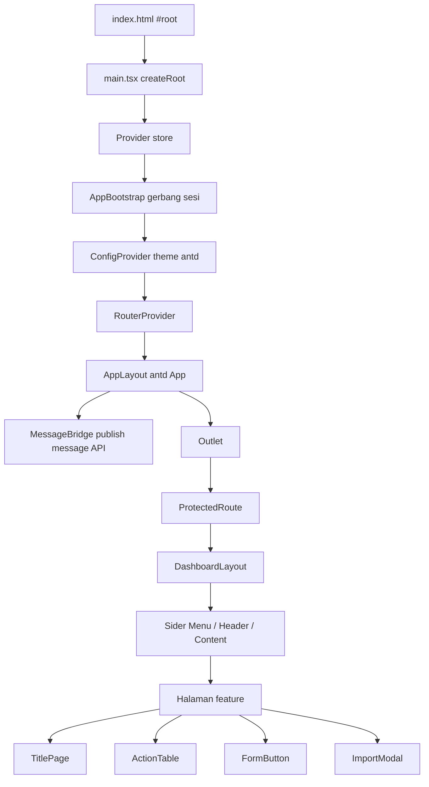
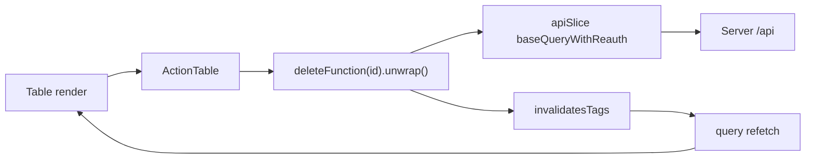

# Alur Aplikasi Frontend, per Komponen

**Berdasarkan:** kode di `apps/frontend` pada repositori ini (kondisi saat dokumen dibuat).
**Cakupan:** `apps/frontend` saja. Untuk rancangan/desain lihat `docs/DESIGN-FRONTEND.md`; untuk aturan produk lihat `docs/PRD.md` (khususnya PRD 5.8 untuk peran dan otorisasi).
**Sifat dokumen:** ini menggambarkan **apa yang benar-benar ada di kode**, bukan yang direncanakan. Bagian 10 mendaftar tempat kode berbeda dari `DESIGN-FRONTEND.md`.

Cara membaca: dokumen ini disusun mengikuti **urutan render** — mulai dari file HTML, naik lapis demi lapis sampai satu halaman tampil. Setelah itu komponen dijelaskan satu per satu, lalu ditutup dengan dua jejak alur nyata.

---

## 1. Peta besar



Semua panah di atas adalah **komposisi**, bukan aliran data. Untuk aliran data, lihat bagian 7.

---

## 2. Rantai bootstrap

Tujuh lapis ini berjalan sebelum satu halaman pun tampil.

### 2.1 `index.html`

**Peran:** shell Vite. Isinya hanya `<div id="root"></div>` dan `<script type="module" src="/src/main.tsx">`, plus preconnect font Inter yang dipakai tema antd.

**Catatan:** meta CSP di dalamnya sedang dikomentari.

### 2.2 `src/main.tsx`

**Peran:** titik masuk React yang sebenarnya. Membuat root dan menyusun seluruh provider sekaligus, dari luar ke dalam:

1. `<StrictMode>`
2. `<Provider store={store}>` — react-redux
3. `<AppBootstrap>`
4. `<ConfigProvider theme={antdTheme}>` — tema antd
5. `<RouterProvider router={router}>`

**Kenapa `Provider` ada di luar `AppBootstrap`:** karena `AppBootstrap` memanggil `useAppDispatch`, yang butuh store sudah tersedia di atasnya.

**Catatan:** antd `<App>` **tidak** di sini. Ia baru ada di dalam router (lihat 2.6).

### 2.3 `src/app/AppBootstrap.tsx`

**Peran:** gerbang sesi. Selama pemulihan sesi belum selesai, komponen ini merender `<Spin size="large">` penuh layar dan **tidak** merender `children`. Artinya tidak ada route yang tampil sebelum status login diketahui.

**Alur:**

1. Baca `tokenStorage.getRefreshToken()`.
2. Tidak ada token → `setReady(true)`. Aplikasi tampil dalam keadaan belum login, lalu `/` mengarahkan ke SignIn.
3. Ada token → `refresh({ refreshToken }).unwrap()`.
4. Simpan refresh token hasil rotasi: `tokenStorage.setRefreshToken(data.refreshToken)`.
5. `dispatch(setAccessToken(data.accessToken))` — supaya permintaan `/auth/me` berikutnya sudah membawa header Bearer.
6. `await loadMe().unwrap()` → `dispatch(setSession({ accessToken, username, role: me.data?.roles?.[0] ?? "" }))`.
7. Kalau ada yang gagal di langkah 3-6 → `tokenStorage.clear()`; `ready` tetap dijadikan `true`.

**Catatan:** ada flag `cancelled` untuk membatalkan pembaruan state setelah unmount (perilaku `StrictMode`).

**Catatan penting:** di sinilah role diambil dari `me.data.roles[0]` — array. Lihat bagian 9.

### 2.4 `src/app/store.ts`

**Peran:** `configureStore` dengan **hanya dua reducer**: `api` (RTK Query) dan `auth`. Middleware: default + `apiSlice.middleware`.

**Konsekuensi desain:** seluruh server state ada di cache RTK Query. Tidak ada slice lain di aplikasi ini — satu-satunya slice buatan tangan adalah `auth`.

### 2.5 `src/app/router.tsx`

**Peran:** `createBrowserRouter`. Bentuknya satu root route dengan `children`:

- `/` → `element: <AppLayout />`, `errorElement: ErrorPage`
- `index` → `SignIn`
- `dashboard` → `ProtectedRoute(DashboardLayout)` yang membungkus semua halaman fitur
- `403` → `Forbidden`
- `*` → `ErrorPage`

**Catatan:** setiap halaman dimuat dengan `lazy()` dan dibungkus `suspenseWrapper` (fallback "Loading..."). Grup fitur memakai `element: <Outlet />` sebagai perantara. Kontrak bersarang di bawah `employee` sebagai `contract/create/:employeeId` dan `contract/update/:employeeId/:contractId`.

### 2.6 `src/components/AppLayout/AppLayout.tsx`

**Peran:** kerangka paling luar untuk **semua** route. Isinya:

```tsx
<App>
  <MessageBridge />
  <Outlet />
</App>
```

`<App>` di sini adalah komponen antd (bukan file proyek). Ia menyediakan konteks yang dibutuhkan `MessageBridge`.

### 2.7 `src/components/MessageBridge/MessageBridge.tsx`

**Peran:** jembatan. Komponen ini **tidak merender apa pun** (`return null`). Tugasnya hanya menerbitkan instance `message` dari antd ke sebuah variabel tingkat modul, supaya kode **bukan komponen** bisa memunculkan notifikasi.

```ts
const { message } = App.useApp();
useEffect(() => setMessageApi(message), [message]);
```

Singleton-nya ada di `src/utils/message.ts` (`setMessageApi` / `getMessageApi`).

**Kenapa perlu:** hook `App.useApp()` hanya bisa dipanggil di dalam komponen. Padahal `errorHandling` harus bisa memunculkan pesan dari mana saja.

### 2.8 `src/utils/errorUtils.ts`

**Peran:** `errorHandling(error)` — jalur error bersama. Isinya: `console.error`, lalu ambil instance pesan dengan `getMessageApi() ?? staticMessage` (fallback ke `message` statis antd kalau jembatan belum siap), lalu tampilkan `error.data.error` atau `error.data.message` atau `"Something error"`.

**Dipakai di ~20 tempat:** setiap form, `ActionTable`, `ImportModal`, `SignIn`, `UserProfile`, dan semua handler mutasi di halaman.

---

## 3. Dua gerbang dan layout

### 3.1 `src/components/ProtectedRoute/ProtectedRoute.tsx`

**Peran:** gerbang login. `auth.logged ? children : <Navigate to="/" />`.

**Catatan:** ia **tidak memeriksa role sama sekali**. Ia juga melakukan `window.scrollTo` ke atas setiap `pathname` berubah.

### 3.2 `src/components/DashboardLayout/DashboardLayout.tsx`

**Peran:** kerangka halaman setelah login. `Sider` berisi `Menu`, `Header` berisi `auth.username` dan `UserProfile`, `Content` berisi `<Outlet />`.

**Detail:** item menu berasal dari `filteredMenuByRole(auth.role)` di `src/constants/dashboardLink.tsx`. Item yang terpilih dihitung dengan mencocokkan `pathname.startsWith(key)`, diurutkan dari key terpanjang, lalu diambil yang pertama — jadi path paling spesifik yang menang. Klik menu → `navigate(key)`.

### 3.3 Sumber daya: `src/constants/`

- `dashboardLink.tsx` → `menuItem` (key = path URL, label, icon, `roles: UserRole[]`) dan `filteredMenuByRole(userRole)`. **Satu-satunya sumber** untuk menu sidebar.
- `roleAccess.ts` → **sumber tunggal aturan akses**: `roles` (enam grup bertipe `UserRole[]`, semuanya memuat `ADMIN` sesuai PRD 5.8), `ALL_ROLES`, predikat `hasAccess(group, userRole)`, dan guard `isUserRole(value)`. Dipakai sebagai `hasAccess(roles.humanResource, auth.role)`.
- `option/` dan `enum/` → daftar opsi Select dan re-export enum dari `@appraisal/types`.

### 3.4 Akses role terjadi di tiga lapis terpisah

1. **Menu** — item dan sub-item yang tidak memuat role user disembunyikan (`filteredMenuByRole`).
2. **Halaman** — tombol dan kolom aksi disembunyikan lewat `hasAccess(roles.humanResource, auth.role)`; sisanya perbandingan enum langsung seperti `auth.role === UserRole.ADMIN`.
3. **Route** — tidak ada pemeriksaan.

Backend tetap otoritasnya; lapisan ini hanya soal tampilan. Aturan produknya ada di PRD 5.8.

Tipe role dijaga di tiga titik: `AuthState.role: UserRole | ""`, grup di `roleAccess.ts` bertipe `UserRole[]`, dan `isUserRole` memvalidasi nilai dari `/auth/me` sebelum masuk ke store. Salah ketik nama role kini gagal saat compile, bukan diam-diam menolak akses.

---

## 4. Komponen shared (`src/components`)

Barrel `src/components/index.ts` mengekspor 9 komponen. **`MessageBridge` dan `DashboardLayout` tidak ada di barrel** — keduanya diimpor lewat path penuh.

### 4.1 `TitlePage/TitlePage.tsx` — 20 call site

**Peran:** header halaman standar. Kiri: `Title` H3 + teks `description`. Kanan: slot `children` untuk tombol aksi.

```ts
type Props = { title?: string; description?: string; children?: React.ReactNode };
```

**Dipakai di:** hampir semua halaman — daftar, create, update, detail kriteria, dan detail appraisal. Ini komponen shared yang paling luas jangkauannya.

### 4.2 `ActionTable/ActionTable.tsx` — 7 call site

**Peran:** kolom aksi untuk satu baris tabel: tombol View, Edit, Delete (ikon, `size="small"`, masing-masing dibungkus `Tooltip`). Solusi untuk boilerplate kolom aksi yang dulu diulang di setiap layar daftar.

**Props:** gabungan tiga tipe, dua di antaranya discriminated union:

```ts
type BaseProps = { id: string | number; linkViewButton?: string };

type EditProps =
  | { isEditButton?: true; linkEditButton: string }
  | { isEditButton: false; linkEditButton?: never };

type DeleteProps =
  | { isDeleteButton?: true; deleteFunction: any }
  | { isDeleteButton: false; deleteFunction?: never };
```

**Perilaku:**
- View tampil hanya kalau `linkViewButton` diisi.
- Edit tampil kalau `isEditButton` (default `true`); `linkEditButton as string` diperlukan karena di cabang union nilai bisa `never`.
- Delete dibungkus `Popconfirm` ("Are you sure to delete this record?") → `await deleteFunction(id).unwrap()` → sukses: `message.success("Record was deleted")`, gagal: `errorHandling(error)`.

**Call site:** `features/users/pages/User.tsx`, `features/employees/pages/Employee.tsx`, `features/departments/pages/Department.tsx`, `features/position/pages/Position.tsx`, `features/contract/pages/Contract.tsx`, dan dua varian di `features/contract/pages/ContractList.tsx` (satu lengkap, satu view-only `isEditButton={false} isDeleteButton={false}`).

**Penyimpangan:** `features/criteria/pages/Criteria.tsx` dan `features/appraisals/pages/Appraisal.tsx` **tidak** memakai komponen ini — keduanya menulis kolom aksinya sendiri secara inline.

### 4.3 `FormButton/FormButton.tsx` — 5 call site

**Peran:** footer Cancel + Submit untuk semua form create/update.

```ts
type Props = { form: FormInstance<any>; isLoading: boolean; submitName: string };
```

**Perilaku:** Cancel → `navigate(-1)`. Submit → `type="primary"`, `loading={isLoading}`, dan `onClick={() => form.submit()}` — memanggil `FormInstance` yang dioper, sehingga tetap bekerja walau tombolnya berada di luar pohon `<Form>`.

**Dipakai di:** `UserForm`, `ContractForm`, `DepartmentForm`, `EmployeeForm`, `PositionForm`.

### 4.4 `ImportModal/ImportModal.tsx` — 2 call site

**Peran:** modal impor `.xlsx` yang bisa dipakai ulang: unduh template (opsional), seret-lepas satu berkas, POST ke endpoint dengan Authorization, tampilkan ringkasan `created / updated / skipped`, dan tampilkan hanya error pertama.

```ts
type Props = {
  open: boolean;
  title?: string;
  templatePath?: string;
  uploadEndpoint: string;
  onClose: () => void;
  onSuccess?: (result: ImportResult) => void;
};
```

**Detail:**
- State `open` dimiliki pemanggil; modal tidak menyimpan status terbuka sendiri.
- `Upload.Dragger` dengan `accept=".xlsx"`, `maxCount={1}`, dan `beforeUpload` yang mengembalikan `false` (mencegah upload otomatis antd).
- Unggah memakai `fetch` mentah + `FormData`, token dibaca dari `store.getState().auth.accessToken`. **Bukan** lewat RTK Query, karena multipart.
- Gagal → mencari `body.details`; kalau punya `row` ditampilkan sebagai error pertama, kalau tidak disintesis `{ row: 0, column: "", message }`.
- Sukses → `message.success("Imported: X created, Y updated, Z skipped")` lalu `onSuccess?.(body.data)`.
- Unduh template → `downloadFile(templatePath, undefined, "template.xlsx")`.

**Call site:** `Employee.tsx` (endpoint `/employees/import`, `onSuccess` menggugurkan tag `Employees`) dan `ContractList.tsx` (`/contracts/import`, menggugurkan `Contracts`).

### 4.5 `MessageBridge/MessageBridge.tsx` — 1 call site

Lihat 2.7. Tidak di-render di barrel; diimpor langsung oleh `AppLayout`.

### 4.6 Komponen shell

- `AppLayout/AppLayout.tsx` — dipakai sekali, di `router.tsx`.
- `ProtectedRoute/ProtectedRoute.tsx` — dipakai sekali, membungkus `DashboardLayout`.
- `DashboardLayout/DashboardLayout.tsx` — dipakai sekali, di dalam `ProtectedRoute`.

### 4.7 `BackButton/` dan `RefreshButton/` — masing-masing 1 call site

Keduanya hanya dipakai di `features/errors/GeneralError.tsx`. BackButton → `navigate(-1)`, RefreshButton → `window.location.reload()`.

### 4.8 `StatsCard/StatsCard.tsx` — 0 call site

Sudah diekspor, belum dipakai dashboard. Properti `{ role, status, value, icon }` — perhatikan `role` di sini berarti label kecil, bukan peran pengguna.

---

## 5. Komponen per feature

Setiap fitur CRUD dibangun dari potongan yang sama: `index.ts` (barrel) → `xApi.ts` → `pages/` → `components/`.

### 5.1 `features/auth`

- **Berkas:** `pages/SignIn.tsx`, `authSlice.ts`, `authApi.ts`, `tokenStorage.ts`.
- **Endpoint:** `signIn`, `refresh`, `me`, `logout` — tanpa tag (login bukan data yang di-cache).
- **Alur SignIn:** `Form` → `useSignInMutation` → `tokenStorage.setRefreshToken(data.refreshToken)` → `dispatch(setAuth({ logged, username, role: data.role, accessToken }))` → `navigate("/dashboard")`.
- **`tokenStorage.ts`:** refresh token di `sessionStorage` dengan key `appraisal.refreshToken`; access token hanya di memori Redux, tidak pernah dipersistenkan.
- **`authSlice.ts`:** `AuthState = { logged, username, role, accessToken }`, aksi `setAuth`, `setSession`, `setAccessToken`, `deleteAuth`.

### 5.2 `features/employees`

- **Halaman:** `Employee` (daftar), `CreateEmployee`, `UpdateEmployee`. **Komponen:** `EmployeeForm`, `EmployeeSearch`.
- **Endpoint:** `getEmployee`, `getEmployeeById`, `createEmployee`, `updateEmployee`, `deleteEmployee` — tag `Employees`.
- **`Employee`:** `TitlePage` dengan tombol Template/Import/Export/Add (semua digerbangi `hasAccess(roles.humanResource, auth.role)`); `EmployeeSearch` mengisi `searchValues` → `queryParams` → `useGetEmployeeQuery`. Kolom aksi disembunyikan bila role tidak berhak.
- **`UpdateEmployee`:** memuat satu karyawan lalu merender `Tabs` — Information (`EmployeeForm`) dan Contracts (`<Contract />` dari fitur contract). Tab aktif dibaca dari `useSearchParams("tab")` — inilah yang membuat `?tab=contracts` dari tombol View bekerja.

### 5.3 `features/contract`

- **Halaman:** `ContractList` (daftar global), `Contract` (tabel per karyawan, dipasang di tab Employee), `CreateContract`, `UpdateContract`. **Komponen:** `ContractForm`.
- **Endpoint:** `getContracts`, `getContractById`, `createContract`, `updateContract`, `deleteContract` — tag `Contracts` + `Employees`.
- **`ContractList`:** `canWrite = auth.role === UserRole.ADMIN || auth.role === UserRole.HR` menentukan varian `ActionTable` yang dirender. Punya `ImportModal` dan satu `Modal` kecil untuk memilih karyawan sebelum membuat kontrak.
- **`Contract`:** hanya menambahkan kolom aksi ke daftar kolom kalau `canWrite` (memakai `columns.push`), lalu tombol "Add Contract" di bawah.

### 5.4 `features/criteria`

- **Halaman:** `Criteria`, `DetailsCriteria`, `CreateCriteria`, `CreateCriteriaVersion`. **Komponen:** `CriteriaForm`, `CriteriaSearch`.
- **Endpoint:** `getCriteriaSets`, `getActiveCriteriaSet`, `getCriteriaSetById`, `createCriteriaSet`, `updateCriteriaSet`, `activateCriteriaSet` — tag `Criteria`.
- **`DetailsCriteria`:** merender `CriteriaForm` hanya bila `status === "DRAFT" && canManage`; selain itu tabel read-only.
- **`CriteriaForm`:** dua `Form.List` bersarang (kriteria dan skala). Tombol Activate diblokir kecuali total bobot tepat 100.
- **`CreateCriteria` dan `CreateCriteriaVersion`:** keduanya hanya shim — `useEffect` → `createSet(undefined).unwrap()` → `navigate` ke halaman detail dengan `{ replace: true }`, sambil menampilkan `<Spin />`.
- **Catatan:** `CriteriaSearch` sudah ada tetapi tidak dipasang di `Criteria.tsx`.

### 5.5 `features/dashboard`

- **Halaman:** `Dashboard`. Tidak ada folder `components`.
- **Endpoint:** `getDashboardSummary` (memberi tag `Appraisals` dan `Employees`), plus lintas-fitur `useGetActiveCriteriaSetQuery` dari fitur criteria.
- **Sifat:** read-only. Tidak ada mutasi, tidak ada pemeriksaan role di halaman.

### 5.6 `features/departments` dan `features/position`

Sepasang folder yang hampir identik.

- **Departments:** tag `Departments`, komponen `DepartmentForm`. Berkas `components/DepartmentSearch.tsx` ada tetapi **kosong** dan tidak dipakai.
- **Position:** tag `Positions`, komponen `PositionForm`, form punya field tambahan `level`.
- **Keduanya:** tidak memeriksa role di halaman. Akses murni lewat menu dan `ProtectedRoute`.
- **Catatan:** `Department.tsx` dan `Position.tsx` masih membawa UI pencarian warisan (pilihan Username/Role) yang menyalin dari halaman Users dan **tidak memfilter apa pun**.

### 5.7 `features/users`

- **Halaman:** `User`, `CreateUser`, `UpdateUser`. **Komponen:** `UserForm`, `UserProfile`.
- **Endpoint:** `getUser`, `getUserById`, `createUser`, `updateUser`, `setUserStatus`, `resetPassword`, `deleteUser` — tag `Users`.
- **`User`:** pemfilteran dilakukan di sisi klien lewat `searchCategory` / `querySearch`. User tidak punya field nama; identitasnya `username`, sedangkan nama karyawan tampil lewat kolom Employee.
- **`UserForm`:** `DEPARTMENT_SCOPED_ROLES = ["HEAD_DEPARTMENT", "SUPERVISOR", "MANAGER"]` memunculkan pilihan `departmentIds` secara kondisional; password wajib saat create, opsional saat update (reset).
- **`UserProfile`:** dropdown avatar di Header; modal profil menampilkan username dan role. Logout → `useLogoutMutation({ refreshToken })` → `dispatch(deleteAuth())` → `tokenStorage.clear()` → `dispatch(apiSlice.util.resetApiState())` → `navigate("/")`.

### 5.8 `features/appraisals`

- **Halaman:** `Appraisal` (daftar), `CreateAppraisal`, `AppraisalDetail`. **Tidak ada folder `components`** — semuanya inline.
- **Endpoint:** `getAppraisals`, `getAppraisalById`, `getAppraisalHistory`, `previewAppraisal` (tanpa tag), `createAppraisal`, `updateAppraisalEmployees`, `saveRatings`, `transitionAppraisal`, `deleteAppraisal`, `runScheduler` — tag `Appraisals`.
- **`AppraisalDetail`:** memakai `getAvailableActions(auth.role, appraisal.status)` dari `src/permissions/appraisalPermissions.ts` untuk menentukan tombol aksi dan mode edit. Ini **satu-satunya** pemakai modul permission di aplikasi.
- **`CreateAppraisal`:** form (departemen + bulan) → `previewAppraisal` → tabel dengan `rowSelection` → `createAppraisal({ departmentId, period, employeeIds })`.
- **Transisi status:** `runTransition` memanggil `transitionAppraisal`; untuk `sendBack` dan `reopen` dibuka `Modal` dengan komentar wajib. Aturan transisinya ada di PRD 5.5 dan 5.8.

### 5.9 `features/errors`

- `Forbidden.tsx` → `<Result status="403">` dengan tombol ke dashboard.
- `GeneralError.tsx` → `ErrorPage` dengan `useRouteError`, memakai `BackButton` + `RefreshButton`.

---

## 6. Aturan tulis-menulis (pola yang harus diikuti)

Semua form mengikuti satu bentuk:

1. `onFinish` membangun body permintaan.
2. `await queryX(...).unwrap()` — `unwrap` wajib, supaya error HTTP benar-benar melempar ke `catch`.
3. Sukses → `message.success("Record was created" / "Record was updated")`.
4. Lalu `form.resetFields()` (create) atau `navigate(-1)` (update).
5. Gagal → `errorHandling(error)`.
6. Tag milik fitur digugurkan otomatis oleh `invalidatesTags` pada definisi mutasi.

**Kenapa `unwrap` penting:** trigger RTK Query mengembalikan promise yang **tidak** reject saat error HTTP — ia resolve menjadi objek `{ data, error, status }`. Hanya `.unwrap()` yang mengubah error menjadi exception. Tanpa `unwrap`, `catch` tidak pernah jalan dan pesan sukses bisa muncul padahal gagal.

---

## 7. Dua jejak alur lengkap

### 7.1 Menghapus satu kontrak dari daftar

1. `ContractList` memanggil `useDeleteContractMutation()` → `deleteContract`, lalu membangun kolom "Action" yang render-nya mengembalikan `<ActionTable deleteFunction={deleteContract} ... />`.
2. antd `Table` memanggil render itu untuk setiap baris.
3. Pengguna klik ikon hapus → `Popconfirm` terbuka.
4. Konfirmasi → `confirm` menjalankan `await deleteFunction(id).unwrap()`.
5. Trigger → `apiSlice` `baseQueryWithReauth` menambahkan `Authorization: Bearer <state.auth.accessToken>`. Kalau server membalas 401, satu refresh dijalankan untuk semua permintaan yang menunggu (single-flight), lalu permintaan awal diulang.
6. `deleteContract.invalidatesTags: ["Contracts", "Employees"]` → semua query yang memberi tag tersebut ditandai basi.
7. `useGetContractsQuery` refetch → `data` berubah → `Table` render ulang tanpa baris itu. Daftar karyawan dan kolom "End Contract" ikut ter-refresh.
8. Resolusi `unwrap` → `message.success("Record was deleted")`. Reject → `errorHandling(error)` lewat instance pesan yang diterbitkan `MessageBridge`.

### 7.2 Mengubah satu kontrak

1. Route → `UpdateContract` → `useGetContractByIdQuery(contractId)`.
2. Sukses → `TitlePage` + `ContractForm` dengan `initialValues` (konversi dayjs dilakukan di `useEffect`).
3. Pengguna klik tombol di `FormButton` → `form.submit()` → `<Form onFinish>`.
4. `onFinish` → `await queryContract({ id: contractId, body: request }).unwrap()`.
5. `updateContract` menggugurkan tag `Contracts` + `Employees`.
6. Daftar kontrak refetch → tabel menampilkan baris yang diperbarui.
7. `message.success("Record was updated")` → `navigate(-1)` kembali ke daftar.



---

## 8. Cara memprediksi fitur yang belum pernah dibaca

Setiap fitur CRUD tersusun dari enam bagian yang sama:

1. `features/X/index.ts` — barrel yang dipakai `router.tsx` untuk lazy import.
2. `features/X/xApi.ts` — satu `apiSlice.injectEndpoints` dengan tag dari daftar tetap (`Criteria`, `Employees`, `Contracts`, `Users`, `Departments`, `Positions`, `Appraisals`). Konvensinya: `getX` (query, `providesTags`), `getXById` (argumen `string | undefined`), `createX` / `updateX` (`{ id, body }`) / `deleteX` (argumen `string`), semuanya `invalidatesTags`.
3. `pages/X.tsx` — `TitlePage` + tombol aksi ber-gate + `Table` + kolom Action berisi `ActionTable`.
4. `pages/CreateX.tsx` — pembungkus tipis: `TitlePage` + `<XForm createForm formFunction={useCreateXMutation} />`.
5. `pages/UpdateX.tsx` — `useGetXByIdQuery` lalu `<XForm createForm={false} formFunction={useUpdateXMutation} initialValues={...} />`.
6. `components/XForm.tsx` — `{ createForm, formFunction, initialValues? }`, memuat opsi dari query fitur lain dengan `useMemo`, `onFinish` → `queryX(...).unwrap()`, ditutup `FormButton`.

Jadi sebuah fitur baru hampir pasti berupa `features/X/{index.ts, xApi.ts, pages/, components/}`, didaftarkan di `router.tsx` (lazy) dan `dashboardLink.tsx` (daftar role menu), memakai `ActionTable` untuk aksi baris dan `FormButton` untuk simpan, dengan satu tag yang sama untuk `providesTags` dan `invalidatesTags`.

---

## 9. Catatan kualitas kode

Bagian ini menyebut apa yang ada, bukan menghakimi. Tidak ada yang diperbaiki oleh dokumen ini.

**Ketidakcocokan yang nyata**

1. **Role: array di satu tempat, scalar di tempat lain.** Role di-seed hanya di dua titik: `SignIn` memakai `data.role` (scalar), `AppBootstrap` memakai `me.data.roles?.[0]` (array). Sementara `AuthenticatedUser.roles` di `@appraisal/types` didefinisikan `string[]`, padahal kolom `role` di database `NOT NULL` dan aturannya satu role per user (AGENTS.md). Frontend kini memvalidasi nilai itu dengan `isUserRole` sebelum dipakai, tetapi bentuk array-nya tetap berasal dari tipe bersama.
2. **Satu aturan, dua gaya.** Lima cek halaman sudah disatukan menjadi `hasAccess(roles.humanResource, auth.role)`, sedangkan `Appraisal.tsx` masih memakai perbandingan enum langsung (`auth.role === UserRole.ADMIN`). Keduanya sudah bertipe aman; yang tersisa hanya beda gaya.
3. **Otorisasi belum terpusat.** `canWriteMaster` di `src/permissions/appraisalPermissions.ts` hanya dipakai oleh spec-nya sendiri. Di backend pun `can()` pada matriks permission belum dipanggil kode produksi. Jadi modul matriks sudah ada di dua sisi tetapi belum menjadi jalur wajib.
4. **`ActionTable` memakai `deleteFunction: any`.** Ini menghapus jaminan bahwa argumennya adalah trigger yang punya `unwrap()`, sehingga panggilan yang salah bentuk baru ketahuan saat runtime.
5. **`downloadFile` dan `ImportModal` tidak dapat refresh 401.** Keduanya memakai `fetch` mentah dan membaca token langsung dari store, jadi keduanya melewati single-flight refresh di `apiSlice`. Token basi akan muncul sebagai error biasa.
6. **Route `/403` tidak pernah dituju.** Tidak ada kode yang mengarahkan ke sana; setiap halaman justru merender `<Result status="403">` sendiri.
7. **Menu dan route adalah string terpisah.** `key` menu di `dashboardLink.tsx` dan `path` di `router.tsx` adalah literal yang sama tetapi diduplikasi, bukan berasal dari satu sumber.
8. **Berkas menganggur.** `StatsCard` tidak punya call site; `components/DepartmentSearch.tsx` di fitur departments kosong; `CriteriaSearch` tidak dipasang.
9. **UI pencarian warisan.** `Department.tsx` dan `Position.tsx` membawa pilihan Username/Role yang tidak memfilter apa pun.

---

## 10. Kode versus `docs/DESIGN-FRONTEND.md`

`DESIGN-FRONTEND.md` menggambarkan rancangan; beberapa bagiannya belum/tidak sama dengan kode:

| Rancangan di `DESIGN-FRONTEND.md` | Kondisi kode |
|---|---|
| Modul permission UI di `shared/permissions` | Nyatanya di `src/permissions/appraisalPermissions.ts`, dan hanya dipakai `AppraisalDetail` |
| Prettier belum terpasang | Prettier dan `eslint-config-prettier` sudah ada di `apps/frontend/package.json` |
| `shared/hooks` (mis. `useDebounce`) | Belum ada |
| `useBlocker` untuk peringatan penilaian belum disimpan | Belum dipakai |
| State daftar (page, filter, search) disimpan di URL query string | Hanya tab karyawan yang memakai URL (`?tab=`); page dan filter masih `useState` |
| Redux menyimpan "unsaved grid edits" | Belum ada slice seperti itu; edit penilaian masih state lokal di `AppraisalDetail` |

Bagian yang **sudah** sesuai: RTK Query sebagai satu-satunya jalur data server, access token di memori + refresh token di `sessionStorage`, dan token refresh single-flight.

---

## 11. Rangkuman dan cek pemahaman

**Poin kunci**

1. Urutan render: `main.tsx` → `AppBootstrap` (gerbang sesi) → `ConfigProvider` → `RouterProvider` → `AppLayout` (`<App>` + `MessageBridge`) → `ProtectedRoute` → `DashboardLayout` → halaman fitur.
2. `AppBootstrap` menahan seluruh aplikasi sampai sesi dipulihkan; role di-seed di sana dan di SignIn saja.
3. `MessageBridge` adalah satu-satunya jembatan antara konteks antd dan kode non-komponen; `errorHandling` bergantung padanya.
4. Server state sepenuhnya di RTK Query dengan tag; hanya `auth` yang menjadi slice.
5. Setiap fitur mengikuti pola enam bagian yang sama, dengan `ActionTable` dan `FormButton` sebagai titik temu.

**Pertanyaan latihan**

1. Kenapa `Provider` Redux berada di luar `AppBootstrap`, dan kenapa `<App>` antd justru berada di dalam router?
2. Kalau `ActionTable` memanggil `deleteFunction(id)` tanpa `.unwrap()`, apa yang rusak dan mengapa tidak ada error yang terlihat?
3. Di mana role pengguna pertama kali diisi, dan mengapa bentuknya berbeda antara login dan pemulihan sesi?

**Jawaban singkat:** (1) `AppBootstrap` memakai `useAppDispatch` sehingga store harus lebih dulu; antd `<App>` menempel pada `AppLayout` karena `AppLayout` adalah element dari root route sehingga konteksnya tersedia untuk semua route. (2) `catch` tidak pernah jalan karena promise tidak reject saat error HTTP, sehingga `errorHandling` dilewati dan pesan sukses tetap muncul. (3) Di `SignIn` dari `data.role` (scalar) dan di `AppBootstrap` dari `me.data.roles[0]` (array) — perbedaan yang berasal dari tipe `AuthenticatedUser.roles`.
