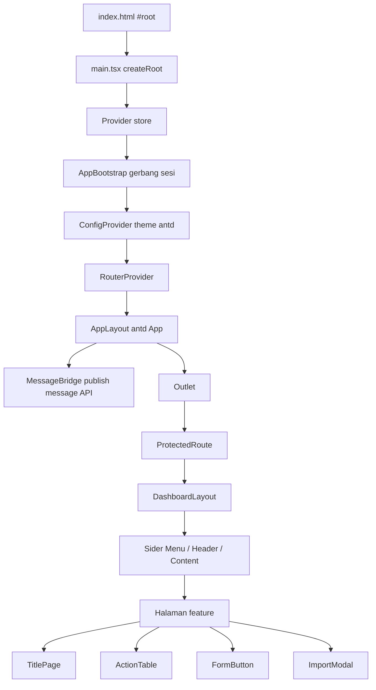
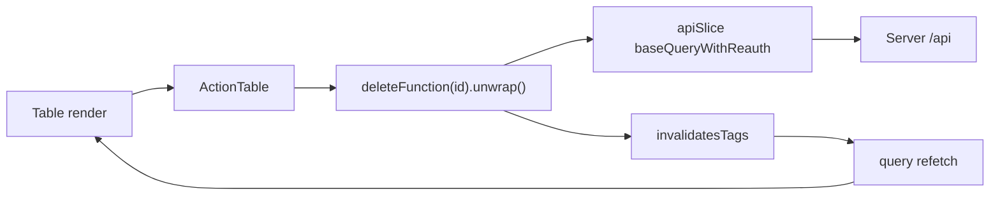

# Alur Aplikasi Frontend, per Komponen

**Berdasarkan:** kode di `apps/frontend` pada repositori ini (diperbarui 27 Oktober 2026).
**Cakupan:** `apps/frontend` saja. Untuk rancangan/desain lihat `docs/DESIGN-FRONTEND.md`; untuk aturan produk lihat `docs/PRD.md` (khususnya PRD v0.9 untuk peran dan otorisasi).
**Sifat dokumen:** ini menggambarkan **apa yang benar-benar ada di kode**, bukan yang direncanakan. Bagian 10 mendaftar tempat kode berbeda dari `DESIGN-FRONTEND.md`.

**Perubahan terbaru yang sudah tercermin di dokumen ini:** sesi dipulihkan lewat cookie refresh HttpOnly (tidak ada `tokenStorage`, access token hanya di memori); logout tanpa argumen; `ImportModal` tidak lagi mengunduh template dan menampilkan error inline; pembuatan draft criteria lewat modal + route shim; daftar department/position/user punya pencarian klien yang benar; daily notes punya search employee + department + date; appraisal punya riwayat status, default tab per role, halaman detail per karyawan dengan daily note sum berbasis window kontrak, dan export hasil `.xlsx` saat COMPLETE; ADMIN adalah peran akses penuh.

Cara membaca: dokumen ini disusun mengikuti **urutan render** — mulai dari file HTML, naik lapis demi lapis sampai satu halaman tampil. Setelah itu komponen dijelaskan satu per satu, lalu ditutup dengan tiga jejak alur nyata.

---

## 1. Peta besar



Semua panah di atas adalah **komposisi**, bukan aliran data. Untuk aliran data, lihat bagian 7.

---

## 2. Rantai bootstrap

Tujuh lapis ini berjalan sebelum satu halaman pun tampil.

### 2.1 `index.html`

**Peran:** shell Vite. Isinya hanya `<div id="root"></div>` dan `<script type="module" src="/src/main.tsx">`, plus preconnect font Inter yang dipakai tema antd.

**Catatan:** meta CSP di dalamnya sedang dikomentari.

### 2.2 `src/main.tsx`

**Peran:** titik masuk React yang sebenarnya. Membuat root dan menyusun seluruh provider sekaligus, dari luar ke dalam:

1. `<StrictMode>`
2. `<Provider store={store}>` — react-redux
3. `<AppBootstrap>`
4. `<ConfigProvider theme={antdTheme}>` — tema antd
5. `<RouterProvider router={router} future={{ v7_startTransition: true }}>`

**Kenapa `Provider` ada di luar `AppBootstrap`:** karena `AppBootstrap` memanggil `useAppDispatch`, yang butuh store sudah tersedia di atasnya.

**Catatan:** antd `<App>` **tidak** di sini. Ia baru ada di dalam router (lihat 2.6).

### 2.3 `src/app/AppBootstrap.tsx`

**Peran:** gerbang sesi. Selama pemulihan sesi belum selesai, komponen ini merender `<Spin size="large">` penuh layar dan **tidak** merender `children`. Artinya tidak ada route yang tampil sebelum status login diketahui.

**Alur:**

1. Panggil `refresh()` → `POST /auth/refresh`. Permintaan ini membawa cookie lewat `credentials: "include"`; refresh token disimpan backend sebagai cookie HttpOnly, jadi JavaScript tidak pernah membaca atau menulisnya. **Tidak ada** `tokenStorage` dan tidak ada pengecekan token di frontend. Backend **tidak merotasi** refresh token: yang diterbitkan hanya access token baru (lihat `DESIGN-BACKEND.md` 8.1). Request ini tetap **single-flight** lewat `refreshRequestRef` agar effect yang dijalankan ulang (StrictMode, Fast Refresh, remount) tidak mengirim POST ganda; sifatnya efisiensi, bukan syarat kebenaran.
2. Sukses → `if (cancelled) return;` lalu `dispatch(setAccessToken(data.accessToken))`, supaya `GET /auth/me` berikutnya sudah membawa header Bearer.
3. `await loadMe().unwrap()` → `if (cancelled) return;` lalu `me.data.roles?.[0]` divalidasi `isUserRole` → `dispatch(setSession({ accessToken, username, role }))`; `setSession` menetapkan `logged = true`.
4. Gagal di langkah 1-3 (tidak ada cookie, cookie kedaluwarsa, atau `/auth/me` menolak) → `dispatch(deleteAuth())`, sehingga `logged` tetap `false`.
5. `finally` → `setReady(true)`. Baru setelah itu `children` (router) dirender.

**Catatan:** flag `cancelled` membatalkan pembaruan state setelah unmount (perilaku `StrictMode`). Guard-nya dicek tepat setelah `refresh()` dan tepat setelah `loadMe()`; `deleteAuth` dan `setReady` juga hanya dijalankan bila run itu masih aktif.

**Catatan:** permintaan refresh sendiri tidak diulang oleh `baseQueryWithReauth`, karena `isRefreshRequest()` mengecualikan `/auth/refresh`.

**Catatan penting:** di sinilah role diambil dari `me.data.roles[0]` — array. Lihat bagian 9.

### 2.4 `src/app/store.ts`

**Peran:** `configureStore` dengan **hanya dua reducer**: `api` (RTK Query) dan `auth`. Middleware: default + `apiSlice.middleware`.

**Konsekuensi desain:** seluruh server state ada di cache RTK Query. Tidak ada slice lain di aplikasi ini — satu-satunya slice buatan tangan adalah `auth`.

### 2.5 `src/app/router.tsx`

**Peran:** `createBrowserRouter`. Bentuknya satu root route dengan `children`:

- `/` → `element: <AppLayout />`, `errorElement: suspenseWrapper(<ErrorPage />)`
- `index` → `SignIn`
- `dashboard` → `ProtectedRoute(DashboardLayout)` yang membungkus semua halaman fitur
- `403` → `Forbidden`
- `*` → `ErrorPage`

**Catatan:** setiap halaman dimuat dengan `lazy()` dan dibungkus `suspenseWrapper` (fallback "Loading..."). Grup fitur memakai `element: <Outlet />` sebagai perantara. Selain halaman master data dan users, route yang terdaftar: `appraisals/{new,:id,:id/employees/:appraisalEmployeeId}`, `daily-notes/{create,:id/edit}`, `contracts`, `templates`, `departments/{create,:id}`, dan `positions/{create,:id}`. Kontrak bersarang di bawah `employee` sebagai `contract/create/:employeeId` dan `contract/update/:employeeId/:contractId`.

**Catatan:** router memakai future flags v7 (`v7_fetcherPersist`, `v7_normalizeFormMethod`, `v7_partialHydration`, `v7_relativeSplatPath`, `v7_skipActionErrorRevalidation`), dan `RouterProvider` menyalakan `v7_startTransition`.

### 2.6 `src/components/AppLayout/AppLayout.tsx`

**Peran:** kerangka paling luar untuk **semua** route. Isinya:

```tsx
<App>
  <MessageBridge />
  <Outlet />
</App>
```

`<App>` di sini adalah komponen antd (bukan file proyek). Ia menyediakan konteks yang dibutuhkan `MessageBridge`.

### 2.7 `src/components/MessageBridge/MessageBridge.tsx`

**Peran:** jembatan. Komponen ini **tidak merender apa pun** (`return null`). Tugasnya hanya menerbitkan instance `message` dari antd ke sebuah variabel tingkat modul, supaya kode **bukan komponen** bisa memunculkan notifikasi.

```ts
const { message } = App.useApp();
useEffect(() => setMessageApi(message), [message]);
```

Singleton-nya ada di `src/utils/message.ts` (`setMessageApi` / `getMessageApi`).

**Kenapa perlu:** hook `App.useApp()` hanya bisa dipanggil di dalam komponen. Padahal `errorHandling` harus bisa memunculkan pesan dari mana saja.

### 2.8 `src/utils/errorUtils.ts`

**Peran:** `errorHandling(error)` — jalur error bersama. Isinya: `console.error`, lalu ambil instance pesan dengan `getMessageApi() ?? staticMessage` (fallback ke `message` statis antd kalau jembatan belum siap), lalu tampilkan `error.data.error` atau `error.data.message` atau `"Something error"`.

**Dipakai di 27 panggilan (22 berkas):** setiap form, `ActionTable`, `ImportModal`, `SignIn`, `UserProfile`, `AppraisalDetail`, `AppraisalEmployeeDetail`, dan semua handler mutasi di halaman.

---

## 3. Dua gerbang dan layout

### 3.1 `src/components/ProtectedRoute/ProtectedRoute.tsx`

**Peran:** gerbang login. `auth.logged ? children : <Navigate to="/" />`.

**Catatan:** `auth.logged` awalnya `false` (`authSlice`), dan tetap `false` setelah `AppBootstrap` gagal (`deleteAuth`). Jadi membuka `/dashboard/...` tanpa sesi langsung dialihkan ke `/` — halaman SignIn. Ia **tidak memeriksa role sama sekali**. Ia juga melakukan `window.scrollTo` (smooth) ke atas setiap `pathname` berubah.

### 3.2 `src/components/DashboardLayout/DashboardLayout.tsx`

**Peran:** kerangka halaman setelah login. `Sider` berisi `Menu`, `Header` berisi `auth.username` dan `UserProfile`, `Content` berisi `<Outlet />`.

**Detail:** item menu berasal dari `filteredMenuByRole(auth.role)` di `src/constants/dashboard-link.tsx`. Fungsi itu meloloskan **semua** item untuk ADMIN; role lain hanya melihat item yang memuat role-nya. `filteredMenuByRole("")` mengembalikan `[]`. Menu punya dua grup induk: **Master Data** (Departments, Positions, Template) dan **Manage User** (Users); key grup (`/dashboard/master-data`, `/dashboard/user`) hanya label, bukan route. Item yang terpilih dihitung dengan mencocokkan `pathname.startsWith(key)`, diurutkan dari key terpanjang, lalu diambil yang pertama — jadi path paling spesifik yang menang. Klik menu → `navigate(key)`.

### 3.3 Sumber daya: `src/constants/`

- `dashboard-link.tsx` → `menuItem` (key = path URL, label, icon, `roles: readonly UserRole[]`) dan `filteredMenuByRole(userRole)`. **Satu-satunya sumber** untuk menu sidebar. ADMIN mendapat semua item, termasuk Daily Notes.
- `role-access.ts` → **sumber tunggal aturan akses**: `roles` (delapan grup bertipe `readonly UserRole[]`; semua grup memuat ADMIN kecuali `noteManagers` yang berisi HEAD_DEPARTMENT + SUPERVISOR; `appraisalResultExport` berisi ADMIN + HR + HEAD_DEPARTMENT + MANAGER + GENERAL_MANAGER), `ALL_ROLES`, predikat `hasAccess(group, userRole)`, dan guard `isUserRole(value)`. `hasAccess` selalu `true` untuk ADMIN, sehingga semua tombol yang memakai grup ini ikut terbuka untuk ADMIN dan `noteManagers` pun terbuka untuknya. Dipakai sebagai `hasAccess(roles.humanResource, auth.role)` (`roles.humanResource` = ADMIN + HR).
- `option/` dan `enum/` → daftar opsi Select dan re-export enum dari `@appraisal/types`.

### 3.4 Akses role terjadi di tiga lapis terpisah

1. **Menu** — item dan sub-item yang tidak memuat role user disembunyikan (`filteredMenuByRole`); ADMIN melihat semuanya.
2. **Halaman** — tombol dan kolom aksi umumnya memakai `hasAccess(roles.X, auth.role)`, yang selalu `true` untuk ADMIN. Beberapa tempat masih memakai perbandingan enum langsung (`Appraisal.tsx` untuk tombol Create/Delete, `DetailsCriteria.tsx` untuk edit ACTIVE).
3. **Route** — tidak ada pemeriksaan.

Backend tetap otoritasnya; lapisan ini hanya soal tampilan. ADMIN juga diloloskan backend di semua endpoint dan transisi. Aturan produknya ada di PRD v0.9 (5.5, 5.8, 5.9).

Tipe role dijaga di tiga titik: `AuthState.role: UserRole | ""`, grup di `role-access.ts` bertipe `readonly UserRole[]`, dan `isUserRole` memvalidasi nilai dari `/auth/me` sebelum masuk ke store. Salah ketik nama role kini gagal saat compile, bukan diam-diam menolak akses.

---

## 4. Komponen shared (`src/components`)

Barrel `src/components/index.ts` mengekspor 9 komponen. **`MessageBridge` dan `DashboardLayout` tidak ada di barrel** — keduanya diimpor lewat path penuh.

### 4.1 `TitlePage/TitlePage.tsx` — 25 call site

**Peran:** header halaman standar. Kiri: `Title` H3 + teks `description`. Kanan: slot `children` untuk tombol aksi.

```ts
type Props = { title?: string; description?: string; children?: React.ReactNode };
```

**Dipakai di:** hampir semua halaman — daftar, create, update, detail kriteria, detail appraisal, dan detail assessment per karyawan. Ini komponen shared yang paling luas jangkauannya.

### 4.2 `ActionTable/ActionTable.tsx` — dipakai di semua daftar CRUD

**Peran:** kolom aksi untuk satu baris tabel: tombol View, Edit, Delete (ikon, `size="small"`, masing-masing dibungkus `Tooltip`). Solusi untuk boilerplate kolom aksi yang dulu diulang di setiap layar daftar.

**Props:** gabungan tiga tipe, dua di antaranya discriminated union:

```ts
type BaseProps = { id: string | number; linkViewButton?: string };

type EditProps =
  | { isEditButton?: true; linkEditButton: string }
  | { isEditButton: false; linkEditButton?: never };

type DeleteProps =
  | { isDeleteButton?: true; deleteFunction: any }
  | { isDeleteButton: false; deleteFunction?: never };
```

**Perilaku:**
- View tampil hanya kalau `linkViewButton` diisi.
- Edit tampil kalau `isEditButton` (default `true`); `linkEditButton as string` diperlukan karena di cabang union nilai bisa `never`.
- Delete dibungkus `Popconfirm` ("Are you sure to delete this record?") → `await deleteFunction(id).unwrap()` → sukses: `message.success("Record was deleted")`, gagal: `errorHandling(error)`. Tombol delete memakai gaya solid danger (`color="danger" variant="solid"`), begitu juga tombol delete lain di aplikasi.

**Call site:** `features/users/pages/User.tsx`, `features/employees/pages/Employee.tsx`, `features/departments/pages/Department.tsx`, `features/position/pages/Position.tsx`, `features/contract/pages/Contract.tsx`, dan dua varian di `features/contract/pages/ContractList.tsx` (satu lengkap, satu view-only `isEditButton={false} isDeleteButton={false}`).

**Penyimpangan:** `features/criteria/pages/Criteria.tsx`, `features/appraisals/pages/Appraisal.tsx`, `features/appraisals/pages/AppraisalDetail.tsx`, dan `features/daily-notes/pages/DailyNote.tsx` **tidak** memakai komponen ini — kolom/aksi baris ditulis inline.

### 4.3 `FormButton/FormButton.tsx` — 5 call site

**Peran:** footer Cancel + Submit untuk semua form create/update.

```ts
type Props = { form: FormInstance<any>; isLoading: boolean; submitName: string };
```

**Perilaku:** Cancel → `navigate(-1)`. Submit → `type="primary"`, `loading={isLoading}`, dan `onClick={() => form.submit()}` — memanggil `FormInstance` yang dioper, sehingga tetap bekerja walau tombolnya berada di luar pohon `<Form>`.

**Dipakai di:** `UserForm`, `ContractForm`, `DepartmentForm`, `EmployeeForm`, `PositionForm`.

### 4.4 `ImportModal/ImportModal.tsx` — 2 call site

**Peran:** modal impor `.xlsx` yang bisa dipakai ulang: seret-lepas satu berkas, unggah ke endpoint dengan Authorization, tampilkan ringkasan `created / updated / skipped`, dan tampilkan hanya error pertama.

```ts
type Props = {
  open: boolean;
  title?: string;
  uploadEndpoint: string;
  onClose: () => void;
  onSuccess?: (result: ImportResult) => void;
};
```

**Detail:**
- Tidak ada prop `templatePath` dan tidak ada tombol unduh template di modal; template diunduh dari halaman Templates lewat `downloadFile`.
- State `open` dimiliki pemanggil; modal tidak menyimpan status terbuka sendiri.
- `Upload.Dragger` dengan `accept=".xlsx"`, `maxCount={1}`, dan `beforeUpload` yang mengembalikan `false` (mencegah upload otomatis antd). Berkas baru diunggah setelah tombol **Import** di footer ditekan.
- Unggah memakai `fetch` mentah + `FormData`, token dibaca dari `store.getState().auth.accessToken`. **Bukan** lewat RTK Query, karena multipart.
- Gagal → mencari `body.details`; kalau punya `row` dipakai, kalau tidak disintesis `{ row: 0, column: "", message }`. Error pertama ditampilkan inline sebagai `<Alert type="error">` (bukan `message.error`), dan modal tetap terbuka.
- Sukses → `message.success("Imported: X created, Y updated, Z skipped")`, `onSuccess?.(body.data)`, reset state, lalu `onClose()`.
- `catch` (mis. jaringan) → `errorHandling(err)`.
- Modal tidak menangani refresh 401; lihat bagian 9.

**Call site:** `Employee.tsx` (endpoint `/employees/import`, `onSuccess` menggugurkan tag `Employees`) dan `ContractList.tsx` (`/contracts/import`, menggugurkan tag `Contracts`).

### 4.5 `MessageBridge/MessageBridge.tsx` — 1 call site

Lihat 2.7. Tidak di-render di barrel; diimpor langsung oleh `AppLayout`.

### 4.6 Komponen shell

- `AppLayout/AppLayout.tsx` — dipakai sekali, di `router.tsx`.
- `ProtectedRoute/ProtectedRoute.tsx` — dipakai sekali, membungkus `DashboardLayout`.
- `DashboardLayout/DashboardLayout.tsx` — dipakai sekali, di dalam `ProtectedRoute`.

### 4.7 `BackButton/` dan `RefreshButton/` — masing-masing 1 call site

Keduanya hanya dipakai di `features/errors/GeneralError.tsx`. BackButton → `navigate(-1)`, RefreshButton → `window.location.reload()`.

### 4.8 `StatsCard/StatsCard.tsx` — 0 call site

Sudah diekspor, belum dipakai dashboard. Properti `{ role, status, value, icon }` — perhatikan `role` di sini berarti label kecil, bukan peran pengguna.

---

## 5. Komponen per feature

Setiap fitur CRUD dibangun dari potongan yang sama: `index.ts` (barrel) → `xApi.ts` → `pages/` → `components/`.

### 5.1 `features/auth`

- **Berkas:** `pages/SignIn.tsx`, `authSlice.ts`, `authApi.ts`. **Tidak ada** `tokenStorage.ts`.
- **Endpoint:** `signIn` (`POST /auth/signin`), `refresh` (`POST /auth/refresh`, tanpa argumen), `me` (`GET /auth/me`), `logout` (`POST /auth/logout`, tanpa argumen) — semuanya tanpa tag (login bukan data yang di-cache).
- **Token:** access token hanya di memori Redux. Refresh token berupa cookie HttpOnly yang di-set backend; `fetchBaseQuery` memakai `credentials: "include"` sehingga browser mengirim dan menyimpannya sendiri. Tidak ada kode frontend yang membaca atau menulis token refresh.
- **Alur SignIn:** `Form` → `useSignInMutation` → `dispatch(setSession({ accessToken: data.accessToken, username: data.username, role: data.role ?? "" }))` → `navigate("/dashboard")`. Cookie refresh ikut di-set oleh respons backend.
- **`authSlice.ts`:** `AuthState = { logged, username, role, accessToken }`, aksi `setSession` (satu-satunya jalur pembentukan sesi, selalu menetapkan `logged = true`), `setAccessToken` (re-auth 401: hanya token yang diganti), dan `deleteAuth`. Pemulihan sesi ada di `AppBootstrap` (bagian 2.3), bukan di slice.

### 5.2 `features/employees`

- **Halaman:** `Employee` (daftar), `CreateEmployee`, `UpdateEmployee`. **Komponen:** `EmployeeForm`, `EmployeeSearch`.
- **Endpoint:** `getEmployee`, `getEmployeeById`, `createEmployee`, `updateEmployee`, `deleteEmployee` — tag `Employees`.
- **`Employee`:** `TitlePage` dengan tombol Import/Export/Add Employee (digerbangi `hasAccess(roles.humanResource, auth.role)`; ADMIN ikut). Kolom tabel: No, Employee No, Name, Department, Position, Status, Start Contract (`contractStartDate`), End Contract (`contract.endDate`), Action; ada kolom ID tersembunyi (`hidden: true`). Kolom aksi disembunyikan bila role tidak berhak. Pagination server-side (`page`/`limit`), total dibaca dari beberapa bentuk meta dengan fallback ke jumlah baris.
- **`EmployeeSearch`:** semua filter inline, tanpa drawer/tombol Filter. Baris atas: Start Contract Range + End Contract Range. Baris bawah: search, Department, Position, Status. Select memakai **id** department/position, range dikirim sebagai `contractStartFrom/To` dan `contractEndFrom/To`. Select dan range langsung memanggil `onSearch`; search memanggil saat Enter atau clear. `Employee` menyimpan hasilnya di `searchValues` → `queryParams` → `useGetEmployeeQuery`.
- **`EmployeeForm`:** update memakai field employee biasa; **create** menambahkan `Form.List` Contracts (type, start date, end date; end date hanya untuk non-PERMANENT) yang ikut dikirim sebagai `contracts` di `createEmployee`. Field atasan memakai `supervisorId`/label "Supervisor".
- **`UpdateEmployee`:** memuat satu karyawan lalu merender `Tabs` — Information (`EmployeeForm`) dan Contracts (`<Contract />` dari fitur contract). Tab aktif dibaca dari `useSearchParams("tab")` — inilah yang membuat `?tab=contracts` dari tombol View bekerja.

### 5.3 `features/contract`

- **Halaman:** `ContractList` (daftar global), `Contract` (tabel per karyawan, dipasang di tab Employee), `CreateContract`, `UpdateContract`. **Komponen:** `ContractForm`.
- **Endpoint:** `getContracts`, `getContractById`, `createContract`, `updateContract`, `deleteContract` — tag `Contracts` + `Employees`.
- **`ContractList`:** `canWrite = hasAccess(roles.humanResource, auth.role)` menentukan varian `ActionTable`. Filter memakai **form state** (`Form.useForm`): baris atas Start Contract + End Contract RangePicker (label horizontal), baris bawah search + contract type; tidak ada drawer. Type dan range langsung memperbarui state `filters`; search saat Enter/clear. State itu dipakai query dan export (`startDateFrom/To`, `endDateFrom/To`). Di backend, `contracts` adalah tabel utama dengan `leftJoin(employees)`; `search` difilter pada `employees.fullName`/`employees.employeeNumber`, sedangkan `contractType` dan rentang tanggal pada `contracts`. Kolom tabel tetap Employee No, Employee, Type, Start, End, Action (satu baris per kontrak). Ada `ImportModal` dan satu `Modal` kecil untuk memilih karyawan sebelum membuat kontrak.
- **`ContractForm`:** create/update kontrak. Backend menolak rentang yang beririsan dengan kontrak lain milik karyawan yang sama (`422 CONTRACT_OVERLAP`), dan pesannya ditampilkan lewat `errorHandling`.
- **`Contract`:** hanya menambahkan kolom aksi ke daftar kolom kalau `canWrite` (memakai `columns.push`), lalu tombol "Add Contract" di bawah.

### 5.4 `features/criteria`

- **Halaman:** `Criteria`, `DetailsCriteria`, `CreateCriteria`, `CreateCriteriaVersion`. **Komponen:** `CriteriaForm`, `CriteriaSearch`.
- **Endpoint:** `getCriteriaSets`, `getAvailableCriteriaSets` (param `departmentId`), `getActiveCriteriaSet` (param `departmentId`), `getCriteriaSetById`, `createCriteriaSet` (body opsional `{ departmentId }`), `updateCriteriaSet`, `activateCriteriaSet` — tag `Criteria`.
- **`Criteria`:** tombol **New draft** (ADMIN/HR) membuka `Modal` berisi pilihan Department (opsional; kosong = set global), lalu `createCriteriaSet({ departmentId })` dan langsung `navigate` ke halaman detail. Tabel menampilkan department/global, versi, status, jumlah kriteria, waktu aktivasi, note, dan aksi Open. Kolom aksi ditulis inline, bukan `ActionTable`.
- **`DetailsCriteria`:** merender `CriteriaForm` bila `DRAFT && canManage` (ADMIN/HR) **atau** `ACTIVE && isAdmin`; selain itu dua tab read-only (Criteria dan Form fields).
- **`CriteriaForm`:** mode `draft` atau `active`. Tab **Criteria** (Form.List kriteria + Form.List score descriptions) dan **Form fields** (Form.List field + options). Setiap field punya input Description di bawah Label; field NUMBER punya rules min/max, TEXT punya minLength/maxLength/pattern, OPTION/MULTI_OPTION punya daftar opsi. Di mode `active`, bobot dinonaktifkan dan tombol tambah/hapus kriteria disembunyikan, sedangkan field dan isi kriteria lain tetap bisa diedit. Activate menyimpan form dulu, memanggil `activateCriteriaSet`, lalu kembali ke daftar; tombolnya diblokir kecuali total bobot tepat 100. Key dan label harus unik per set; backend menolak duplikat (`CRITERIA_FIELD_DUPLICATE_KEY` / `CRITERIA_FIELD_DUPLICATE_LABEL`) dan database punya unique index parsial untuk keduanya.
- **`CreateCriteria` dan `CreateCriteriaVersion`:** keduanya shim berbasis `useEffect` dengan guard `useRef` (aman terhadap `StrictMode`). `CreateCriteria` membaca `?departmentId=` lalu `createCriteriaSet({ departmentId })`; `CreateCriteriaVersion` memuat set sumber `:id` dan membuat draft untuk `departmentId` yang sama. Keduanya menampilkan `<Spin />` lalu `navigate(..., { replace: true })`; gagal → `errorHandling` + kembali ke daftar.
- **Catatan:** `CriteriaSearch` sudah ada tetapi tidak dipasang di `Criteria.tsx`.

### 5.5 `features/dashboard`

- **Halaman:** `Dashboard`. Tidak ada folder `components`.
- **Endpoint:** `getDashboardSummary` (memberi tag `Appraisals` dan `Employees`), plus lintas-fitur `useGetActiveCriteriaSetQuery` dari fitur criteria.
- **Isi:** kartu appraisals per status, total employee + sebaran per department, dan daftar kriteria dari active criteria set (`Empty` bila tidak ada set global aktif).
- **Sifat:** read-only. Tidak ada mutasi, tidak ada pemeriksaan role di halaman.

### 5.6 `features/departments` dan `features/position`

Sepasang folder yang hampir identik.

- **Departments:** tag `Departments`, komponen `DepartmentForm`. Berkas `components/DepartmentSearch.tsx` ada tetapi **kosong** dan tidak dipakai. Daftar memakai `Input.Search` yang memfilter di sisi klien berdasarkan `code` atau `name`.
- **Position:** tag `Positions`, komponen `PositionForm`, form punya field tambahan `level` (wajib, minimal 1). Daftar memakai `Input.Search` yang memfilter `code`, `name`, atau `level`.
- **Keduanya:** tidak memeriksa role di halaman. Akses murni lewat menu dan `ProtectedRoute`. Error query dirender sebagai `<Result status="error">`.

### 5.7 `features/users`

- **Halaman:** `User`, `CreateUser`, `UpdateUser`. **Komponen:** `UserForm`, `UserProfile`.
- **Endpoint:** `getUser`, `getUserById`, `createUser`, `updateUser`, `setUserStatus`, `resetPassword`, `deleteUser` — tag `Users`.
- **`User`:** satu `Input.Search` memfilter di sisi klien pada `username` dan `role`. User tidak punya field nama; identitasnya `username`, sedangkan nama karyawan tampil lewat kolom Employee.
- **`UserForm`:** `DEPARTMENT_SCOPED_ROLES = [HEAD_DEPARTMENT, SUPERVISOR, MANAGER]` memunculkan pilihan `departmentIds` secara kondisional (dicek dengan `isUserRole`). Ada pilihan Employee opsional. Password wajib saat create, opsional saat update (kosong = tidak diubah; field hanya dikirim jika diisi).
- **`UserProfile`:** dropdown avatar di Header; modal profil menampilkan username dan role. Logout → `useLogoutMutation()` tanpa argumen → sukses `message.success("Logout was success")` → `finally` selalu `deleteAuth()`, `apiSlice.util.resetApiState()`, dan `navigate("/")`; error tetap dilaporkan lewat `errorHandling`. Cookie refresh dihapus oleh backend.

### 5.8 `features/appraisals`

- **Halaman:** `Appraisal` (daftar), `CreateAppraisal`, `AppraisalDetail`, `AppraisalEmployeeDetail`. **Tidak ada folder `components`** — semuanya inline.
- **Endpoint:** `getAppraisals`, `getAppraisalById`, `getAppraisalHistory`, `getAppraisalEmployee` (detail per karyawan), `previewAppraisal` (tanpa tag), `createAppraisal`, `updateAppraisalEmployees`, `saveRatings`, `transitionAppraisal`, `deleteAppraisal`, `runScheduler` — tag `Appraisals`. Download hasil memakai `downloadFile("/appraisals/:id/export-result")`, bukan RTK Query.
- **`Appraisal`:** tab status dari query `?tab=`, diselesaikan `resolveStatusTab`: nilai valid dipakai; kalau tidak ada, default per role (HR → DRAFT, HEAD_DEPARTMENT → PENDING, MANAGER → SUBMITTED, GENERAL_MANAGER → APPROVED, ADMIN → COMPLETE, role kosong → DRAFT). Filter department, tabel appraisal dengan kolom Employees dan Source. `canManageAppraisals = isHr || isAdmin` memunculkan tombol Create dan Delete DRAFT; tombol "Run scheduler now" hanya ADMIN.
- **`CreateAppraisal`:** form Department + Month + Criteria set. Opsi criteria set berasal dari `getAvailableCriteriaSets(departmentId)` dan di-reset saat department/bulan berubah; ada peringatan bila tidak ada set. `previewAppraisal` menampilkan tabel employee eligible (termasuk Contract start dan Contract ends) dengan `rowSelection` (semua terpilih default), lalu `createAppraisal({ departmentId, period, criteriaSetId, employeeIds })`; hasilnya DRAFT dan langsung dibuka di halaman detail.
- **`AppraisalDetail`:** tabel appraisal **read-only**. Action bar transisi dibangun dari `getAvailableActions(auth.role, appraisal.status)`; ADMIN mendapat semua aksi valid. Kolom Action hanya muncul untuk HEAD_DEPARTMENT/ADMIN dan membuka `/dashboard/appraisals/:id/employees/:appraisalEmployeeId` ("Edit assessment" saat PENDING, "View assessment" selain itu). Saat status **COMPLETE**, tombol **Export result** muncul untuk ADMIN/HR/HEAD_DEPARTMENT/MANAGER/GENERAL_MANAGER dan mengunduh `.xlsx` lewat `downloadFile`. Tidak ada lagi edit rating inline, tombol "Save ratings", atau penyimpanan rating otomatis saat transisi; backend tetap menolak submit jika ada rating kosong. Status history tetap ditampilkan.
- **`AppraisalEmployeeDetail` (baru):** halaman per karyawan untuk HEAD_DEPARTMENT (department sendiri) dan ADMIN; role lain mendapat 403. Menampilkan info karyawan + window kontrak, kartu **Daily note sum** (informasi, tidak mempengaruhi skor), dan form penilaian: satu `InputNumber` per kriteria (`scaleMin`–`scaleMax`) dengan rubrik `scaleDescriptions` di sampingnya, plus comment. Form editable hanya saat `PENDING` (`editRatings`); simpan memakai `saveRatings` dengan rating yang terisi + comment, lalu `Appraisals` di-invalidate.
- **Transisi status:** `runTransition` memanggil `transitionAppraisal`; untuk SUBMITTED backend memvalidasi semua rating sudah terisi. Aturan transisinya ada di PRD 5.5 dan 5.8.
- **Catatan:** cabang `COMPLETE && ADMIN` di bagian bawah `getAvailableActions` tidak pernah tercapai karena cabang `role === ADMIN` sudah `return` lebih dulu; `reopen` untuk ADMIN datang dari cabang awal. Lihat bagian 9.

### 5.9 `features/daily-notes`

- **Halaman:** `DailyNote` (daftar), `CreateDailyNote`, `EditDailyNote`. **Komponen:** `NoteForm`.
- **Endpoint:** `getDailyNotes`, `getDailyNoteById`, `getAccessibleEmployees`, `createDailyNote`, `updateDailyNote`, `deleteDailyNote` — tag `DailyNotes`.
- **`DailyNote`:** `canManage = hasAccess(roles.noteManagers, auth.role)`; karena `hasAccess` selalu true untuk ADMIN, ADMIN bisa membuka halaman ini (backend juga memberi scope semua departemen). Role yang tidak berhak mendapat `<Result status="403">`. Filter memakai `Form` + state `filters`: search berdasarkan nomor/nama karyawan (Enter/clear), dropdown Department, dan satu `DatePicker` yang dikirim sebagai `dateFrom = dateTo`. Backend memfilter search pada `employees.employeeNumber`/`employees.fullName`, department pada `dailyNotes.departmentId`, dan tanggal pada `recordDate`. Kolom: Employee No, Employee Name, Department, Criteria, Date, Period, Created, Action; aksi Open dan Delete (solid danger), tombol "New note". Pagination dari meta respons.
- **`CreateDailyNote`:** pilih employee (opsi dari `getAccessibleEmployees`; untuk ADMIN berisi semua employee) → department menentukan criteria set yang tersedia (opsi dari `getAvailableCriteriaSets`, dengan peringatan bila kosong) → pilih set → `getCriteriaSetById` memasok `fields` ke `NoteForm`.
- **`EditDailyNote`:** memakai criteria set yang di-pin pada note, employee/date dikunci (`lockKeyFields`), nilai awal diambil dari `note.values`. Submit hanya mengirim `{ values }` lewat `updateDailyNote`.
- **`NoteForm`:** satu `Form` dengan employee, date, criteria set, dan field dinamis dari criteria set. Setiap field adalah `Form.Item` dengan `name={field.id}` dan input asli dirender **langsung** sebagai child (`renderFieldInput(field)` → InputNumber/Select/DatePicker/Switch/TextArea), sehingga `value`/`onChange`/`checked` benar-benar terikat. Deskripsi field tampil di bawah label; required message memakai label (`messageVariables`); `scrollToFirstError` aktif. Saat daftar field berubah, `useEffect` mengisi nilai awal dari `note.values` atau `field.defaultValue` (DATE dikonversi ke Dayjs); bila belum ada field, `Empty` menjelaskan bahwa criteria set harus dipilih atau belum punya field. Mengganti employee mereset criteria set. Submit mengubah DatePicker menjadi `YYYY-MM-DD` dan mengirim `{ employeeId, recordDate, criteriaSetId, values: [{ fieldId, value }] }`.

### 5.10 `features/templates`

- **Halaman:** `Template`. **Sumber data:** array `templates` di `features/templates/templates.ts` (Employees → `/employees/import-template`, Contracts → `/contracts/import-template`).
- **Perilaku:** tabel judul/deskripsi + tombol Template; unduh lewat `downloadFile`, loading per baris, error lewat `errorHandling`. Menu Templates hanya untuk ADMIN.

### 5.11 `features/errors`

- `Forbidden.tsx` → `<Result status="403">` dengan tombol ke dashboard.
- `GeneralError.tsx` → `ErrorPage` dengan `useRouteError`, memakai `BackButton` + `RefreshButton`.

---

## 6. Aturan tulis-menulis (pola yang harus diikuti)

Form CRUD master data mengikuti satu bentuk (form dinamis daily notes dan wizard appraisal punya alur masing-masing di bagian 5.8–5.9):

1. `onFinish` membangun body permintaan.
2. `await queryX(...).unwrap()` — `unwrap` wajib, supaya error HTTP benar-benar melempar ke `catch`.
3. Sukses → `message.success("Record was created" / "Record was updated")`.
4. Lalu `form.resetFields()` (create) atau `navigate(-1)` (update). Pengecualian: `ContractForm` langsung `navigate(-1)` setelah create, tanpa reset.
5. Gagal → `errorHandling(error)`.
6. Tag milik fitur digugurkan otomatis oleh `invalidatesTags` pada definisi mutasi.

**Kenapa `unwrap` penting:** trigger RTK Query mengembalikan promise yang **tidak** reject saat error HTTP — ia resolve menjadi objek `{ data, error, status }`. Hanya `.unwrap()` yang mengubah error menjadi exception. Tanpa `unwrap`, `catch` tidak pernah jalan dan pesan sukses bisa muncul padahal gagal.

---

## 7. Tiga jejak alur lengkap

### 7.1 Menghapus satu kontrak dari daftar

1. `ContractList` memanggil `useDeleteContractMutation()` → `deleteContract`, lalu membangun kolom "Action" yang render-nya mengembalikan `<ActionTable deleteFunction={deleteContract} ... />`.
2. antd `Table` memanggil render itu untuk setiap baris.
3. Pengguna klik ikon hapus → `Popconfirm` terbuka.
4. Konfirmasi → `confirm` menjalankan `await deleteFunction(id).unwrap()`.
5. Trigger → `fetchBaseQuery.prepareHeaders` menambahkan `Authorization: Bearer <state.auth.accessToken>`. Kalau server membalas 401, `baseQueryWithReauth` menjalankan satu refresh lewat cookie HttpOnly untuk semua permintaan yang menunggu (single-flight), lalu mengulang permintaan awal; kalau refresh gagal → `deleteAuth()`.
6. `deleteContract.invalidatesTags: ["Contracts", "Employees"]` → semua query yang memberi tag tersebut ditandai basi.
7. `useGetContractsQuery` refetch → `data` berubah → `Table` render ulang tanpa baris itu. Daftar karyawan dan kolom "End Contract" ikut ter-refresh.
8. Resolusi `unwrap` → `message.success("Record was deleted")`. Reject → `errorHandling(error)` lewat instance pesan yang diterbitkan `MessageBridge`.

### 7.2 Mengubah satu kontrak

1. Route → `UpdateContract` → `useGetContractByIdQuery(contractId)`.
2. Sukses → `TitlePage` + `ContractForm` dengan `initialValues` (konversi dayjs dilakukan di `useEffect`).
3. Pengguna klik tombol di `FormButton` → `form.submit()` → `<Form onFinish>`.
4. `onFinish` → `await queryContract({ id: contractId, body: request }).unwrap()`.
5. `updateContract` menggugurkan tag `Contracts` + `Employees`.
6. Daftar kontrak refetch → tabel menampilkan baris yang diperbarui.
7. `message.success("Record was updated")` → `navigate(-1)` kembali ke daftar.



### 7.3 Menyimpan daily note (form dinamis)

1. `CreateDailyNote` memanggil `useGetAccessibleEmployeesQuery()`. Untuk ADMIN backend mengembalikan semua employee (scope `all`), untuk role lain hanya subordinate/department scope.
2. Setelah employee dipilih, `departmentId` menentukan query `useGetAvailableCriteriaSetsQuery(departmentId)`. Setelah criteria set dipilih, `useGetCriteriaSetByIdQuery(criteriaSetId)` memberi `fields`.
3. `NoteForm` merender satu `Form.Item` per field dengan `name={field.id}`. Input asli (InputNumber/Select/DatePicker/Switch/TextArea) adalah **child langsung** `Form.Item`, sehingga Ant Design menyuntikkan `value`/`onChange`/`checked` dan nilai masuk ke form state. Ini penting: membungkus input dengan komponen perantara yang tidak meneruskan props akan membuat form selalu kosong.
4. Submit → validasi required memakai label field (`messageVariables`) dan `scrollToFirstError`; `handleFinish` mengubah DatePicker (Dayjs) menjadi `YYYY-MM-DD`, lalu membangun `values: [{ fieldId, value }]`.
5. `createDailyNote(payload).unwrap()` → sukses `message.success` + `navigate("/dashboard/daily-notes")`; gagal → `errorHandling`. Mutasi menggugurkan tag `DailyNotes`, sehingga daftar refetch.
6. `EditDailyNote` memakai set yang di-pin, mengisi nilai awal dari `note.values`, dan mengunci employee/date.

---

## 8. Cara memprediksi fitur yang belum pernah dibaca

Setiap fitur CRUD tersusun dari enam bagian yang sama:

1. `features/X/index.ts` — barrel yang dipakai `router.tsx` untuk lazy import.
2. `features/X/xApi.ts` — satu `apiSlice.injectEndpoints` dengan tag dari daftar tetap (`Criteria`, `Employees`, `Contracts`, `Users`, `Departments`, `Positions`, `Appraisals`, `DailyNotes`). Konvensinya: `getX` (query, `providesTags`), `getXById` (argumen `string | undefined`), `createX` / `updateX` (`{ id, body }`) / `deleteX` (argumen `string`), semuanya `invalidatesTags`.
3. `pages/X.tsx` — `TitlePage` + tombol aksi ber-gate + `Table` + kolom Action berisi `ActionTable`.
4. `pages/CreateX.tsx` — pembungkus tipis: `TitlePage` + `<XForm createForm formFunction={useCreateXMutation} />`.
5. `pages/UpdateX.tsx` — `useGetXByIdQuery` lalu `<XForm createForm={false} formFunction={useUpdateXMutation} initialValues={...} />`.
6. `components/XForm.tsx` — `{ createForm, formFunction, initialValues? }`, memuat opsi dari query fitur lain dengan `useMemo`, `onFinish` → `queryX(...).unwrap()`, ditutup `FormButton`.

Jadi sebuah fitur baru hampir pasti berupa `features/X/{index.ts, xApi.ts, pages/, components/}`, didaftarkan di `router.tsx` (lazy) dan `dashboard-link.tsx` (daftar role menu), memakai `ActionTable` untuk aksi baris dan `FormButton` untuk simpan, dengan satu tag yang sama untuk `providesTags` dan `invalidatesTags`.

**Pengecualian nyata:** `daily-notes` memakai `NoteForm` dinamis dan tombol aksi inline (bukan `ActionTable`/`FormButton`); `appraisals` memakai wizard create, tabel read-only + halaman detail per karyawan, dan action bar sendiri; `templates` read-only tanpa API/tag; `contract` menempel sebagai tab di halaman employee selain punya daftar global.

---

## 9. Catatan kualitas kode

Bagian ini menyebut apa yang ada, bukan menghakimi. Tidak ada yang diperbaiki oleh dokumen ini.

**Ketidakcocokan yang nyata**

1. **Role: array di satu tempat, scalar di tempat lain.** `LoginResponse.role` bertipe `UserRole | null` (scalar), sedangkan `AuthenticatedUser.roles` di `@appraisal/types` bertipe `string[]`, padahal aturan produk satu role per user. `SignIn` memakai `data.role ?? ""` tanpa guard; `AppBootstrap` memakai `me.data.roles?.[0]` lalu memvalidasinya dengan `isUserRole`. Perbedaan bentuk ini berasal dari tipe bersama, bukan dari store.
2. **Satu aturan, dua gaya.** Sebagian besar cek halaman memakai `hasAccess(...)` (yang punya bypass ADMIN), sedangkan `Appraisal.tsx` dan `DetailsCriteria.tsx` masih memakai perbandingan enum langsung. Keduanya bertipe aman, tetapi pengecualian ADMIN harus diingat di dua gaya tersebut.
3. **Otorisasi belum terpusat.** `canWriteMaster` di `src/permissions/appraisalPermissions.ts` hanya dipakai oleh spec-nya sendiri. Di backend pun `can()` pada matriks permission belum dipanggil kode produksi. Jadi modul matriks sudah ada di dua sisi tetapi belum menjadi jalur wajib.
4. **`ActionTable` memakai `deleteFunction: any`.** Ini menghapus jaminan bahwa argumennya adalah trigger yang punya `unwrap()`, sehingga panggilan yang salah bentuk baru ketahuan saat runtime.
5. **`downloadFile` dan `ImportModal` tidak dapat refresh 401.** Keduanya memakai `fetch` mentah dan membaca token langsung dari store, jadi keduanya melewati single-flight refresh di `apiSlice`. Ini juga berlaku untuk export employees/contracts dan export hasil appraisal. Token basi akan muncul sebagai error biasa.
6. **Route `/403` tidak pernah dituju.** Tidak ada kode yang mengarahkan ke sana; setiap halaman justru merender `<Result status="403">` sendiri.
7. **Menu dan route adalah string terpisah.** `key` menu di `dashboard-link.tsx` dan `path` di `router.tsx` adalah literal yang sama tetapi diduplikasi, bukan berasal dari satu sumber. Dua key grup menu (`/dashboard/master-data`, `/dashboard/user`) bahkan tidak punya route sendiri.
8. **Berkas/export menganggur.** `StatsCard` tidak punya call site; `components/DepartmentSearch.tsx` di fitur departments kosong; `CriteriaSearch` tidak dipasang; `utils/score.ts` (`calculateScore`) hanya dipakai spec-nya sendiri; hook `useMeQuery` diekspor tetapi tidak dipakai (bootstrap memakai `useLazyMeQuery`).
9. **Debug logging tersisa.** `console.log` masih ada di `EmployeeForm`, `Department`, `Position`, `DepartmentForm`, `PositionForm`, `UserForm`, dan `CriteriaSearch`.
10. **Cabang mati di `getAvailableActions`.** `if (status === COMPLETE && role === ADMIN)` di bagian bawah tidak pernah tercapai karena cabang `role === ADMIN` di atas sudah `return`; perilaku `reopen` untuk ADMIN tetap benar karena diambil dari cabang awal.
11. **Form dinamis tidak punya test komponen.** `NoteForm` bergantung pada perilaku `cloneElement` milik `Form.Item`; kesalahan seperti input yang dibungkus komponen perantara tidak tertangkap build/lint dan hanya terlihat saat runtime. Dokumen ini mencatat pola yang benar (input sebagai child langsung).

---

## 10. Kode versus `docs/DESIGN-FRONTEND.md`

`DESIGN-FRONTEND.md` menggambarkan rancangan; beberapa bagiannya belum/tidak sama dengan kode:

| Rancangan di `DESIGN-FRONTEND.md` | Kondisi kode |
|---|---|
| Modul permission UI di `shared/permissions` | Nyatanya di `src/permissions/appraisalPermissions.ts`, dipakai `AppraisalDetail` dan `AppraisalEmployeeDetail` |
| `tokenStorage.ts` menyimpan refresh token di `sessionStorage` | Tidak ada modul itu; refresh token berupa cookie HttpOnly, access token hanya di memori Redux |
| Bootstrap memanggil `/auth/refresh` hanya jika ada refresh token | `AppBootstrap` selalu memanggil `/auth/refresh`; tanpa cookie hasilnya 401 lalu `deleteAuth()` |
| Login `POST /auth/login` → `{ accessToken, refreshToken, user }` | `POST /auth/signin` → `{ username, role, accessToken }`; refresh token di-set backend sebagai cookie |
| Logout mengirim refresh token lalu menghapus `sessionStorage` | `POST /auth/logout` tanpa body; frontend tidak punya token refresh untuk dihapus |
| Prettier belum terpasang | Prettier dan `eslint-config-prettier` sudah ada di `apps/frontend/package.json` |
| `shared/hooks` (mis. `useDebounce`) | Belum ada |
| State daftar (page, filter, search) disimpan di URL query string | Hanya tab (`?tab=` di `UpdateEmployee` dan `Appraisal`) dan `CreateCriteria` (`?departmentId=`) yang memakai URL; page dan filter masih state lokal (`useState`/AntD Form) |
| Create appraisal punya tombol "Add employee" di luar daftar eligible | Belum ada; tabel hanya berisi employee eligible dari `previewAppraisal` |
| Appraisal detail punya komponen `Steps` lima tahap | Belum ada; hanya `Tag` status |
| Appraisal detail punya aksi "Edit employee list" | Belum dirender; daftar employee hanya bisa diubah lewat flow create/update di backend |
| Create appraisal punya filter + select-all khusus di tabel employee | Belum ada; tabel hanya `rowSelection` biasa (semua terpilih default) |

Bagian yang **sudah** sesuai: RTK Query sebagai satu-satunya jalur data server, access token hanya di memori, dan token refresh single-flight. Rancangan menyebut refresh token di `sessionStorage`, sedangkan kode sudah memakai cookie HttpOnly (opsi upgrade yang disebut rancangan), jadi baris itu tidak lagi berlaku dan `tokenStorage.ts` tidak ada.

---

## 11. Rangkuman dan cek pemahaman

**Poin kunci**

1. Urutan render: `main.tsx` → `AppBootstrap` (gerbang sesi) → `ConfigProvider` → `RouterProvider` → `AppLayout` (`<App>` + `MessageBridge`) → `ProtectedRoute` → `DashboardLayout` → halaman fitur.
2. `AppBootstrap` menahan seluruh aplikasi sampai sesi dipulihkan lewat cookie refresh HttpOnly; role di-seed di sana dan di SignIn saja.
3. `MessageBridge` adalah satu-satunya jembatan antara konteks antd dan kode non-komponen; `errorHandling` bergantung padanya.
4. Server state sepenuhnya di RTK Query dengan tag; hanya `auth` yang menjadi slice.
5. Setiap fitur mengikuti pola enam bagian yang sama, dengan `ActionTable` dan `FormButton` sebagai titik temu; daily notes/appraisals/templates adalah pengecualian yang nyata. Appraisal memakai tabel read-only + halaman detail per karyawan.
6. **ADMIN adalah peran akses penuh:** menu menampilkan semua item, `hasAccess` selalu true, `getAvailableActions` mengembalikan semua aksi sesuai status, dan backend meloloskan ADMIN di semua endpoint/transisi.
7. **Form dinamis daily note:** input harus menjadi **child langsung** `Form.Item` agar `value`/`onChange`/`checked` terikat; komponen perantara wajib meneruskan props tersebut.
8. **Token:** access token hanya di memori Redux; refresh token berupa cookie HttpOnly yang diurus browser lewat `credentials: "include"`. Tidak ada `tokenStorage` maupun `sessionStorage` di frontend.
9. **Export hasil appraisal:** tombol muncul hanya saat status COMPLETE untuk ADMIN/HR/HEAD_DEPARTMENT/MANAGER/GENERAL_MANAGER; file `.xlsx` berisi baris karyawan × kolom kriteria + Total Score + Comment, diunduh lewat `downloadFile`.

**Pertanyaan latihan**

1. Kenapa `Provider` Redux berada di luar `AppBootstrap`, dan kenapa `<App>` antd justru berada di dalam router?
2. Kalau `ActionTable` memanggil `deleteFunction(id)` tanpa `.unwrap()`, apa yang rusak dan mengapa tidak ada error yang terlihat?
3. Di mana role pengguna pertama kali diisi, dan mengapa bentuknya berbeda antara login dan pemulihan sesi?
4. Mengapa input dinamis pada `NoteForm` harus dirender langsung di dalam `Form.Item`, bukan lewat komponen pembungkus biasa?

**Jawaban singkat:** (1) `AppBootstrap` memakai `useAppDispatch` sehingga store harus lebih dulu; antd `<App>` menempel pada `AppLayout` karena `AppLayout` adalah element dari root route sehingga konteksnya tersedia untuk semua route. (2) `catch` tidak pernah jalan karena promise tidak reject saat error HTTP, sehingga `errorHandling` dilewati dan pesan sukses tetap muncul. (3) Di `SignIn` dari `data.role` (scalar, `?? ""`) dan di `AppBootstrap` dari `me.data.roles[0]` (array) yang divalidasi `isUserRole` — perbedaan berasal dari tipe bersama (`LoginResponse.role` vs `AuthenticatedUser.roles`). (4) Karena `Form.Item` menyuntikkan `value`/`onChange`/`checked` ke child langsung lewat `cloneElement`; pembungkus yang tidak meneruskan props membuat nilai tidak masuk ke form state dan validasi required selalu gagal.
