# Database Schema

PostgreSQL. Diagram ini mencerminkan kondisi database **saat ini**, yaitu hasil akhir dari:

- `apps/backend/src/db/schema.ts`
- `apps/backend/src/db/audit-logs.schema.ts`
- Migrasi `apps/backend/drizzle/0000_init.sql` s/d `0006_drop_criteria_effective_date.sql`

Legenda: `PK` primary key, `FK` foreign key, `UK` unique (index/constraint). Relasi memakai notasi crow's foot Mermaid.

## Enums

| Enum | Nilai |
| --- | --- |
| `user_role` | `ADMIN`, `HR`, `HEAD_DEPARTMENT`, `SUPERVISOR`, `MANAGER`, `GENERAL_MANAGER` |
| `employee_status` | `ACTIVE`, `INACTIVE` |
| `employee_gender` | `MALE`, `FEMALE` |
| `criteria_set_status` | `DRAFT`, `ACTIVE`, `ARCHIVED` |
| `field_input_type` | `TEXT`, `NUMBER`, `OPTION`, `MULTI_OPTION`, `BOOLEAN`, `DATE` |
| `appraisal_status` | `DRAFT`, `PENDING`, `SUBMITTED`, `APPROVED`, `COMPLETE` |
| `appraisal_source` | `MANUAL`, `SCHEDULER` |

`contract_status` sudah dihapus pada migrasi `0002`.

## ERD

```mermaid
erDiagram
    USERS {
        uuid id PK
        varchar username UK
        text password
        uuid employee_id FK
        user_role role
        boolean is_active
        timestamptz last_login_at
        timestamp created_at
        timestamp updated_at
        boolean is_deleted
        timestamp deleted_at
    }

    REFRESH_TOKENS {
        uuid id PK
        uuid user_id FK
        varchar token_hash
        timestamptz expires_at
        timestamptz revoked_at
        uuid replaced_by
        timestamp created_at
        varchar ip
        varchar user_agent
    }

    USER_DEPARTMENTS {
        uuid user_id PK, FK
        uuid department_id PK, FK
    }

    DEPARTMENTS {
        uuid id PK
        varchar code UK
        varchar name
        uuid head_employee_id FK
        boolean is_active
        timestamp created_at
        timestamp updated_at
        boolean is_deleted
        timestamp deleted_at
    }

    POSITIONS {
        uuid id PK
        varchar code UK
        varchar name
        integer level
        boolean is_active
        timestamp created_at
        timestamp updated_at
        boolean is_deleted
        timestamp deleted_at
    }

    EMPLOYEES {
        uuid id PK
        varchar employee_number UK
        varchar full_name
        employee_gender gender
        date birth_date
        date join_date
        text address
        uuid department_id FK
        uuid position_id FK
        employee_status status
        uuid superior_id FK
        timestamp created_at
        timestamp updated_at
        boolean is_deleted
        timestamp deleted_at
    }

    CONTRACTS {
        uuid id PK
        uuid employee_id FK
        varchar contract_type
        date start_date
        date end_date
        timestamp created_at
        timestamp updated_at
        boolean is_deleted
        timestamp deleted_at
    }

    CRITERIA_SETS {
        uuid id PK
        uuid department_id FK
        integer version UK
        criteria_set_status status
        text note
        uuid created_by FK
        uuid activated_by FK
        timestamptz activated_at
        timestamp created_at
        timestamp updated_at
        boolean is_deleted
        timestamp deleted_at
    }

    CRITERIA {
        uuid id PK
        uuid criteria_set_id FK
        varchar code
        varchar name
        text description
        integer scale_min
        integer scale_max
        numeric weight
        integer display_order
        timestamp created_at
        timestamp updated_at
        boolean is_deleted
        timestamp deleted_at
    }

    CRITERIA_SCALE_DESCRIPTIONS {
        uuid id PK
        uuid criterion_id FK
        integer score
        text description
        timestamp created_at
        timestamp updated_at
        boolean is_deleted
        timestamp deleted_at
    }

    CRITERIA_FIELDS {
        uuid id PK
        uuid criteria_set_id FK
        varchar field_key
        varchar label
        field_input_type input_type
        boolean required
        jsonb default_value
        jsonb rules
        jsonb options
        integer display_order
        timestamp created_at
        timestamp updated_at
        boolean is_deleted
        timestamp deleted_at
    }

    DAILY_NOTES {
        uuid id PK
        uuid employee_id FK
        uuid department_id FK
        uuid criteria_set_id FK
        date period
        date record_date
        uuid created_by FK
        uuid deleted_by
        timestamp created_at
        timestamp updated_at
        boolean is_deleted
        timestamp deleted_at
    }

    DAILY_NOTE_VALUES {
        uuid id PK
        uuid note_id FK
        uuid field_id FK
        jsonb value
        timestamp created_at
        timestamp updated_at
        boolean is_deleted
        timestamp deleted_at
    }

    APPRAISALS {
        uuid id PK
        uuid department_id FK
        date period
        uuid criteria_set_id FK
        appraisal_status status
        appraisal_source source
        uuid created_by FK
        uuid deleted_by
        timestamp created_at
        timestamp updated_at
        boolean is_deleted
        timestamp deleted_at
    }

    APPRAISAL_EMPLOYEES {
        uuid id PK
        uuid appraisal_id FK
        uuid employee_id FK
        varchar employee_number
        varchar employee_name
        uuid department_id
        varchar department_name
        uuid position_id
        varchar position_name
        uuid contract_id
        varchar contract_type
        date contract_end_date
        text comment
        numeric total_score
        timestamp created_at
        timestamp updated_at
        boolean is_deleted
        timestamp deleted_at
    }

    APPRAISAL_RATINGS {
        uuid id PK
        uuid appraisal_employee_id FK
        uuid criterion_id FK
        integer rating
        uuid updated_by
        timestamp created_at
        timestamp updated_at
        boolean is_deleted
        timestamp deleted_at
    }

    APPRAISAL_STATUS_HISTORY {
        bigint id PK
        uuid appraisal_id FK
        appraisal_status from_status
        appraisal_status to_status
        varchar action
        text comment
        uuid actor_user_id
        timestamptz created_at
    }

    AUDIT_LOGS {
        bigint id PK
        timestamptz occurred_at PK
        varchar actor_type
        uuid user_id
        varchar username
        varchar role
        varchar employee_number
        varchar action
        varchar entity
        varchar entity_id
        jsonb before_data
        jsonb after_data
        jsonb metadata
        varchar ip_address
        varchar request_id
    }

    EMPLOYEES |o--o{ USERS : "linked account"
    USERS ||--o{ REFRESH_TOKENS : "owns"
    USERS ||--o{ USER_DEPARTMENTS : "scoped to"
    DEPARTMENTS ||--o{ USER_DEPARTMENTS : "grants access"

    EMPLOYEES |o--o{ DEPARTMENTS : "heads"
    DEPARTMENTS |o--o{ EMPLOYEES : "employs"
    DEPARTMENTS |o--o{ CRITERIA_SETS : "owns"
    POSITIONS |o--o{ EMPLOYEES : "assigned"
    EMPLOYEES |o--o{ EMPLOYEES : "supervises"
    EMPLOYEES ||--o{ CONTRACTS : "has"

    USERS |o--o{ CRITERIA_SETS : "created"
    USERS |o--o{ CRITERIA_SETS : "activated"
    CRITERIA_SETS ||--o{ CRITERIA : "contains"
    CRITERIA ||--o{ CRITERIA_SCALE_DESCRIPTIONS : "has scale"
    CRITERIA_SETS ||--o{ CRITERIA_FIELDS : "defines"

    EMPLOYEES ||--o{ DAILY_NOTES : "noted for"
    DEPARTMENTS ||--o{ DAILY_NOTES : "in department"
    CRITERIA_SETS ||--o{ DAILY_NOTES : "pins form version"
    USERS |o--o{ DAILY_NOTES : "created"
    DAILY_NOTES ||--o{ DAILY_NOTE_VALUES : "has"
    CRITERIA_FIELDS ||--o{ DAILY_NOTE_VALUES : "filled by"

    DEPARTMENTS ||--o{ APPRAISALS : "appraised"
    CRITERIA_SETS ||--o{ APPRAISALS : "scored with"
    USERS |o--o{ APPRAISALS : "created"
    APPRAISALS ||--o{ APPRAISAL_EMPLOYEES : "includes"
    EMPLOYEES ||--o{ APPRAISAL_EMPLOYEES : "snapshot of"
    APPRAISAL_EMPLOYEES ||--o{ APPRAISAL_RATINGS : "has"
    CRITERIA ||--o{ APPRAISAL_RATINGS : "rated with"
    APPRAISALS ||--o{ APPRAISAL_STATUS_HISTORY : "logs"
```



`AUDIT_LOGS` sengaja tidak punya foreign key: `user_id` dan `entity_id` disimpan sebagai nilai historis, bukan relasi, agar baris audit tetap utuh ketika data sumber berubah atau dihapus.

## Domain

### Autentikasi dan organisasi

`USERS` menyimpan akun dan satu role. `REFRESH_TOKENS` menyimpan hash refresh token (id = JWT `jti`) dengan rotasi lewat `replaced_by` dan pencabutan lewat `revoked_at`. `USER_DEPARTMENTS` adalah scope departemen untuk role yang tidak global.

`DEPARTMENTS` dan `POSITIONS` adalah master data. `EMPLOYEES` mereferensikan keduanya, dan `superior_id` adalah self-reference untuk atasan langsung. `CONTRACTS` menyimpan riwayat kontrak per karyawan.

### Kriteria

Satu set kriteria ber-versi (`CRITERIA_SETS`) berisi banyak `CRITERIA` dan banyak field form dinamis (`CRITERIA_FIELDS`). Field form terikat langsung ke set, bukan ke salah satu criterion, sehingga tidak ada grouping per criterion. Setiap kriteria punya deskripsi skala (`CRITERIA_SCALE_DESCRIPTIONS`). Hanya boleh ada satu set berstatus `ACTIVE` per department group.

### Catatan harian

`DAILY_NOTES` mem-pin `criteria_set_id` saat dibuat, menyimpan `department_id` sebagai snapshot, dan menurunkan `period` dari `record_date`. Nilai form disimpan per field di `DAILY_NOTE_VALUES`. Satu karyawan hanya boleh punya satu catatan non-deleted per tanggal.

### Appraisal

`APPRAISALS` mem-pin `criteria_set_id` dan berisi snapshot karyawan di `APPRAISAL_EMPLOYEES` (nomor, nama, departemen, jabatan, kontrak). Rating per kriteria ada di `APPRAISAL_RATINGS`; skor total disimpan di `appraisal_employees.total_score`. Perubahan status dicatat append-only di `APPRAISAL_STATUS_HISTORY`.

## Constraint dan index penting

### Soft delete

Tabel aplikasi memakai `is_deleted` + `deleted_at`. Semua query dan index parsial memakai `deleted_at IS NULL`. Tabel tanpa soft delete: `refresh_tokens`, `user_departments`, `appraisal_status_history`, `audit_logs`.

### Partial unique index

| Index | Tabel | Definisi |
| --- | --- | --- |
| `uq_employees_number_active` | `employees` | `(employee_number) WHERE deleted_at IS NULL` |
| `uq_contracts_employee_start` | `contracts` | `(employee_id, start_date) WHERE deleted_at IS NULL` |
| `uq_criteria_sets_department_version` | `criteria_sets` | `(coalesce(department_id, zero uuid), version)` |
| `uq_criteria_sets_department_active` | `criteria_sets` | `(coalesce(department_id, zero uuid)) WHERE status = 'ACTIVE'` |
| `uq_daily_note_employee_date` | `daily_notes` | `(employee_id, record_date) WHERE deleted_at IS NULL` |
| `uq_appraisals_department_period` | `appraisals` | `(department_id, period) WHERE deleted_at IS NULL` |

### Unique constraint / index

| Tabel | Kolom |
| --- | --- |
| `users` | `username` |
| `departments` | `code` |
| `positions` | `code` |
| `criteria_sets` | `(coalesce(department_id, zero uuid), version)` — unique |
| `criteria` | `(criteria_set_id, code)` |
| `criteria_scale_descriptions` | `(criterion_id, score)` |
| `criteria_fields` | `(criteria_set_id, field_key)` where `is_deleted = false` |
| `daily_note_values` | `(note_id, field_id)` |
| `appraisal_employees` | `(appraisal_id, employee_id)` |
| `appraisal_ratings` | `(appraisal_employee_id, criterion_id)` |

### Check constraint

| Constraint | Tabel | Aturan |
| --- | --- | --- |
| `criteria_scale_check` | `criteria` | `scale_min < scale_max` |
| `criteria_weight_check` | `criteria` | `weight > 0` |
| `appraisals_period_first_day` | `appraisals` | `period = date_trunc('month', period)::date` |

### Exclusion constraint

`contracts_no_overlap` mencegah dua kontrak milik karyawan yang sama memiliki rentang tanggal beririsan:

```sql
ALTER TABLE contracts ADD CONSTRAINT contracts_no_overlap EXCLUDE USING gist (
  employee_id WITH =,
  daterange(start_date, COALESCE(end_date, 'infinity'::date), '[]') WITH &&
) WHERE (deleted_at IS NULL);
```

Membutuhkan extension `btree_gist` (dibuat di migrasi `0001`).

### Audit log

- Dipartisi bulanan dengan `PARTITION BY RANGE (occurred_at)`, plus partisi default `audit_logs_default`.
- Primary key gabungan `(id, occurred_at)`.
- Index: `idx_audit_logs_occurred_at`, `idx_audit_logs_entity (entity, entity_id)`, `idx_audit_logs_user (user_id, occurred_at)`.
- Role aplikasi (`app_user`) hanya diberi `SELECT` dan `INSERT`; tidak ada `UPDATE`/`DELETE`.

### Perilaku ON DELETE

`CASCADE`: `refresh_tokens.user_id`, `user_departments.user_id`, `user_departments.department_id`, `contracts.employee_id`, `criteria.criteria_set_id`, `criteria_scale_descriptions.criterion_id`, `criteria_fields.criteria_set_id`, `daily_notes.employee_id`, `daily_note_values.note_id`, `appraisal_employees.appraisal_id`, `appraisal_ratings.appraisal_employee_id`, `appraisal_status_history.appraisal_id`.

Sisanya memakai default `NO ACTION`, termasuk relasi yang mengunci versi (`daily_notes.criteria_set_id`, `appraisals.criteria_set_id`, `appraisal_ratings.criterion_id`).

## Catatan migrasi (sudah tidak ada di schema)

- `0002`: kolom `contracts.status` dan enum `contract_status` dihapus; aturan overlap kontrak diganti berbasis tanggal.
- `0003`: kolom `users.full_name` dihapus.
- `0004`: tabel `dynamic_inputs` dan kolom lama `daily_notes` (`supervisor_id`, `score`, `note`, `description`) dihapus.
- `0006`: kolom `criteria_sets.effective_date` dihapus.
- `0007`: `criteria_sets.department_id` ditambahkan; enum `SUPERSEDED` di-rename menjadi `ARCHIVED`; index versi/aktif menjadi per department group; index `uq_criteria_field_key` menjadi parsial (`is_deleted = false`).
- `0008`: `criteria_fields.criterion_id` dihapus; field sekarang hanya terikat ke `criteria_set_id`; unique index menjadi `(criteria_set_id, field_key)` parsial.

## Sumber

- `apps/backend/src/db/schema.ts`
- `apps/backend/src/db/audit-logs.schema.ts`
- `apps/backend/drizzle/0000_init.sql` - `0008_glossy_lenny_balinger.sql`

Diverifikasi dengan introspeksi `information_schema` dan `pg_catalog` pada database lokal: 19 relasi (termasuk partisi `audit_logs_default`) dan 208 kolom.
